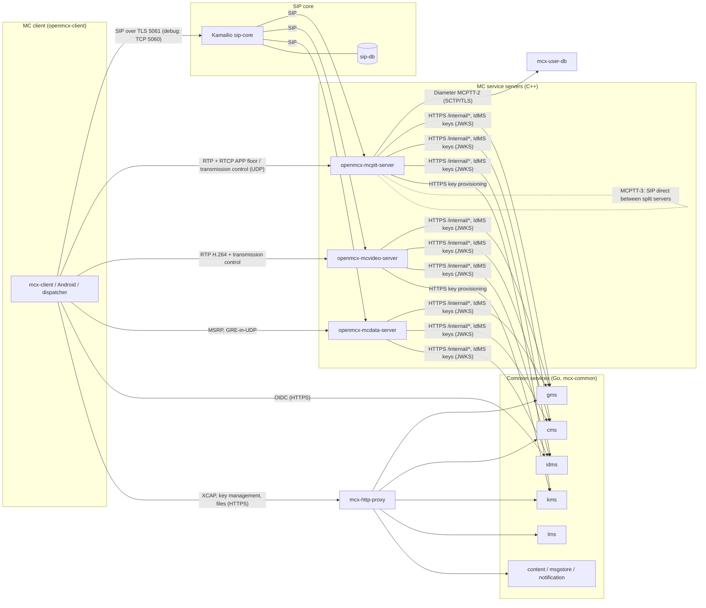
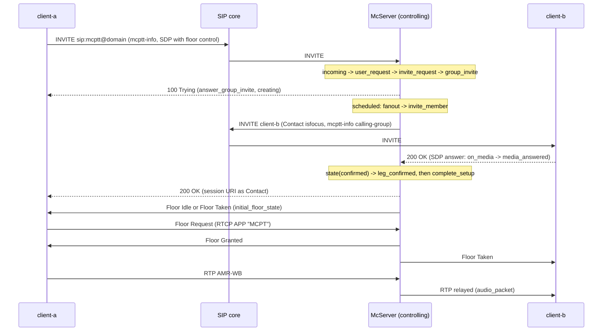
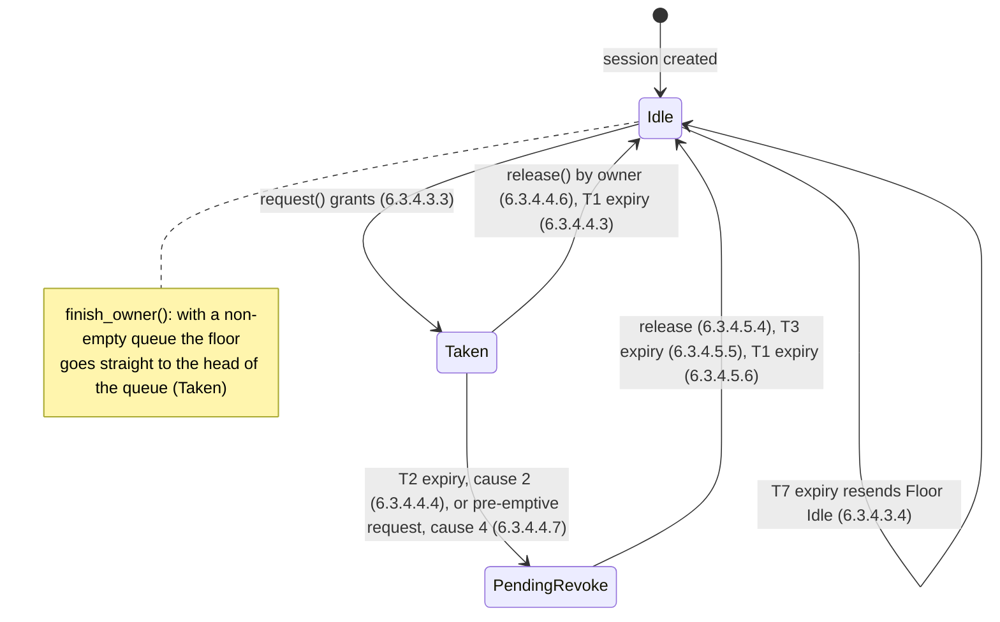

# OpenMCX server developer guide

How the OpenMCX server is built, how a request flows through it, and how to add or fix a 3GPP procedure. It is
written for a developer who knows C++, Go or Python and joins the project. What the system supports is in the
[feature list](FEATURES.md); how to build the images is in [building](BUILD.md); how to run and drive a lab is in
[using the lab](USAGE.md). The 3GPP functional entities and reference points are described in
[docs/architecture](architecture/5g-ims-mcx-functional-entities.md) and not repeated here.

Every statement below refers to the code by file path and function name, not by line number. When this guide and
the code disagree, the code is right; correct the guide in the same commit.

Contents:

1. [Overview](#1-overview)
2. [Source tree](#2-source-tree)
3. [Run loop, SIP engine and dispatch](#3-run-loop-sip-engine-and-dispatch)
4. [Walkthroughs](#4-walkthroughs)
5. [State machines](#5-state-machines)
6. [Security and protection layers](#6-security-and-protection-layers)
7. [Configuration](#7-configuration)
8. [Events, status and health](#8-events-status-and-health)
9. [Testing](#9-testing)
10. [Development workflow](#10-development-workflow)
11. [Glossary](#11-glossary)

## 1. Overview

### 1.1 Programs and containers

OpenMCX is one MC system with three MC service servers, the common services, a SIP core and a user database. Each
program runs in a container of its own ([images and containers](IMAGES.md)).

| Program | Language | Source | What it is |
|---|---|---|---|
| `openmcx-mcptt-server` | C++20 | `src/mcptt`, `src/server` | Controlling and participating MCPTT functions (TS 24.379) with the floor control server (TS 24.380) |
| `openmcx-mcvideo-server` | C++20 | `src/mcvideo`, `src/server` | Controlling and participating MCVideo functions (TS 24.281) with the transmission control server (TS 24.581), video push and pull with recording |
| `openmcx-mcdata-server` | C++20 | `src/mcdata` | Combined participating and controlling MCData functions (TS 24.282, TS 24.582): SDS, FD, IP connectivity, release, message store deposit |
| `mcx-common --role <role>` | Go | `services/cmd/mcx-common`, `services/internal/common` | One common service per process: `idms`, `gms`, `cms`, `kms`, `lms`, `content`, `msgstore`, `notification`, `credentials` |
| `mcx-http-proxy` | Go | `services/cmd/mcx-http-proxy` | The HTTP proxy of TS 24.482 annex A.2.2.2 in front of the common services |
| `mcx-user-db` | C++ | `src/user_db/user_db.cpp` | MCPTT user profiles over Diameter (MCPTT-2, TS 29.283), from `site.json` |
| `mcx-keytool` | C++ | `src/keytool/keytool.cpp` | Key operations (KMS authority and user keys, KMS responses, GKTP documents) run by the KMS and GMS from a JSON request on stdin |
| SIP core | Kamailio 6.1.4 | `docker/Dockerfile.kamailio`, `docker/kamailio.cfg` | P-/S-CSCF role: registration, digest authentication, routing of the PSIs to the servers |
| `sip-db` | MySQL 8.0 | `docker/Dockerfile.sipdb` | The SIP core's subscriber database |

The MCPTT and MCVideo servers are the same C++ core (`McServer`, `src/server/server.hpp`) with a different service
profile and media plane control; the MCData server is a separate class (`DataServer`, `src/mcdata/data_server.hpp`)
that shares only the service parts in `src/server/parts`. The clients (`mcx-client`, the Android app, the
dispatcher) live in the [openmcx-client](https://github.com/openMCX/openmcx-client) repository and build against this
repository's libraries.

An MCPTT or MCVideo server runs as `both` (combined participating and controlling functions, the default),
`participating` or `controlling` (`mcptt.role` in its configuration); a lab with `--split` runs one controlling and
two participating servers (`mcptt-server`, `mcptt-part-1`, `mcptt-part-2`).

### 1.2 How they talk



- **SIP.** Every client request reaches a server through the SIP core, which routes the service's PSI
  (`sip:mcptt@<domain>`, `sip:mcvideo@<domain>`, `sip:mcdata@<domain>`) to its server. Between the participating and
  controlling functions of a split system the servers send SIP directly to each other with an explicit `Route`
  (`src/server/parts/peers.hpp`, `McServer::route_to`). A server accepts requests only from the SIP core's address
  (`trusted_core`) and from its configured peers (`McServer::incoming`).
- **Media.** Speech (AMR-WB in RTP), video (H.264 in RTP) and the RTCP APP floor or transmission control messages go
  directly between client and server over UDP; the server relays them between the legs of a call. MCData uses MSRP
  (`src/media/msrp.cpp`) and, for IP connectivity, a GRE-in-UDP tunnel (`src/media/ipconn.cpp`).
- **HTTP.** Clients authenticate at the IdMS (OIDC authorisation code with PKCE) and reach the other common services
  through `mcx-http-proxy`. The servers read group documents, user profiles and the service configuration from the
  common services' internal interface (`/internal/...`, HTTP Basic with the server's client ID and secret,
  `src/server/parts/common_services.cpp`) and check access tokens themselves against the IdMS's keys, the JWKS its
  discovery document names (TS 33.180 annex B.11.2, `AccessTokens` in the same file), so any IdMS that follows annex
  B can issue them.
- **Diameter.** The MCPTT server pulls the user profile from `mcx-user-db` at service authorisation (MCPTT-2,
  `DiameterProfileClient` in `src/common/diameter.cpp`). The MCPTT and MCVideo servers may also be the AF towards a
  PCRF over Rx or a PCF over N5 ([QoS for call media](POLICY.md)).
- **No push from the common services.** The GMS and CMS do not notify the servers. The servers poll the internal
  interface and compare entity tags (`McServer::docsub_tick`, `src/server/group_documents.cpp`,
  `src/server/configuration.cpp`); the MCPTT server is the SIP front (subscription proxy function) of the GMS and CMS
  for the clients' `xcap-diff` subscriptions.

## 2. Source tree

| Directory | Responsibility | Key files |
|---|---|---|
| `include/mcx/` | Public headers of the libraries the servers and the client share | `sip.hpp` (SIP engine API), `floor.hpp` and `media_control.hpp` (floor control codec and arbitration), `transmission.hpp` (MCVideo transmission control codec), `mbms.hpp` (MBMS and 5G MBS subchannel control and notification messages, TS 24.380 clauses 8.4 to 8.6 and TS 24.581 clauses 9.3 to 9.5; the code points the specifications leave open are listed in its header), `mbms_usage.hpp` (MBMS usage information bodies of TS 24.379 and TS 24.281 annex F.2), `protocol.hpp` (SIP bodies), `mcdata.hpp`, `msrp.hpp`, `warning.hpp`, `service.hpp` (service profiles), `runtime.hpp` |
| `src/sip/` | SIP user agent and application server core over pjsip (`SipEngine`, private implementation `sip_impl.hpp`) | `incoming.cpp` (received requests, INVITE state), `requests.cpp`, `responses.cpp`, `transactions.cpp`, `messages.cpp` (bodies and their protection hooks) |
| `src/server/` | `McServer`, the shared core of the MCPTT and MCVideo servers, one topic per file | `server.hpp` (the class), `server.cpp` (construction, run loop, tick, status), `sip_dispatch.cpp` (request dispatch), `group_call.cpp`, `private_call.cpp`, `adhoc.cpp`, `ambient.cpp`, `priority.cpp`, `affiliation.cpp`, `regroup.cpp`, `functional_alias.cpp`, `split.cpp`, `split_relay.cpp`, `xml_protection.cpp`, `policy.cpp` |
| `src/server/parts/` | Service parts shared by `McServer` and `DataServer`, reached through small host interfaces (`ServiceHost`) | `task_queue.hpp`, `served_users.hpp`, `location_service.*`, `peer_registration.*`, `peers.*`, `alias_registry.*`, `common_services.*`, `program.*` (shared `serve` entry point) |
| `src/mcptt/` | `McpttServer`: the MCPTT service hooks of `McServer` and the floor control server interface | `mcptt_server.hpp`, `floor_control.cpp` |
| `src/mcvideo/` | `McvideoServer`: transmission and reception control, video relay, video push and pull with the server, recording | `transmission_control.cpp`, `video_media.cpp`, `video_push_pull.cpp`, `recording.cpp` |
| `src/mcdata/` | `DataServer`: the MCData server, one topic per file | `sip_dispatch.cpp`, `message.cpp`, `sds.cpp`, `delivery.cpp`, `file_distribution.cpp`, `media_session.cpp`, `media_delivery.cpp`, `release.cpp`, `ipconn.cpp`, `emergency_alert.cpp`, `protection.cpp` |
| `src/media/` | Media plane codecs: floor control and its arbitrator, transmission control coding, AMR-WB and RTP, H.264, MSRP, GRE | `floor.cpp`, `transmission.cpp`, `media.cpp`, `video.cpp`, `msrp.cpp`, `ipconn.cpp` |
| `src/protocol/` | XML and SDP documents of the MC services (libxml2) | `service_info.cpp` (mcptt-info, mcvideo-info), `sdp.cpp`, `mcdata.cpp` (mcdata-info and the binary messages of TS 24.282 clause 15), `affiliation.cpp`, `resource_lists.cpp`, `conference.cpp` |
| `src/security/` | Keys and protection: MIKEY-SAKKE, ECCSI, SRTP/SRTCP, XML protection, the KMS client, HTTPS/OIDC client | `keying.cpp`, `security.cpp`, `xml_security.cpp`, `key_client.cpp`, `key_documents.cpp`, `http.cpp` |
| `src/location/` | Location documents (TS 24.379 annex F.3 and siblings) and SEAL location documents (TS 24.545) | `location.cpp`, `seal_location.cpp` |
| `src/common/` | Process runtime and policy control | `runtime.cpp` (configuration, UDP sockets, control FIFO, status file, `event`), `diameter.cpp`, `rx.cpp`, `af.cpp` and `h2.cpp` (N5) |
| `src/user_db/`, `src/keytool/` | `mcx-user-db`, `mcx-keytool` | |
| `services/` | Go common services and the HTTP proxy, dependencies vendored | `cmd/mcx-common/main.go`, `internal/common/handler.go` (routes per role), `idms.go`, `group_store.go`, `user_profile.go`, `service_config.go`, `kms.go` |
| `tests/` | C++ unit tests (`test_*.cpp`), integration scenarios and wire verifiers (`tests/integration`), test reports (`tests/mcptt`, `tests/mcdata`, `tests/mcvideo`) | see [Testing](#9-testing) |
| `tools/` | Lab and build tools | `regress.py`, `prepare-prearranged-test.py`, `provision.py`, `mcx`, `build-images`, `lint`, `format`, `lab-clean`, `healthcheck.py` |
| `docker/` | Dockerfiles (development, runtime targets, CentOS, Kamailio, SIP DB, lint), `fetch`, `packages`, `kamailio.cfg` | |
| `config/` | `lab.json`, the input of provisioning; `config/generated/` is written by `tools/provision.py` and never committed | |
| `helm/openmcx/` | Kubernetes and OpenShift chart, experimental in release 1.0.0 ([chart README](../helm/openmcx/README.md)) | |
| `tutorials/` | End-to-end and unit-test tutorials ([index](../tutorials/README.md)) | |

The CMake targets (`CMakeLists.txt`) follow the same split: `mcx_core` (protocol, media, security, location),
`mcx_keying`, `mcx_sip` (SIP engine and runtime), `mcx_service_parts`, `mcx_server_core` (`McServer`), `mcx_af`,
`mcx_diameter`, `mcx_rx`, and the executables. `mcx_server_core` and the server executables are built with
link-time optimisation.

## 3. Run loop, SIP engine and dispatch

### 3.1 One thread per server

Each C++ server runs on one thread. The program's `main` calls `mcx::serve` (`src/server/parts/program.cpp`), which
parses `--config`, `--disable-tls`, `--status` and `--command`, loads the configuration (`load_config`), installs
the SIGINT and SIGTERM handlers and calls the server's `run()`.

`McServer::run` (`src/server/server.cpp`) provisions the server's keys at the KMS (when `security` is configured),
starts the policy clients, installs the SIP body filters (section 6) and loops until `stopping`:

1. `sip_.poll(5 ms)`: pjsip handles its events on this thread (`pjsip_endpt_handle_events` in `SipEngine::poll`);
   received requests and responses call back into the server synchronously.
2. `pending_.run()`: the tasks scheduled while handling requests (section 3.4).
3. `control_.read()`: commands from the control FIFO (`quit`, `hangup`, `ambient-release`, `seal-*`,
   `regroup-remove`), written by `--command`.
4. For every leg: up to 32 floor (or transmission) control packets (`media_control_packet`), up to 32 audio packets
   (`audio_packet`), and the video of an MCVideo leg (`service_media_packets`); then the relays of a participating
   function (`relay_packets`).
5. `tick()`: timers and supervision (section 5), and the status file at most every 200 ms.

`DataServer::run` (`src/mcdata/data_server.cpp`) has the same shape with its own commands and tick. No server uses
locks or worker threads, with one exception: the SEAL location notification channel of `McServer` is read by a
detached thread of its own, which hands its results over through `SealChannel` under a mutex.

Calls to the common services (`internal()`, `group_profile()`, `user_profile()`) are synchronous HTTPS requests made on
this thread; nothing is cached between requests, except the IdMS's JWKS (`AccessTokens`), fetched at the first access
token and again, at most once a minute, for a token of a key it does not hold. A common service that does not answer holds
the loop up until the request times out; the document polling then backs off from it for a while
(`service_down`, `service_failed` in `src/server/temporary_groups.cpp`).

### 3.2 The SIP engine

`SipEngine` (`include/mcx/sip.hpp`) wraps pjsip. The application sees plain structures:

- `SipMessage`: a received request with its headers, MIME parts (`parts`), parsed SDP (`remote_media`), dialog ID,
  source address and, when the incoming body filter refused the body, `protection_error`.
- `SipResponse`: the application's answer: status, headers, parts, `local_media` (an SDP built from a
  `MediaDescription`) or `local_sdp` (ready-made SDP, used by MCData), the Contact (`contact_uri`, `focus`), and
  `deferred` for a final answer sent later with `SipEngine::respond` or `SipEngine::answer`.
- `SipCallbacks`: `on_request` (returns the `SipResponse`), `on_call_state` (`SipCallState::early`, `confirmed`,
  `disconnected`), `on_media` (the SDP answer to an offer the server made), `on_response`, `on_error`, `on_ack`.

`SipEngine::Impl::receive_request` (`src/sip/incoming.cpp`) answers what the application must not see (482 for a
colliding Call-ID, 420 for an unsupported `Require`, pjsip's INVITE checks), calls the application through
`safe_application_response` (an exception becomes 500), and then sends the answer: an INVITE with SDP is accepted as
an INVITE session, a 2xx to SUBSCRIBE creates the subscription dialog, a deferred answer is kept by transaction ID.
In-dialog INVITE, ACK, BYE, CANCEL, UPDATE and PRACK belong to pjsip's INVITE usage and reach the application as
dialog state changes, re-INVITEs and BYEs.

Sending: `request` (out of dialog, through the SIP core unless an explicit `Route` header is given), `publish`,
`subscribe`, `notify`, `invite`, `invite_sdp`, `reinvite`, `request_in_dialog` (INFO, MESSAGE in a dialog), `answer`,
`respond`, `bye`. Every outgoing body passes through the outgoing filter after the destination is resolved, every
received body through the incoming filter before the application sees it (`set_body_filters`).

The server's own header fields on INVITE answers (P-Asserted-Identity and the `Supported` option tags of TS 24.379
clauses 6.3.2.1.5 and 6.3.3.2.3) are set once in the `McServer` constructor (`invite_provisional_headers`,
`invite_success_headers`, `reinvite_success_headers` of `SipConfig`).

### 3.3 Dispatch of an incoming request (MCPTT and MCVideo)

`McServer::incoming` (`src/server/sip_dispatch.cpp`) is the `on_request` callback. Its order matters, and a new
procedure must be placed in it deliberately:

1. Content refused by the incoming body filter: 403 with Warning 139 (integrity) or 140 (decryption)
   (`refuse_unprotectable`, TS 24.379 clauses 6.6.1.4 and 6.6.2.4.2).
2. Source neither the SIP core nor a configured peer: 403. `OPTIONS`: 200.
3. A request in the dialog of a call relayed by this participating function goes to the other side
   (`relay_request`, `relay_conference`).
4. A request from a peer server: location, affiliation and functional alias PUBLISH, regroup, the terminating
   participating function for users served here (`peer_request`, `peer_presence_publish`, `terminating_request`).
5. `PUBLISH` with `Event: poc-settings`: service authorisation (`service_authorization`).
6. `BYE` of a leg: only the leg's own user may end it (481 otherwise).
7. `MESSAGE` from a local client: location report (`location_.from_client`).
8. `SUBSCRIBE` to `xcap-diff` from an MCS server of this system (`server_document_subscribe`).
9. Otherwise the sender must be an authorised user (`authenticated`, which throws `UnknownUser`), and
   `user_request` dispatches by method and `Event`: document and GKTP subscriptions, `conference`, functional alias
   status, affiliation status (`SUBSCRIBE`); affiliation (`PUBLISH presence`); `user_message` (MESSAGE);
   `invite_request` (INVITE); anything else 405.

Exceptions map to answers in one place: `CapacityReached` to 500 with `Retry-After`, `UnknownUser` to 404 with
Warning 141, any other exception to 403 with the event `sip_request_rejected`. A procedure that must answer with a
specific code and Warning sets it in `response` and returns; it does not throw.

`invite_request` refuses pre-established sessions (403, Warning 100, not supported), answers a re-INVITE without MC
service information as a session refresh or a hold/resume (`plain_reinvite`), relays a call controlled elsewhere
(`invite_to_controller`), then chooses by `<session-type>`: ambient listening (`ambient_invite`), private and
first-to-answer and the MCVideo one-to-one push and pull (`private_invite`), ad hoc (`adhoc_invite`), the service's
own call types (`service_invite`: MCVideo push to and pull from the server), and finally group calls
(`group_invite`).

### 3.4 Answers, scheduled tasks and outgoing requests

A procedure answers by filling the `SipResponse` it returns. Work that must follow the answer (a NOTIFY after the
200 to a PUBLISH, the fan-out of a group call, a registration with the controlling servers after a service
authorisation) is queued with `schedule(...)` and runs from `pending_` on the next pass of the run loop
(`src/server/parts/task_queue.hpp`). A task that throws is reported as `operation_failed`; the others still run.

Some answers wait for other parties: a new prearranged group call is answered 100 and the originator's 200 is sent
by `complete_setup` (`src/server/group_call.cpp`) once enough invited members have answered; a deferred non-INVITE
answer (for example a relayed request) is sent with `sip_.respond(transaction_id, ...)`. The service parts send
through their host (`ServiceHost::send_message`, `publish`, `respond`, `schedule`).

### 3.5 The MCData server

`DataServer::incoming` (`src/mcdata/sip_dispatch.cpp`) first removes the MCData signalling protection (CSK) and the
XML confidentiality protection of the request (`open_from`, `decrypt_xml`), refusing with 403 (Warning 140 for XML)
when that fails, then `DataServer::dispatch` chooses by method and `Event` or `Info-Package`: `PUBLISH poc-settings`
(`authorise`), `PUBLISH presence` (`affiliate` or `functional_alias_publish`), `SUBSCRIBE presence`
(`affiliation_subscribe`), `NOTIFY xcap-diff` (group document changes), `INVITE` (`media_invite`, the media plane
and IP connectivity), `INFO` of the communication release package (`com_release_info`), `MESSAGE` (location, then
`message`). `DataServer::message` (`src/mcdata/message.cpp`) then chooses by the MCData info body, the ICSI in
`Accept-Contact` and the binary message type of the `mcdata-signalling` body (SDS signalling, SDS notification, FD
signalling, FD notification, FD HTTP termination). The answer's XML is protected again on the way out
(`encrypt_xml`). An exception becomes 400 with the event `mcdata_request_rejected`.

## 4. Walkthroughs

### 4.1 Service authorisation (MCPTT, MCVideo)

TS 24.379 clause 7.3.3 (TS 24.281 clause 7.3.3), with TS 24.379 clause 6.6.2.

1. The client sends `PUBLISH` with `Event: poc-settings` to the PSI; it carries the access token and client ID in
   the mcptt-info (or mcvideo-info) body, and, with XML protection, an `application/mikey` body that uploads its CSK
   and protects the token with it.
2. `McServer::incoming` routes it to `service_authorization`.
3. `open_with_uploaded_csk` accepts the CSK at the key client (`KeyClient::accept_csk`), verifies the signatures of
   the XML bodies and decrypts their protected content with it (403 with Warning 139 or 140 on failure).
4. The asserted identity must equal the From URI; token and client ID must be present.
5. `service_claims` (`src/server/parts/common_services.cpp`) checks the token (TS 33.180 annex B.11.2): its RS256
   signature by a key of the IdMS's JWKS, `iss` and `aud` (the MC servers' audience) where the token has them
   (table B.2.2.2-1 requires neither; RFC 7519 sections 4.1.1 and 4.1.3), `exp`, the claims of tables
   B.2.2.2-1 and B.2.2.3-1 (`scope`, which must hold the service's scope, `client_id`, the MC service ID claim). A
   token of OpenMCX's IdMS (it has `mc_id`) binds the SIP URI (`sip_uri`) and the MC client ID (`mc_client_id`) as
   well, and `token_subject_valid` (a service hook) checks its subject; another IdMS's token has the annex B claims
   only. A failure is 403 with the service authorisation Warning (step 6 of the clause).
6. The MCPTT server pulls the user profile over Diameter (`diameter_->pull`).
7. `bind_authorized_user` stores the `User` (MC service ID, client ID, SIP URI, expiry from the token, the CSK as
   floor keys), answers 200 with `SIP-ETag` (or 412 for an unknown `SIP-If-Match`, RFC 3903), logs
   `service_authorized`, and schedules the registration with the controlling servers
   (`register_with_controllers`, TS 24.379 clause 9.2.2.2.6) and the location reporting configuration
   (`location_.configure`, TS 24.379 clause 13.2.2).

Before binding, an ended authorisation of the user's (or of the public user identity) is removed (clause 7.3.3 step
8), and a live one from another client ID or public user identity is refused with 486 and warning 164, the
`<max-simultaneous-authorizations>` of 1 being reached (clause 7.3.3 steps 3a and 3b).

A poc-settings `PUBLISH` with `Expires: 0` is the log-off of clause 7.3.5 (`McServer::service_log_off`): RFC 3903
first (the `SIP-If-Match` of the user's publication, else 412; neither entity tag nor body, 400), then
`remove_binding` ends the affiliations (the affiliation status subscription is terminated), functional aliases, calls
and relays, withdraws the user from its controllers and removes the binding, and the answer is 200 with `Expires: 0`
and the entity tag. `expire_users` calls `remove_binding` when a service authorisation ends.

The MCData server does the same in `DataServer::authorise` and `DataServer::log_off` (`src/mcdata/authorisation.cpp`),
with warning 228.

### 4.2 Affiliation

TS 24.379 clause 9.2.2.2.3. `McServer::affiliation_publish` (`src/server/sip_dispatch.cpp`):

1. A PIDF that is a functional alias activation goes to `functional_alias_publish` (or to the owning server).
2. Client ID and request URI must be the user's; `Expires` must be 4294967295 or 0 (else 423 with `Min-Expires`);
   a `SIP-If-Match` other than the current entity tag is 412.
3. The PIDF is parsed (`parse_affiliation`, `src/protocol/affiliation.cpp`); each group is admitted when the user is a
   member of the group document (`member(group_profile(group), ...)`), up to the `<MaxAffiliationsN2>` limit
   (`affiliation_limit`). The PUBLISH is answered 200 whatever the outcome per group (step 8).
4. `apply_affiliation` (`src/server/affiliation.cpp`) updates the user, notifies its affiliation status subscription
   (`notify`) and late entry of running calls; the events are `affiliated` and `deaffiliated`.

Implicit affiliation (chat, emergency, alerts; TS 24.379 clauses 9.2.2.3.6 and 9.2.2.3.7) uses the
`ImplicitAffiliation` guard in `server.hpp`: it removes the affiliation again when the request finally fails
(clause 9.2.2.3.11).

### 4.3 Prearranged group call setup

TS 24.379 clauses 10.1.1.4.1 and 10.1.1.4.2 at the controlling function, TS 24.380 clause 6.3 for the floor.



1. `group_invite` (`src/server/sip_dispatch.cpp`) finds an existing call by session URI or group
   (`find_group_session`), and checks in turn: the constituent group of a regroup (`regroup_constituent_allowed`),
   affiliation or implicit affiliation (`group_call_affiliated`), the request URI, the SDP offer, membership and call
   type (`group_call_type_allowed`), the media offer and protection (`group_media_acceptable`), the call policy and
   required members (`group_call_admitted`), priority (`validate_priority`) and the join checks
   (`group_join_allowed`). Each refuses by setting `response` and returning false.
2. A re-INVITE of a joined participant goes to `priority_reinvite` (TS 24.379 clause 10.1.1.4.7).
3. `create_group_session` builds the `Session` with its `MediaPlaneController` (`make_media_control`, a
   `FloorArbitrator` with `floor_options()`), and `group_call_leg` the caller's `Leg` (local media ports, SDP
   answer).
4. `answer_group_invite` applies the requested priority (`apply_priority`), publishes the session and leg, and, for a
   new prearranged call, answers 100 and keeps the 200 in `leg->answer` (`awaiting_answer`). It schedules
   `fanout`.
5. `fanout` (`src/server/group_call.cpp`) invites the affiliated members, required members first; `invite_member`
   sends each INVITE with the mcptt-info, the priority headers, `Answer-Mode` and the focus Contact.
6. Each answer arrives as `media_answered` (SDP checks) and `state(..., confirmed)`, which calls `leg_confirmed`;
   `complete_setup` sends the originator's 200 once `minimum_participants` and the required members have answered,
   or 408/480 at `setup_timeout_ms` (TS 24.379 clause 6.3.3.3).
7. `initial_floor_state` tells each new leg the floor state (Floor Idle or Floor Taken), then the floor control of
   section 5.2 runs per packet.

A chat group call (`session_type` `chat`, TS 24.379 clause 10.1.2) creates the session on the first join and invites
nobody; a broadcast group call sets `Session::broadcast` and ends when the initiator's transmission ends
(`supervise_session`). With split servers, the participating server relays the INVITE to the group's controlling
server (`invite_to_controller` -> `relay_outgoing`, `src/server/split_relay.cpp`) and then passes speech and floor
packets unchanged (`relay_packets`).

### 4.4 Private call

TS 24.379 clause 11.1.1. `McServer::private_invite` (`src/server/private_call.cpp`) is a sequence of steps, each a
function that returns a refusal or nothing:

`private_invite_admission` (steps 3 to 8: caller and resource list) -> `private_call_target` or
`first_to_answer_invitees` (steps 9 to 12) -> `private_call_replaced` (transfer, RFC 3891) ->
`private_call_emergency` (clauses 6.3.3.1.13.1 and 6.3.3.1.13.2) -> `private_call_media_refusal` (Resource-Priority,
media, KMS redirect) -> the `max_calls` busy check (486) -> `private_invitee_check` per invitee (terminating checks,
clause 11.1.1.3.2) -> `make_private_session` -> `private_caller_answer` -> `schedule_private_invitations` ->
`invite_private_target`.

The session's `private_call`, `first_to_answer`, `no_media_control` (a call without floor control, clause 11.1.2),
`protected_private` (PCK end to end: the caller's I_MESSAGE is passed unchanged to the callee and the server relays
SRTP as it is) and `no_answer_deadline` (TNP1, forwarding on no answer, clause 6.3.2.5) fields drive the rest.
`select_first_answer` and `release_not_selected` finish a first-to-answer call; `revalidate_private` re-checks the
rulesets every 2 s. Call-back, remotely initiated calls, transfer and forwarding requests are SIP MESSAGEs handled
by `private_service_message` (`src/server/private_services.cpp`).

### 4.5 MCData standalone SDS and file distribution

TS 24.282 clause 9.2.2 (SDS over the signalling plane):

1. `DataServer::message` -> `sds` (`src/mcdata/sds.cpp`): decodes the SDS signalling, measures the payload (a
   payload with the protected bit set is not decoded), checks the sender's `transmit_data` authorisation (Warning 200).
2. `sds_one_to_one`: the target from the resource-lists body, the profile limits and target lists (Warnings 202,
   229, 203, 218), a functional alias answered 300 (Multiple Choices), the callee logged in and allowed to receive
   (230).
3. `deliver` (`src/mcdata/delivery.cpp`) holds a copy for re-delivery, strips the access token and client ID, seals
   the bodies for the recipient (`seal_for`) and sends the MESSAGE with the SDS `Accept-Contact` and
   `P-Asserted-Service`.
4. The originator gets 202 (Accepted). A requested disposition is recorded in `dispatched_`; the recipient's
   disposition notification comes back through `notification`, is correlated, aggregated for a group under TDC1, or
   for UNDELIVERED held for re-delivery under TDP1.

Refusals go through `DataServer::reject`, which counts them and logs `mcdata_rejected`.

File distribution over HTTP (clause 10.2.4) is `DataServer::fd` (`src/mcdata/file_distribution.cpp`): the file is
checked at the content server (`file_available`, HTTP HEAD), a `FileTransfer` is recorded with its TDC2 expiry, and
the FD request is delivered like an SDS. Over the media plane (clause 10.2.5) `media_invite`
(`src/mcdata/media_session.cpp`) checks the request, the targets, the MSRP SDP offer with its file selector, then
opens the server's MSRP endpoint and invites the recipients; the file arrives as MSRP SEND and is relayed in
`media_file_received` (`src/mcdata/media_delivery.cpp`).

### 4.6 MCVideo transmission

TS 24.581 clause 6.3. The MCVideo server uses the same group and private call procedures as MCPTT; what differs is in
its service hooks (`src/mcvideo/mcvideo_server.hpp`):

- `service_media` adds the video port to every leg; `check_service_media` requires transmission control.
- `media_control_packet` is `McvideoServer::transmission_packet` (`src/mcvideo/transmission_control.cpp`): it decodes
  the MCV0/MCV2 message (`transmission::decode`) and maps Transmission Request, Release and Queue Position Request
  onto the same `MediaPlaneController` as floor control, answers Transmission End Request and Reception End Request,
  handles Receive Media Request (reception control), and Remote Transmission (cancel) Request
  (`remote_transmission`).
- `media_control_notice` is `send_transmission_notice`: a grant becomes Transmission Granted with new audio and video
  SSRCs, a taken floor becomes a Media Transmission Notification (`transmission_notification`) whose Reception
  Mode is automatic in broadcast, emergency and imminent peril calls and without `reception_control`, manual
  otherwise (TS 24.581 clause 6.3.6.3.3); with manual reception the leg receives video only once it accepts, and
  so on.
- `service_media_packets` reads the leg's video and `video_packet` (`src/mcvideo/video_media.cpp`) relays the
  transmitting participant's video to the receiving legs.
- `service_invite` handles video push to and pull from the server (`server_video_invite`,
  `src/mcvideo/video_push_pull.cpp`), with the recording in `recording.cpp`.

## 5. State machines

### 5.1 What the specifications define and what OpenMCX implements

The stage 3 specifications describe some behaviour as formal state machines (named states, events, timers) and the
rest as procedures (numbered steps per clause). OpenMCX implements the on-network server side. The client-side
machines are the client's (openmcx-client), and the off-network machines (TS 24.379 clauses 10.2, 10.3, 11.2 and 12.2;
TS 24.380 clause 7; TS 24.581 clause 7) are outside this build.

| Specification state machine | Clause | OpenMCX file / type | Notes |
|---|---|---|---|
| Floor control server, general floor control: 'G: Floor Idle', 'G: Floor Taken', 'G: pending Floor Revoke' | TS 24.380 clause 6.3.4 | `FloorArbitrator` in `include/mcx/floor.hpp`, `src/media/floor.cpp`; `FloorState { Idle, Taken, PendingRevoke }` in `include/mcx/media_control.hpp` | The state is derived, not stored: no owner is 'G: Floor Idle', an owner with `revoked_at_ms_` set is 'G: pending Floor Revoke', otherwise 'G: Floor Taken' (`FloorArbitrator::state`). 'Start-stop' and 'Releasing' are the life of the `Session`. 'G: Floor Initialising' (clause 6.3.4.8), unicast media flow control and dual floor control (clause 6.3.6) are not implemented |
| Floor control server towards the floor participant: 'U: not permitted and Floor Idle', 'U: not permitted and Floor Taken', 'U: permitted', 'U: pending Floor Revoke', 'U: not permitted but sends media', 'U: not permitted and initiating' | TS 24.380 clause 6.3.5 | `McpttServer::floor_packet`, `floor_request`, `send_floor_notice` (`src/mcptt/floor_control.cpp`); per leg `Leg::floor_granted`, `floor_sequence`, `floor_retries` (`FloorAckRetry`) | No per-participant state variable: the participant's state follows from the arbitrator (owner, queue, pending revoke) and the leg. Media from a participant that is not the owner is dropped in `McServer::audio_packet`; see section 5.6 |
| Participating MCPTT function floor control | TS 24.380 clause 6.4 | `McServer::relay_packets` (`src/server/split_relay.cpp`); `McpttServer::refuse_remote_request` returns false | Procedures, no states: floor messages and RTP pass unchanged |
| Non-controlling MCPTT function of a group ('P: has no permission', 'P: has permission') | TS 24.380 clause 6.5 | none | Not implemented. A call on a group regroup is controlled by the function holding the regroup; calls of the constituent groups are refused with Warning 148 |
| Floor participant: 'U: has no permission', 'U: pending Request', 'U: has permission', 'U: pending Release', 'U: queued' | TS 24.380 clause 6.2.4 | `FloorParticipantTimers`, `FloorParticipantState` in `include/mcx/floor.hpp` | The client side, in the shared library; not used by the server programs; tested in `tests/test_floor.cpp` |
| Transmission control server, general: 'G: Transmit Idle', 'G: Transmit Taken', 'G: pending Transmission Revoke' | TS 24.581 clause 6.3.4 | the same `FloorArbitrator` (`McServer::make_media_control`, `src/server/service_info.cpp`) | TS 24.581 clause 6.3.4 follows TS 24.380 clause 6.3.4, so one arbitrator serves both; `FloorState::Idle` is 'G: Transmit Idle' and so on. Timers from the `mcvideo` configuration block (`floor_options`) |
| Transmission control server towards the participant: 'U: not permitted and Transmit Idle', 'U: not permitted and transmit taken', 'U: permitted', 'U: pending Transmit Revoke' | TS 24.581 clause 6.3.5 | `McvideoServer::transmission_packet`, `send_transmission_notice` (`src/mcvideo/transmission_control.cpp`) | As for MCPTT. Transmission control messages are sent without the acknowledgement bit |
| Reception control: 'Gr: Reception Idle', 'Gr: Reception accepted'; 'U: not permitted to receive', 'U: permitted to receive' | TS 24.581 clauses 6.3.6 and 6.3.7 | `Leg::receiving`, `McvideoServer::reception_control()`, Receive Media Request and Reception End Request in `transmission_packet` | Enabled by `reception_control` in the `mcvideo` block; a boolean per leg, no general reception state |
| Transmission participant and reception participant | TS 24.581 clauses 6.2.4 and 6.2.5 | none in this repository's servers | Client side |
| Controlling function: in-progress emergency and imminent peril state of a group, emergency alerts | TS 24.379 clauses 4.6 and 6.3.3.1 (TS 24.281 likewise) | `McServer::PriorityState` (`src/server/server.hpp`): `emergency`, `imminent`, `emergency_users`, `imminent_users`, `alerts`, `alert_locations`, `emergency_deadline` (TNG2); per group in `priorities_`, per private or ad hoc call in `Session::priority` | Procedures with state flags, not a formal machine. `apply_priority` changes it, `expire_emergency_states` ends the emergency state at TNG2 (clause 6.3.3.1.16), `priority_fanout` tells the members, `priority_name` gives `emergency`, `imminent` or `normal` |
| Client priority states: MEGC, MEG, MIGC, MIG, MEA, MEPC, MEPP, MPEA (MCPTT); MVEGC, MVEG, ... (MCVideo); MDEGC, MDEG, MDIG, MDEA, ... (MCData) | TS 24.379 clause 6.2.8, TS 24.281 and TS 24.282 likewise | none in the servers | Client side. The MCData server keeps `GroupPriority` (`src/mcdata/data_server.hpp`), the group state that the clients' MDEG and MDIG mirror |
| Ad hoc group emergency alert | TS 24.379 clause 12.1A | `McServer::AdhocAlert`, `supervise_adhoc_alerts` | Recipients re-evaluated every 2 s |
| Private call call-back | TS 24.379 clause 11.1.5 | `private_service_message`, `authorize_private_service` (`src/server/private_services.cpp`) | No state at the server: the requests are authorised and relayed as SIP MESSAGEs |
| MCData disposition, file availability, release and re-delivery timers | TS 24.282 clauses 12.2, 10.2.4, 13, 9.2.2.4.1.1 | `Dispatched::tdc1`, `FileTransfer::expires` (TDC2), `FileTransfer::tdc3`, `ReleaseProcess::tdc3`, `Held::redeliver_at` (TDP1) in `src/mcdata/data_server.hpp` | Deadlines on `monotonic_ms()`, 0 meaning not running, checked in `DataServer::tick`. TS 24.582 defines no state machine the server implements |
| SIP call and session handling | TS 24.379 clauses 10.1, 11.1, 6.3.8 | `Session`, `Leg`, `SipCallState` | Procedures, not a formal machine; see section 5.4 |

### 5.2 The floor control server

The arbitrator is pure: it knows participants by MC service ID, takes the time as an argument and returns
`FloorNotice`s (Granted, Taken, Denied, Idle, Revoke, QueuePosition, with recipient, participant, reject cause,
priority and queue position). It never sends anything. `McServer` turns the notices into messages
(`notices` and `send_notice` in `src/server/notices.cpp`, then the service hook `media_control_notice`). This keeps
the arbitration unit-testable (`tests/test_floor.cpp`) and shared by MCPTT and MCVideo.



| Event | Function | Clause |
|---|---|---|
| Floor Request in 'G: Floor Idle' | `FloorArbitrator::request`: owner set, Granted to the requester, Taken to the others | TS 24.380 clause 6.3.4.3.3 |
| Floor Request in 'G: Floor Taken' | `request`: pre-emptive priority higher than the owner's revokes (cause 4) and queues; with queueing, queued (Queue Position Info, or Deny cause 7 when full); otherwise Deny cause 1; unauthorised Deny cause 255 | clauses 6.3.4.4.7, 6.3.5.4.4 |
| Floor Request from the owner | `McpttServer::floor_request` resends Floor Granted with the T2 still running (`talk_time_remaining`), or Floor Revoke in 'G: pending Floor Revoke' | clause 6.3.4.4.8 |
| Floor Release | `release`, then `finish_owner` | clauses 6.3.4.4.6, 6.3.4.5.4 |
| RTP from the owner | `media_received`: T2 starts at the first packet, T1 restarts, T20 stops | clause 6.3.4.4.5 |
| RTP from a participant without permission | `McServer::unpermitted_media`: not forwarded; Floor Revoke cause #3 and 'U: not permitted but sends media' while another participant has the floor, or after its own Floor Release; T8 repeats the revoke while the media goes on; Floor Release or a grant ends it | clauses 6.3.5.3.8, 6.3.5.4.6, 6.3.5.7 |
| Timers | `tick`: T7 (Floor Idle, counter C7), T20 (Floor Granted, counter C20), T1 (End of RTP media), T2 (Stop talking), T3 (Stop talking grace), Floor Revoke resent as for T8 | clauses 6.3.4.3.4, 6.3.4.4.3, 6.3.4.4.4, 6.3.4.4.9, 6.3.4.5.5, 6.3.4.5.6, 6.3.5.6.3 |
| Participant joins or leaves | `add` (Taken or Idle to the new participant), `remove` | clause 6.3.5 on entering |
| Priority change | `set_priority_class`, called by `apply_priority` (`src/server/priority.cpp`): 3 emergency, 2 imminent peril, 1 pre-emptive user, 0 normal; reorders the queue | TS 24.379 clause 4.6 |

Timer values (`FloorArbitratorOptions`): for MCPTT from the CMS service configuration document
(`transmit_time_limit_ms` for T2, `fc_timers_counters` with `t1`, `t3`, `t7`, `t8`, `t20`, `c7`, `c20`, and
`floor_queue`, `floor_queue_depth`), read by `McServer::floor_options` (`src/server/priority.cpp`); for MCVideo from
the server's `mcvideo` configuration block. Floor Ack retransmission of the server's own messages (TS 24.380 clause
8.2.13) is per leg in `FloorAckRetry`, run by `retry_floor_messages`; `floor_ack: false` in the `mcptt` block turns
the acknowledgement request off.

Call-level timers are not in the arbitrator: T4 (Inactivity) and the maximum call duration (TNG3, or the private call
timer) are in `McServer::supervise_call_timers` (`src/server/server.cpp`), with `inactivity_timeout_ms` and
`maximum_duration_ms` of the call policy.

### 5.3 How the state shows

- **Events.** `floor_request` (with the owner after arbitration), `floor_denied_receive_only`,
  `floor_denied_ambient_listening`, `floor_rejected` (a refused packet), `transmission_control_sent` (MCVideo),
  `priority_changed`, `emergency_timer_expired`.
- **Status file.** Each call in `sessions` has `floor_owner`, `priority` (`emergency`, `imminent`, `normal`),
  `alerts`, `call_type`, `established` and `participants`; `group_priority` lists the groups' priority states
  (`McServer::session_status`, `save_status`). The 'G:' state itself is not written; a test infers it from
  `floor_owner` and the clients' own status.
- **Wire.** The floor messages are decoded from the capture by the wire verifiers (section 9.3).

### 5.4 SIP call handling: procedures, not a machine

TS 24.379 describes call setup and release as procedures. OpenMCX keeps their state in plain structures:

- `Session` (one call at the controlling function, keyed by group, or `private:<id>` for a private call) holds the
  call type flags, members, policy, priority, the `MediaPlaneController`, `established`, `created`, `last_media` and
  `normal_since` (for T4 and TNG3), `no_answer_deadline` (TNP1), and the setup bookkeeping.
- `Leg` (one user's dialog) holds `active`, `awaiting_answer`, `held`, `floor_granted`, the media sockets and the SDP
  of both sides.
- `Relay` (a participating function's call relayed to a peer) holds both dialogs and the port triple.
- The dialog state comes from pjsip as `SipCallState` (early, confirmed, disconnected) through `McServer::state`,
  which calls `leg_confirmed` and `leg_disconnected`; `release_departed_leg` releases the call when TS 24.379 clause
  6.3.8.1 says so.
- `tick` supervises every session (`supervise_session`): setup completion, ambient listening timer, call timers, the
  arbitrator's `tick`, the end of a broadcast, and policy revalidation every 2 s.

### 5.5 Adding or changing a transition

1. Find the clause and read the state's other transitions in the specification; note which timers start or stop.
2. Decide where the transition lives: arbitration (who may send) in `FloorArbitrator`; the message coding or what
   one participant is told in `McpttServer::floor_packet` / `send_floor_notice` (or the MCVideo equivalents); call
   level timers in `supervise_call_timers`. Do not send packets from the arbitrator; return notices.
3. Name states, timers and causes as the specification does (`docs/CODING_STYLE.md` sections 1.2 and 2): a timer is a
   named constant or option with its clause, a cause value carries its number and clause in a comment.
4. Start the function with its reference: `// TS 24.380 clause 6.3.4.4.7: in 'G: Floor Taken', ...`.
5. Add a unit test in `tests/test_floor.cpp` (or `test_transmission.cpp`) that drives the arbitrator through the
   transition with explicit times, and, when the wire changes, extend the scenario and its wire verifier.
6. If the code deliberately differs from the text, mark it `// Deviation from TS ... because ...`.

### 5.6 Known gaps against the server state machines

- 'G: Floor Initialising', the non-controlling function's floor control (clause 6.5), multi-talker and dual floor
  control are not implemented ([limitations](LIMITATIONS.md)).

## 6. Security and protection layers

OpenMCX applies TS 33.180 in four layers. Where each applies in the request pipeline:

| Layer | Keys | Where | Code |
|---|---|---|---|
| Transport | TLS certificates | SIP over TLS (port 5061) between clients, SIP core and servers; HTTPS to the common services; Diameter over TLS | `SipTlsConfig`, `HttpClient` (`src/security/http.cpp`: the configured CA only, or with the system's CAs as well for IdMS, `HttpTrust`); `--disable-tls` gives clear SIP over TCP for capture-based tests only |
| XML confidentiality | XPK: the client's CSK towards a client, the SPK towards a peer server | The SIP engine's body filters: `McServer::protect_outgoing` just before sending, `protect_incoming` on receipt, before `incoming` sees the request (TS 24.379 clauses 6.6.2.3.2 and 6.6.1.4) | `src/server/xml_protection.cpp`, `src/security/xml_security.cpp` (`xmlsec::encrypt`, `decrypt`, the per-service `Profile` of sensitive elements) |
| XML integrity | integrity key derived from the XPK | Same filters: `sign_parts` adds an `application/vnd.3gpp.mcptt-signed+xml` body over every XML MIME body; `verify_parts` checks and removes it before decryption (TS 24.379 clause 6.6.3) | `src/server/xml_protection.cpp`, `src/security/xml_security.cpp` (`xmlsec::sign`, `verify`, `canonicalize`) |
| Media and media plane control | GMK (group media, distributed in GKTP documents by the GMS), PCK (private calls, end to end), CSK (floor and transmission control, SRTCP), SPK (between servers) | `ProtectedCall` per user: `unprotect_floor` in `floor_packet`, `protect_floor` in `transmit_floor` and `send_transmission`; group SRTP is relayed unchanged (`audio_packet`) | `include/mcx/protected_call.hpp`, `src/security/security.cpp` (AEAD_AES_128_GCM), `src/security/keying.cpp` (MIKEY-SAKKE, ECCSI), `src/security/key_client.cpp` |

- **CSK upload.** A client uploads its CSK in the service authorisation PUBLISH (`open_with_uploaded_csk`); the server
  keeps it in `User::csk` and `User::protection`.
- **Group keys.** A member subscribes to its group's GKTP document (`key_subscribe`, TS 24.481 clause 7.7); the server
  polls the GMS and notifies a new key (`notify_key`). `stop_unkeyed_leg` ends a protected leg whose floor key is
  missing or expired.
- **Refusals.** Content that cannot be verified or decrypted is refused with 403 and Warning 139 or 140 (section 3.3);
  an I_MESSAGE that fails authentication with 488 and Warning 136.
- **MCData.** `src/mcdata/protection.cpp`: hop-by-hop signalling protection under the CSK (`open_from`, `seal_for`,
  `mcdata.protect_signalling`), XML confidentiality, and payloads protected end to end by the clients, which the
  server never opens (the protected bit of the DATA PAYLOAD), and XML integrity, both as the MCData service
  configuration document's `<signalling-protection>` enables them (`DataServer::signalling_protection_`): the SIP
  engine's body filters `DataServer::sign_outgoing` and `verify_incoming`,
  the service authorisation that uploads the CSK verified in `authorise_csk`.
- **Signatures.** Every XML MIME body is signed (TS 33.180 clause 9.3.5), with Canonical XML 1.0; a verifier
  canonicalises SignedInfo in its document by its CanonicalizationMethod (Canonical XML 1.0 or 1.1, Exclusive XML
  Canonicalization, with or without comments), refuses a SignedInfo without one and an HMACOutputLength below 128
  bits, and %-decodes the cid URLs (`xmlsec::sign`, `verify`).
- **CSK key download.** `csk-download <MC service ID>` on the control FIFO of the MCPTT or MCVideo server
  (`McServer::send_csk_download`, TS 24.379 clause 7.3.7); the server uses the new CSK after the client's 200 (OK).
- **Wire profile.** TS 33.180 annex E.6 leaves the Key Parameters IEI unassigned; the protected labs use an explicitly
  configured value (`--key-parameters-iei 0x79` in `tools/regress.py`). See the [limitations](LIMITATIONS.md).

## 7. Configuration

### 7.1 Files

| File | Read by | Written by |
|---|---|---|
| `config/lab.json` | `tools/provision.py` | by hand: domain, users, groups |
| `config/generated/site.json` | `mcx-common` (all roles), `mcx-user-db`; schema `Config` in `services/internal/common/config.go` | `tools/provision.py`; MCX Admin rewrites the site configuration that `mcx-user-db --watch` reloads |
| `config/generated/mcptt-server.json`, `mcvideo-server.json`, `mcdata-server.json` | the C++ servers (`load_config`, `src/common/runtime.cpp`) | `tools/provision.py`, then `tools/prepare-prearranged-test.py` for a lab |
| `config/generated/http-proxy.json` | `mcx-http-proxy` | `tools/provision.py` |
| `config/generated/diameter-*.conf` | freeDiameter in `mcx-user-db` and the MCPTT server | `tools/provision.py` |
| `config/generated/kamailio.cfg`, `tls.cfg`, `sip-db.sql` | SIP core and SIP database | `tools/provision.py` from `docker/kamailio.cfg` |

`config/generated/` holds secrets and certificates and is never committed. `tools/provision.py` refuses to
overwrite an existing output; `tools/prepare-prearranged-test.py` generates a lab of its own in a new directory.
`--certificate-days` sets how long the lab CA and the certificates it signs last (30 days by default).

The validity and issue periods of OpenMCX's own CA are local policy (RFC 5280 sections 3.3 and 5.1.2.5); their
defaults are pending the maintainer's choice (no spec value). In the `credentials` block of `site.json`
(`CredentialsConfig`): `certificate_days`, the lifetime of an issued device certificate (30); `certificate_backdate_s`,
how far its notBefore lies before its issue (300); `crl_validity_days`, the time from a CRL's issue to its nextUpdate
(30); `crl_refresh_hours`, how often the CRL is issued again (24), at most the validity, since the next CRL is issued
no later than nextUpdate (RFC 5280 section 5.1.2.5); `crl_clock_skew_s`, how far its thisUpdate lies before its issue
(300).

### 7.2 A server's configuration

`load_config` requires `control_fifo`, `status_file`, `sip` (`listen`, `advertise`, `port`, `core_uri` ending in
`;transport=tls`, `identity`), and `tls` (`ca_file`, `cert_file`, `key_file`); the optional `media` block
(`rtp_port`, `floor_port`, `mode`) is checked when present (the MCData server has none). The `McServer` constructor
then reads:

- `service`: `mcptt` (default) or `mcvideo`; it must match the program (`McServer::configured_service`).
- `trusted_core`: the SIP core host, the only non-peer source accepted.
- The service block, named after the service (`mcptt`, `mcvideo`): `service_uri` (the PSI), `role`, `servers` (the
  peers with their SPKs), `controller`, `group_controllers`, `functional_alias_controller`, `max_talk_ms`,
  `call_policy`, `private_call`, `adhoc_call`, `floor_ack`, `document_poll_ms`, `configuration_poll_ms`, and for
  MCVideo the `floor_*` timer settings and `reception_control`. A participating server without `controller`, or a
  controller that is not a configured peer, refuses to start.
- `mcptt.mbms`, `mcvideo.mbms` (optional): pre-activated MBMS bearers of the participating function (role `both`;
  `include/mcx/multicast.hpp`, `src/server/mbms.cpp`; TS 24.379 clause 14.2, TS 24.281 clause 16.3). `bearers` is a
  list of `{"tmgi", "general_purpose": "<IPv4 host group>:<port>", "subchannels": ["<host group>:<port>", ...],
  "service_areas": ["<hexBinary>", ...]}` with optional `qci`, `frequency` and `report_suspension` (`"system": "mbs"`
  makes it a 5G MBS session: `tmgi` is its MBS session ID, `mode` broadcast or multicast, optional `report_join` and
  `fsa_ids`; TS 24.379 clause 14B, TS 24.380 clause 10B, announced in the MBS usage information, "MCSC"/"MCV5"); `users` lists the
  MC service IDs the bearers are announced to (local policy, clause 14.2.2.1; omitted: every served user);
  `interface` (default `0.0.0.0`), `ttl` (1), the AMR-WB `payload_type` (96) and `octet_aligned` (false) and, for
  MCVideo, the H.264 `video_payload_type` (97; an MCVideo subchannel carries the video on its pool port and the
  audio two ports above); `bearer_announcement_ms` (default 0, off) sends the Bearer Announcement
  message over each general purpose subchannel (TS 24.380 clause 4.1.3.7). After each service authorisation of a
  user on the list the server sends the MBMS bearer announcement (a SIP MESSAGE with the SDP of the general purpose
  subchannels, the MBMS usage information and P-Asserted-Identity set to `service_uri`, the PSI the reports go to).
  Listening status reports on the general purpose subchannel are taken for announced TMGIs from users on the list.
  The floor granted in a group session whose served participants listen to a bearer's general purpose subchannel
  maps the conversation to a subchannel of the bearer's pool (Map Group To Bearer every T16; the media once over
  the subchannel for the participants that reported listening for the session; Unmap Group To Bearer after T15 of
  silence, every T17 up to C17; TS 24.380 clause 10.2); `t15_ms` (30000), `t16_ms` (500), `t17_ms` (200) and `c17`
  (3) set the timers. The BM-SC and the radio are emulated: each subchannel is an IPv4 host group on the media
  network. Floor Taken and Floor Idle (MCVideo: Transmission Idle, Media Transmission Notification) to listeners
  go once over the subchannel with the server's SSRC and acknowledgement bit '0' (`McServer::mbms_control`; TS 24.380
  clauses 10.2.3.2 and 10.2.3.3). `mscck` (false) puts an MSCCK in the announcement's "a=key-mgmt" and sends the
  subchannel control messages as SRTCP under it; `musik` (false) sends each user a default MuSiK download after the
  announcement, and protected floor control then goes over the subchannel as SRTCP under the MuSiK to the users that
  took it (unicast to the others). Both need the `security` block (the server's key management client). A
  "suspending" report moves the bearer's conversations to unicast (Application Paging, Unmap Group To Bearer) and keeps
  new ones off it until "not-suspending"; Group Dynamic Data Notify goes over the general purpose subchannels when a
  group's dynamic data changes (TS 24.380 clause 10A.1). The former
  `multicast` block is refused. MCVideo video goes over the subchannel as the speech does
  (`src/mcvideo/video_media.cpp`, TS 24.581 clause 10.2). Status: `mbms_bearers`, `mbms_announced`,
  `mbms_general_purpose`, `mbms_bearer_announcements`, `mbms_conversations`, `mbms_map_sent`, `mbms_unmap_sent`,
  `mbms_control_sent`, `mbms_musik_users`, `mbms_mscck_id`, `mbms_musik_id`, `mbms_suspended`, `mbms_paging_sent`,
  `mbms_group_data_sent`, `mbs_joined`,
  `multicast_forwarded` (packets sent over subchannels), `multicast_listening` (users and sessions).
- `common`: the common services' URLs and the server's client ID and secret; `issuer` (default: `idms`), the IdMS
  whose access tokens the server accepts, and `token_audience` (default: `client_id`), their audience.
- `diameter_config`: MCPTT-2; required by the MCPTT server (`McpttServer` constructor), not used by MCVideo.
- `security`: the KMS client (`KeyClient`). The XML protection is not configured here: `McServer::xml_protection` and
  `integrity_protection` follow `<signalling-protection>` of the service configuration document as the CMS's
  `/internal/service-config` gives it (an absent element enables it, TS 24.379 clauses 6.6.2.3.2 and 6.6.3.3.2), and
  server-to-server protection follows `<allow-signalling-protection>`; until the document is read nothing whose
  protection is unknown is sent (`protect_outgoing`), nor without the recipient's key.
  `mikey_clock_skew_s` (also read by the Linux client's `KeyClient`) is the allowable clock skew of received MIKEY
  I_MESSAGEs, which RFC 3830 section 5.4 leaves to local policy; 300 s by default, pending the maintainer's choice
  (no spec value). `kms_keyprov_identity_path` (also read by the Linux client; default `true`) chooses the KMS
  KeyProvision Request-URI of TS 33.180 annex D.2.4: `true` names the identity in a `keyprov` subdirectory, `false`
  sends the plain `…/keyprov` for the identity of the access token (another MC service ID, such as the MCData ID,
  is still named in the subdirectory).
- `pcf`, `rx`: policy control ([QoS for call media](POLICY.md)).

`DataServer` reads its own `mcdata` block (aggregation, redelivery, release, media, IP connectivity, protection
switches, and `disposition_wait_ms`: how long a sent SDS waits for its disposition notifications, 86400000 (24 hours) by default;
a notification arriving later is refused 403 with warning 216, TS 24.282 clause 12.2.3 step 5).

### 7.3 What the servers read from the common services

| Document | Source | When |
|---|---|---|
| Group document | GMS `GET /internal/group?id=` (`McServer::group_profile`, with regroups merged) | on each request that needs it, and polled for document subscriptions |
| User profile | MCPTT: Diameter pull from `mcx-user-db` at service authorisation; all services: CMS `GET /internal/user?<id>=` (`McServer::user_profile`) for rulesets | on each request that needs it |
| Service configuration (TS 24.484 clauses 8.4 and 9.4: Resource-Priority values, floor timers and queue) | CMS `GET /internal/service-config?service=` (`McServer::refresh_service_config`) | every 30 s, every 2 s until the first answer |
| IdMS's keys, for the access tokens | the JWKS of the issuer's discovery document (`AccessTokens`, over HTTPS trusting `tls.ca_file` and the system's CAs, `HttpTrust::configured_and_system`) | at the first access token, then for a token of a new key |
| Keys | KMS (`provision_server_keys`: the annex D.2 requests with the access token of the server's key management client, `security.key_client`, from the IdMS's client credentials grant) and GMS (GKTP documents) | at start, at a new key period and per key subscription |

The service's view of a document is passed through its hooks (`service_user_profile`, `service_members`), so the
MCVideo server sees the MCVideo parts.

## 8. Events, status and health

### 8.1 Events

Every C++ program logs one JSON object per line to stdout with `mcx::event(kind, detail)`
(`src/common/runtime.cpp`): the detail fields plus `"event": kind` and `"monotonic_ms"`. The log level
(`"log_level"` in the configuration, overridden by `MCX_LOG`; `mcx::log_level()`) is `info` by default; `debug` adds
a human-readable line on stderr per SIP message (`mcx::debug_line`, from a pjsip module registered only at that level,
`src/sip/lifecycle.cpp`) and, in the Go services, per HTTP request (`services/internal/common/request_log.go`), each
starting with the date, time and `OpenMCX DEBUG [<program>]`. stdout stays the JSON event stream. See
[using the lab](USAGE.md#7-troubleshooting-logs-and-readable-sip). For example:

```json
{"event":"call_created","group_id":"sip:operations@mcx.test","monotonic_ms":1234567,"session_uri":"sip:mcptt@mcx.test;mcptt-session=...","user_id":"sip:alice.mcptt@mcx.test"}
```

Event names are lower-case with underscores and name what happened (`server_started`, `service_authorized`,
`affiliated`, `call_created`, `call_joined`, `call_fanout`, `call_admitted`, `call_setup_failed`, `floor_request`,
`private_call_created`, `session_refreshed`, `sip_request_rejected`, `xml_refused`, `sdp_rejected`,
`operation_failed`; most MCData events start with `mcdata_`). Tests and the lab tools search these lines, so rename an event
only together with every test that reads it. The Go services log through `logEvent` (`services/internal/common/handler.go`):
a JSON object with `event` and `role` on stderr.

### 8.2 Status file

Each server writes its status to `status_file` atomically at most every 200 ms (`write_status`,
`McServer::save_status`, `DataServer` likewise). It has `ready`, the authorised and affiliated users, the
affiliations, functional aliases, document subscriptions, XML protection counters, server role, relayed calls, media
ports in use, regroups, group priorities, the policy clients (`pcf`, `rx`), and the calls (`sessions`).
`openmcx-mcptt-server --config FILE --status` prints it; `--command TEXT` writes a command to the control FIFO. There is
no HTTP status endpoint on the C++ servers.

### 8.3 Health checks

`tools/healthcheck.py` (installed as `/healthcheck.py`) is the container health check of the servers: it passes when
the status file was written since the container started, less than 10 s ago, and has the given key (`ready` for
servers, `authorized` for clients) true. The Go services answer `GET /healthz` and `GET /readyz`; the Compose files
check `/readyz` over HTTPS. The SIP core is checked by its listening port, `mcx-user-db` by its SCTP endpoint.

## 9. Testing

### 9.1 Unit tests

`tests/test_*.cpp` are plain programs with `assert` (built with `NDEBUG` undefined), registered with CTest in
`CMakeLists.txt`: most in a `foreach(component ...)` list per library they link. To add one, create
`tests/test_<name>.cpp` and add `<name>` to the list of the library it needs, or add its own `add_executable` and
`add_test`. Name the test functions after the clause they prove (`docs/CODING_STYLE.md` section 2.2).

The Go tests are `*_test.go` beside their code and run with `go test ./...` in `services/`.

Both run in the build stage of `docker/Dockerfile` on every image build (CTest without `diameter_sctp`), and locally
in the development image with `tools/mcx test`.

### 9.2 Integration scenarios and the lab matrix

A scenario is a self-contained Python script `tests/integration/<name>_scenario.py` with `--compose`, `--artifacts`
and `--project`. It drives the clients with `mcx-client --command`, waits on the clients' and servers'
`status.json`, and ends with a JSON line `{"scenario", "passed", "error"}` and exit code 0 or 1. Shared helpers:
`lab_wait.py` (`holds`, for checks that something stays true or never happens), `capture.py` (pcap reading).

`tools/regress.py` runs the matrix `LABS`. Each entry, made with `lab(name, kind, flags, scenarios, tags)`, names
the generator flags (`tools/prepare-prearranged-test.py`: `--split`, `--mcvideo`, `--protected`, `--rx`, `--pcf`,
...), the scenarios and tags (`smoke`, `mcptt`, `mcdata`, `mcvideo`, `protected`, `split`, ...). For each scenario
the tool prepares a fresh lab, starts it with `--wait`, runs the scenario, keeps the logs and tears the lab down.

```sh
tools/fetch-dependencies.py
tools/regress.py --list
tools/regress.py --images <tag> --client-image openmcx-client:<tag> --select =<lab>   # one lab only
tools/regress.py --images <tag> --client-image openmcx-client:<tag> --select smoke
tools/regress.py --images <tag> --client-image openmcx-client:<tag> --all --transport both --jobs 2
```

`--select` takes lab names and tags; a name also matches labs tagged with it, `=name` selects that lab alone. Results
are in `artifacts/regress-<stamp>/` (`summary.md`, `summary.json`, per lab the generated configuration, logs,
`status.json` and captures). `tools/lab-clean` reports anything left behind.

### 9.3 Wire verifiers

Over debug TCP SIP (the default transport), `tests/integration/wire_check.py` captures at the scenario's server from
before the clients sign in, and the scenario's verifier (`tests/integration/verify_*.py`) decodes the capture
independently of the C++ code: message order, bodies, floor and MSRP messages, and the messages that must not be sent.
`verifiers()` in `wire_check.py` maps a scenario to its verifier. The result is reported as `<scenario>/wire`.
Labs over TLS and split labs skip it ([using the lab](USAGE.md#6-tests)).

### 9.4 Adding a scenario and a lab

1. Write `tests/integration/<thing>_scenario.py`, starting from a short existing one such as
   `reinvite_refresh_scenario.py`; use `lab_wait.holds` for negative checks.
2. If the lab needs other configuration, add a flag to `tools/prepare-prearranged-test.py`.
3. Add the scenario to an existing lab in `LABS` (`tools/regress.py`), or a new `lab(...)` entry with a comment citing
   the clauses it covers.
4. For a wire check, write `verify_<thing>.py` and add it to `verifiers()` in `wire_check.py`.
5. Describe the test and its evidence in the service's test document ([MCPTT](../tests/MCPTT_TEST.md),
   [MCData](../tests/MCDATA_TEST.md), [MCVideo](../tests/MCVIDEO_TEST.md)).
6. Run the lab alone with `--select =<lab>`, then the labs it touches.

The host is shared: run labs with a small `--jobs`, and tear them down (`tools/regress.py` does; `tools/lab-clean`
checks).

### 9.5 Tutorials

The unit-test tutorials (`tutorials/unit-tests/NN-*/`) each have a `docker-compose.yaml` generated from a lab
(`tools/tutorial-compose.py`), a `run.sh` that drives the clients, and the captures of a run
([tutorials](../tutorials/README.md)). They are not part of `tools/regress.py`; a change that alters what a tutorial
shows on the wire needs its capture regenerated.

## 10. Development workflow

### 10.1 Build and style

- Build everything in Docker ([building](BUILD.md)); nothing is installed on the host. `docker/compose/compose.dev.yaml` mounts
  binaries built under `build/` into a running lab.
- Follow the [coding style](CODING_STYLE.md): no single-letter names, the separator line before every function, one
  topic per file, `tools/format` and `tools/lint` in the `openmcx-lint` image. Formatting changes go in commits of
  their own.

### 10.2 Specification references in the code

The convention is in [CODING_STYLE.md section 2](CODING_STYLE.md#2-specification-references). In short:

- A file header names the specifications with their versions ([specifications followed](SPECS.md)); references in
  the file then carry no version.
- A function implementing a procedure starts with its reference, down to the deepest clause and the steps:
  `// TS 24.379 clause 10.1.1.4.2 (prearranged) and clause 10.1.2.4.1 (chat): the controlling function receives a
  group call request`.
- Timers, limits, codes and bits are named constants with their reference.
- Deviations and gaps are marked `// Deviation from TS ... because ...` and `// Not implemented: TS ...`; local choices
  the specification leaves open say so (for example `key_poll_ms` in `server.hpp`, "a local choice").
- Events and error texts name the procedure and, where useful, the clause.

### 10.3 Strict 3GPP compliance

OpenMCX follows the Release 19 texts at the versions in [SPECS.md](SPECS.md). When the code and the text differ, the
text wins, unless the text itself is wrong:

1. Check the clause, its steps and the related tables in the pinned version.
2. Fix the deviation in the code with a reference to the clause, a unit test, and a scenario or wire check that would
   have caught it.
3. Where the code must choose (an ambiguity, a value the text leaves open), mark it as a deviation or a local choice
   and record it in the acceptance matrix of the service ([MCPTT](architecture/mcptt-standards-and-acceptance.md),
   [MCData](architecture/mcdata-standards-and-acceptance.md), [MCVideo](architecture/mcvideo-standards-and-acceptance.md)).

### 10.4 Defects in the specifications

A defect in the specification text itself (a wrong clause or table number, a schema that does not compile, a
procedure that is undefined or contradicts another) is recorded in
[3GPP correction candidates](3GPP_CORRECTION_CANDIDATES.md), in the table for its kind, with the specification and
version, the location, the current text and a proposed correction. Do not invent a protocol element to fill a gap in
the text; implement one reading, mark it in the code and note it there.

### 10.5 Branches and commits

- `main` is the trunk. Work goes on a branch `test/<topic>` off `origin/main` and is merged when accepted.
- A commit subject is the area, a colon and what changes, stated as behaviour, for example
  `server: a re-INVITE without MC service information refreshes the session` or
  `regress: a session refresh by re-INVITE in a group call and a private call`. Areas in use include `server`,
  `regress`, `wire verifiers`, `MCData`, `Protocol`, `Lab generator`, `FEATURES`, `SPECS`, `Helm chart`.
- The body explains why, cites the clauses, and says how the change was verified (which labs, over which transport),
  or that it has not been run yet.

## 11. Glossary

Abbreviations as they appear in identifiers and comments.

| Term | Meaning |
|---|---|
| AF | Application function towards policy control (N5, Rx) |
| AUID | XCAP application usage ID, e.g. `org.openmobilealliance.groups` |
| C7, C20 | Floor control server counters for Floor Idle and Floor Granted (TS 24.380 clause 11) |
| CMS | Configuration management server |
| CSB-ID, CS-ID | Crypto session bundle ID and crypto session ID of MIKEY (TS 33.180) |
| CSK | Client-server key: protects XML signalling and floor or transmission control between a client and its server |
| DPPK | MCData payload protection key (TS 33.180 clause 8.5) |
| ECCSI, SAKKE | Signature and key encapsulation schemes of MIKEY-SAKKE (RFC 6507, RFC 6508) |
| FA | Functional alias |
| FD | MCData file distribution |
| G:, U:, P: | Prefixes of the general, per-participant and non-controlling states of TS 24.380 and TS 24.581 |
| GKTP | Group key transport payload, the GMS document carrying a GMK |
| GMK, GUK-ID | Group master key; group user key ID (GMK-ID XOR the user salt) |
| GMS | Group management server |
| I_MESSAGE | The MIKEY-SAKKE message carrying a key |
| ICSI | IMS communication service identifier, e.g. `urn:urn-7:3gpp-service.ims.icsi.mcptt` |
| IdMS | Identity management server (OIDC) |
| KMS | Key management server |
| Leg | One user's dialog in a call at the controlling function (`McServer::Leg`) |
| LMS | Location management server |
| MCPT, MCV0, MCV1, MCV2 | RTCP APP names of floor control and of MCVideo transmission control (participant, server, both) |
| MEGC, MEG, MEA, MEPC, MEPP, MIGC, MIG, MPEA | MCPTT client priority state machines of TS 24.379 clause 6.2.8 (MV... for MCVideo, MD... for MCData) |
| MONP | The binary message coding of MCData signalling (TS 24.282 clause 15) |
| MSRP | Message session relay protocol, the MCData media plane |
| N2 | `<MaxAffiliationsN2>`, the maximum number of simultaneous affiliations |
| PCK | Private call key, end to end between the two clients |
| PSI | Public service identity of a server, e.g. `sip:mcptt@<domain>` |
| Relay | A call that a participating function passes to a controlling function on a peer (`McServer::Relay`) |
| RIC | Remotely initiated call |
| SDS | MCData short data service |
| SEAL, VAL | Service enabler architecture layer (TS 24.545 location management); vertical application layer server |
| Session | One call at the controlling function (`McServer::Session`) |
| SPK | Signalling protection key between servers |
| T1, T2, T3, T7, T8, T20 | Floor control server timers: end of RTP media, stop talking, stop talking grace, floor idle, media revoke, floor granted (TS 24.380 clause 11.1.3) |
| T4 | Inactivity: release of a call without media |
| T100, T101, T103, T104, T132 | Floor participant timers (TS 24.380 clause 11.1.1) |
| TDC1, TDC2, TDC3, TDP1 | MCData timers: disposition aggregation, file availability, release after intent, re-delivery |
| TNG2, TNG3 | In-progress emergency group call timer; group call timer (maximum duration) |
| TNP1 | No-answer timer of private call forwarding |
| XCAP, XUI | XML configuration access protocol; XCAP user identifier |
| XPK | XML protection key: the CSK towards a client, the SPK towards a server |
