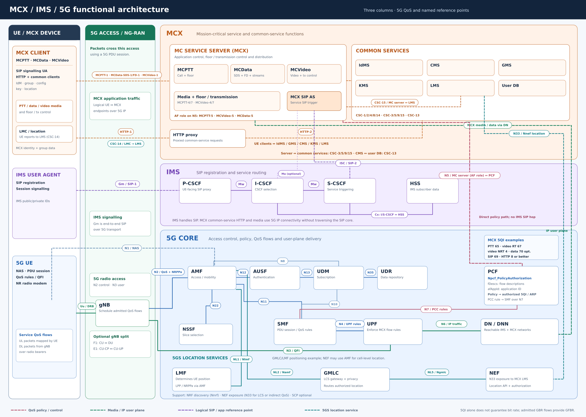

# 5G, IMS and MCX functional entities

This is an **on-network reference architecture** for an MCX service reached through 5G access. Its three columns are **UE / MCX device**, **5G Access / NG-RAN**, and the network. In the network column, **5G Core is at the bottom**, **IMS in the middle**, and **MCX at the top**. The UE at left contains corresponding 5G, IMS and MCX functions in one device. Each box is a *function*, not necessarily a separate process or server. The figure combines relevant 3GPP architectures; it is not a single normative 3GPP topology or an inventory of the current OpenMCX deployment. The [EPC-based MCPTT reference figure](https://www.aivader.com/uploads/1/3/9/0/139033062/edited/mcptt.png) informed the layout; the network functions and interfaces here follow the cited 5G specifications.

Solid lines show named direct relationships. Dashed lines show **logical end-to-end** or illustrative paths. N1 terminates at the UE and AMF, and Gm terminates at the UE and P-CSCF; both cross NG-RAN. Red identifies policy control, green the user plane, purple IMS signalling, orange MCX application relationships, and teal the location-service path. Line crossings without a junction dot are separate relationships. A reference-point name identifies endpoints at its own layer; a 5QI identifies the QoS characteristics of a flow, not a network interface.

## Read the main paths

| Path | What happens |
| --- | --- |
| Radio and 5GC | Uu connects UE and gNB. N2 carries the gNB–AMF control relationship; N3 carries the gNB–UPF user-plane relationship. N1 is the UE–AMF NAS relationship via NG-RAN. SMF controls UPF over N4, and UPF reaches the data network over N6. |
| SIP signalling | The UE obtains IP connectivity through the gNB and UPF. Its IMS user agent reaches the P-CSCF; the S-CSCF applies registration and service routing and delivers relevant SIP requests to an MCX service server acting as a SIP application server. The I-CSCF helps locate the serving CSCF during registration or terminating routing; it is not necessarily in every SIP request path. |
| MCX management | The MCX client reaches the IdMS, CMS, GMS, KMS and LMS over application signalling such as HTTPS, OIDC and XCAP. These requests use 5G IP connectivity but do not have to traverse the IMS SIP core. |
| Media and streams | MCPTT speech, MCVideo media, and MCData streams reach the appropriate MCX service function over the 5G user plane. MCPTT floor and MCVideo transmission control are application functions, not IMS proxy functions. |
| QoS policy | The MC service server acts in the 5GC **AF role** when requesting service QoS from PCF over **N5**. PCF authorizes PCC rules for SMF over **N7**. SMF programs UPF over **N4** and supplies the QoS profile and QoS rules for NG-RAN and UE via AMF. N5 carries the policy request; media follows the N6–UPF–N3–gNB–Uu path. |
| MCX location | The UE location management client (LMC) can report device location to the MCX location management server (LMS) over **CSC-14**. The MC service server can request location from LMS over **CSC-15**. For operator-provided positioning, LMS acts as an external AF on **N33** to NEF; an illustrative request continues via GMLC, AMF and LMF. LMF determines location using UE and/or NG-RAN positioning via AMF. There is no direct MCX-to-LMF reference point. |

## Access and 5G Core reference points

The on-network links follow [TS 23.501 §4.2.7](https://www.etsi.org/deliver/etsi_TS/123500_123599/123501/19.05.00_60/ts_123501v190500p.pdf). The optional split gNB interfaces follow [TS 38.401 §6.1](https://www.etsi.org/deliver/etsi_TS/138400_138499/138401/18.06.00_60/ts_138401v180600p.pdf).

| Point | Functional endpoints | Role |
| --- | --- | --- |
| Uu | UE ↔ gNB | NR radio interface. |
| F1; E1 | gNB-DU ↔ gNB-CU; gNB-CU-CP ↔ gNB-CU-UP | Optional interfaces when the gNB is split. |
| N1 | UE ↔ AMF, logically via NG-RAN | NAS signalling. |
| N2 | gNB/NG-RAN ↔ AMF | Access control signalling. |
| N3 | gNB/NG-RAN ↔ UPF | User-plane packets. |
| N4 | SMF ↔ UPF | User-plane control. |
| N6 | UPF ↔ data network (DN) | Delivery to reachable IMS and MCX application networks. |
| N11 | AMF ↔ SMF | Session coordination. |
| N12; N13 | AMF ↔ AUSF; AUSF ↔ UDM | Authentication relationships. |
| N7; N5 | SMF ↔ PCF; MC service server (AF role) ↔ PCF | PCC rules and MCX application QoS requests. N5 is explicitly drawn from the MC service server to PCF. |
| N8; N10 | AMF ↔ UDM; SMF ↔ UDM | Subscription data relationships; listed in this guide for clarity. |
| N22; N35 | AMF ↔ NSSF; UDM ↔ UDR | Slice selection and subscription-data storage; listed in this guide for clarity. |
| N33; NL5 | LMS (external AF) ↔ NEF; NEF ↔ GMLC | Exposure of an authorized MCX location request and its forwarding for GMLC-based LCS. |
| NL2; NL1 | GMLC ↔ AMF; AMF ↔ LMF | Request UE location, then determine the position. |
| N2 (NRPPa); N1 (LPP) | AMF ↔ NG-RAN; AMF ↔ UE | Carry network and UE positioning messages for LMF via AMF. |

The figure uses reference-point notation for readability. In a 5GC deployment, many control-plane interactions are realized over corresponding **service-based interfaces**; NRF discovery uses `Nnrf`, and an SCP can be used for indirect communication. The QoS profile reaches NG-RAN in N2 session-management information, while QoS rules reach the UE in N1 session-management information, both through AMF. N3 and N6 are user-plane links, while N1 is a logical UE–AMF relationship. [TS 23.502 §4.3.3.2](https://www.etsi.org/deliver/etsi_ts/123500_123599/123502/19.06.00_60/ts_123502v190600p.pdf) describes the PDU-session modification signalling.

## IMS and MCX signalling reference points

[TS 23.228](https://www.etsi.org/deliver/etsi_ts/123200_123299/123228/19.05.00_60/ts_123228v190500p.pdf) defines the IMS points. [TS 23.280 §§7.3 and 7.5](https://www.etsi.org/deliver/etsi_ts/123200_123299/123280/19.10.00_60/ts_123280v191000p.pdf) maps the MCX signalling points onto the appropriate IMS/HTTP relationships.

| Point | Functional endpoints | Role / mapping |
| --- | --- | --- |
| Gm | IMS UA in UE ↔ P-CSCF | UE-facing IMS SIP; a logical application path over the PDU session. |
| Mw | CSCF ↔ CSCF | SIP between P-CSCF, I-CSCF and S-CSCF as required by routing. I-CSCF discovery is not on every established dialog. |
| Cx | I-CSCF or S-CSCF ↔ HSS | IMS subscriber and serving-CSCF information. |
| ISC | S-CSCF ↔ SIP application server | IMS service triggering toward the MCX service AS. |
| Ma | I-CSCF ↔ SIP application server | Alternative IMS relationship used where the selected MCX SIP procedure calls for it. |
| SIP-1 | MCX signalling UA ↔ SIP core | MCX signalling relationship using a profiled Gm point. |
| SIP-2 | SIP core ↔ MCX SIP AS | MCX signalling relationship using ISC/Ma. |
| HTTP-1; HTTP-2 | HTTP client ↔ HTTP proxy; HTTP proxy ↔ HTTP server | HTTP transport/routing for applicable MCX common-service procedures. OpenMCX's architecture uses a direct HTTPS path for CSC-1. |

`Gm / SIP-1` and `ISC / SIP-2` on the figure show **one mapped relationship each**, rather than two parallel physical links. MCX service-specific and `CSC-*` names below are application-plane relationships that may use these SIP or HTTP signalling points. IMS routes SIP; the MCX service server performs call, data and video logic.

## MCX application-plane reference points

The top MCX band names the common points in [TS 23.280 §7.5.2](https://www.etsi.org/deliver/etsi_ts/123200_123299/123280/19.10.00_60/ts_123280v191000p.pdf). The UE common-service clients reach IdMS, GMS, CMS, KMS and LMS; the MCX server exchanges group, configuration, key and location data with those services. The table spells out each endpoint pair.

| Point | Functional endpoints | Purpose |
| --- | --- | --- |
| CSC-1 | Identity management client ↔ IdMS | MCX authentication. |
| CSC-2 | Group management client ↔ GMS | Group configuration and notifications. |
| CSC-4 | Configuration management client ↔ CMS | On-network user and service configuration. |
| CSC-8 | Key management client ↔ KMS | Client security material. |
| CSC-14 | Location management client ↔ LMS | UE location reporting. |
| CSC-3 | MCX service server ↔ GMS | Group information and policy. |
| CSC-5 | MCX service server ↔ CMS | Service configuration. |
| CSC-9 | MCX service server ↔ KMS | Server security material. |
| CSC-15 | MCX service server ↔ LMS | Application use of location. |
| CSC-13 | CMS ↔ MC service user database | Stored user profile. |

The service-specific examples in the figure are [MCPTT-1](https://www.etsi.org/deliver/etsi_ts/123300_123399/123379/19.09.00_60/ts_123379v190900p.pdf) (MCPTT client ↔ server), [MCVideo-1](https://www.etsi.org/deliver/etsi_ts/123200_123299/123281/19.10.00_60/ts_123281v191000p.pdf) (MCVideo client ↔ server), and [MCData-SDS-1 / MCData-FD-1](https://www.etsi.org/deliver/etsi_ts/123200_123299/123282/19.08.00_60/ts_123282v190800p.pdf) (SDS or file-distribution signalling). MCPTT-4/7 and MCVideo-4/7 are separate unicast floor/transmission-control and media relationships. The [MCPTT reference-point inventory](mcptt-reference-points.md), [MCData inventory](mcdata-reference-points.md), and [MCVideo inventory](mcvideo-reference-points.md) cover additional service points.

## MCX and 5GS location interaction

The diagram shows two location sources. The MCX **LMC** can report device-derived location to the **LMS** over CSC-14. The MC service server requests or receives that information from LMS over CSC-15. These are MCX application relationships defined in [TS 23.280 §7.5.2.14–15](https://www.etsi.org/deliver/etsi_ts/123200_123299/123280/19.10.00_60/ts_123280v191000p.pdf).

For network-derived location, [TS 23.289 §7.5.1](https://www.etsi.org/deliver/etsi_ts/123200_123299/123289/19.07.00_60/ts_123289v190700p.pdf) permits the LMS to use **N33 via NEF** or **Le via GMLC**. The figure draws the N33 route: **LMS → NEF → GMLC → AMF → LMF**. The labels are N33/Nnef, NL5/Ngmlc, NL2/Namf and NL1/Nlmf. LMF uses UE and NG-RAN positioning messages through AMF, including N1/LPP and N2/NRPPa as applicable. [TS 23.273 §§4.2, 4.4 and 6.1.2](https://www.etsi.org/deliver/etsi_ts/123200_123299/123273/19.06.00_60/ts_123273v190600p.pdf) defines that chain, including authorization and privacy handling. NEF can also obtain a cell-level location through AMF without involving GMLC/LMF, depending on the request and deployment. The drawn GMLC/LMF chain is an example for network positioning, not a claim that every location request follows it.

The figure describes a standards-based integration option. It does not claim that the current OpenMCX deployment already connects to NEF, GMLC or LMF.

## MCX QoS and the N5 policy path

The 5QI examples are in a small informative box beside PCF in the 5G Core; the box is not a network function. They come from [TS 23.289 §4.3](https://www.etsi.org/deliver/etsi_ts/123200_123299/123289/19.07.00_60/ts_123289v190700p.pdf), which specifies mission-critical services over 5GS; [TS 23.501 §5.7.4](https://www.etsi.org/deliver/etsi_ts/123500_123599/123501/17.15.00_60/ts_123501v171500p.pdf) defines 5QI characteristics. [TS 23.280 §7.4.2.3.2](https://www.etsi.org/deliver/etsi_ts/123200_123299/123280/19.10.00_60/ts_123280v191000p.pdf) defines the **MC service server** as the functional entity; its PCF-facing **AF role** in this view does not introduce a second MCX server.

| MCX traffic | Standardized 5QI in this view | Qualification |
| --- | --- | --- |
| MCPTT voice and MCPTT-4/-9 floor signalling | **65** | Required by TS 23.289 for the MCPTT voice-call QoS flow. |
| MCVideo real-time media | **67** | Urgent and non-urgent real-time modes. |
| MCVideo non-real-time media | **4** | Non-real-time mode; transmission/reception control can use a separate flow. |
| MCData media | **70** | Permitted standardized choice; a non-standardized 5QI is also possible. This is not a blanket value for every file-transfer packet. |
| MCX SIP-1 signalling | **69** | Required for this MCX signalling reference point. |
| MCX HTTP-1 signalling | **8 or better** | Minimum specified for this MCX HTTP reference point. |

For unicast resource management, [TS 23.289 §§5.4–5.6](https://www.etsi.org/deliver/etsi_ts/123200_123299/123289/19.07.00_60/ts_123289v190700p.pdf) maps **MCPTT-5, MCVideo-5 and MCData-5** to direct **N5** interaction with PCF when the service provider has the required operator relationship. An indirect **N33 → NEF** path or **Rx** interworking is an alternative in the standard.

On N5, PCF exposes **`Npcf_PolicyAuthorization`**. The AF may identify an application with `afAppId`, describe IP media flows with `medComponents[*].medSubComps[*].fDescs`, or supply both where applicable. `fDescs` is the API field for flow descriptions, while `afAppId` is the application identifier. These are request inputs, not a hard-coded 5QI assignment. PCF binds the request to a PDU session and applies operator policy and subscription data to authorize a PCC rule containing a **5QI and ARP**. [TS 29.514 §§5.6.2.3, 5.6.2.7–8](https://www.etsi.org/deliver/etsi_ts/129500_129599/129514/16.15.00_60/ts_129514v161500p.pdf) defines those API fields; [TS 23.503 §6.1.3](https://www.etsi.org/deliver/etsi_ts/123500_123599/123503/19.07.00_60/ts_123503v190700p.pdf) defines policy authorization and PCC behavior. MCX-specific request identifiers such as `mcpttId` or `mcVideoId` may also be present for prioritized sessions.

PCF sends PCC rules to SMF over N7; SMF supplies QoS rules to UE, the QoS profile to NG-RAN, and UPF rules over N4. **UPF enforces authorized flow handling; gNB schedules the admitted QoS flow; UE maps uplink packets using its QoS rules.** Standardized 5QI 65, 67 and 70 are **non-GBR**, so those values alone do not guarantee a bit rate. A bit-rate guarantee requires an admitted GBR QoS flow with GFBR. ARP controls admission and pre-emption separately; emergency and imminent-peril handling also depends on operator policy. The MC service server and PCF do not forward media on N5.

### Relation to the EPC/eMBMS reference image

The linked image uses LTE/EPC points such as S1, Gx and M1. This figure uses 5GS points **Uu, N2, N3, N5 and N7** for the corresponding radio, core and policy roles. For optional multicast/broadcast operation, [TS 23.247 §5.3](https://www.etsi.org/deliver/etsi_ts/123200_123299/123247/19.02.00_60/ts_123247v190200p.pdf) adds **MBSF, MB-SMF, MB-UPF and MBSTF**. Its named points include **Nmb10** (MCX AF/AS ↔ MBSF), **Nmb13** (MCX AF/AS ↔ MB-SMF), **N4mb** (MB-SMF ↔ MB-UPF), **N3mb** (MB-UPF ↔ NG-RAN) and **N6mb** (MCX AF/AS ↔ MB-UPF). The main drawing traces the requested unicast N5 policy path and its QoS flow; the MBS entities form an additional deployment path.

## Entity guide

| Level | Entity | Function in this view |
| --- | --- | --- |
| UE/access | MCX UE/client | MCPTT, MCData and MCVideo user agents plus common-service clients. |
| UE/access | IMS UA | SIP registration and session signalling. |
| UE/access | 5G UE and gNB/NG-RAN | Radio access, NAS signalling, and the N2/N3 connection to the 5G Core. |
| 5G Core | AMF | Access, registration and mobility control. |
| 5G Core | AUSF; UDM; UDR | 5G subscriber authentication, subscription management and stored data. These are distinct from MCX IdMS. |
| 5G Core | SMF; UPF | PDU session control and user-plane packet forwarding to the IMS or MCX data network. |
| 5G Core | PCF; NEF | Network policy and QoS, and exposed network capabilities. Their use depends on deployment policy. |
| 5G Core | GMLC; LMF | Authorized 5GS location gateway and UE positioning function. The MCX LMS obtains operator location through the LCS exposure path. |
| 5G Core | NSSF; NRF; SCP | Slice selection, network-function discovery, and optional indirect service communication. |
| 5G Core | DN/DNN | The data-network destination and its name; IMS and MCX can be reached through configured PDU sessions. |
| IMS | P-CSCF | First IMS SIP contact for the UE. |
| IMS | I-CSCF | Locates or selects the serving CSCF for registration and terminating routing. |
| IMS | S-CSCF | Serving registrar and SIP service-control point; routes to an application server under service criteria. |
| IMS | HSS / IMS subscriber data | IMS identities and service profile. The deployment may interwork or co-locate with 5G subscription functions, but the IMS role remains distinct. |
| IMS | IBCF/SBC; MRFC/MRFP | Optional border/interconnect and media-resource functions; not required for the basic MCX path shown. |
| MCX signalling | HTTP client and HTTP proxy | Client-facing and service-facing HTTP routing for common-service procedures. |
| MCX | MCPTT server | Call control, floor arbitration and speech distribution; may perform controlling and participating roles. |
| MCX | MCData server | Short data, file distribution, streaming and IP connectivity capabilities as provided by the service profile. |
| MCX | MCVideo server | Video session and transmission control, plus media distribution. |
| MCX | MC service server (AF role) | The MCPTT, MCData or MCVideo server can request 5GC policy authorization over N5; it is the MC service server of TS 23.280 acting in the 5GC AF role. |
| MCX common services | CMS; GMS | User/service configuration and group configuration or membership. |
| MCX common services | IdMS; KMS; LMS | MCX user authentication, MCX key distribution, and MCX location information. |
| MCX common services | MC service user DB | Service user information consumed by MCX servers. |
| MCX optional | ACM server; MC gateway | Administrative configuration where deployed. |
| OpenMCX operations | MCX Admin; dispatcher | Product administration and operator endpoints. The dispatcher client is planned. These are not additional 3GPP 5GC or IMS network functions. |

**Identity boundary:** a 5G subscriber, an IMS public/private identity, and an MCX user identity serve different authentication and authorization purposes. Deployment-specific provisioning maps them together; they should not be treated as one account record merely because one person uses all three.

**Scope of “all”:** the figure covers the principal on-network functions relevant to an MCX call, message or video session. [TS 23.501](https://www.etsi.org/deliver/etsi_TS/123500_123599/123501/19.05.00_60/ts_123501v190500p.pdf) §4.2.2 also defines other optional or specialized 5GC functions, including SEPP, NSACF, NSSAAF, NWDAF, CHF, 5G-EIR, UDSF, UCMF, EASDF, non-3GPP access functions, and analytics/data-collection functions. They are grouped or omitted from the main path for legibility.

## OpenMCX mapping

OpenMCX's [SIP core evaluation](sip-core-evaluation.md) describes a compact Kamailio `sip-core` with proxy, registration and application selection for its standalone profile. That is a deployment choice within the MCX signalling architecture; the IMS band depicts a generic full IMS reference deployment. The figure does not claim that OpenMCX currently deploys those three IMS entities or a 5G Core.

## Standards used

- [3GPP TS 38.401 / ETSI TS 138 401](https://www.etsi.org/deliver/etsi_TS/138400_138499/138401/18.06.00_60/ts_138401v180600p.pdf), §6.1: NG-RAN access and optional gNB CU/DU split.
- [3GPP TS 23.501 / ETSI TS 123 501](https://www.etsi.org/deliver/etsi_TS/123500_123599/123501/19.05.00_60/ts_123501v190500p.pdf), §§4.2.2–4.2.3: 5GS functions and non-roaming reference architecture.
- [3GPP TS 23.502 / ETSI TS 123 502](https://www.etsi.org/deliver/etsi_ts/123500_123599/123502/19.06.00_60/ts_123502v190600p.pdf), §4.3.3.2: PDU-session modification and N1/N2 QoS signalling.
- [3GPP TS 23.503 / ETSI TS 123 503](https://www.etsi.org/deliver/etsi_ts/123500_123599/123503/19.07.00_60/ts_123503v190700p.pdf): application influence, PCF policy and PCC rules.
- [3GPP TS 29.514 / ETSI TS 129 514](https://www.etsi.org/deliver/etsi_ts/129500_129599/129514/16.15.00_60/ts_129514v161500p.pdf), §§5.6.2.3 and 5.6.2.7–8: `Npcf_PolicyAuthorization` request fields including `afAppId` and `fDescs`.
- [3GPP TS 23.228 / ETSI TS 123 228](https://www.etsi.org/deliver/etsi_ts/123200_123299/123228/19.05.00_60/ts_123228v190500p.pdf): IMS entities and S-CSCF service control toward an application server.
- [3GPP TS 23.280 / ETSI TS 123 280](https://www.etsi.org/deliver/etsi_ts/123200_123299/123280/19.10.00_60/ts_123280v191000p.pdf), §§7.3–7.5: common MCX functions, CSC-14 and CSC-15.
- [3GPP TS 23.289 / ETSI TS 123 289](https://www.etsi.org/deliver/etsi_ts/123200_123299/123289/19.07.00_60/ts_123289v190700p.pdf), §§4.3, 5.4–5.6 and 7.5.1: MCX-over-5GS QoS and LMS access to operator location over N33 or Le.
- [3GPP TS 23.273 / ETSI TS 123 273](https://www.etsi.org/deliver/etsi_ts/123200_123299/123273/19.06.00_60/ts_123273v190600p.pdf), §§4.2, 4.4 and 6.1.2: 5GS LCS exposure, GMLC, AMF, LMF, privacy and positioning procedures.
- [3GPP TS 23.247 / ETSI TS 123 247](https://www.etsi.org/deliver/etsi_ts/123200_123299/123247/19.02.00_60/ts_123247v190200p.pdf), §5.3: optional 5G multicast/broadcast functions and reference points.
- [3GPP TS 23.379](https://www.etsi.org/deliver/etsi_ts/123300_123399/123379/19.09.00_60/ts_123379v190900p.pdf), [TS 23.281](https://www.etsi.org/deliver/etsi_ts/123200_123299/123281/19.10.00_60/ts_123281v191000p.pdf), and [TS 23.282](https://www.etsi.org/deliver/etsi_ts/123200_123299/123282/19.08.00_60/ts_123282v190800p.pdf): service-specific MCPTT, MCVideo and MCData functions.
