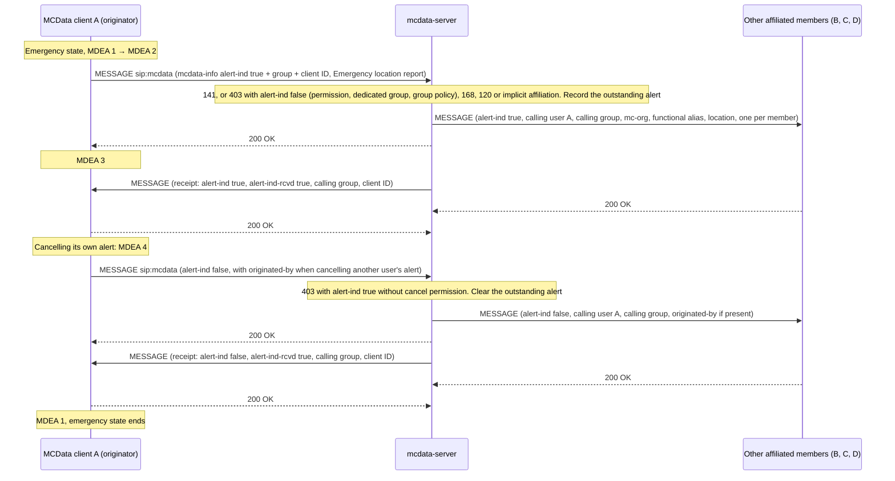

# MCData group emergency alert tests

These tests cover the **MCData group emergency alert** (TS 24.282 V19.7.0 §16.2 with §6.3.7): raising an alert with a location report, notifying the affiliated members, the receipts, late alerts, and cancellation by the originator or by another authorised user. Emergency and imminent-peril MCData *communications* are media-plane sessions and are not implemented.

Back to the [MCData test index](../MCDATA_TEST.md). The shared four-client fixture, the client status fields and the MCData deployment are described in the [standalone SDS tests](MCDATA_SDS_TEST.md), which also holds the shared coverage gaps. Architecture: MCData Phase 1 design, [standards and acceptance](../../docs/architecture/mcdata-standards-and-acceptance.md).

## How it works

- **Alert.** A SIP MESSAGE with `<alert-ind>` true, the MCData group, the client ID and an `Emergency` location report. The client moves through the MDEA states and enters the MCData emergency state.
- **Notification and receipt.** Every other affiliated member is told, with the originator, organisation, functional alias and location; each acknowledgement returns to the originator as a receipt with `<alert-ind-rcvd>`.
- **Cancellation.** The originator cancels its own alert; another authorised user cancels it naming the originator in `<originated-by>`.

## Implemented profile

| Step | Behaviour | Reference |
|---|---|---|
| Group emergency alert | A SIP MESSAGE with `<alert-ind>` true, the MCData group, the client ID and an `Emergency` location report (`urn:3gpp:ns:mcdataLocationInfo:1.0`) enters the MCData emergency alert state (MDEA 2, then MDEA 3 on 200). The server checks `<allow-activate-emergency-alert>`, the dedicated `<EmergencyAlert>` groups when listed, and the group's `<mcdata-allow-emergency-alert>` (403 with `<alert-ind>` false), `168` for a preconfigured-use-only group, and affiliation: a member is implicitly affiliated, a non-member gets `120`. The other affiliated members receive the alert with the group, originator, `<mc-org>`, functional alias and the copied location; the server then sends the originator a receipt with `<alert-ind-rcvd>`. A member affiliating later receives outstanding alerts. Cancellation (`<alert-ind>` false) needs `<allow-cancel-emergency-alert>` (403 with `<alert-ind>` true otherwise); a user cancelling another user's alert names it in `<originated-by>`, which also needs the any-user permission, and the originator is told. The in-progress emergency group state is not kept: it belongs to emergency group communications (INVITE, media plane). | V19.7.0 §16.2.1.1–16.2.1.3, §16.2.3.1–16.2.3.3, §6.3.7.1, §6.3.7.2 |

### Client commands

```bash
mcx-client --config FILE --command 'mcdata-alert [group=<id>]'
mcx-client --config FILE --command 'mcdata-alert cancel [group=<id>] [<originator MCData ID>]'
```

## Performed tests

Recorded on **2026-09-22** against image `openmcx:0.29-mcdata` (`fb662f09297d`), TS 24.282 V19.7.0, clear SIP (debug mode), in a fresh lab captured from the first request: 163 scenario assertions and 64 wire checks on one MCData server instance. The scenario and the wire report cover every MCData SDS feature, so the evidence links below are shared with the other MCData SDS documents.

| ID | Scenario | Result evidence |
|---|---|---|
| EA-01 | Group emergency alert: 200, MDEA 3 and the MCData emergency state; a receipt with `<alert-ind-rcvd>`; every other affiliated member notified with originator, organisation and location; the server records the outstanding alert | Scenario report (`artifacts/mcdata29-lab/artifacts/integration/mcdata-sds-results.json`), wire report (`artifacts/mcdata29-lab/artifacts/integration/mcdata-sds-sip-wire.json`), capture (`artifacts/mcdata29-lab/artifacts/integration/mcdata-sds.pcap`) |
| EA-02 | A member that de-affiliates and affiliates again receives the outstanding alert | Scenario report (`artifacts/mcdata29-lab/artifacts/integration/mcdata-sds-results.json`), wire report (`artifacts/mcdata29-lab/artifacts/integration/mcdata-sds-sip-wire.json`), capture (`artifacts/mcdata29-lab/artifacts/integration/mcdata-sds.pcap`) |
| EA-03 | The originator cancels: MDEA 1, the emergency state ends, other members and the server clear the alert | Scenario report (`artifacts/mcdata29-lab/artifacts/integration/mcdata-sds-results.json`), wire report (`artifacts/mcdata29-lab/artifacts/integration/mcdata-sds-sip-wire.json`), capture (`artifacts/mcdata29-lab/artifacts/integration/mcdata-sds.pcap`) |
| EA-04 | Another authorised user cancels the originator's alert with `<originated-by>`; the originator returns to MDEA 1 | Scenario report (`artifacts/mcdata29-lab/artifacts/integration/mcdata-sds-results.json`), wire report (`artifacts/mcdata29-lab/artifacts/integration/mcdata-sds-sip-wire.json`), capture (`artifacts/mcdata29-lab/artifacts/integration/mcdata-sds.pcap`) |
| EA-05 | Alert rejections: no activation permission (403, `<alert-ind>` false), group outside the dedicated alert groups, group without alert permission, 168 preconfigured use only, 120 not a member; no cancel permission (403, `<alert-ind>` true) | Scenario report (`artifacts/mcdata29-lab/artifacts/integration/mcdata-sds-results.json`), wire report (`artifacts/mcdata29-lab/artifacts/integration/mcdata-sds-sip-wire.json`), capture (`artifacts/mcdata29-lab/artifacts/integration/mcdata-sds.pcap`) |
| EA-06 | Implicit affiliation of an eligible member alerting on an unaffiliated group | Scenario report (`artifacts/mcdata29-lab/artifacts/integration/mcdata-sds-results.json`), wire report (`artifacts/mcdata29-lab/artifacts/integration/mcdata-sds-sip-wire.json`), capture (`artifacts/mcdata29-lab/artifacts/integration/mcdata-sds.pcap`) |

## High-level call flow (group emergency alert)


The server, not the members, generates the receipt. It sends the receipt to the originator right after its 200 OK and does not wait for the members' 200 OK responses. If the originator was implicitly affiliated, the server also sends it an affiliation NOTIFY.



When A cancels another user's alert, that originator is one of the notified members. It returns to MDEA 1 when it receives the `alert-ind` false MESSAGE that names it in `<originated-by>`.


## Coverage gaps

| Area | Gap |
|---|---|
| Priority and emergency | The used priority is always the requested value (no local policy change). TS 24.282 V19.7.0 has no emergency or imminent-peril variant of standalone signalling-plane SDS: emergency and imminent-peril MCData communications are SDS sessions and file distribution over the media plane (INVITE, TS 24.582), covered with the in-progress group state by the [media plane tests](MCDATA_MEDIA_TEST.md). Of the alert procedures, the ad hoc group emergency alert (§16.2A) and emergency location updates without an alert are not implemented. |
