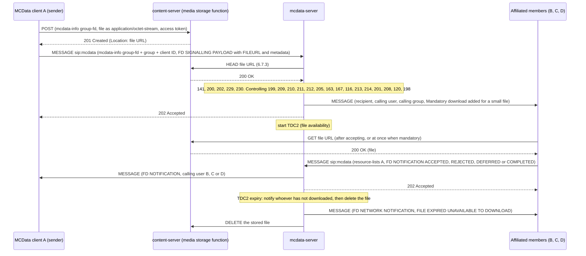

# MCData file distribution over HTTP tests

These tests cover **MCData file distribution (FD) using HTTP** (TS 24.282 V19.7.0 §10.2.2 to §10.2.4), with the FD disposition notifications of §12.2, the file availability timer TDC2 of §12.4 and the release of a distribution (§15.1.13). The recorded results cover the implemented subset below, not complete MCData conformance. FD over the media plane, file distribution to a network-stored file (upload by reference), deferred delivery and payload protection are not implemented; see [coverage gaps](#coverage-gaps).

Back to the [MCData test index](../MCDATA_TEST.md). Standalone SDS is in the [SDS tests](MCDATA_SDS_TEST.md). Acceptance: [MCData acceptance matrix](../../docs/architecture/mcdata-standards-and-acceptance.md).

## How it works

- **The content server.** `content-server` (`mcx-common --role content`) is a new container holding the **media storage function** of the MCData content server (TS 23.282 §6.6.3). Clients reach it through the HTTP proxy, as TS 24.282 §10.2.2.1 NOTE 2 requires; the MCData server reaches it directly for its own checks.
- **Upload (§10.2.2).** The client POSTs a `multipart/mixed` body — an `mcdata-info` part (`request-type` `one-to-one-fd` or `group-fd`, the calling user, and the group for a group upload) and the file as `application/octet-stream` — with its access token in the Authorization header field. The media storage function answers **201 Created** with the file URL in the Location header field.
- **The FD request (§10.2.4).** The client then sends a SIP MESSAGE to the MCData PSI carrying `mcdata-info` and an **FD SIGNALLING PAYLOAD** (§15.1.3) whose single Payload IE has content type **FILEURL** and whose Metadata IE describes the file. One-to-one requests also carry a `resource-lists` body. The server applies the participating and controlling checks and answers **202 Accepted**.
- **Delivery and download (§10.2.1.2, §10.2.3).** Each recipient receives the request with the FD ICSI. With a Mandatory download IE it downloads at once; otherwise it offers the file to the user and runs timer TDU2 until the user accepts, rejects or defers. The download is an HTTP GET of the file URL with the recipient's access token.
- **Notifications (§12.2).** The recipient reports FILE DOWNLOAD REQUEST ACCEPTED, REJECTED, DEFERRED and FILE DOWNLOAD COMPLETED in an **FD NOTIFICATION** (§15.1.6), which the server relays to the originator.
- **File availability (§12.4).** The controlling function runs **TDC2** per FD request. At expiry it tells every recipient that has not downloaded the file with an **FD NETWORK NOTIFICATION** (§15.1.9, FILE EXPIRED UNAVAILABLE TO DOWNLOAD) and removes the file from the media storage function.

## Implemented profile

| Step | Behaviour | Reference |
|---|---|---|
| Discovery | When the client has no `<MCDataContentServerURI>` it asks for the absolute URI of the media storage function with an `msf-disc-req` (no signalling body, FD ICSI). The server applies the participating check (`200` without a group) and the controlling group checks (`163`, `167`, `116`, `213`, `488`/`214`, `201`, `120`), answers 200 and then sends a separate MESSAGE with `msf-disc-res` carrying `<mcdata-controller-psi>` set to the URI. A configured URI takes precedence over a discovered one; TS 24.282 gives both sources without a precedence rule. | §10.2.1.3 |
| Upload | `POST` of a `multipart/mixed` body to the media storage function with the access token; 201 Created with the file URL in Location. The function checks transmission control (403), the service limit `<max-data-size-fd-bytes>` and, for a group upload, the group limit `<mcdata-on-network-max-data-size-for-FD>` (413), that the group exists, allows FD and is not preconfigured-use-only. | §10.2.2.1, §10.2.2.2 |
| Download | `GET` of the file URL with the access token; 200 with the file, 404 once it is gone. Reception control: the uploader, the MCData members of the group a group file was uploaded for, and for a one-to-one file the users whose incoming communication list admits the uploader. TS 24.282 leaves this policy to an editor's note. | §10.2.3.1, §10.2.3.2 |
| FD request | SIP MESSAGE with the `g.3gpp.mcdata.fd` feature tag, the FD ICSI in P-Preferred-Service, `mcdata-info` (`one-to-one-fd` with a `resource-lists` target, or `group-fd` with the group and client ID) and an FD SIGNALLING PAYLOAD with one FILEURL Payload IE, the Metadata IE (RFC 5547 file selector, file description, file availability), and the optional FD disposition request type and Mandatory download IEs. The file selector carries the name, size and an RFC 5547 SHA-256 hash selector, and the file availability is an RFC 5322 date-time. | §10.2.4.1, §10.2.4.2.1, §6.2.2.2, §15.1.3, §15.2.17 |
| Participating checks | `141` unknown sender; `200` no `<allow-transmit-data>`; `202` over `<MaxData1To1>`; `229` target outside the one-to-one list; `230` sender outside the recipient's incoming list. | §10.2.4.3.1 step 7, §10.2.4.3.2 step 5A |
| Controlling checks | `199` missing bodies; `209` not exactly one FD message; `210`/`211` the Payload IE is missing or is not FILEURL; `212` the file URL does not resolve (checked with an HTTP HEAD, §6.7.3); `205` no single one-to-one target; `145`/300 functional alias resolution; for a group `163` unknown, `167` preconfigured use only, `116` not a member, `213` FD not allowed, `488`/`214` no FD enabler, `201` no transmit permission, `208` over the group file size, `120` not affiliated, `198` no other affiliated member. | §10.2.4.4.2 steps 3–12 |
| Auto-receive | A file at or below `<max-data-size-auto-recv-bytes>` is delivered with the Mandatory download IE added by the controlling function. | §11.2, §10.2.4.4.1 step 5 |
| Reception | The downloaded file is checked against the hash selector when the metadata carries one; a mismatch is recorded and no completion is reported (TS 24.282 does not define the behaviour). Mandatory download: accept, download, and report completion when the request asked for it. Otherwise the offer waits for the user with TDU2 running; a deferral is only possible while TDU2 runs. An unknown Application ID is discarded. | §10.2.1.2.1–10.2.1.2.3 |
| Notifications | FD NOTIFICATION with ACCEPTED, REJECTED, DEFERRED or COMPLETED to the originator named in `resource-lists`; the server correlates by Conversation ID and Message ID (`216` otherwise), records who downloaded, and deletes the file once every recipient has rejected it. | §6.2.3.2, §12.2.1.1, §12.2.2.1 step 13, §12.2.3 step 6 |
| Notification aggregation | For a group distribution the controlling function collects the FD notifications under TDC1 and sends them to the originator in one SIP MESSAGE, one signalling body per notification, when TDC1 expires or once every recipient has reported a final disposition (completed or rejected). Notifications arriving after the aggregate are relayed individually, and a pending aggregate is flushed when the file is released or expires. | §12.2.3 step 15c–15d, Table F.2.2-1 |
| Release | The originator releases its own distribution with an **FD HTTP TERMINATION** (§15.1.13) naming the Conversation ID, Message ID and file URL with Termination information type TERMINATION REQUEST. The server answers 202, tells every recipient that has not downloaded the file that it was deleted (FILE DELETED UNAVAILABLE TO DOWNLOAD), removes it and stops TDC2, then sends an FD HTTP TERMINATION with TERMINATION RESPONSE and Release response type RELEASE SUCCESS to the originator. `223` when the Conversation ID or Message ID is absent, `404`/`224` when no such transmission is known, and 403 for a user that is not the originator. An authorised user that takes part in the communication releases another user's distribution with AUTH USER TERMINATION REQUEST FOR COMM OVER HTTP: it needs `release_any_user` in its ruleset (403 otherwise), is answered with a TERMINATION RESPONSE, and the originator is told with TRANSMISSION STOPPED. The server releases a transmission by its own policy the same way, with the reason in a Reason header field; before doing so it may announce INTENT TO RELEASE COMM OVER HTTP and run timer TDC3, during which the originator may send EXTENSION REQUEST FOR COMM OVER HTTP and receive an EXTENSION RESPONSE of ACCEPTED or REJECTED. In this deployment the operator triggers both through the server's control interface (`release-intent <message id>` and `release <message id> [reason]`), which stands in for the release policies of clause 13. | §6.2.2.4, §6.3.6.1, §10.2.4.4.2 steps 11 and 17, §12.4.2.1, §13.2.3.3.4, §13.2.4.5, §13.2.5.3, §15.2.21–§15.2.23 |
| File availability | TDC2 per FD request, from the file availability in the Metadata IE bounded by `<max-file-availability>`, or `<default-file-availability>`. At expiry every recipient that has not downloaded the file gets an FD NETWORK NOTIFICATION of type FILE EXPIRED UNAVAILABLE TO DOWNLOAD (`request-type` `notify`) and the file is removed. | §12.4.1.1, §12.4.2, §15.1.9 |

Configuration: the content server URI is `<MCDataContentServerURI>` in the client configuration (`endpoints.content`), the service limits are `mcdata_service.max_data_size_fd_bytes` in the CMS configuration, and the MCData server holds `mcdata.fd` (`content_server`, `content_server_internal`, `max_data_size_auto_recv_bytes`, `max_file_availability_ms`, `default_file_availability_ms`). Groups carry `allow_fd`, `fd_supported` and `max_fd_bytes`. Element names follow their references in TS 24.282 because TS 24.484 and TS 24.481 are not supplied.

### Large files

By default the HTTP proxy passes at most 32 MiB to the media storage function, and the proxy and the content server
end a request after their 15–20 s read and write timeouts. Deployments that distribute larger files raise both:

| Setting | Where | Default |
|---|---|---|
| `--content-request-limit-bytes N` | `mcx-http-proxy`: the largest upload body passed to the content server (the file plus its multipart framing); the message store keeps 32 MiB | 32 MiB |
| `--file-transfer-timeout-ms N` | `mcx-http-proxy` and `mcx-common --role content`: the read and write deadline of one file upload or download (`/content/mcdata/files…`, `/mcdata/files…`); other requests keep the short timeouts | 0 (unchanged) |

The file limit itself stays `mcdata_service.max_data_size_fd_bytes`; a group upload is bounded by both it and the
group's `max_fd_bytes`, so a group cannot raise the service limit. With neither set, 64 MiB applies. An upload of
unknown length that overruns the proxy bound is answered 413, like one whose Content-Length is too large.

### Client commands and status

```bash
mcx-client --config FILE --command 'fd-send [mandatory] [completed] [app=<n>] [available=<seconds>] [url=<file URL>] <MCData ID|group=<id>|fa=<alias>> <path>'
mcx-client --config FILE --command 'fd-accept <message ID>'   # or fd-reject, fd-defer
mcx-client --config FILE --command 'fd-cancel <message ID>'   # release a distribution this client started
mcx-client --config FILE --command 'fd-release <message ID>'  # release another user's distribution (authorised users)
mcx-client --config FILE --command 'fd-extend <message ID>'   # ask to keep a file available after an intent to release
mcx-client --config FILE --command 'fd-discover [group=<id>]'  # absolute URI of the media storage function
openmcx-mcdata-server --config FILE --command 'release-intent <message ID>'   # or: release <message ID> [reason]
```

`available=<seconds>` sets the file availability in the Metadata IE, and `url=<file URL>` sends an FD request for a file that is already stored (used by the negative tests). `status.json` records `mcdata_files_sent` (with the file URL and size), `mcdata_files` (offers received, their state and the download result), `mcdata_fd_last_result` (the last FD request, or `upload_status` when the media storage function refused the upload) and `mcdata_file_notifications` (FD notifications, network notifications and termination responses). An entry of `mcdata_files_sent` records the state `terminated`, `stopped`, `release-pending`, `extended` or `extension-refused`. `mcdata_content_server` and `mcdata_discovery_result` record a discovered URI and the outcome of the last discovery. The server status records `file_transfers` per Message ID (originator, group, file URL, recipients, downloaded, rejected) with `release_intent` and `extended`, and the counters `fd_requests`, `fd_delivered`, `fd_downloads`, `fd_expired`, `fd_terminated`, `fd_stopped` and `fd_extended`.

## Separate four-client fixture

```bash
docker build -t openmcx:<tag> -f docker/Dockerfile .
python3 tools/prepare-prearranged-test.py --directory artifacts/mcdata-fd-lab --project openmcx-mcdata-fd \
  --debug-sip --private-call --mcdata --image openmcx:<tag>
C=".cache/deps/docker-compose-linux-x86_64 -p openmcx-mcdata-fd -f artifacts/mcdata-fd-lab/compose.json"
$C up -d mcdata-server                      # start the capture before the clients authorise
docker run -d --rm --name openmcx-mcdata-fd-capture --network "container:$($C ps -q mcdata-server)" \
  --cap-drop ALL --cap-add NET_RAW openmcx-dev:0.4 \
  sh -c "tcpdump -Z root -i eth0 -U --immediate-mode -s 0 -w /tmp/c.pcap 'tcp port 5060'"
$C up -d
python3 tests/integration/mcdata_fd_scenario.py \
  --compose artifacts/mcdata-fd-lab/compose.json --artifacts artifacts/mcdata-fd-lab/artifacts --project openmcx-mcdata-fd
docker cp openmcx-mcdata-fd-capture:/tmp/c.pcap artifacts/mcdata-fd-lab/artifacts/integration/mcdata-fd.pcap
python3 tests/integration/verify_mcdata_fd.py artifacts/mcdata-fd-lab/artifacts/integration/mcdata-fd.pcap \
  --service sip:mcdata@mcx.test --output artifacts/mcdata-fd-lab/artifacts/integration/mcdata-fd-sip-wire.json
docker rm -f openmcx-mcdata-fd-capture            # the reports and the capture are kept; the lab is not
$C down -v
```

The fixture adds file distribution to the MCData rules of the [SDS fixture](MCDATA_SDS_TEST.md#separate-four-client-fixture): the group `operations` allows FD with at most 2000 bytes per file, the service allows 4000, files of at most 64 bytes are received automatically, TDC2 is 20 s unless the sender asks for less and TDU2 is 8 s. `operations-nosds` also has FD switched off (213) and `operations-nosupport` has no FD enabler (214).

## Performed tests

The content server's transfer bounds and timeouts are configurable; the Go tests `TestConfiguredContentLimitAllowsLargeStreamingUpload`, `TestContentRequestLimitRejectsKnownAndUnknownLength`, `TestSlowFileTransferUsesConfiguredTimeout` and `TestGroupUploadCannotBypassServiceLimit` cover them. With the Android client, two phones exchanged image, PDF and MP4 files and a 100,000,000-byte file through the proxy with `--content-request-limit-bytes 100065536` and `--file-transfer-timeout-ms 900000`.

The scenario (`mcdata_fd_scenario.py`) makes 64 assertions and its wire verifier (`verify_mcdata_fd.py`) 38 checks, clear SIP (debug mode), on one MCData server instance; the regression runs them in the `mcdata` lab, and with protected signalling in `mcdata-xml`.

| ID | Scenario | Result evidence |
|---|---|---|
| FD-01 | One-to-one FD: the file is uploaded and its URL sent; the small file is received automatically (auto-receive); the downloaded bytes are identical to the file sent and match the hash selector of the metadata; accepted and completed notifications reach the originator; the server records the download | Scenario report (`artifacts/integration/mcdata-fd-results.json`) |
| FD-02 | Group FD: every other affiliated member is offered the file without mandatory download and the sender is not; one accepts and downloads identical bytes, one rejects, one defers; all four notifications reach the originator; the server records the download and the rejection | Same report |
| FD-03 | File availability: with a 3 s availability TDC2 expires, the members are told the file is no longer available, the server forgets the transfer and a later download returns 404 | Same report |
| FD-04 | Rejections: 200, 229, 230, 213, 488/214, 404/163, 212 (file URL does not exist), 208 and 202; the media storage function itself refuses an upload over the service limit with 413 and an upload by a user who may not transmit data with 403 | Same report |
| FD-05 | FD to a functional alias: 300 Multiple Choices, then the request to the selected user, whose download matches the file sent | Same report |
| FD-06 | Release: the originator cancels a group distribution, the request is accepted with 202, a TERMINATION RESPONSE with RELEASE SUCCESS returns, the recipients are told the file was deleted, the server forgets the transfer and a later download returns 404 | Same report |
| FD-07 | Releasing a transmission the server no longer knows is rejected with 404/224 | Same report |
| FD-08 | Aggregation: the four notifications of the group distribution arrive in one aggregated SIP MESSAGE at TDC1 expiry, and the late notification of the member that deferred is relayed individually | Same report |
| FD-10 | Prior indication and extension: the server announces its intent to release, the originator asks for an extension and it is accepted, and a later policy release stops the transmission with its reason and deletes the file | Same report |
| FD-11 | Release by an authorised user: a user without the authorisation is rejected with 403, the authorised user is answered with RELEASE SUCCESS and the originator is told that its transmission was stopped | Same report |
| FD-09 | Discovery: the absolute URI of the media storage function is discovered for a one-to-one and for a group distribution, and refused with 213 for a group without file distribution and with 200 for a user that may not transmit | Same report |
| FD-12 | SIP wire checks (38), with clause 15 bodies decoded independently of the C++ codec: FD feature tag, ICSI and P-Preferred-Service; one FILEURL payload with file metadata, the RFC 5547 hash selector and an RFC 5322 file availability; one-to-one and group request shapes; 202; delivery with the recipient, originator and calling group; the file URL relayed unchanged; the Mandatory download IE added by auto-receive; the four notification types and their relay; the FD NETWORK NOTIFICATION with `request-type` `notify`; the 300 redirect and its follow-up; the discovery request and its msf-disc-res answer; the intent to release and the transmission stopped with their Reason header, the extension request and its ACCEPTED answer, and the authorised-user release with its 403 and 202; the release request and its TERMINATION RESPONSE with RELEASE SUCCESS, the FILE DELETED notification and the 404/224 rejection; aggregated notifications with one body each and the calling group; nine rejection warnings | Wire report (`artifacts/integration/mcdata-fd-sip-wire.json`), capture (`artifacts/integration/mcdata-fd.pcap`) |
| FD-13 | Unit tests: byte-exact FD SIGNALLING PAYLOAD, FD NOTIFICATION and FD NETWORK NOTIFICATION fixtures, the half-octet IEs, a payload that is not FILEURL, a missing file URL, the Metadata IE attributes, and FD HTTP TERMINATION with its termination and release response types | `test_mcdata` in the image build |
| FD-14 | Content server tests: upload, download, HEAD, the internal listing and removal, the service and group size limits, transmission and reception control | `go test ./...` in the image build |
| FD-15 | Malformed FD requests over HTTP, raw from client-a's container (`sip_negative.py --mcdata`, lab `negative`): no Payload IE and two Payload IEs → 403/210, a payload that is not FILEURL → 403/211, a one-to-one FD without the resource list → 403/205 (TS 24.282 clause 10.2.4.4.2 steps 6, 7a and 10a) | `negative` lab |

## High-level call flow (group FD over HTTP)

Kamailio and the HTTP proxy are omitted from the arrows: every SIP request passes through Kamailio and every HTTP request through the proxy.



A one-to-one FD follows the same pattern with a `resource-lists` body naming the single target and no group identity.

## Coverage gaps

| Area | Gap |
|---|---|
| Media plane | FD over the media plane (§10.2.5) is covered by the [media plane tests](MCDATA_MEDIA_TEST.md). |
| Upload by reference | Implemented for a file in the uploader's own MCData message store account; see the [message store tests](MCDATA_MESSAGE_STORE_TEST.md). Any other `message/external-body` URL is refused. |
| Termination and release | The release policies themselves (data volume and time limits) are not implemented: the operator triggers a policy release through the server's control interface, and the automatic announcement before TDC2 expiry (`intent_before_release_ms`) is off in the lab. The data volume and time limits apply to communications over the media plane, not to a distribution over HTTP. Release over the media plane and the authorised user's release with prior indication over HTTP (§13.2.6.3) are covered by the [communication release tests](MCDATA_RELEASE_TEST.md). |
| Discovery | The combined server always knows its own media storage function, so the participating-to-controlling relay of the discovery request (§10.2.1.3.3 steps 8–14) is internal rather than a second SIP exchange. |
| Notifications | Deferred delivery and the download-completed cleanup of a stored deferred communication (§12.2.2.1 step 6a) are not implemented. |
| Metadata | The file transfer identifier, icon and range attributes of RFC 5547 are not carried, and the hash selector is always SHA-256 (RFC 5547 lists only SHA-1 as supported at the time of writing, with the algorithm taken from the IANA registry). |
| Storage | Stored files and their metadata live in the content server's own volume; the deferred list and the storage quota of a user are not implemented. Files are removed at TDC2 expiry or when every recipient rejects them. |
| Security | One-to-one files are protected end to end with a PCK (§10.2.2.1 step 7) and the XML confidentiality of TS 33.180 §9.3 applies ([protected MCData tests](MCDATA_PROTECTED_TEST.md), DP-12). Group files are uploaded in clear, as §10.2.2.1 step 8b has it. XML integrity protection is not implemented. |
| Wire qualification | In-repository decoders only; no independent-peer run. Clear SIP (debug mode) only. |
