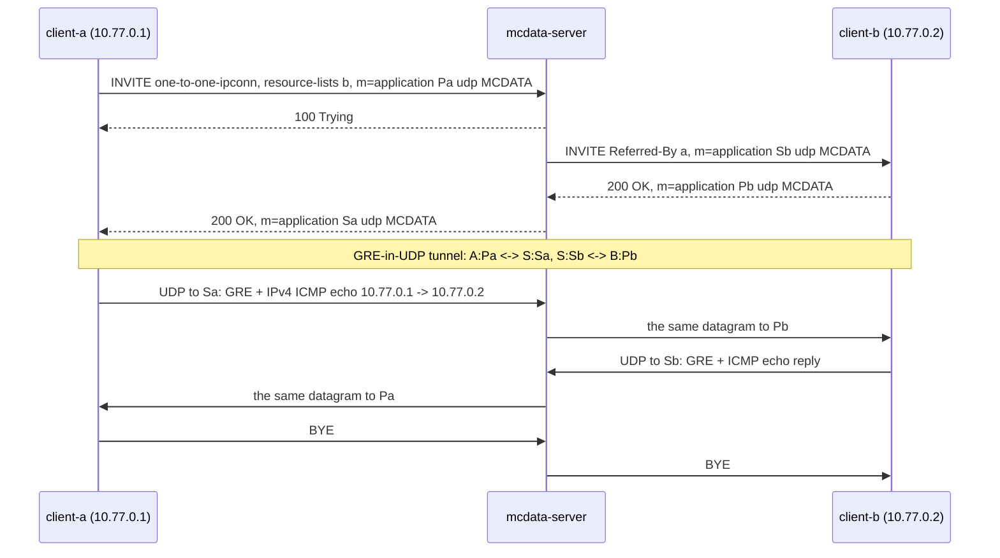

# MCData IP connectivity tests

These tests cover **MCData IP connectivity**: a one-to-one session that carries IP packets between two MCData clients through a GRE-in-UDP tunnel (TS 24.282 V19.7.0 clause 20, TS 24.582 V19.0.0 clause 13, IETF RFC 8086 over RFC 2784). Clause 20 defines one-to-one sessions only; there is no group IP connectivity in V19.7.0. The recorded results cover the implemented subset below, not complete conformance.

Back to the [MCData test index](../MCDATA_TEST.md). The shared four-client fixture is described in the [standalone SDS tests](MCDATA_SDS_TEST.md#separate-four-client-fixture). Acceptance row: MD-IP-01 in the [MCData acceptance matrix](../../docs/architecture/mcdata-standards-and-acceptance.md).

## How it works

- **The tunnel.** Each end of the tunnel is a UDP port named in SDP as `m=application <port> udp MCDATA` with `a=fmtp:MCDATA mcdata-ipconn-s-port=<port>` (TS 24.582 §13.5.2.1, §13.6.2). Every IP packet travels as a UDP datagram carrying a 4-octet GRE header (version 0, no checksum, no key, protocol type `0x0800` for IPv4) followed by the packet (§13.4). The UDP checksum is used.
- **The server is in the path.** `mcdata-server` combines the participating and controlling functions, and both are in the path of the tunnel (§13.2, §13.3). It opens one UDP socket facing each client, puts its own address and port in each SDP (TS 24.282 §20.3.0a, §20.4.0a, §20.4.0b), and relays each datagram unchanged to the other leg. It accepts a datagram only from the address and source port the client named in its SDP, and only if it is GRE carrying IP. Everything else is dropped and counted.
- **Setup.** The caller's INVITE to the MCData PSI names one target in `resource-lists` and `request-type` `one-to-one-ipconn`. The server answers `100 Trying`, invites the called client, and completes the caller's INVITE with 200 only when the called client has accepted (§20.4.2). A rejection by the called client, with its warning, goes back to the caller.
- **The IP application.** TS 24.582 §13.1.1 leaves the interface between the client and its IP application to the implementation. Here the client is its own IP application: a minimal IPv4 endpoint at the address in `mcdata.ipconn.address` (provisioned as `10.77.0.<n>`). It answers ICMP echo requests addressed to it, and `ipcon-ping` sends echo requests into the tunnel. Real IPv4 and ICMP packets therefore cross the tunnel in both directions, and no TUN device or extra container privilege is needed.

## Implemented profile

| Step | Behaviour | Reference |
|---|---|---|
| Request | INVITE to the MCData PSI with `+g.3gpp.mcdata.ipconn` and the ipconn ICSI in Contact and in two Accept-Contact header fields with `require;explicit`, the ICSI in P-Preferred-Service, `mcdata-info` with `one-to-one-ipconn` (with `<call-to-functional-alias-ind>` for an alias and the active `<functional-alias-URI>`), a `resource-lists` body with one entry, and the tunnel SDP offer | §20.2.0a, §20.2.1 |
| Checks | 403 without the ipconn feature tag or ICSI in Accept-Contact; `404/141` unknown caller; `403/200` without `<allow-transmit-data>`; `403/227` no single target; `403/229` target outside the one-to-one list; `403/230` caller outside the target's incoming list; `404` target not registered; `488` offer without an IP connectivity section | §20.3.1, §20.4.2 steps 2 and 5a, §11.1 |
| Functional alias | A target that is a functional alias, by the indication or because the CMS knows it, is answered `300 (Multiple Choices)` with the selected user in `<mcdata-request-uri>`, or `403/145` if nobody has activated it. The client then invites that user with the alias in `<called-functional-alias-URI>` | §20.4.2 step 5a1, §20.2.1 |
| Invitation | INVITE to the called client with the ipconn ICSI in P-Asserted-Service, the two Accept-Contact header fields, Referred-By naming the caller's public user identity, `mcdata-info` naming the called and calling users (and the active functional alias of the caller), and the server's own tunnel end | §20.4.1 |
| Answer | The called client answers 200 with its own tunnel end, or 486 if it already has a session. The caller receives 200 with the server's tunnel end only then; a failure is passed back with its status and warning | §20.2.2, §20.4.2, §20.3.1 |
| Relay | Datagrams from the negotiated address and source port, checked to be GRE carrying IP, are sent unchanged to the other client; the server counts packets, octets and drops per session | TS 24.582 §13.2, §13.3 |
| IP application | The client decapsulates, checks the IPv4 header, drops packets not addressed to its tunnel address, answers ICMP echo requests and records the replies to its own | TS 24.582 §13.1 |
| Release | Either client ends the session with BYE and the server ends the other leg. A session with no traffic for `mcdata.ipconn.idle_ms` (default 300 s) is released, and a caller whose called client has not answered within `mcdata.ipconn.setup_ms` (default 30 s) receives 408 | §20.2.1 |

### Client commands and status

```bash
mcx-client --config FILE --command 'ipcon <MCData ID>'                  # open a session
mcx-client --config FILE --command 'ipcon fa=<functional alias>'        # to a functional alias (300, then the user)
mcx-client --config FILE --command 'ipcon-ping <address> [count] [size]'  # ICMP echo through the tunnel (default 3 x 32 bytes)
mcx-client --config FILE --command 'ipcon close'
```

`status.json` records `mcdata_ipconn`. That holds the state (`inviting`, `open`, `rejected`, `closed` by this client, or `released` by the other side or the server), the SIP status and warning, the tunnel address, the server's end (`peer`), and either the target or the caller, with `referred_by`, `called_alias`, `selected` and the caller's `functional_alias` where they apply. It also records `mcdata_ipconn_counters` (datagrams sent, received and dropped, echoes answered and requests outstanding) and `mcdata_ipconn_pings` (each echo reply with its source, sequence, size, TTL and round-trip time). The server status lists `ipconn_sessions`: caller, target, whether it is established, the port facing each client, datagrams relayed each way, octets and drops. The server counts `ipconn_sessions`, `ipconn_packets`, `ipconn_bytes` and `ipconn_dropped`.

## Fixture and commands

The fixture is the one of the [SDS tests](MCDATA_SDS_TEST.md#separate-four-client-fixture): client-a may send only to b and c; b accepts only a; c accepts anyone; d may not transmit; `front-desk.fa` may be activated by a and b. `tools/provision.py` gives each client its tunnel address, `mcdata.ipconn.address` = `10.77.0.1` to `10.77.0.4`. The capture covers SIP and every UDP port, because the tunnel ports are ephemeral.

```bash
docker build -t openmcx:<tag> -f docker/Dockerfile .
python3 tools/prepare-prearranged-test.py --directory artifacts/mcdata-ipconn-lab --project openmcx-mcdata-ipconn \
  --debug-sip --private-call --mcdata --image openmcx:<tag>
C=".cache/deps/docker-compose-linux-x86_64 -p openmcx-mcdata-ipconn -f artifacts/mcdata-ipconn-lab/compose.json"
$C up -d mcdata-server                      # start the capture before the clients authorise
docker run -d --rm --name openmcx-mcdata-ipconn-capture --network "container:$($C ps -q mcdata-server)" \
  --cap-drop ALL --cap-add NET_RAW openmcx-dev:0.1 \
  sh -c "tcpdump -Z root -i eth0 -U --immediate-mode -s 0 -w /tmp/c.pcap 'tcp port 5060 or (udp and not port 53)'"
$C up -d
python3 tests/integration/mcdata_ipconn_scenario.py \
  --compose artifacts/mcdata-ipconn-lab/compose.json --artifacts artifacts/mcdata-ipconn-lab/artifacts --project openmcx-mcdata-ipconn
docker cp openmcx-mcdata-ipconn-capture:/tmp/c.pcap artifacts/mcdata-ipconn-lab/artifacts/integration/mcdata-ipconn.pcap
python3 tests/integration/verify_mcdata_ipconn.py artifacts/mcdata-ipconn-lab/artifacts/integration/mcdata-ipconn.pcap \
  --service sip:mcdata@mcx.test --output artifacts/mcdata-ipconn-lab/artifacts/integration/mcdata-ipconn-sip-wire.json
docker rm -f openmcx-mcdata-ipconn-capture        # the reports and the capture are kept; the lab is not
$C down -v
```

## Performed tests

The scenario (`mcdata_ipconn_scenario.py`) makes 31 assertions and its wire verifier (`verify_mcdata_ipconn.py`) 22 checks, clear SIP (debug mode), on one MCData server instance; the regression runs them in the `mcdata-ipconn` lab, and with protected signalling in `mcdata-xml-ipconn`. tshark also decodes every tunnel datagram independently as GRE carrying ICMP.

| ID | Scenario | Result evidence |
|---|---|---|
| IP-01 | Setup: the session opens at both clients; the called client learns the caller and Referred-By; the server holds one established tunnel and faces each client from a port of its own | Scenario report (`artifacts/integration/mcdata-ipconn-results.json`) |
| IP-02 | IP traffic both ways: five 64-byte ICMP echoes from the caller are answered by the called client's IP application with the data unchanged and TTL 64, three 1200-byte echoes go the other way, and the server relays all 16 datagrams | Same report |
| IP-03 | The IP application drops packets for an address that is not its own, and nothing answers them | Same report |
| IP-04 | The server drops well-formed GRE datagrams sent to a tunnel port from another container, and nothing reaches the called client | Same report |
| IP-05 | Closing the session releases both clients and the tunnel | Same report |
| IP-06 | A second session to a client that already has one is refused with 486, passed back to the caller, while the first continues; the called party may release the session too | Same report |
| IP-07 | Rejections: `200` without `<allow-transmit-data>`, `229` outside the one-to-one list, `230` outside the target's incoming list, `145` for an alias nobody has activated; no tunnel is created | Same report |
| IP-08 | Session to a functional alias: the 300 names the user who activated `front-desk.fa`, the caller invites that user with `<called-functional-alias-URI>`, the called client learns the alias, and IP traffic flows | Same report |
| IP-09 | SIP and tunnel wire checks (22), decoded independently of the C++ implementation: the request's feature tag, ICSI, Accept-Contact, resource-lists and SDP with `mcdata-ipconn-s-port`; the invitation with the ICSI, Referred-By and both users; the server's own address and ports on each leg; 100 and then 200 to the caller; the 300 and the follow-up with the called alias; the rejections 200, 229, 230, 145 and 486; BYE; every tunnel datagram between the SDP ends, sent from the named source port, with a UDP checksum, GRE version 0 without key or sequence, IPv4 and ICMP checksums that verify, each reply matching its request, each datagram relayed unchanged; and tshark decoding the same datagrams | Wire report (`artifacts/integration/mcdata-ipconn-sip-wire.json`), capture (`artifacts/integration/mcdata-ipconn.pcap`) |
| IP-10 | Unit tests: the tunnel SDP with and without the source port, the session-level and media-level addresses and the 13.5.2.1 example; the RFC 1071 checksum on the well-known IPv4 header (`0xb861`); byte-exact IPv4 and ICMP echo; GRE for IPv4 and IPv6, with a verified checksum, and the rejection of a key, version 1, a non-IP protocol type, a mismatched protocol type and short headers | `test_ipconn` in the image build |

The capture was taken on the server's container interface, where the kernel leaves UDP checksums to be completed by the interface (checksum offload), which a veth never does. Every tunnel datagram therefore shows a non-zero partial checksum over the pseudo header, which the verifier and tshark both accept as offload; no datagram has its checksum disabled.

## High-level call flow



## Coverage gaps

| Area | Gap |
|---|---|
| IP application | The client is its own minimal IPv4 endpoint (ICMP echo). There is no TUN device or interface to an external non-3GPP host (TS 24.582 §13.1.1), no IPv6 endpoint (GRE for IPv6 is encoded and decoded), and no implicit target determination from the IP information of the one-to-one user list (§20.2.1). |
| SIP details | The called client's 200 does not add the ipconn feature tags to its Contact (§20.2.2 steps 7 and 8), and the server's Contact carries no `isfocus` or MCData session identity for the tunnel legs. `<application-data>` is copied from the called client's 200 but never generated. A failed media plane does not send BYE with Reason `FAILURE_CAUSE`. |
| Priority | `<user-requested-priority>` is not sent for IP connectivity. There is no emergency IP connectivity. |
| Topology | The participating and controlling functions are collocated. |
| Security | No protection of the tunnel. |
| Wire qualification | Clear SIP only (debug mode). In-repository decoders plus tshark; no independent-peer run. |
