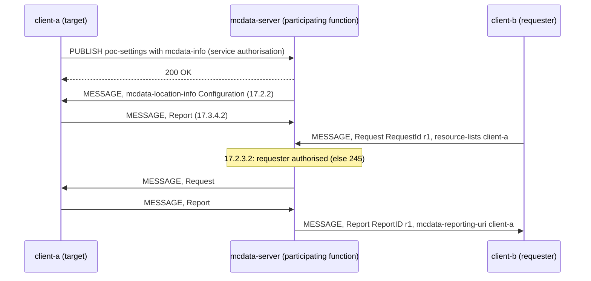

# MCData location tests

These tests cover **location management for MCData** (TS 24.282 V19.7.0 clause 17, §6.3.7.1.6 and §6.3.7.1.7, with the location-info body of Annex D.4). The procedures are those of MCPTT, described in the [MCPTT location tests](../mcptt/LOCATION_TEST.md). This page gives only what is specific to MCData and the results. What the tests do not cover is listed under [coverage gaps](#coverage-gaps).

Back to the [MCData test index](../MCDATA_TEST.md).

## What differs from MCPTT

| Item | MCData | Reference |
|---|---|---|
| Body | `application/vnd.3gpp.mcdata-location-info+xml`, namespace `urn:3gpp:ns:mcdataLocationInfo:1.0`, `<McdataSignallingEvent>` and `<mcdata-reporting-uri>` | 24.282 Annex D.4 |
| Headers | The MCData ICSI in P-Asserted-Service and the icsi-ref Accept-Contact; reports carry the g.3gpp.mcdata Accept-Contact | §17.2.2, §17.3.4.2 |
| Refusals | 244 invalid location request target client list, 245 not authorised to request location information, 246 not authorised to request location configuration changes | §17.2.2A, §17.2.3.2 |
| Area notices | `<emergency-alert-area-ind>`, `<group-geo-area-ind>` and `<associated-group-id>` in the mcdata-info `<anyExt>`. On entry into an emergency alert area the client starts an MCData emergency alert (§16.2.1.1), which carries its current coordinate. On a group area entry or exit it affiliates to, or de-affiliates from, its MCData group. | §6.3.7.1.6, §6.3.7.1.7 |
| Confidentiality | With confidentiality protection, the location XML sent between a client and the participating function is encrypted with the client's CSK like the rest of its XML (TS 33.180 §9.3). That covers the `<CurrentLocation>` sub-elements, the coordinates and the areas of a configuration. They become `type="Encrypted"` with an xmlenc EncryptedData, as Annex D.4 item 2 requires. | D.4, §6.5.2 |
| Configuration | `mcdata.location` on the MCData server, and the same `location` object of the user profile | §17.2.2 |

The client keeps one reporting configuration per service. Both share the simulated position and radio identities (`location position`, `location radio`). MCData requests and changes use `mcdata-location request|configure`, with the same arguments as `location request|configure`. The client status has `mcdata_location`, `mcdata_location_last_request` and `mcdata_location_last_result`. The server status has `location`.

## Call flow

The flows are those of the [MCPTT location tests](../mcptt/LOCATION_TEST.md#call-flows) with the MCData server, the MCData body (Annex D.4) and the MCData ICSI. With CSK confidentiality protection, the location XML is encrypted hop by hop.



## Run a separate lab

```bash
python3 tools/prepare-prearranged-test.py --directory artifacts/mcdata-location-lab --project openmcx-mcdata-location \
  --debug-sip --mcdata --location --image openmcx:0.68-loc          # add --protected --key-parameters-iei 0x79 for D.4 item 2
C=".cache/deps/docker-compose-linux-x86_64 -p openmcx-mcdata-location -f artifacts/mcdata-location-lab/compose.json"
$C up -d --wait mcdata-server        # then start a capture in its namespace, as for MCPTT
$C up -d --wait
python3 tests/integration/mcdata_location_scenario.py --compose artifacts/mcdata-location-lab/compose.json \
  --artifacts artifacts/mcdata-location-lab/artifacts --project openmcx-mcdata-location
python3 tests/integration/verify_location.py CAPTURE --service sip:mcdata@mcx.test --mcdata [--protected] --output RESULT
```

The fixture is the one of the MCPTT location tests. In the MCData lab, client-a is the user whose emergency alert area entry raises an alert, because it is the one allowed to alert on its MCData group.

## Performed tests

Recorded on **2026-09-25** against image `openmcx:0.68-loc` (`088f3e9629d4`). Every report records **PASS**.

| ID | Checks | Evidence |
|---|---|---|
| MDL-01–MDL-03 | Configuration after MCData service authorisation (t1 to t7); log-on reports stored; a user denied reporting is refused 403 | [Clear](../../artifacts/mdl-lab-f2/artifacts/mcdata-location.json), [protected](../../artifacts/mdl-lab-fp2/artifacts/mcdata-location.json) |
| MDL-04 | Travelled distance and zone entry | Same reports |
| MDL-05–MDL-08 | A request answered with the RequestId and the reporting MCData ID; refresh; LocationFilter; a user who does not share is not reported | Same reports |
| MDL-09 | Refusals 245, 244 and 246 | Same reports |
| MDL-10 | An authorised Update adds a periodic trigger; the target reports on it | Same reports |
| MDL-11 | Group geographic area: entry recorded, exit de-affiliates the client from its MCData group, entry affiliates it again | Same reports |
| MDL-12 | Emergency alert area: entry starts an MCData emergency alert with the current coordinate; Emergency reports on t7; exit recorded after the alert is cancelled | Same reports |
| MDL-13 | Protected only: the location XML encrypted and decrypted, none refused (the server encrypted 44 XML bodies and decrypted 48) | [Protected](../../artifacts/mdl-lab-fp2/artifacts/mcdata-location.json) |

The scenario passed 27 checks clear and 28 protected. `verify_location.py --mcdata` passed 14 wire checks clear ([result](../../artifacts/mdl-lab-f2/artifacts/integration/mcdata-location-wire.json)). With `--protected` it passed 16 ([result](../../artifacts/mdl-lab-fp2/artifacts/integration/mcdata-location-wire.json)): 29 location bodies crossed with their location as `type="Encrypted"` EncryptedData, and no coordinate crossed in clear.

## Coverage gaps

The gaps of the [MCPTT location tests](../mcptt/LOCATION_TEST.md#coverage-gaps) apply, except XML protection, which MCData has. In addition:

| Area | Gap |
|---|---|
| Group areas | The client acts only on a notice for its configured MCData group. |
| Integrity | The location XML is encrypted but not signed. XML integrity protection is not implemented for any MCData XML. |
