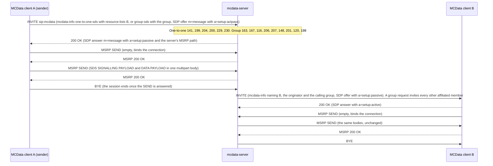
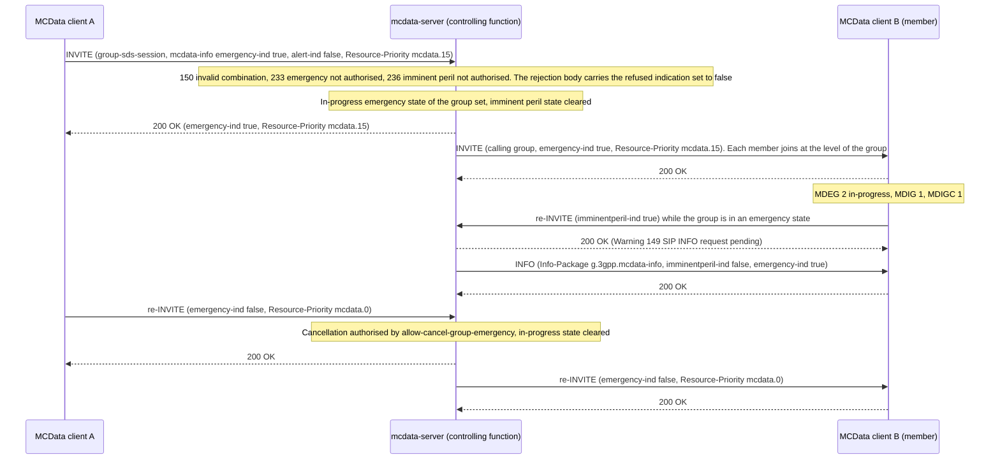
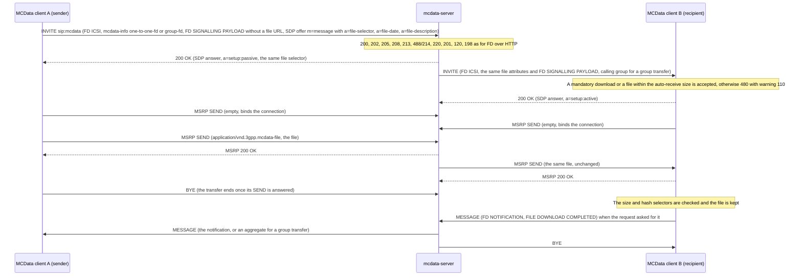

# MCData media plane tests

These tests cover **MCData SDS carried over the media plane**: standalone messages one-to-one and to a group (TS 24.282 V19.7.0 §9.2.3 with TS 24.582 V19.0.0 §6.1.1), **SDS sessions** that stay open for several messages with in-band disposition notifications (§9.2.4 with TS 24.582 §6.1.2), the **emergency one-to-one communication** those sessions carry (§6.2.8.3, §6.2.8.4.3, §6.2.8.4.4), the **emergency and imminent peril group communications** of a group session with the in-progress states of the group (§6.2.8.1, §6.3.7.1, §6.3.7.2), and **file distribution over the media plane** (§10.2.5 with TS 24.582 clause 7), where the file itself travels in MSRP instead of being uploaded to the content server. The recorded results cover the implemented subset below, not complete MCData conformance. IP connectivity has its own [tests](MCDATA_IPCONN_TEST.md); pre-established sessions are not implemented; see [coverage gaps](#coverage-gaps).

Back to the [MCData test index](../MCDATA_TEST.md). The same message over the signalling control plane is in the [standalone SDS tests](MCDATA_SDS_TEST.md), which also hold the shared four-client fixture. Acceptance: [MCData acceptance matrix](../../docs/architecture/mcdata-standards-and-acceptance.md).

## How it works

- **MSRP.** The media plane uses MSRP (IETF RFC 4975 with the connection binding of RFC 6135). PJSIP has no MSRP stack, so OpenMCX has its own module covering the subset TS 24.582 uses: SEND and REPORT framing with the seven-hyphen end-line and its continuation flag, chunking and reassembly, and a TCP endpoint driven from the application's poll loop.
- **Who connects.** TS 24.582 §5.1.1 makes the MCData client and the controlling function the MSRP endpoints; a relay appears only when a separate participating function sits between them. Here the participating and controlling functions are collocated, so there is no relay: the server always listens (`a=setup:passive`) and each client connects.
- **The exchange.** The client offers an `m=message` stream in an INVITE to the MCData PSI, with `a=path`, `a=setup:actpass` and the two MCData types in `a=accept-types`. The server answers 200 with its own passive stream. The client connects, binds the connection with an empty SEND, and sends the SDS SIGNALLING PAYLOAD and DATA PAYLOAD as one `multipart/mixed` body. When the SEND is answered the client releases the SIP session (§6.1.1.2.1).
- **Delivery.** The server decodes the bodies, offers a second media plane leg to the recipient with the same ICSI, and forwards the bodies unchanged once that connection is bound. Both sessions are released when their purpose is served.

## Implemented profile

| Step | Behaviour | Reference |
|---|---|---|
| Offer | INVITE to the MCData PSI with the `g.3gpp.mcdata.sds` feature tag, the SDS ICSI in P-Preferred-Service, `mcdata-info` with `request-type` `one-to-one-sds` and a `resource-lists` body naming the target, or `group-sds` with the group in `<mcdata-request-uri>` and the client ID and no `resource-lists`, and an `m=message` section with `TCP/MSRP`, the format list `*`, `a=path`, `a=setup:actpass`, `a=sendonly` and `a=accept-types` naming the signalling and payload types | §9.2.3.2.1, §9.2.3.2.3 |
| Answer | 200 with an `m=message` section of the server's own, `a=setup:passive` and its MSRP URI in `a=path`, so the client is the active endpoint | §9.2.3.3.2, TS 24.582 §6.1.1.2.1 |
| Checks | The same transmission control as the signalling plane. One-to-one: `141` unknown sender, `199` missing bodies, `204` no single target, `200` no `<allow-transmit-data>`, `229` target outside the one-to-one list, `230` sender outside the recipient's incoming list. Group: `163` unknown group, `167` preconfigured use only, `116` not a member, `206` SDS not allowed, `488`/`207` no SDS enabler, `148` regrouped, `201` no transmit permission on the group, `120` not affiliated, `198` no other affiliated member. The group's SDS size limit is applied when the payload arrives, because the INVITE does not carry it; an oversized message is discarded and the session released | §9.2.3.3.3, §9.2.3.4.4, §11.1 |
| Transfer | The active endpoint binds the connection with an empty SEND, then sends the SDS SIGNALLING PAYLOAD and DATA PAYLOAD as one `multipart/mixed` body; a body larger than the chunk size is split across SENDs and reassembled by Message-ID | TS 24.582 §6.1.1.2.1, §6.1.1.2.4, §6.4.1 |
| Delivery | The server offers a leg to each recipient with the SDS ICSI in P-Asserted-Service and `mcdata-info` naming the recipient, the originator and, for a group request, the calling group, and forwards the bodies unchanged. A group request goes to every other affiliated member, one leg each | §9.2.3.4.3, §9.2.3.4.4, §6.3.4 |
| SDS session | `one-to-one-sds-session` or `group-sds-session` opens a session that stays open: the server opens every leg at once and relays each MSRP SEND to the other legs, so any participant may send and the disposition notifications travel in band on the same connection. A session message names its sender in the Sender MCData user ID IE, since any participant may send. The session ends when a participant releases it or after `mcdata.media.idle_ms` without traffic | §9.2.4, TS 24.582 §6.1.2, §6.3.2.3 |
| Emergency communication | A one-to-one session is opened with `<emergency-ind>` true, or an ongoing one is upgraded with a re-INVITE, and cancelled the same way. The client moves through the MDEPC states (1 capable, 2 requested, 3 granted) and sets the MCData emergency state; requests while the condition holds carry the provisioned emergency Resource-Priority. The server checks `<allow-emergency-private-call>` (403 `112`) and the cancel authorisation, records the condition on every leg, and re-INVITEs the other participants so they follow. Only a one-to-one session may become an emergency communication here | §6.2.8.3.1–6.2.8.3.4, §6.2.8.4.2–6.2.8.4.4, §9.2.4.2.6 |
| Emergency alert with the request | An emergency group communication may carry `<alert-ind>` true and the location of the originator, which the server authorises as an alert of clause 16.2 (`<allow-activate-emergency-alert>`, the group's `<mcdata-allow-emergency-alert>` and the dedicated group list), records in the alert state of the group, repeats to each member with its location, and receipts to the originator. An unauthorised alert leaves the communication in place and is refused with warning `149` and a SIP INFO request carrying `<alert-ind>` false, which returns the client to MDEA 1 | §6.2.8.1.1 step 3, §6.2.8.1.4 step 1b, §6.3.7.1.3, §6.3.7.1.10, §6.3.7.2.1 |
| In-progress state notification | The affiliated members of the group that are not participating in the communication are told of its in-progress emergency or imminent peril state by a SIP MESSAGE, and a member that affiliates while a state is outstanding is told on affiliation, as it is for an outstanding alert. The client sets its MDEG or MDIG state without becoming a participant | §6.3.7.1.2, §16.2.3.3 |
| Priority group communication | A group session is opened with `<emergency-ind>` or `<imminentperil-ind>` true, or an ongoing one is raised with a re-INVITE, and cancelled the same way. The client keeps the MDEGC and MDIGC communication states and the MDEG and MDIG in-progress states of the group, and carries the provisioned emergency (`mcdata.15`), imminent peril (`mcdata.10`) or normal (`mcdata.0`) Resource-Priority. The server validates the combination of indications (403 `150`), authorises the request against the user profile and the group document (403 `233`, 403 `236`, each with the refused indication set to false in the response body), holds the in-progress emergency and imminent peril states of the group, invites and re-INVITEs every member at that level, and upgrades an imminent peril state to an emergency one. An imminent peril request on a group already in an emergency state is answered 200 with warning `149` and corrected by a SIP INFO request carrying `<imminentperil-ind>` false and `<emergency-ind>` true | §6.2.8.1.1–6.2.8.1.17, §6.3.7.1.1, §6.3.7.1.8–6.3.7.1.11, §6.3.7.1.14, §6.3.7.2.3–6.3.7.2.7, §9.2.4.4.4 |
| File distribution | `fd-media` offers the file on an `m=message` stream whose SDP carries the RFC 5547 `a=file-selector` (name, type, size and SHA-256 hash), `a=file-date` and `a=file-description`, with `a=accept-types:application/vnd.3gpp.mcdata-signalling` and an FD SIGNALLING PAYLOAD that has no Payload IE, since there is no file URL. The server applies the same transmission control as FD over HTTP (`200`, `202`, `205`, `208`, `213`, `488`/`214`, `220`, `201`, `120`, `198`), invites each recipient with the same file attributes and the FD ICSI, and relays the file. A recipient accepts a mandatory download or a file small enough to be auto-received, and otherwise answers `480` with warning `110`. The file is one `application/vnd.3gpp.mcdata-file` body in MSRP SEND requests; the recipient checks it against the size and hash selectors, keeps it beside the other artifacts and sends the FILE DOWNLOAD COMPLETED notification over the signalling plane when it was requested. A group file distribution is carried at the in-progress priority level of its group. The server keeps a record of the transfer only to correlate its disposition notifications: once every recipient has reported a final one, or the time for them has passed, it is removed (`mcdata_media_file_transfer_closed`), and a later notification is refused with `403` and warning `216` | §10.2.5, TS 24.582 §7.1, §7.2, §12.2 |
| Release | The sender of a standalone message releases its session once its SEND is answered; the server releases a delivery leg as soon as the recipient answers its SEND, and any session that outlives its purpose (`mcdata.media.session_ms`) | TS 24.582 §6.1.1.2.1 |

The MCData server holds `mcdata.media` (`session_ms` for a standalone transfer, `idle_ms` for a session) and `mcdata.resource_priority` (`emergency`, `imminent_peril` and `normal`), which the clients also carry. The user profile carries `emergency_group`, `emergency_group_cancel`, `imminent_peril` and `imminent_peril_cancel`, and the group document `allow_emergency_call` and `allow_imminent_peril`. The transport is `TCP/MSRP`; `TCP/TLS/MSRP` is parsed and generated but not yet used.

### Client commands and status

```bash
mcx-client --config FILE --command 'sds-media <MCData ID|group=<id>> <text>'    # standalone
mcx-client --config FILE --command 'sds-session <MCData ID|group=<id>>'         # open a session
mcx-client --config FILE --command 'sds-session send [delivery|read] <text>'
mcx-client --config FILE --command 'sds-session <MCData ID> emergency'          # one-to-one
mcx-client --config FILE --command 'sds-session group=<id> emergency [alert]|imminent'  # group
mcx-client --config FILE --command 'sds-session emergency [cancel]'   # on an open session
mcx-client --config FILE --command 'sds-session imminent [cancel]'    # group sessions only
mcx-client --config FILE --command 'sds-session close'
mcx-client --config FILE --command 'fd-media [mandatory] [completed] <MCData ID|group=<id>> <path>'
```

`status.json` records `mcdata_media_result` (the message ID, target, SIP status and the state: `inviting`, `connecting`, `sent`, `delivered`, `released` or a failure) `mcdata_media_received` (messages that arrived over the media plane, with their payloads, sender and requested disposition), `mcdata_media_sent` and `mcdata_media_notifications` (the in-band notifications of a session) `mcdata_media_session` (whether a session is open), `mcdata_session_emergency` with `mcdata_session_emergency_state` (the MDEPC state), and, for a group session, `mcdata_session_group`, `mcdata_session_imminent`, `mcdata_group_emergency_state` (MDEG), `mcdata_group_emergency_communication_state` (MDEGC), `mcdata_group_imminent_state` (MDIG), `mcdata_group_imminent_communication_state` (MDIGC) and `mcdata_priority_corrections`. In-progress state notifications are listed in `mcdata_group_notifications`, and the alert state stays in `mcdata_alert_state` and `mcdata_alerts_received` as for an alert of its own. Files received over the media plane are listed in `mcdata_media_files` (the originator, the calling group, the metadata of the SDP file selector, where the file was written, the verified hash and the state: `received`, `corrupt` or `declined`). The server status records `emergency` and `imminent` per leg, `group_priority` (the in-progress states of each group and who raised them) `file` per leg, `group_priority` with the originator of each state, and the counters `media_state_notifications`, `media_alerts`, `media_files`, `media_files_delivered`, `media_file_bytes`, `media_emergency`, `media_emergency_cancelled`, `media_group_emergency`, `media_group_emergency_cancelled`, `media_imminent_peril`, `media_imminent_peril_cancelled` and `media_priority_corrections`. The server status records `media_sessions` (originator, target, message ID, which leg and whether the connection is bound) and the counters `media_sds` and `media_delivered`. For an ad hoc group, `mcdata_media_result` also records `adhoc` and, at a participant reached through a functional alias, `called_alias`; the ad hoc group of a session is `mcdata_session_group`, the server lists its ad hoc groups in `adhoc_groups` and counts `media_adhoc`.

## Separate four-client fixture

The fixture is the one of the [SDS tests](MCDATA_SDS_TEST.md#separate-four-client-fixture); the media plane needs no extra provisioning beyond `mcdata.media.session_ms`, which the fixture sets to 20 s. The capture must cover every TCP port, because the MSRP connections use ephemeral ports.

```bash
docker build -t openmcx:<tag> -f docker/Dockerfile .
python3 tools/prepare-prearranged-test.py --directory artifacts/mcdata-media-lab --project openmcx-mcdata-media \
  --debug-sip --private-call --mcdata --image openmcx:<tag>
C=".cache/deps/docker-compose-linux-x86_64 -p openmcx-mcdata-media -f artifacts/mcdata-media-lab/compose.json"
$C up -d mcdata-server                      # start the capture before the clients authorise
docker run -d --rm --name openmcx-mcdata-media-capture --network "container:$($C ps -q mcdata-server)" \
  --cap-drop ALL --cap-add NET_RAW openmcx-dev:0.4 \
  sh -c "tcpdump -Z root -i eth0 -U --immediate-mode -s 0 -w /tmp/c.pcap tcp"
$C up -d
python3 tests/integration/mcdata_media_scenario.py \
  --compose artifacts/mcdata-media-lab/compose.json --artifacts artifacts/mcdata-media-lab/artifacts --project openmcx-mcdata-media
docker cp openmcx-mcdata-media-capture:/tmp/c.pcap artifacts/mcdata-media-lab/artifacts/integration/mcdata-media.pcap
python3 tests/integration/verify_mcdata_media.py artifacts/mcdata-media-lab/artifacts/integration/mcdata-media.pcap \
  --service sip:mcdata@mcx.test --output artifacts/mcdata-media-lab/artifacts/integration/mcdata-media-sip-wire.json
docker rm -f openmcx-mcdata-media-capture         # the reports and the capture are kept; the lab is not
$C down -v
```

## Performed tests

The scenario (`mcdata_media_scenario.py`) makes 128 assertions and its wire verifier (`verify_mcdata_media.py`) 63 checks, clear SIP and clear MSRP (debug mode), on one MCData server instance; the regression runs them in the `mcdata` lab, and with protected signalling in `mcdata-xml`.

| ID | Scenario | Result evidence |
|---|---|---|
| MP-01 | One-to-one standalone SDS over the media plane: the INVITE is accepted with 200, the payload goes out on the MSRP connection, the session ends once the SEND is answered, the recipient receives the message with the same Message ID and the originator, and the server counts the request and its delivery. No signalling plane SDS is used | Scenario report (`artifacts/integration/mcdata-media-results.json`) |
| MP-02 | Rejections: 200 for a user without `<allow-transmit-data>`, 229 for a target outside the one-to-one list and 230 for a sender outside the recipient's incoming list | Same report |
| MP-03 | The server releases the media plane sessions it no longer needs | Same report |
| MP-04 | Group standalone SDS over the media plane: every other affiliated member receives it over its own MSRP leg with the calling group and the originator, the sender is not offered its own message, the server counts one delivery per recipient, and the group rejections 201, 206 and 488/207 | Same report |
| MP-05 | SDS session: the session is established and stays open, a message reaches the other party with its sender named, the in-band DELIVERED notification returns on the same connection, the invited party answers on the same session, and closing it releases both ends | Same report |
| MP-06 | Emergency one-to-one communication: an ongoing session is upgraded, the sender reaches MDEPC 3 and the other party follows, the session keeps carrying messages, the cancellation returns both to MDEPC 1, and a user without the authorisation is refused with 403/112 | Same report |
| MP-07 | SIP and MSRP wire checks (63), decoded independently of the C++ implementation: the offer with its feature tag, ICSI and MSRP attributes; the one-to-one target in resource-lists and the group in `<mcdata-request-uri>` without one; the passive answer; the delivery legs with their calling group; six rejection warnings; BYE; the in-band notifications of a session; the emergency upgrade with its Resource-Priority, the condition passed to the other party, the cancellation and the 403/112 refusal; the emergency and imminent peril group communications with `mcdata.15` and `mcdata.10`, the cancellation with `mcdata.0`, the members invited at the level of the group, the members told when the state is cancelled, the 403/233 and 403/236 rejections carrying the refused indication set to false, the 200 with warning 149 and the SIP INFO request that corrects it to the emergency level, the alert and its location in the request and in each invitation, the SIP MESSAGE that tells an affiliated non-participant of the in-progress state; the FD offer with its feature tag, ICSI, RFC 5547 file attributes and an FD SIGNALLING PAYLOAD without a file URL, the answer repeating the file selector, the recipients offered the same file with the FD ICSI and the calling group, the 480/110 decline, the FD rejections 202, 208, 213, 488/214 and 200, the emergency group file distribution at `mcdata.15`, the file carried as `application/vnd.3gpp.mcdata-file` and relayed unchanged; the ad hoc requests with `adhoc-group-sds-session` and `adhoc-group-fd-session`, named by a participant list, criteria or the ad hoc group, a standalone SDS offered `a=sendonly` and a session `a=sendrecv`, the 200 naming the ad hoc group, each participant invited with the ad hoc group, the calling user and `Referred-By`, and the rejections 238, 240, 241 and 242; every MSRP frame with To-Path and From-Path; the empty SEND that binds the connection; the two MCData bodies in one SEND; the clause 15 bodies decoded by their tables; the same message relayed unchanged; and every SEND answered with an MSRP 200 | Wire report (`artifacts/integration/mcdata-media-sip-wire.json`), capture (`artifacts/integration/mcdata-media.pcap`) |
| MP-08 | Unit tests: MSRP URIs, SEND and response framing with the end-line and continuation flags, an incomplete frame, two messages in one buffer, malformed frames rejected, the multipart MCData bodies, a real TCP loopback exchange with chunk reassembly, and the `m=message` SDP round trip | `test_msrp` in the image build |
| MP-09 | Emergency group communication on a group SDS session: the session is accepted with `<emergency-ind>` true, the originator reaches MDEGC 3 with the group at MDEG 2 and the MCData emergency state set, every other affiliated member joins at MDEG 2, the server records the in-progress emergency state of the group, the session carries messages, the cancellation returns every member to MDEG 1 and clears the state on the server, and the session is released at every member | Same report |
| MP-10 | An imminent peril request on a group already in an in-progress emergency state: it is answered 200 with warning `149`, the SIP INFO request that follows leaves the client at MDIGC 1 and MDIG 1 with the group at MDEG 2, and the group keeps its emergency state | Same report |
| MP-11 | Imminent peril group communication: the session is accepted, the originator reaches MDIGC 3 with the group at MDIG 2, every other member follows, the MCData emergency state stays clear, an upgrade to an emergency group communication moves the group to MDEG 2 and MDIG 1 at every member, and the cancellation returns the group to no priority | Same report |
| MP-13 | One-to-one file distribution over the media plane: the offer is accepted with 200, the recipient receives the file over MSRP with its size and hash verified and learns the originator and the metadata, the FILE DOWNLOAD COMPLETED notification reaches the sender over the signalling plane, the server counts the transfer, its delivery and its bytes, and the sending leg is released once the file has been relayed | Same report |
| MP-14 | Group file distribution: every other affiliated member receives the file with the calling group named, and the server counts one delivery per recipient | Same report |
| MP-15 | A file that is neither a mandatory download nor small enough to be auto-received is declined by the recipient with 480/110 and never transferred | Same report |
| MP-16 | FD transmission control: 202 over the one-to-one limit, 200 without `<allow-transmit-data>`, 208 over the group limit, 213 where file distribution is not allowed for the group and 488/214 without the FD enabler | Same report |
| MP-17 | A group file distribution while the group is in an in-progress emergency state is distributed at the emergency level, its recipients are at MDEG 2, and the state is cancelled afterwards | Same report |
| MP-18 | An emergency alert sent inside the session request: the session is accepted, the alert reaches MDEA 3, the other members learn of it with the originator and the location, and the server records it in the alert state of the group | Same report |
| MP-19 | A member that affiliates while the group has an in-progress emergency state is told by a SIP MESSAGE, reaches MDEG 2 without becoming a participant, and also learns of the outstanding alert; the cancellation then clears both | Same report |
| MP-12 | Priority rejections: a group whose document allows neither answers 403/`233` and 403/`236`, and a user whose profile allows neither is refused the same way, with no in-progress state raised | Same report |
| MP-20 | Standalone SDS to an ad hoc group over the media plane: a participant list is accepted with 200 naming a server-generated ad hoc group, the listed participants receive the message over their own MSRP legs with the ad hoc group and the originator, a listed user without `<allow-adhoc-group-data-comn-participation>` receives nothing, and the server holds the ad hoc group with its members | Same report |
| MP-21 | A follow-up names the existing ad hoc group in `<mcdata-request-uri>`: a participant sends to it, the other members receive it, and no new ad hoc group is created | Same report |
| MP-22 | Ad hoc group SDS session: participants determined from criteria, the session offered and answered `a=sendrecv` at every participant, all of them holding the same ad hoc group, a message and its in-band DELIVERED notifications, a message from another participant reaching everyone else, the emergency upgrade refused by the client (not implemented), and closing the session releases every leg | Same report |
| MP-23 | File distribution to an ad hoc group over the media plane (`adhoc-group-fd-session`): both participants receive the file with its hash verified and the ad hoc group, and the sending leg is released once it has been relayed | Same report |
| MP-24 | Ad hoc rejections: 238 without `<allow-adhoc-group-data-comn>`, 242 above `<max-no-participants>`, 241 when no listed user may participate, and 240 for criteria that determine nobody and for an unknown ad hoc group | Same report |
| MP-25 | Application priority (§9.2.3.4.3 step c): a standalone SDS with `<user-requested-priority>` 4 reaches the recipient in an INVITE whose `<used-priority>` is 4; without a requested priority the recipient's INVITE has none (MP-01) | Same report |

## High-level call flow (standalone SDS over the media plane)



## Call flow (emergency and imminent peril group communications)



## Call flow (file distribution over the media plane)



## Coverage gaps

| Area | Gap |
|---|---|
| Ad hoc groups | Ad hoc group standalone SDS, SDS sessions and FD are carried over the media plane (clause 24 on-demand setup). Not implemented: ad hoc group emergency and imminent peril communications (a request carrying either indication, and a re-INVITE on an ad hoc session, is refused with 403); a communication that follows an ad hoc group emergency alert (`<adhoc-grp-emg-alert-grp-ind>`); pre-established sessions; the conference event package; leave, rejoin and participant modification (24.2.4 to 24.2.6); the preconfigured group of an end-to-end secured communication. The server answers the originator at once instead of after the first participant's 200, as it already does for a group. |
| Emergency communications | An alert is only sent with the request that starts the communication, not cancelled by a later re-INVITE (§6.2.8.1.3), and the group emergency alert of §16.2 is a separate document. A member that declines an invitation is treated as a participant, so it is not told of the state by SIP MESSAGE. The Resource-Priority correction of §6.3.7.1.12 (183 with a later UPDATE) is not implemented: a request whose Resource-Priority does not match its indications is accepted at the level of the group instead of being rejected as §9.2.4.4.4 step 3D requires. |
| SDS sessions | A client holds one media plane session at a time. |
| File distribution | The transfer is one MSRP message, so the recorded runs never exceed the 2048-octet chunk size, although chunking is implemented and unit-tested. Accepting a file is decided by the mandatory download indication and the configured auto-receive size, because these clients have no interactive user; deferral (warning `231`) is not offered. There is no upload by reference, and the transfer is not resumable. End-to-end protection is covered by the [protected MCData tests](MCDATA_PROTECTED_TEST.md) (DP-11). |
| IP connectivity and pre-established sessions | Clause 20 is covered by the [IP connectivity tests](MCDATA_IPCONN_TEST.md). Clause 18 (pre-established sessions) is not implemented. |
| Dispositions | A standalone media plane SDS carries no disposition request in these tests; only a session exercises the in-band notifications, and READ needs a display indication that these tests do not give. |
| Transport and security | `TCP/MSRP` between client and server. The MIKEY-SAKKE key management attribute of §9.2.3.2.1 step 2 is sent in a protected one-to-one offer ([protected MCData tests](MCDATA_PROTECTED_TEST.md), DP-08). MSRP relays (RFC 4976) and CEMA (RFC 6714) are not implemented, and are not needed while the participating and controlling functions are collocated. |
| Chunking | Chunking is implemented and unit-tested, but the recorded scenario sends a message small enough for one chunk. |
| Wire qualification | In-repository decoders only; no independent-peer run. Clear SIP and clear MSRP (debug mode) only. |
