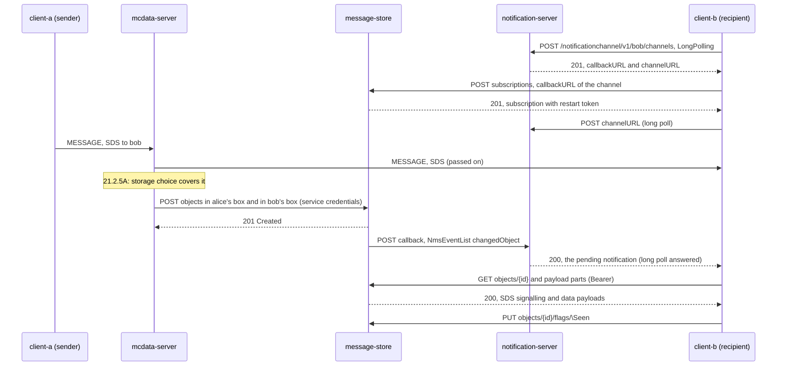
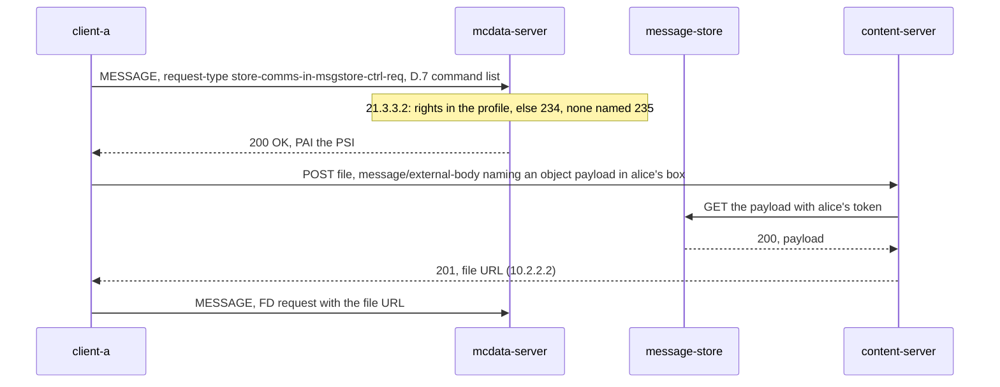

# MCData message store tests

These tests cover the **MCData message store** (TS 24.282 V19.7.0 clause 21, TS 23.282 §7.13):

- the message store function (MCData-7 for the clients, MCData-8 for the MCData server);
- the MCData notification server (MCData-10 and MCData-11);
- the control of communications storage (§21.3);
- upload by reference of a file kept in the message store (§10.2.2).

What the tests do not cover is listed under [coverage gaps](#coverage-gaps).

Back to the [MCData test index](../MCDATA_TEST.md).

## Implemented profile

TS 24.282 clause 21 bases MCData-7 and MCData-8 on the OMA RESTful Network Message Storage API (OMA-TS-REST_NetAPI_NMS-V1_0), and MCData-10 on the OMA NotificationChannel API (OMA-TS-REST_NetAPI_NotificationChannel-V1_0). Neither OMA specification is supplied with this repository. The resources, JSON roots and field names below follow NMS V1.0 as TS 24.282 names them; where it does not name them, they are this implementation's reading (see [local choices](#local-choices)).

| Procedure | Behavior | Reference |
|---|---|---|
| Access | HTTPS through the HTTP proxy (`/msgstore`, `/notification`). A client presents its MCData access token, and reaches only the box named by its MCData ID (403 otherwise). The MCData server authenticates with the system's service credentials. An account, with its root folder and an Inbox, is created on first use. | §21.1, TS 23.282 §7.13.1, §7.13.2, §7.13.3.7 |
| Deposit | After an SDS or FD request is passed on, the participating function deposits it for the originator and for each recipient it serves, when their storage choice covers it. An SDS is deposited with its SDS SIGNALLING PAYLOAD and DATA PAYLOAD as payload parts, plus attributes: Date, Direction, Request-Type, From, To, Group-Id, Message-Id, Conversation-Id, and Text for a clear text payload. A file is deposited by its content server URL, and the store fetches it into the user's area (`retrieveFile` absent or "Yes"). | §21.2.5A |
| Objects | `/nms/v1/{store}/{boxId}/objects`: retrieve, create (JSON, or multipart/form-data with root-fields and attachments), delete, flags (list, replace, add, remove), payload and payload parts (a part still at the content server redirects to it), `retrieve` | §21.2.1, §21.2.3, §21.2.4, §21.2.15, §21.2.24 |
| Operations | `objects/operations/`: `search` (Attribute, Flag, PresentFlag, NotPresentFlag, Date, TextContent, ModifiedSince, and CreatedObjects with a `creationCursor`; VanishedObjects gives the deletions since a mod-seq), `bulkUpdate` (AddFlag and RemoveFlag), `bulkDelete`, `bulkCreation`, `copyToFolder` and `moveToFolder` for objects and folders | §21.2.2, §21.2.3, §21.2.4, §21.2.6, §21.2.10, §21.2.15, §21.2.17 |
| Folders | Create (409 for a duplicate name), retrieve with its subfolders and objects (`root` names the root), delete with its content (the root and the Inbox stay: 403), search by name or attribute, and the hierarchy (FolderReferenceList) when no criteria or scope limit is given | §21.2.7, §21.2.8, §21.2.11, §21.2.18, §21.2.23 |
| Subscriptions | `subscriptions`: create with a callback URL, update (lifetime, and a restart from an index with the restart token), delete. Each change is recorded as an NmsEvent (changedObject, deletedObject, changedFolder, deletedFolder). The events after a subscription's index are POSTed to its callback as an NmsEventList with the callback data, the index and the restart token, and retried on failure. | §21.2.12A, §21.2.13A, §21.2.14A, §21.2.16.1 |
| Notification server | `/notificationchannel/v1/{userId}/channels`: create a LongPolling channel (callbackURL and channelURL), read, delete, and update its lifetime. The message store POSTs its notifications to the callback with the service credentials, and the client long-polls the channelURL. | §21.2.16.3, §21.2.19–§21.2.22 |
| Storage control | The request-type `store-comms-in-msgstore-ctrl-req` with `<store-all-private-comms-in-msgstore>`, `<store-all-group-comms-in-msgstore>`, `<store-specific-private-comms-in-msgstore>`, `<store-specific-group-comms-in-msgstore>` and the Annex D.7 `msgstore-ctrl-command-list` body. The rights come from the profile's `store_comms`, `store_private_comms` and `store_group_comms`. The refusals are 234 (not authorised, all or per group) and 235 (no user or group named). Success is answered 200, asserting the PSI. | §21.3.2, §21.3.3, D.7 |
| Upload by reference | A `message/external-body` part (access-type URL) naming an object's payload in the uploader's own account. The media storage function fetches it with the uploader's token and stores it like an upload (403 for another account's payload). `fd-send ref=<object>` then sends it. | §10.2.2.1 NOTE 3, §10.2.2.2 |

### Local choices

| Choice | Reason |
|---|---|
| The JSON names of NMS V1.0 as recalled: `object`, `objectList`, `selectionCriteria`, `folder`, `folderReferenceList`, `targetSourceRef`, `bulkUpdate`, `nmsSubscription`, `nmsSubscriptionUpdate`, `nmsEventList`, `notificationChannel`, `notificationList`, `requestError` with SVC and POL message IDs | The OMA specifications are not supplied. |
| The attributes of a deposited communication (Direction, Request-Type, From, To, Group-Id, Message-Id, Conversation-Id, Text) | TS 23.282 §7.13.3.8 names only the object; its content is left open. |
| Storage choices are kept in the participating function's memory | TS 24.282 §21.3.3.2 step 5 says "update or store the record" without a lifetime. |
| §21.3.3.2 step 4f (a resource-lists body for the specific variants) accepts the D.7 body instead | The client procedure (§21.3.2.2 step 6) sends the users and groups in the D.7 body, not in resource-lists. |
| The client leaves the `<allow-store-comms-in-msgstore>` check to the participating function | The server check (234) is the one tested. |
| A long poll waits at most 9 s (8 s by default) | The HTTP proxy waits 10 s for a response header. |
| Only LongPolling channels | WebSocket and native channels need a transport the lab does not have. |
| In the proxy, a backslash may appear only in the last segment of a flags path | NMS flag names are `\Seen`, `\Flagged` and so on; any other backslash is still refused. |

### Client commands

```bash
mcx-client --config FILE --command 'mcdata-msgstore-ctrl enable|disable [all-private] [all-group] [private=<ID>,...] [group=<ID>,...]'
mcx-client --config FILE --command 'mcdata-msgstore sync|get <id>|payload <id> [part]|search name=value... flag=<flag>'
mcx-client --config FILE --command 'mcdata-msgstore flag|unflag <id> <flag>|bulk-flag <flag> <id>...|delete <id>...'
mcx-client --config FILE --command 'mcdata-msgstore folders|folder <id|root>|folder-search <name>|folder-create <name> [parent]|folder-delete <id>'
mcx-client --config FILE --command 'mcdata-msgstore move|copy|move-folder|copy-folder <target folder> <id>...'
mcx-client --config FILE --command 'mcdata-msgstore upload <path> [folder]|retrieve <id>|subscribe|restart <index>|unsubscribe'
mcx-client --config FILE --command 'fd-send ref=<object id> <MCData ID>'
```

The client status has `msgstore`: the local copy of the objects (from the synchronisation and the notifications), the folders, the last request and its answer, the notifications received, and the channel and subscription. The MCData server status has `msgstore` (controls, refusals, deposits, failures).

## Call flows

### Deposit of an SDS and notification of the recipient (MS-01 to MS-06)

SIP passes through the SIP core, and HTTP through the HTTP proxy; both are omitted.



### Storage control and upload by reference (MS-10 to MS-12)



## Run a separate lab

```bash
python3 tools/prepare-prearranged-test.py --directory artifacts/msgstore-lab --project openmcx-msgstore \
  --debug-sip --mcdata --msgstore --image openmcx:0.69-msgstore
C=".cache/deps/docker-compose-linux-x86_64 -p openmcx-msgstore -f artifacts/msgstore-lab/compose.json"
$C up -d --wait
python3 tests/integration/mcdata_msgstore_scenario.py --compose artifacts/msgstore-lab/compose.json \
  --artifacts artifacts/msgstore-lab/artifacts --project openmcx-msgstore
```

`--msgstore` gives the storage rights:

| User | Rights |
|---|---|
| client-a | Private and group communications (its group allows storage) |
| client-b | Private communications only |
| client-c | No `<allow-store-comms-in-msgstore>` |
| client-d | Storage, but not of private communications |

Every lab now runs a `message-store` and a `notification-server` container.

## Performed tests

Recorded on **2026-09-25** against image `openmcx:0.69-msgstore` (`ebb21427490c`), built from branch `mcptt-mcdata`. The scenario report (`artifacts/ms-lab-3/artifacts/mcdata-msgstore.json`) records **PASS** with 81 checks.

| ID | Checks |
|---|---|
| MS-01 | Enabling all private and group communications, and the communications with one user (D.7 body): 200 asserting the PSI |
| MS-02 | Refusals: 234 without `<allow-store-comms-in-msgstore>`, 234 for private communications without their right, 235 with nothing named, 234 for a group that does not allow storage |
| MS-03 | A one-to-one SDS is deposited for its sender (outgoing, in the Inbox, with its two MCData parts) and its recipient (incoming, from the sender) |
| MS-04 | A group SDS is deposited for the sender only, the member that does not store group communications has none |
| MS-05 | After disabling one user, the sender no longer stores its SDS to that user; the recipient still does |
| MS-06 | A file distribution is deposited, and the message store fetched the file from the content server into the user's area (the payload's SHA-256 matches the file) |
| MS-07 | Retrieve; set and remove flags; search by attribute and flag; create a folder; list the hierarchy; move into the folder; list the folder; copy into the Inbox; search folders by name; copy a folder with its content; delete it; the Inbox cannot be deleted (403); bulk flag update; client upload; delete; a synchronisation (CreatedObjects and VanishedObjects) drops the deleted object and keeps the uploaded one |
| MS-08 | Another user's storage area is refused (403) |
| MS-09 | A LongPolling channel and a subscription naming its callback; a deposit reaches the client through the channel with its index, restart token and callback data |
| MS-10 | Restarting the subscription from index 0 resends the earlier changes |
| MS-11 | A file of the message store is sent by reference; the recipient downloads it and verifies its hash |
| MS-12 | Unsubscribing removes the channel and the subscription |

The MCData server recorded 4 storage controls, 4 refusals, and 12 deposits with no failures. Go unit tests (`services/internal/common/msgstore_test.go`) cover the store, the notification server and upload by reference. `services/cmd/mcx-http-proxy/main_test.go` covers the proxy routes and what they keep out of reach.

Regression on the same image, where every lab now also runs the message store and the notification server:
- the six MCData scenarios (SDS, FD, release, status, media plane, IP connectivity) and the protected MCData scenario passed;
- `run_all_call_types.sh` (8 call types) passed;

The media plane scenario first failed one check, MP-20: it read the server's periodically written status file once, before the file was refreshed. The check now waits, and the scenario then passed.

## Coverage gaps

| Area | Gap |
|---|---|
| OMA conformance | The NMS and NotificationChannel resources are implemented from TS 24.282 clause 21 and a reading of the OMA APIs, not against the OMA specifications or their test suites. Object attributes, the full SelectionCriteria (sorting, text search on payloads), bulk creation with attachments, and the `summary` and `payload` variants of NMS V1.0 are subsets. |
| Notification channels | LongPolling only; no WebSocket or native (push) channel. An in-band callback to a client (§21.2.16.2) is possible only for a client that runs an HTTPS server, which the lab client does not. |
| Storage records | Storage choices are kept in memory by the participating function and lost when it restarts. The message store itself persists its boxes. |
| What is deposited | SDS and FD over HTTP (one-to-one and group). SDS and files over the media plane, IP connectivity and communication release are not deposited. Protected (end-to-end encrypted) payloads are deposited as they are, which the store cannot read. |
| Security | MCData-8 and MCData-11 use the system's service credentials over TLS. The TS 33.180 mechanisms for these interfaces are not implemented. |
