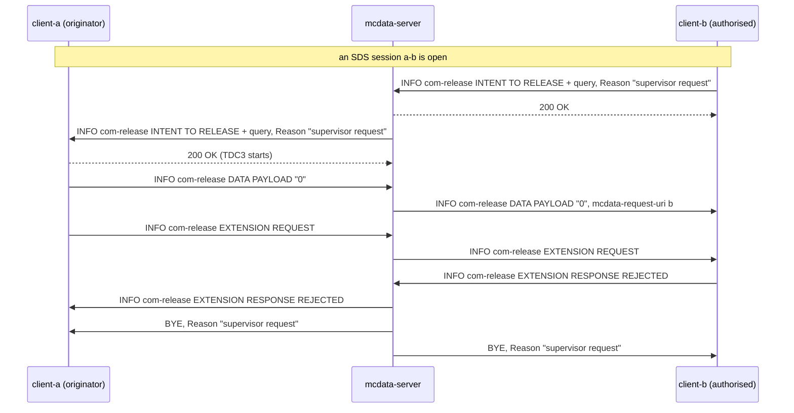

# MCData communication release tests

These tests cover the **release of MCData communications** (TS 24.282 V19.7.0 clause 13) over the media plane: SDS sessions, file distribution using the media plane and IP connectivity. They also cover the authorised user's release with prior indication of a file distribution over HTTP (§13.2.6.3), which completes the HTTP release procedures recorded in the [FD over HTTP tests](MCDATA_FD_TEST.md) (§13.2.3.3, §13.2.4.5 and §13.2.5.3). The recorded results cover the implemented subset below, not complete conformance.

Back to the [MCData test index](../MCDATA_TEST.md). The communications being released are described in the [media plane tests](MCDATA_MEDIA_TEST.md) and the [IP connectivity tests](MCDATA_IPCONN_TEST.md). Acceptance row: MD-REL-01 in the [MCData acceptance matrix](../../docs/architecture/mcdata-standards-and-acceptance.md).

## How it works

- **Who decides.** `mcdata-server` combines the participating and controlling functions, so the controlling function's decisions (§13.2.2.2.4) are taken where the participating function's relaying would happen, and the relaying steps collapse into one hop.
- **Leaving.** A client leaves with BYE. The server then applies the release policy. A one-to-one communication ends when one participant is left (§13.2.2.2.4.2 step 3). A group communication ends when one or no participant is left, or, by local policy (`mcdata.release.initiator_leave`, on by default), when its initiator leaves (§13.2.2.2.4.1 steps 3 and 4). Otherwise only the leaving participant's leg ends. An authorised user's BYE carrying `Reason: SIP;cause=200;text="User requested release"` ends an ad hoc group communication for everyone (§13.2.2.2.4.3 step 3A).
- **Limits.** The originating leg of each session or transfer measures the time since setup and the octets relayed. Past `mcdata.release.max_duration_ms` or `mcdata.release.max_bytes`, the server releases the communication (§13.2.2.2.4.1 and §13.2.2.2.4.2 steps 1 and 2). It sends each leg a BYE with `Reason: SIP;cause=200;text="time limit expiry"` or `"data volume limit"` (§13.2.3.2.4). With `mcdata.release.prior_indication` set, it first announces the release (§13.2.4). An IP connectivity session is measured the same way and always released without prior indication.
- **Prior indication.** The server sends the originator a SIP INFO request of the `g.3gpp.mcdata-com-release` package. The request carries a COMMUNICATION RELEASE message with `INTENT TO RELEASE` (and the Data query type when it wants the remaining data) and a Reason header field (§13.2.4.4.1). Timer TDC3 (`mcdata.release.tdc3_ms`) starts when the INFO is answered 200. The originator may report its remaining data in a DATA PAYLOAD and may ask for an extension. The server answers `EXTENSION RESPONSE` per `mcdata.release.accept_extension`: an accepted extension starts the limits again; a refusal, or TDC3 expiring, releases the communication.
- **Authorised users.** A participant whose profile has `release_any_user` may release the communication at once with `AUTH USER RELEASE REQ` (§13.2.5.2), or announce it with `INTENT TO RELEASE` (§13.2.6.2). In the second case the server passes the originator's remaining data and extension request to that user, and passes the user's `EXTENSION RESPONSE` back to the originator. Anyone else is refused with 403.
- **Operator.** `release-session <key or dialog> [reason]` and `release-session-intent <key or dialog> [query] [reason]` on the server's control FIFO trigger the release by policy for a session, a transfer or an IP connectivity session.

## Implemented profile

| Step | Behaviour | Reference |
|---|---|---|
| Codec | COMMUNICATION RELEASE: message type `0x0a`, the Comm release information type (`INTENT TO RELEASE`, `EXTENSION REQUEST`, `EXTENSION RESPONSE`, `AUTH USER RELEASE REQ`), and the type 1 Data query type (IEI `B`, `REMAINING AMOUNT OF DATA`) and Extension response type (IEI `C`) IEs; reserved values, repeated and unknown IEs are rejected | §15.1.10, §15.2.19–§15.2.21 |
| Leave policy | One-to-one: released when one participant is left. Group: when one or none is left, or when the initiator leaves (local policy). Ad hoc: by an authorised user's BYE with `User requested release` | §13.2.2.2.4.1–§13.2.2.2.4.3 |
| Server release | Time and data limits per communication, or an operator command; BYE to each leg with `Reason: SIP;cause=200;text="..."`; the client shows the reason | §13.2.3.2 |
| Intent and extension | INFO `g.3gpp.mcdata-com-release` with `Content-Disposition: Info-Package` and the reason; TDC3 from the 200; the remaining data as one TEXT payload; the extension request answered and applied | §13.2.4.2, §13.2.4.4 |
| Authorised user, at once | `AUTH USER RELEASE REQ` with `<mcdata-client-id>`; 200 and release with the user's reason, or 403 | §13.2.5.2 |
| Authorised user, with prior indication | `INTENT TO RELEASE` from the user, passed to the originator with the user's reason; the remaining data and the extension request passed to the user with `<mcdata-request-uri>`; the user's `EXTENSION RESPONSE` passed to the originator; a refusal or TDC3 releases | §13.2.6.2 |
| IP connectivity | Limits, operator release and `AUTH USER RELEASE REQ` on either leg; both legs released with the reason | §13.2.3.2, §13.2.5.2 |
| FD over HTTP, authorised user with prior indication | FD HTTP TERMINATION `INTENT TO RELEASE COMM OVER HTTP` from an authorised user with its reason, passed to the originator; the originator's extension request passed to the user; the user's `EXTENSION RESPONSE` passed to the originator; a refusal or TDC3 stops the transmission, and the user receives `RELEASE SUCCESS` (or `RELEASE FAILED` when it accepted the extension) | §13.2.6.3 |

The server's configuration is `mcdata.release`, with the keys `max_duration_ms`, `max_bytes`, `prior_indication`, `tdc3_ms`, `accept_extension` and `initiator_leave`. The time and data limits are off unless set. The user profile's `release_any_user` authorises a user to release other users' communications. The server status lists `pending_releases` (initiator, reason, whether TDC3 runs, whether an extension was requested, and the remaining data), plus `relayed_bytes` and `dialog` per media leg and `dialog` per IP connectivity session. It counts `releases_policy`, `releases_server`, `releases_authorised`, `release_intents`, `extensions_accepted` and `extensions_rejected`.

### Client commands and status

```bash
mcx-client --config FILE --command 'mcdata-release extend'                    # originator: ask for an extension
mcx-client --config FILE --command 'mcdata-release now [reason]'              # authorised user: release at once
mcx-client --config FILE --command 'mcdata-release intent [query] [reason]'   # authorised user: announce the release
mcx-client --config FILE --command 'mcdata-release accept|reject'             # authorised user: answer an extension request
mcx-client --config FILE --command 'mcdata-release ipcon now [reason]'        # the same on the IP connectivity session
mcx-client --config FILE --command 'sds-session close all'                    # BYE with "User requested release"
mcx-client --config FILE --command 'fd-release-intent <message ID> [reason]'  # FD over HTTP (13.2.6.3)
mcx-client --config FILE --command 'fd-extension-response accept|reject <message ID>'
```

`status.json` records `mcdata_release` with these fields:
- `state`: `release-pending`, `extension-requested`, `extended` or `extension-refused`
- the `reason`, and whether the intent carried a data `query`
- the remaining data reported (`remaining_reported`) or received (`remaining`)
- the last request sent (`last_action`) and its SIP status (`last_status`)

A communication released with a reason shows it as `release_reason` in `mcdata_media_result` or `mcdata_ipconn`.

## Fixture and commands

The fixture is the one of the [SDS tests](MCDATA_SDS_TEST.md#separate-four-client-fixture), with `--mcdata-release`. It sets a 20 s time limit and a 5000-byte data limit, releases without prior indication, runs TDC3 for 5 s and accepts extension requests. The media idle timer stays at 25 s, so the time limit is what ends an idle session. client-b holds `release_any_user`; client-c does not.

```bash
docker build -t openmcx:0.46-mcdata -f docker/Dockerfile .
python3 tools/prepare-prearranged-test.py --directory artifacts/release46-lab --project openmcx-release46 \
  --debug-sip --private-call --mcdata --mcdata-release --image openmcx:0.46-mcdata
C=".cache/deps/docker-compose-linux-x86_64 -p openmcx-release46 -f artifacts/release46-lab/compose.json"
$C up -d mcdata-server                      # start the capture before the clients authorise
docker run -d --rm --name openmcx-release46-capture --network "container:$($C ps -q mcdata-server)" \
  --cap-drop ALL --cap-add NET_RAW openmcx-dev:0.1 \
  sh -c "tcpdump -Z root -i eth0 -U --immediate-mode -s 0 -w /tmp/c.pcap 'tcp port 5060'"
$C up -d
python3 tests/integration/mcdata_release_scenario.py \
  --compose artifacts/release46-lab/compose.json --artifacts artifacts/release46-lab/artifacts --project openmcx-release46
docker cp openmcx-release46-capture:/tmp/c.pcap artifacts/release46-lab/artifacts/integration/mcdata-release.pcap
python3 tests/integration/verify_mcdata_release.py artifacts/release46-lab/artifacts/integration/mcdata-release.pcap \
  --service sip:mcdata@mcx.test --output artifacts/release46-lab/artifacts/integration/mcdata-release-sip-wire.json
docker rm -f openmcx-release46-capture        # the reports and the capture are kept; the lab is not
$C down -v
```

## Performed tests

Recorded on **2026-09-23** against image `openmcx:0.46-mcdata` (`89f593704af5`), built from branch `mcdata-phase1` on top of `fd8b7e0`, TS 24.282 V19.7.0, clear SIP (debug mode), in a fresh lab captured from the first request. Every report records **PASS**: 57 scenario assertions and 26 wire checks on one MCData server instance. On the same image the media plane, SDS, FD over HTTP, IP connectivity and all MCPTT call-type regressions passed unchanged. On `openmcx:0.47-mcdata` (`72745e819dbc`), which adds enhanced status, each suite passed again in a fresh lab: the communication release (57, 26) and enhanced status (11, 6) scenarios, the media plane (128, 63), SDS (163, 64), FD over HTTP (64, 38), IP connectivity (31, 22) and every MCPTT call type on one server instance (prearranged 21, failure/refresh 15, broadcast 56, private 96, chat 67, ad hoc 81, remote group 20, ambient listening 51).

| ID | Scenario | Result evidence |
|---|---|---|
| REL-01 | Group policy: a participant that leaves a group SDS session is released alone and the others continue; the initiator leaving releases every participant | Scenario report (`artifacts/release46-lab/artifacts/integration/mcdata-release-results.json`) |
| REL-02 | One-to-one policy: the other party leaving releases the originator, with no reason | Same report |
| REL-03 | Data limit: past 5000 bytes both parties are released with `data volume limit` | Same report |
| REL-04 | Time limit: after 20 s both parties are released with `time limit expiry`, before the idle timer | Same report |
| REL-05 | Operator release without prior indication, with the operator's reason | Same report |
| REL-06 | Intent to release with the data query and reason; the originator reports its remaining data, which the server stores; the extension request is accepted and the session outlives TDC3 | Same report |
| REL-07 | Intent without a data query and no extension request: TDC3 expires and both parties are released with the reason | Same report |
| REL-08 | An authorised user releases at once with its reason (200); a user without the authorisation is refused with 403 and the session continues | Same report |
| REL-09 | An authorised user announces the release: the originator receives the intent with the user's reason, the remaining data and the extension request reach the user, and the user's refusal reaches the originator and releases the session | Same report |
| REL-10 | Ad hoc group session: an ordinary participant leaves alone; the authorised user's BYE with `User requested release` ends it for everyone | Same report |
| REL-11 | IP connectivity: an operator release and an authorised user's release both end the two legs with the reason | Same report |
| REL-12 | FD over HTTP: an authorised user announces the release with its reason, receives the originator's extension request and refuses it; the originator learns the refusal and the transmission is stopped; the user receives `RELEASE SUCCESS` | Same report |
| REL-13 | SIP wire checks (26), with the COMMUNICATION RELEASE, DATA PAYLOAD and FD HTTP TERMINATION bodies decoded independently of the C++ codec: the INFO package and Content-Disposition; intents with and without the data query and with a reason; the TEXT payload of the remaining data; extension requests and responses (ACCEPTED and REJECTED); `AUTH USER RELEASE REQ` with the client ID, answered 200 and 403; the authorised user's intent and the requests passed to it with `<mcdata-request-uri>`; BYEs carrying each of seven reasons in RFC 3326 form, and `User requested release`; and the five FD HTTP TERMINATION steps of §13.2.6.3 | Wire report (`artifacts/release46-lab/artifacts/integration/mcdata-release-sip-wire.json`), capture (`artifacts/release46-lab/artifacts/integration/mcdata-release.pcap`) |
| REL-14 | Unit tests of the COMMUNICATION RELEASE codec: byte-exact intent with data query (`0a 01 b1`), extension response (`0a 03 c2`) and `AUTH USER RELEASE REQ` (`0a 04`), and six rejections | `test_mcdata` in the image build |

These tests exposed a fault in the SIP engine that affected every in-dialog request a client sends on an INVITE dialog. When the SIP core challenges such a request, pjsip's INVITE session layer sends it again with its own credentials. The engine had reported the 407 challenge as the final answer, and the real answer was lost, so a 403 never reached the client. The engine now hands the request's handler to the transaction that pjsip sends again, with the next CSeq.

## High-level call flow (authorised user with prior indication)



## Coverage gaps

| Area | Gap |
|---|---|
| Topology | The participating and controlling functions are collocated. |
| Policies | The minimum number of affiliated group members (§13.2.2.2.4.1 step 5) is not checked. The limits are one per server, not per group or per user. The remaining data a client reports is what it still holds to send (0 for an idle session), not an application's estimate. |
| IP connectivity | Prior indication is not implemented for IP connectivity (§13.2.4.1 limits it to SDS and FD, but §13.2.6.2 names IPCONN). |
| Standalone SDS over the media plane | A standalone transfer lasts one message, so it has no key and no limits apply to it. |
| Wire qualification | Clear SIP only (debug mode); in-repository decoders; no independent-peer run. |
