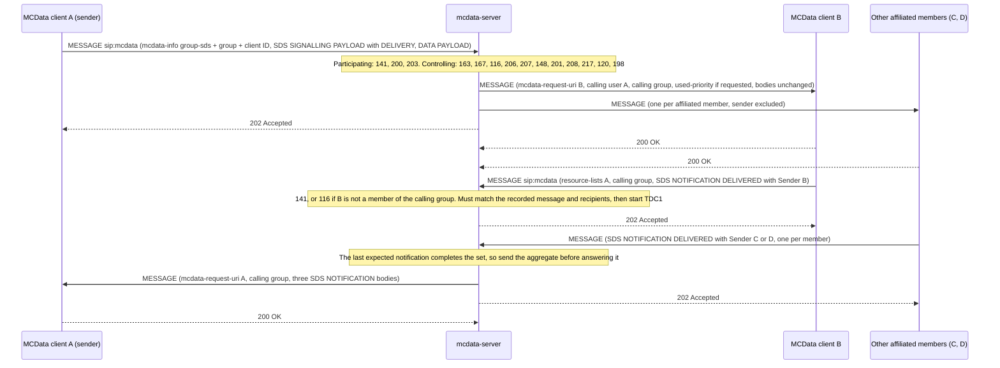

# MCData standalone SDS tests

These tests cover **MCData short data service (SDS) sent as standalone messages over the signalling control plane** (TS 24.282 V19.7.0 §9.2.2), with MCData service authorisation (§7), MCData affiliation (§8) and SDS disposition notifications (§12.2). The features built on top of standalone SDS have their own documents: [ad hoc group SDS](MCDATA_ADHOC_SDS_TEST.md), [functional aliases](MCDATA_FUNCTIONAL_ALIAS_TEST.md), [affiliation status](MCDATA_AFFILIATION_TEST.md), [disposition handling](MCDATA_DISPOSITION_TEST.md) and [group emergency alerts](MCDATA_EMERGENCY_ALERT_TEST.md). This document also holds the fixture and the coverage gaps they share. The recorded results cover the implemented subset below, not complete MCData conformance. SDS over the media plane, SDS sessions, file distribution, IP connectivity and payload protection are not implemented; see [coverage gaps](#coverage-gaps).

Back to the [MCData test index](../MCDATA_TEST.md). File distribution is in the [FD tests](MCDATA_FD_TEST.md). Acceptance: [MCData acceptance matrix](../../docs/architecture/mcdata-standards-and-acceptance.md).

## How it works

- **Deployment.** `mcdata-server` (`openmcx-mcdata-server`) is its own container and SIP application server. Its public service identity is `sip:mcdata@DOMAIN`, and Kamailio routes requests for it there. It combines the participating and controlling MCData functions. The MCData client is a module of `mcx-client` and shares the UE's single SIP registration with the MCPTT client (§7.1).
- **Identities.** Each user has a distinct MCData ID (`sip:<user>.mcdata@DOMAIN`), carried in the IdMS access token (`mcdata_id`) and served by the CMS.
- **Service authorisation.** After MCPTT authorisation, the client sends PUBLISH `poc-settings` to the MCData PSI with an `mcdata-info` body (access token, client ID) and a `poc-settings` body. The server checks the token against the IdMS's keys and binds MCData ID, client ID and public user identity.
- **Affiliation.** PUBLISH `presence` with `mcdata-info` (own MCData ID) and a PIDF in the `urn:3gpp:ns:mcdataPresInfo:1.0` namespace. The server checks MCData group membership in the GMS.
- **SDS.** A SIP MESSAGE to the MCData PSI carries three bodies: `mcdata-info` (`request-type` `one-to-one-sds` or `group-sds`), the binary SDS SIGNALLING PAYLOAD and the binary DATA PAYLOAD (clause 15, MONP coding). One-to-one SDS also carries a `resource-lists` body with the target. The server checks transmission control (§11.1), relays the binary bodies unchanged to each target with `mcdata-request-uri`, `mcdata-calling-user-id` and, for a group, `mcdata-calling-group-id`, and answers **202 Accepted**.
- **Dispositions.** The receiving client sends an SDS NOTIFICATION to the original sender (named in `resource-lists`): DELIVERED at once for "delivery"; READ after a display indication for "read"; for "delivery and read", DELIVERED AND READ if displayed before timer TDU1, otherwise DELIVERED at TDU1 expiry and READ after display.

## Implemented profile

| Step | Behaviour | Reference |
|---|---|---|
| Authorisation | Token check (TS 33.180 annex B.11.2); MCData ID, client ID and SIP identity must match; 403 `101` otherwise; Expires 0 logs off | 24.282 §7.2.2, §7.3.3, §7.3.5 |
| Affiliation | MCData PIDF; groups must list the user as an MCData member; Expires 0 de-affiliates, with or without a PIDF body | §8.2.2 (V19.7.0 NOTE 1), §8.3, §8.4.1 |
| Sender binding | Unknown or expired sender → 404 `141` | §9.2.2.3.1 step 3 |
| Bodies | Missing `mcdata-info`, signalling or payload → 403 `199`; malformed, reserved or protected TLV content → 400 | §9.2.2.4.2 step 2, §15.2 |
| One-to-one checks | `200` no `<allow-transmit-data>`; `202` over `<MaxData1To1>`; `229` target outside `<One-to-One-Communication>`; `203` over the signalling-plane limit; `218` over the one-to-one SDS size; `204` no single target; `404` target not bound; `230` sender outside the target's `<IncomingOne-to-OneCommunicationList>` | §9.2.2.3.1 steps 7–8, §9.2.2.4.2 step 5, §9.2.2.3.2 step 3a, §11.1 |
| Group checks | `163` unknown group, `167` preconfigured use only, `116` not an MCData member, `206` SDS not allowed, `207` (488) no SDS enabler, `148` regrouped, `201` no transmit permission on the group, `208` over the per-request limit, `217` over the group SDS size, `120` sender not affiliated, `198` no other affiliated member | §9.2.2.4.2 step 6 |
| Delivery | Only affiliated members, sender excluded; binary bodies unchanged; P-Asserted-Service `urn:urn-7:3gpp-service.ims.icsi.mcdata.sds` | §9.2.2.4.1.1, §6.3.4 |
| Priority | The sender's `<user-requested-priority>` is delivered as `<used-priority>` (local policy keeps the value) and removed; the receiving client records it | §9.2.2.2.1, §9.2.2.4.1.1 step 5c, §9.2.2.2.2 step 3A |
| Reception | User payloads are rendered; a known Application ID goes to its application; an unknown one is discarded without user notification; conversation threading by Conversation ID and InReplyTo | §9.2.1.2 |
| Notifications | Relayed to the sender named in `resource-lists`, checked against the recorded message and its recipients; one that cannot be correlated with a recorded message (kept `mcdata.disposition_wait_ms`, 24 h by default) is refused 403 `216`; group notifications need MCData group membership (`116`) | §9.2.1.3, §12.2.1–12.2.3 |

Configuration: the CMS serves the MCData ruleset as `mcdata` on the internal user resource (`transmit_data`, `targets`, `incoming_from`, `incoming_any`, `max_data_1to1`) and grants `<allow-transmit-data>` in the user profile document. The GMS serves `mcdata` on groups (`members`, `sds_supported`, `allow_sds`, `transmit_members`, `max_sds_bytes`, `max_request_bytes`). Service limits are in `mcdata-server.json` (`max_payload_size_sds_cplane_bytes`, `max_data_size_sds_bytes`). Element names follow their references in TS 24.282 because TS 24.484 and TS 24.481 are not supplied.

### Client commands and status

```bash
mcx-client --config FILE --command 'sds [delivery|read|both] [app=<n>] [priority=<n>] <MCData ID> <text>'
mcx-client --config FILE --command 'sds-group [delivery|read|both] [app=<n>] [priority=<n>] <group> <text>'
mcx-client --config FILE --command 'sds-reply <received message ID> <text>'
mcx-client --config FILE --command 'sds-display <received message ID>'
mcx-client --config FILE --command 'mcdata-affiliate'      # or mcdata-deaffiliate
```

`status.json` records `mcdata_authorized`, `mcdata_affiliated`, `mcdata_inbox` (received messages, payloads, notifications sent), `mcdata_notifications` (received), `mcdata_sent`, `mcdata_last_result` (status and Warning of the last SDS), `mcdata_discarded`, `mcdata_storage_limit`, `mcdata_undelivered` (messages reported UNDELIVERED), `mcdata_affiliations` and `mcdata_affiliation_subscribed` (from the NOTIFY), `mcdata_affiliation_p_id` (last sent and received) and `mcdata_affiliation_fetch`, and for alerts `mcdata_alert_state`, `mcdata_emergency`, `mcdata_alerts_received` (per group and originator, with organisation, alias, location and count), `mcdata_alert_last_result` and `mcdata_alert_receipts`. The server status records the bindings and affiliations per MCData ID, active functional aliases, ad hoc groups, outstanding `emergency_alerts` per group, `stored_for_redelivery` (recipient, Message ID, attempts) and counters (`undelivered`, `sds_redelivered`, `redelivery_abandoned`, `aggregates`). Each received notification records `aggregated`: the number of notifications in its SIP MESSAGE.

## Separate four-client fixture

```bash
docker build -t openmcx:<tag> -f docker/Dockerfile .
python3 tools/prepare-prearranged-test.py --directory artifacts/mcdata-sds-lab --project openmcx-mcdata-sds \
  --debug-sip --private-call --mcdata --image openmcx:<tag>
C=".cache/deps/docker-compose-linux-x86_64 -p openmcx-mcdata-sds -f artifacts/mcdata-sds-lab/compose.json"
$C up -d mcdata-server                      # start the capture before the clients authorise
docker run -d --rm --name openmcx-mcdata-sds-capture --network "container:$($C ps -q mcdata-server)" \
  --cap-drop ALL --cap-add NET_RAW openmcx-dev:0.2 \
  sh -c "tcpdump -Z root -i eth0 -U --immediate-mode -s 0 -w /tmp/c.pcap 'tcp port 5060'"
$C up -d
python3 tests/integration/mcdata_sds_scenario.py \
  --compose artifacts/mcdata-sds-lab/compose.json --artifacts artifacts/mcdata-sds-lab/artifacts --project openmcx-mcdata-sds
docker cp openmcx-mcdata-sds-capture:/tmp/c.pcap artifacts/mcdata-sds-lab/artifacts/integration/mcdata-sds.pcap
python3 tests/integration/verify_mcdata_sds.py artifacts/mcdata-sds-lab/artifacts/integration/mcdata-sds.pcap \
  --service sip:mcdata@mcx.test --output artifacts/mcdata-sds-lab/artifacts/integration/mcdata-sds-sip-wire.json
docker rm -f openmcx-mcdata-sds-capture        # the reports and the capture are kept; the lab is not
$C down -v
```

`--mcdata` provisions:

| User | MCData ruleset |
|---|---|
| client-a | May transmit; one-to-one targets b and c only; at most 300 bytes per one-to-one request; may initiate ad hoc group SDS; may activate and cancel emergency alerts (organisation `Alpha Fire`) |
| client-b | May transmit; receives one-to-one SDS only from client-a; may initiate ad hoc group SDS; may activate emergency alerts only on `operations-nosds`, and not cancel them |
| client-c | May transmit; no one-to-one limits; not allowed to transmit on the group; may take part in, but not initiate, ad hoc group SDS |
| client-d | Not allowed to transmit data; may not take part in ad hoc group data communication; may cancel any user's emergency alert; implicitly affiliated to `operations-alertonly` |

Service limits are 1000 bytes over the signalling plane and 500 bytes per one-to-one SDS. The group `operations` has all four MCData members, 400 bytes per SDS and 800 per request. The groups `operations-nosds` (SDS not allowed), `operations-nosupport` (no SDS enabler), `operations-alertonly` (members b, c and d), `operations-preconf` (preconfigured use only, 167 and 168) and `operations-regrouped` (regrouped, 148) are added; all but `operations-nosupport` and `operations-regrouped` allow emergency alerts, and the MCPTT-only `operations-parallel` group has no MCData members. Ad hoc group SDS is enabled with at most 3 participants. Functional aliases: `front-desk.fa` (client-a and client-b; one activation; take-over allowed, and client-b holds the take-over permission), `patrol-car-12.fa` (client-c and client-d; two activations) and `incident-commander.fa` (client-a; never activated). TDP1 is 2 s with at most 2 re-delivery attempts; notification aggregation is on with TDC1 3 s. Clients set TDU1 to 3 s so the scripted display can land inside it, and know Application ID 7.

## Performed tests

The SDS scenario (`mcdata_sds_scenario.py`) makes 163 assertions and its wire verifier (`verify_mcdata_sds.py`) 64 checks, clear SIP (debug mode), on one MCData server instance. They cover every MCData SDS feature: the ad hoc, functional alias, affiliation, disposition and emergency alert documents describe parts of the same scenario. The regression runs it in the `mcdata` and `smoke-mcdata` labs, and with protected signalling in `mcdata-xml`.

| ID | Scenario | Result evidence |
|---|---|---|
| SD-00 | All four clients MCData-authorised and affiliated; the server binds each MCData ID to its client and group | Scenario report (`artifacts/integration/mcdata-sds-results.json`) |
| SD-01 | One-to-one text SDS: 202 Accepted, delivered only to the target with the sender and message IDs, rendered to the user | Same report |
| SD-02 | A reply keeps the Conversation ID and carries InReplyTo | Same report |
| SD-03 | DELIVERED notification for a "delivery" request | Same report |
| SD-04 | READ only after the display indication | Same report |
| SD-05 | "Delivery and read": DELIVERED AND READ when displayed within TDU1; DELIVERED at TDU1 expiry and READ after a later display | Same report |
| SD-06 | Application ID 7 delivered to the application; unknown ID 9 discarded and not rendered | Same report |
| SD-07 | One-to-one rejections 200, 202, 229, 203, 218, 230, 204 | Same report |
| SD-08 | Group SDS to every other affiliated member with the group identity; one DELIVERED per recipient naming the group; a group reply in the same conversation | Same report |
| SD-09 | A de-affiliated member receives no group SDS | Same report |
| SD-10 | Group rejections 404/163, 116, 206, 488/207, 167, 148, 201, 208, 217, 200, 120, 198; members re-affiliate. On a `--protected` fixture the first six are refused by the client, which holds no GMK for those groups ([protected payload tests](MCDATA_PROTECTED_TEST.md)) | Same report |
| SD-11 | Application priority: `<user-requested-priority>` 5 (one-to-one) and 3 (group) delivered as `<used-priority>`; none when not requested (V19.7.0 §9.2.2.4.1.1 step 5c) | Same report |
| SD-12 | SIP wire checks (64), with clause 15 bodies decoded independently of the C++ codec: authorisation body; affiliation with a PIDF and de-affiliation with Expires 0 and no PIDF; the affiliation status SUBSCRIBE, its fetch and 403 answers, and the NOTIFY bodies with affiliated groups, the echoed p-id and terminating states; SDS Accept-Contact and P-Preferred-Service; one-to-one and group request shapes; 202; downlink P-Asserted-Service, request URI, calling user and group; unchanged relay of signalling and payload; all three disposition request types; InReplyTo; DELIVERED, READ and DELIVERED AND READ notifications; notification routing; the Sender IE in group notifications, aggregated notifications (one body per notification, calling group, no calling user), every accepted group notification relayed exactly once; `used-priority` replacing `user-requested-priority`; ad hoc request shapes, 202 with the ad hoc group identity and ad hoc delivery; functional alias status change, 300 redirect and follow-up, alias presentation; emergency alert and cancellation shapes with location and `<originated-by>`, alert notifications with `<mc-org>`, receipts with `<alert-ind-rcvd>`, alert rejections with `<alert-ind>`, 168 and 120; UNDELIVERED sent to the server and never relayed, re-delivery bodies identical to the original and only for messages reported UNDELIVERED; 21 SDS rejection warnings | Wire report (`artifacts/integration/mcdata-sds-sip-wire.json`), capture (`artifacts/integration/mcdata-sds.pcap`) |
| SD-13 | Unit tests: byte-exact clause 15 fixtures, reserved, protected, duplicated and truncated content rejected, `mcdata-info` schema order, MCData PIDF, binary multipart | `test_mcdata` in the image build (19/19 native tests on `openmcx:0.27-mcdata`), including `user-requested-priority`, `used-priority` and the UNDELIVERED notification type |

## High-level call flow (group SDS with delivery notification)

Kamailio is omitted: every request and response passes through it, and it adds `P-Asserted-Identity`. The MCData server combines the participating and controlling functions. The order follows the recorded capture: the server relays each message before it answers the sender with 202 Accepted. The recipients' 200 OK responses end at the server; the sender learns about delivery only from the notifications it asked for.



If TDC1 expires before every recipient has reported, the server sends the aggregate at expiry instead. With aggregation off, or for a notification arriving after the aggregate was sent, the server relays each notification on its own, with the notifier as `mcdata-calling-user-id`.

A one-to-one SDS follows the same pattern with a `resource-lists` body naming the single target and no group identity. Its checks are 141, 200, 202, 229, 203, 218, 204, 404 (target not bound) and 230. An ad hoc group SDS also follows it: the sender lists participants or criteria instead of a group, the server checks 238, 239, 242, 241 and 240, generates the ad hoc group identity, relays with that identity as the calling group, and returns it in the 202.

## Coverage gaps

| Area | Gap |
|---|---|
| Media plane | SDS over the media plane (§9.2.3) and SDS sessions (§9.2.4) are covered by the [media plane tests](MCDATA_MEDIA_TEST.md). A payload above the signalling-plane limit is rejected with 203; the client does not switch to the media plane by itself. |
| Temporary groups and regroups | The MCData server refuses a regrouped group with 148 and does not apply temporary groups or act as a non-controlling function (§9.2.2.5); the MCPTT server does ([temporary group tests](../mcptt/TEMPORARY_GROUP_TEST.md)). |
| Security | Payload protection, signalling protection under the CSK and XML confidentiality are covered by the [protected MCData tests](MCDATA_PROTECTED_TEST.md); the scenarios here run clear. XML integrity protection is not implemented. |
| Profiles | The MCData server reads the ruleset and group elements as internal JSON projections. The GMS serves the TS 24.481 group documents over XCAP ([group management tests](../mcptt/GROUP_MANAGEMENT_TEST.md)); the MCData service configuration document is not served. MCData-2 (Diameter to the MCData user database) is not used. |
| Registration | The REGISTER Contact does not carry the MCData media feature tags (§7.2.1); service authorisation uses PUBLISH only. |
| Terminating binding | A one-to-one SDS to a configured user without a binding gets 404 (§9.2.2.3.2 step 3). Not tested: every lab user logs on, and the profiles may name only configured users. |
| Wire qualification | In-repository decoders only; no independent-peer run. Clear SIP (debug mode) only. |