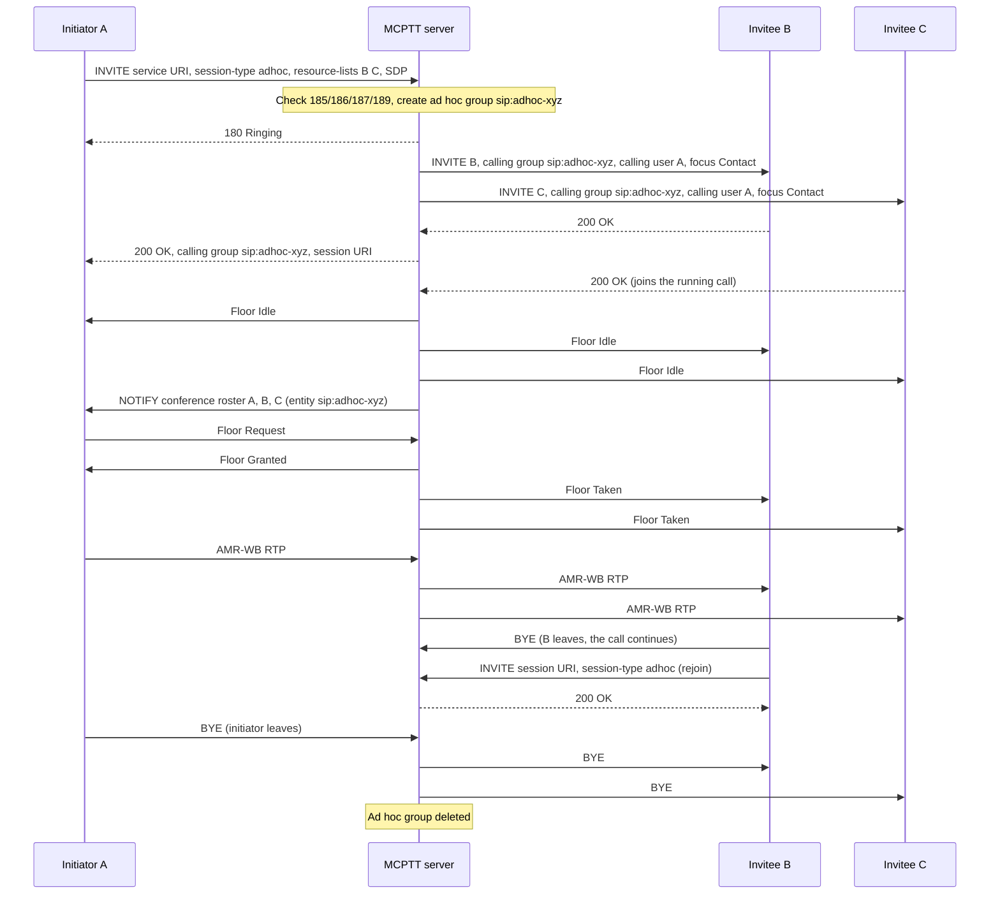

# Ad hoc group call tests

These tests cover **on-network, on-demand ad hoc group calls with an initiator-supplied participant list** (TS 23.379 ad hoc group communication, TS 24.379 clause 17). There is no preconfigured group: the server creates a temporary ad hoc group for the call and deletes it when the call ends. The recorded results cover the implemented subset below, not complete ad hoc conformance. Criteria-based participants, participant modification, emergency and imminent-peril ad hoc calls and ad hoc emergency alerts are covered below; end-to-end security and pre-established sessions are not implemented; see [coverage gaps](#coverage-gaps).

Back to the [test index by call type](../MCPTT_TEST.md).

## How ad hoc works

- **Setup.** The initiator runs `adhoc <MCPTT ID> [<MCPTT ID> …]`. The client sends an INVITE to the service URI with `session-type` adhoc and a `resource-lists` body naming the users to call. No group is named.
- **Admission.** The server checks the initiator's `adhoc_call` ruleset (warning 185), that the service is enabled (186), that the list names someone other than the initiator (187), and the participant limit (189).
- **Ad hoc group.** The server generates a group identity `sip:adhoc-<random>@<domain>`. Each listed user is invited with that identity as the calling group and the initiator as the calling user. Invited users are treated as implicitly affiliated, so they need no prior affiliation.
- **Answer.** The initiator hears ringing, then receives 200 once the first invitee answers. The 200 carries the ad hoc group identity and the `isfocus` session URI. Later answers join the running call, and a decline or an unreachable invitee does not fail it. If no listed user is reachable, the initiator gets 480.
- **During the call.** Floor control and speech work as in a prearranged call. Conference rosters use the ad hoc group identity. A participant who leaves can `rejoin` by session identity; only listed users may do so (warning 188).
- **Release.** The call ends when the initiator leaves (configurable), at the TNG3 call timer (`maximum_duration_ms`), or after inactivity. Unlike prearranged and chat calls, one remaining participant does **not** release it, because §6.3.8.1 item 2 does not list ad hoc calls. The ad hoc group is deleted with the session, and the next call gets a new identity.

Compare a [prearranged call](PREARRANGED_TEST.md), where the group and its members are provisioned in the GMS, and a [chat call](CHAT_CALL_TEST.md), where members join a provisioned group themselves.

## Implemented profile

| Step | Behavior | Reference |
|---|---|---|
| Originating INVITE | `session-type` adhoc, calling user, client ID; `resource-lists` with the invitees; SDP offer. No `mcptt-request-uri` group. | 24.379 §17.2.2.1.1 steps 1–13 |
| Initiator authorization | CMS user profile `adhoc_call.allow` (`<allow-adhoc-group-call>`); if absent → 403 `185 user is not authorised to initiate the adhoc group call`. | §17.3.2.1.1 step 9, §17.4.2.2 step 4 |
| Service support | Server `mcptt.adhoc_call.enabled` (`<allow-adhoc-group-call-support>`); if absent or false → 403 `186 the MCPTT system do not support adhoc group call`. | §17.4.2.2 step 5 |
| Participant determination | The list minus the initiator, duplicates removed, at most 64 entries. An empty result → 403 `187 can't determine the adhoc group participants`. More than `max_participants` (`<max-no-participants>`) → 403 `189 maximum number of allowed adhoc group participants exceeded`. | §17.4.2.2 steps 6–7, 12 a |
| Ad hoc group and invites | Generated group identity; invited with `mcptt-request-uri` = invitee, `mcptt-calling-group-id` = ad hoc group, `mcptt-calling-user-id` = initiator, `Answer-Mode` from policy (default Auto), an `isfocus` Contact, and no `Priv-Answer-Mode`. Invitees are implicitly affiliated. | §17.4.2.1.1, §17.4.2.2 steps 10, 13, 15–16; §17.3.2.1.1 step 12 |
| Answer to initiator | 180, then 200 after the first invitee's 200 (minimum 2 participants), carrying `mcptt-calling-group-id` and the session URI. 408 at `setup_timeout_ms` or 480 if nobody answers. | §17.4.2.2 (200 handling) |
| Rejoin | An INVITE to the session URI with `session-type` adhoc. A listed member is admitted with 200; anyone else gets 403 `188 user is not allowed to participate in adhoc group call`; an unknown session gets 404. | §17.4.4.1.1 |
| Release | The initiator leaving (`end_when_initiator_leaves`, default true), TNG3 `maximum_duration_ms`, or `inactivity_timeout_ms`. The server deletes the ad hoc group with the session and rechecks the initiator's authorization every 2 s. | §6.3.8.1 items 1, 3, 5; §17.4.3 |
| Criteria and modification | `adhoc criteria <criteria>` sends `<call-participants-criterias>` instead of a list; a list together with criteria → 403/187. The server resolves `affiliated:<group>` / `member:<group>`, re-evaluates every 2 s, invites new matches and releases users who no longer match. `adhoc-modify add|remove <ids>` (entries with `method=INVITE`/`BYE`) or `adhoc-modify criteria <criteria>` re-INVITEs the session. That needs `adhoc_call.modify` (else 403/190) and respects the limit (403/189). | §17.2.6, §17.4.5, §17.4.6, §17.4.3.1.2 |
| Emergency / imminent peril | `adhoc emergency|imminent <ids>` sends `<adhoc-emergency-ind>` or `<imminentperil-ind>` with Resource-Priority. The request is authorised by `adhoc_call.emergency` / `.imminent`; otherwise 403 with the indicator false. Combining both indicators → 403/150. Invitations carry the indicator and Resource-Priority, and the floor sets the D/E bit. Priority calls run without TNG3; TNG2 (`emergency_timeout_ms`) releases an emergency ad hoc call. | §17.4.2.2 steps 3A–3D, 13, 14A; §17.4.2.1.1 steps 6–7 |
| Ad hoc emergency alert | `adhoc-alert <criteria>` sends a MESSAGE with `<adhoc-alert-ind>` true and criteria, authorised by `adhoc_call.alert`. The server creates an ad hoc group identity, alerts the users meeting the criteria (re-evaluated every 2 s, with withdrawal for users who leave), confirms to the originator with `<adhoc-alert-ind-rcvd>`, and cancels on `adhoc-alert cancel` (`adhoc_call.alert_cancel`). After the 200 to a cancellation it sends the originator a receipt with `<adhoc-alert-ind>` false and `<adhoc-alert-ind-rcvd>` true (§12.1A.3.2 step 4 g)); the client is in AH-MEA 4 (cancel pending) from the request until that receipt, then AH-MEA 1 (§12.1A.1.2, §12.1A.1.3). `adhoc [emergency] alert-group` sets up a call on that group with `<adhoc-grp-emg-alert-grp-ind>`, inviting the alerted users or joining the ongoing session. | §12.1A.1, §12.1A.3; §17.4.2.2 steps 7A–7B, 12d |
| Not permitted | Group-style emergency or alert indications → 403/150; protected (end-to-end) SDP → 488. |

Configure the service in the server's `mcptt.adhoc_call` (for example `{"enabled": true, "max_participants": 8}`) and per-user permission in `config/lab.json` (`"adhoc_call": {"allow": true}`). The default provisioning enables both for alice and bob.

### Client commands

```bash
mcx-client --config FILE --command 'adhoc sip:bob.mcptt@mcx.test sip:client-c.mcptt@mcx.test'
mcx-client --config FILE --command answer      # invitee in manual mode; reject declines (480 + warning 110)
mcx-client --config FILE --command rejoin      # rejoin the last ad hoc call by session identity
mcx-client --config FILE --command 'adhoc criteria affiliated:sip:operations-parallel@mcx.test'
mcx-client --config FILE --command 'adhoc-modify add sip:client-c.mcptt@mcx.test'   # or: remove ..., criteria ...
mcx-client --config FILE --command 'adhoc emergency sip:bob.mcptt@mcx.test'        # or: adhoc imminent ...
mcx-client --config FILE --command 'adhoc-alert affiliated:sip:operations-parallel@mcx.test'
mcx-client --config FILE --command 'adhoc emergency alert-group'                    # call the alert's ad hoc group
mcx-client --config FILE --command 'ptt /artifacts/speech/alpha.wav'
mcx-client --config FILE --command hangup
```

`call_type` is `adhoc`, and `call_group` holds the generated ad hoc group identity. A rejected setup reports `last_call_failure` (`status`, `warning`).

## Separate four-client fixture

```bash
docker build -t openmcx:0.6-adhoc -f docker/Dockerfile .
python3 tools/prepare-prearranged-test.py --directory artifacts/adhoc-lab --project openmcx-adhoc \
  --debug-sip --adhoc --image openmcx:0.6-adhoc
mkdir -p artifacts/adhoc-lab/artifacts/speech
cp artifacts/speech/{alpha,bravo}.wav artifacts/adhoc-lab/artifacts/speech/
.cache/deps/docker-compose-linux-x86_64 -p openmcx-adhoc -f artifacts/adhoc-lab/compose.json up -d
```

`--adhoc` enables the service with `max_participants=3`, `setup_timeout_ms=5000` and `maximum_duration_ms=30000`. It allows ad hoc calls for clients a–c and denies client-d.

Capture the server namespace, then run and verify:

```bash
SERVER=$(.cache/deps/docker-compose-linux-x86_64 -p openmcx-adhoc -f artifacts/adhoc-lab/compose.json ps -q mcptt-server)
docker run --rm --name openmcx-adhoc-capture --network "container:$SERVER" --cap-drop ALL --cap-add NET_RAW \
  openmcx-dev:0.1 tcpdump -Z root -i eth0 -U -s 0 -w - '(udp and not port 53) or tcp port 5060' \
  > artifacts/adhoc-lab/artifacts/integration/adhoc-call.pcap &
python3 tests/integration/adhoc_call_scenario.py \
  --compose artifacts/adhoc-lab/compose.json --artifacts artifacts/adhoc-lab/artifacts
docker stop openmcx-adhoc-capture
python3 tests/integration/verify_adhoc_call.py artifacts/adhoc-lab/artifacts/integration/adhoc-call.pcap \
  --service sip:mcptt@mcx.test --output artifacts/adhoc-lab/artifacts/integration/adhoc-call-sip-wire.json
python3 tools/inspect-pcap.py artifacts/adhoc-lab/artifacts/integration/adhoc-call.pcap \
  artifacts/adhoc-lab/artifacts/integration/adhoc-call-floor-wire.json
```

## Performed tests

Recorded on **2026-09-21** against image `openmcx:0.6-adhoc` (`e29489f3ef0b`), built from branch `feat/mcptt-phase1` (this change, committed on top of `d35c8fb`). The fixture ran clear media with debug SIP over TCP. Every report below records **PASS**. The scenario run made 44 assertions: 41 numbered, plus readiness, idle-start and unchanged-server checks. All ran on one server instance.

| ID | Scenario | Assertions | Result evidence |
|---|---|---|---|
| AH-01 | Listed users b and c are invited into one generated ad hoc group; c was deaffiliated beforehand and still joins (implicit affiliation); unlisted d is not invited | 3 | [Scenario report](../../artifacts/adhoc-lab/artifacts/integration/adhoc-call-results.json) |
| AH-02 | Conference rosters list the three participants under the ad hoc group identity | 1 | Same report |
| AH-03 | Floor contention and two-way decoded speech (337 and 355 RTP packets relayed in the capture) | 7 | Same report |
| AH-04 | A participant leaves, the call continues with an updated roster, and the participant rejoins the same session and group by session identity | 3 | Same report |
| AH-05 | The initiator alone keeps the ad hoc session (still active after 3 s) | 2 | Same report |
| AH-06 | The initiator leaving releases the call; the next call gets a new ad hoc group identity | 5 | Same report |
| AH-07 | 403/185 (client-d not authorised), 403/189 (4 invitees > 3), 403/187 (initiator only), 480 (no reachable invitee); no session left behind | 5 | Same report |
| AH-08 | Manual invitee: the initiator connects when another invitee answers, and the manual invitee joins after `answer`; a decline (480 + warning 110) leaves the call running with the others | 6 | Same report |
| AH-09 | An ad hoc call alongside a prearranged group call, with independent floors; ending the ad hoc call keeps the group call | 7 | Same report |
| AH-10 | The TNG3 call timer (30 s) releases the call while speech flows (observed 30.03 s) | 2 | Same report |
| AH-11 | SIP and floor wire checks (15): participant list only on originating INVITEs; invitee INVITEs with the ad hoc group, initiator and `isfocus` Contact and no `Priv-Answer-Mode`; 200 returns the group identity; 6 distinct identities for 6 calls; rejoin 200; warnings 185/189/187 and 480; invitee decline seen; conference NOTIFY entity is the ad hoc group; server-originated releases; A-bit floor | 15 | [SIP/floor wire report](../../artifacts/adhoc-lab/artifacts/integration/adhoc-call-sip-wire.json) |
| AH-12 | Independent floor/RTP decode: all floor types present, 12 Audio SSRC fields validated | decoder | [Floor wire report](../../artifacts/adhoc-lab/artifacts/integration/adhoc-call-floor-wire.json) |
| AH-13 | Regression on the same image, run after adding the private-call, broadcast and chat settings to this fixture: prearranged lifecycle 21, failure/refresh 15, broadcast 32, private 53, chat 35 | 156 | [Lifecycle](../../artifacts/adhoc-lab/artifacts/integration/prearranged-results.json), [failure](../../artifacts/adhoc-lab/artifacts/integration/prearranged-failure-results.json), [broadcast](../../artifacts/adhoc-lab/artifacts/integration/broadcast-call-results.json), [private](../../artifacts/adhoc-lab/artifacts/integration/private-call-results.json), [chat](../../artifacts/adhoc-lab/artifacts/integration/chat-call-results.json) |
| AH-14 | Unit and service tests: `test_adhoc_call` (multi-entry resource list; warnings 185/186/187/189), Go `TestCMSServesAdhocCallPolicy`; native suite 18/18; Go tests pass | native/Go | `tools/mcx test` |

The capture of every ad hoc scenario is [adhoc-call.pcap](../../artifacts/adhoc-lab/artifacts/integration/adhoc-call.pcap); the regression runs came after it. [Container identities](../../artifacts/adhoc-lab/artifacts/integration/adhoc-containers.txt) record the deployment. TShark was unavailable, so external Wireshark dissection was not run.

### Rerun with priority, criteria, modification and alerts — 2026-09-22

Image `openmcx:0.17` (`7a42efef3b69`), fixture `--adhoc`. It adds `emergency`, `imminent`, `modify`, `alert` and `alert_cancel` for client-a, a 12 s TNG2 and Resource-Priority values. The scenario made **81 assertions**, all **PASS**; AH-01–AH-10 repeat the earlier scenarios (TNG3 observed 29.97 s). SIP wire checks: 19, adding priority invitations, modification entries and 190. Evidence: `artifacts/final-adhoc/artifacts/integration/`.

| ID | Scenario | Assertions |
|---|---|---|
| AH-15 | Emergency / imminent peril (S15): unauthorised emergency → 403; the authorised emergency call's invitees learn the state; TNG2 releases the call (observed 12.01 s, before TNG3); an imminent-peril call is established and released | 6 |
| AH-16 | Criteria and modification (S14): an `affiliated:<group>` call invites exactly the matching users; a user newly meeting the criteria is invited; a departed user is not re-invited until it matches again; `adhoc-modify` adds and removes participants; an unauthorised modification → 403/190 and leaves the call unchanged | 22 |
| AH-17 | Ad hoc emergency alert (S15): unauthorised alert → 403; the originator gets the receipt (AH-MEA 3); only users meeting the criteria are alerted, with withdrawal when they leave and a new alert when they return; `adhoc emergency alert-group` invites the alerted users on the alert's group; cancellation withdraws every alert | 9 |

Functional-alias entries and broadcast ad hoc calls are recorded in the [functional-alias tests](FUNCTIONAL_ALIAS_TEST.md) (FA-08, FA-09).

### Emergency broadcast ad hoc call (H7) — 2026-09-22

Image `openmcx:0.22-h7` (`ce0e1df78d04`), fixture `--adhoc`. The scenario made **84 assertions**, all **PASS**; AH-01–AH-17 repeat the earlier run. Evidence: [scenario report](../../artifacts/h7-adhoc-lab/artifacts/integration/adhoc-call-results.json).

| ID | Scenario | Assertions |
|---|---|---|
| AH-15b | `adhoc broadcast emergency <b> <c>`: the call is set up in emergency with both invitees told it is a broadcast (the server lists it with call type `broadcast`); receivers see Floor Taken with B+D (0x5000); the call ends with the initiator's transmission | 3 |

## High-level call flow

Registration and service authorization come before this flow. Each SIP arrow passes through Kamailio, which is omitted here. Floor ACKs and conference SUBSCRIBE/200 are also omitted.



## Physical-setup validation — not yet performed

| ID | Physical test to perform | What to validate and retain |
|---|---|---|
| AH-P01 | Ad hoc call to several real devices | Display of the initiator and ad hoc group, answer/decline UI, audio |
| AH-P02 | Unreachable and busy invitees | Call proceeds with the reachable subset; user feedback on failures |
| AH-P03 | Rejoin after coverage loss | Rejoin by session identity; roster consistency |
| AH-P04 | Independent implementation | Participant list, ad hoc group identity handling and warnings with another vendor |

## Coverage gaps

The blockers and implementation guide records what S14, S15 and S17 implemented and what remains.

| Area | Gap |
|---|---|
| Criteria vocabulary | Criteria are local policy (§17.4.6.1). Only `affiliated:<group>` and `member:<group>` are supported, resolved on the controlling function without the participating-function user-list MESSAGE exchange. |
| Priority ad hoc re-INVITE | Upgrading an established ad hoc call to emergency or imminent peril in-dialog is not implemented; priority is set at setup. |
| Ad hoc alert extras | The alert participant-information messages (§6.3.3.1.24) and the participant-criteria modify MESSAGE for alerts (§12.1A.1.5) are not implemented. |
| End-to-end security | `end-to-end-security` and the `preconfigured-group-id` that supplies the security context (§17.1, §17.4.2.2 step 11) are not implemented. Clear media only; protected SDP → 488. |
| Service switch | Warning 186 (service disabled) is covered by unit tests only; the fixture always enables the service. |
| Rejoin by a non-member | Warning 188 is implemented but not exercised: the client holds a session identity only for calls it took part in. |
| Multiple servers | The ad hoc scenario passes on the H2 split system. Participants were removed and added again on calls (IS-24, IS-25 in the full edition). Functional-alias targets and broadcast ad hoc calls are covered in the [functional-alias tests](FUNCTIONAL_ALIAS_TEST.md). |
| Pre-established sessions | Ad hoc calls over a pre-established session are not implemented (H8). |
| Wire qualification | In-repository decoders only; no external Wireshark dissection or independent-peer run. |
