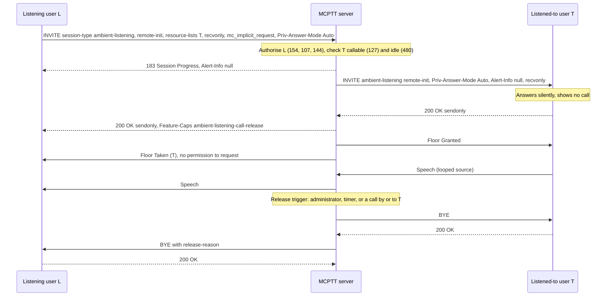

# Ambient listening call tests

These tests cover **ambient listening calls** (TS 24.379 §11.1.6, TS 23.379 §10.14): one user hears the surroundings of another user's device without that device's user being made aware of it. The recorded results cover the implemented on-demand subset below, not complete conformance. Pre-established sessions are not implemented; private call key (PCK) protection is covered elsewhere, see [coverage gaps](#coverage-gaps).

Back to the [test index by call type](../MCPTT_TEST.md). Related: [private calls](PRIVATE_CALL_TEST.md), [remotely initiated calls](REMOTE_INITIATED_TEST.md).

## How ambient listening calls work

- **Two types.** In a **remotely initiated** call (`remote-init`), the listening user calls the user to be listened to. In a **locally initiated** call (`local-init`), the listened-to user calls the user who will listen. Either way, the listened-to user's microphone is the only source of speech.
- **Setup.** The originator sends an INVITE with `session-type` `ambient-listening`, an `<ambient-listening-type>`, one listed user in `resource-lists`, `Priv-Answer-Mode: Auto` and `mc_implicit_request`. Speech is offered `recvonly` by a listening originator and `sendonly` by a listened-to originator (§6.2.1 step c). Both invitees answer automatically.
- **Authorization.** The server checks the originator's ruleset: `allow-request-remote-initiated-ambient-listening` or `allow-request-locally-initiated-ambient-listening` (403/154), `allow-private-call` (107) and the `<PrivateCall>` list (144). The callee must be callable in private calls (127).
- **No indication at the listened-to device.** A listened-to invitee gets a null `Alert-Info` (`<file:///dev/null>`) and shows no call at all. A listened-to originator gets no indication that its call was set up or ended (§11.1.6.2.0).
- **Floor.** Once both parties are connected, the server grants the floor to the listened-to user, who keeps it for the whole call. The listening user gets Floor Taken with no permission to request the floor; a request is denied with cause 5 (receive only).
- **Release by a user.** Only a party that received the D.3 `g.3gpp.mcptt.ambient-listening-call-release` feature capability may release: the originator of either type (in the 200 OK), and the listening invitee of a local-init call (in the INVITE). A listened-to invitee cannot release a call it does not know about.
- **Release by the server** (§11.1.6.4.3). The server sends BYE to the listened-to user first, then to the listening user with a `<release-reason>`: `administrator-action`, `private-call-expiry`, `call-request-for-listened-to-client` or `call-request-initiated-by-listened-to-client` (TS 23.379 §10.14.3.3).

## Implemented profile

| Step | Behavior | Reference |
|---|---|---|
| Originating INVITE | `session-type` ambient-listening, `<ambient-listening-type>` remote-init or local-init, one `resource-lists` entry, `Priv-Answer-Mode: Auto`, `mc_implicit_request`, `recvonly` (remote-init) or `sendonly` (local-init) | 24.379 §11.1.6.2.1.1 steps 7–14 |
| Participating checks | Ruleset element for the requested type (403/154), `allow-private-call` (107), `<PrivateCall>` list (144), SDP direction matching the type (488) | §11.1.6.3.1.1 steps 4–9 |
| Terminating checks | Callee unknown or not registered (480), not callable in private calls (403/127) | §11.1.6.3.2.1 steps 4–5 |
| Busy users | An originator already in a call gets 486; a target already in a call, including an ambient call, gets 480 | TS 23.379 §10.14.3.1–2 preconditions; §11.1.6.4.2 |
| Invitation | Listened-to invitee: `Priv-Answer-Mode: Auto`, null `Alert-Info`, `recvonly` offer. Listening invitee: `Priv-Answer-Mode: Auto`, `Feature-Caps` D.3, `sendonly` offer | §11.1.6.4.1 steps 6–7 |
| Answer to the originator | 183 without ringing (null `Alert-Info` for remote-init), then 200 OK with `Feature-Caps` D.3 and the complementary SDP direction | §11.1.6.4.2 |
| Floor | Granted to the listened-to user when both legs are connected; the listening user gets Floor Taken with Permission to Request 0, and Floor Deny cause 5 on request. No T1/T2 revocation during the call | TS 23.379 §10.14.3.1–2 steps 6–7; 24.380 |
| Private call timer | Runs from the invitation (30 s in the test fixture); expiry releases with `private-call-expiry` | §11.1.6.4.1 step 9 |
| Server release | BYE to the listened-to user, then BYE with `<release-reason>` to the listening user | §11.1.6.4.3 |
| BYE from a participant | Releases the other participant | §11.1.6.4.4 |
| Client role cache | Each client caches its role and the ambient listening type and clears them on release | §11.1.6.2.1.1–4 |

The ruleset is served by the CMS as `ambient_remote` / `ambient_local` in the `private_call` policy of the internal user resource, and as the two ruleset actions in the user profile document.

### Listened-to client behaviour

The lab client simulates the device of a listened-to user:

- It shows no call: `call_state` stays `idle`, and `call_type`, `private_peer` and `talking` are empty. The `ambient` status entry is test instrumentation, not a user indication.
- It transmits a looped source instead of a microphone: the WAV set by `ambient-source`, else `mcptt.ambient_source`, else silence.
- `hangup` and `release` do nothing in a remotely initiated call, because the user does not know about it.
- A call request of its own (`call`, `chat`, `private`, `first-to-answer`, `adhoc`, `ambient`, `callback-fulfil`, or a remote/transfer/forward request it has to place) takes over. The client drops the ambient call once the new INVITE is sent, and the server then releases the ambient call. If the command fails before an INVITE is sent, the client stays in the ambient call (AL-09a).

### Client and server commands

```bash
mcx-client --config FILE --command 'ambient remote sip:bob.mcptt@mcx.test'   # listen to bob
mcx-client --config FILE --command 'ambient local sip:alice.mcptt@mcx.test'  # be listened to by alice
mcx-client --config FILE --command 'ambient-source /artifacts/speech/bravo.wav'
openmcx-mcptt-server --config FILE --command 'ambient-release sip:bob.mcptt@mcx.test' # or: ambient-release all
```

A client's status shows `ambient` (type, role, peer, release permission, null alert, attached, transmitting) during the call and `last_ambient` (including `release_reason`) after it. The server status lists the session with `call_type` `ambient`, `ambient_listening_type`, `listening`, `listened_to` and `release_reason`.

## Separate four-client fixture

```bash
docker build -t openmcx:0.21-fixes -f docker/Dockerfile .
python3 tools/prepare-prearranged-test.py --directory artifacts/fixes-lab --project openmcx-fixes \
  --debug-sip --private-call --image openmcx:0.21-fixes
mkdir -p artifacts/fixes-lab/artifacts/speech
cp artifacts/speech/{alpha,bravo}.wav artifacts/fixes-lab/artifacts/speech/
.cache/deps/docker-compose-linux-x86_64 -p openmcx-fixes -f artifacts/fixes-lab/compose.json up -d
```

The `--private-call` fixture grants client-a both ambient listening types (targets limited to client-b and client-c by its `<PrivateCall>` list), client-b the locally initiated type only, client-c neither, and makes client-d uncallable. The private call timer is 30 s.

Capture the server namespace, then run and verify:

```bash
SERVER=$(.cache/deps/docker-compose-linux-x86_64 -p openmcx-fixes -f artifacts/fixes-lab/compose.json ps -q mcptt-server)
docker run --rm --name openmcx-fixes-capture --network "container:$SERVER" --cap-drop ALL --cap-add NET_RAW \
  openmcx-dev:0.1 tcpdump -Z root -i eth0 -U -s 0 -w - '(udp and not port 53) or tcp port 5060' \
  > artifacts/fixes-lab/artifacts/integration/ambient-listening.pcap &
python3 tests/integration/ambient_listening_scenario.py \
  --compose artifacts/fixes-lab/compose.json --artifacts artifacts/fixes-lab/artifacts --project openmcx-fixes
sleep 5  # let the capture flush before stopping it
docker stop openmcx-fixes-capture
python3 tests/integration/verify_ambient_listening.py artifacts/fixes-lab/artifacts/integration/ambient-listening.pcap \
  --service sip:mcptt@mcx.test --output artifacts/fixes-lab/artifacts/integration/ambient-listening-sip-wire.json
```

Stopping the capture container straight after the scenario can drop the last packets; wait a few seconds first.

## Performed tests

Recorded on **2026-09-22** against image `openmcx:0.21-fixes` (`a2ddb25a01bf`), built from branch `feat/mcptt-phase1` at the tree committed as `bec8c19`. The fixture ran clear media with debug SIP. Every report records **PASS**. The scenario made 51 assertions: 43 numbered, plus five "client-a listens to client-b" setup waits and the readiness, idle-start and unchanged-server checks. All ran on one server instance.

| ID | Scenario | Checks | Result evidence |
|---|---|---|---|
| AL-01 | Remote-init: client-a listens to client-b. Server session records the type, the listening and listened-to users and the floor owner. Client-a caches its role, may release and saw a null alert in the 183. Client-b shows no call but is transmitting, with no release permission. Client-a gets Floor Taken naming client-b with no permission to request | 5 | [Scenario report](../../artifacts/fixes-lab/artifacts/integration/ambient-listening-results.json) |
| AL-02 | Client-b's speech reaches client-a (150+ packets); no other client receives it | 2 | Same report |
| AL-03 | Client-a's floor request is denied with cause 5; the floor stays with client-b | 2 | Same report |
| AL-04 | `hangup` by the listened-to user of a remote-init call changes nothing | 1 | Same report |
| AL-05 | The listening user's release ends the call for both, with no release reason; both role caches are cleared | 2 | Same report |
| AL-06 | Local-init: client-b asks client-a to listen. Client-a is told and may release (Feature-Caps in the INVITE); client-b gets no indication but may release (Feature-Caps in the 200 OK); speech reaches client-a | 4 | Same report |
| AL-07 | The listened-to originator of a local-init call releases it | 1 | Same report |
| AL-08 | `ambient-release` on the server ends the call; the listening user gets `administrator-action`, the listened-to user's BYE has no reason | 2 | Same report |
| AL-09a | A call command by the listened-to user that fails before any INVITE (`private` to itself) is no call request: client-b stays attached and keeps transmitting, and the server and client-a keep the call | 3 | Same report |
| AL-09 | A group call by the listened-to user releases the ambient call with `call-request-initiated-by-listened-to-client`, and the group call proceeds | 3 | Same report |
| AL-10 | A private call to the listened-to user (from client-c) releases the ambient call with `call-request-for-listened-to-client`, and the private call is established | 3 | Same report |
| AL-11 | Private call timer expiry releases the call with `private-call-expiry` after 30.1 s (not before 29 s) | 3 | Same report |
| AL-12 | Rejections with no ambient session created: requester without the remote-init ruleset (154); a local-only user asking for remote-init (154); target outside `<PrivateCall>` (144); uncallable target (127) | 8 | Same report |
| AL-13 | An ambient request to a user already in a private call gets 480 and does not disturb that call | 4 | Same report |
| AL-14 | SIP wire checks (12): originating INVITE content; `recvonly`/`sendonly` by type; listened-to invitee headers and offer; listening invitee Feature-Caps and offer; 200 OK Feature-Caps and direction; 183 with null Alert-Info; 403/154, 403/144 and 403/127; 480 for a busy user; each release reason on the listening user's BYE; release reasons only in ambient dialogs. The capture held 11 originating INVITEs (9 remote-init, 2 local-init) and 6 terminating INVITEs | 12 | [Wire report](../../artifacts/fixes-lab/artifacts/integration/ambient-listening-sip-wire.json), [capture](../../artifacts/fixes-lab/artifacts/integration/ambient-listening.pcap) |
| AL-15 | Regression on the same image: the all-call-types run on one server instance (see the [test index](../MCPTT_TEST.md#one-server-for-all-call-types)), private services 32 | — | [All-types run](../../artifacts/all-types-lab/run.log) |

An earlier run on `openmcx:0.20-ambient` (before AL-09a was added) passed 48 checks and the same 12 wire checks.

## High-level call flow (remote-init, then server release)

Kamailio and floor retransmission detail are omitted. The listening user L and the listened-to user T are both served by the one combined MCPTT server.



## Physical-setup validation — not yet performed

| ID | Physical test to perform | What to validate and retain |
|---|---|---|
| AL-P01 | Remote-init listening to a real device | No indication of any kind on the listened-to device (display, audio, haptic) during setup, the call and release |
| AL-P02 | Local-init call from a real device | The originating user gets no progress or end indication; the listener hears the device microphone |
| AL-P03 | Listened-to user starts a call | The new call proceeds normally and the ambient call ends without a trace on the device |

## Coverage gaps

The blockers and implementation guide describes each item.

| Area | Gap |
|---|---|
| Pre-established sessions | Ambient listening over a pre-established session (§11.1.6.2.2, §11.1.6.3.1.4), including the SIP INFO release reason, is not implemented (H8). |
| End-to-end protection | PCK protection (§11.1.6.2.1.1 step 10) is covered in the [protected private-call tests](PROTECTED_PRIVATE_CALL_TEST.md) (PP-06, and this scenario run on the protected fixture). |
| Implicit request | The server grants the floor to the listened-to user whether or not the offer carries `mc_implicit_request` (§6.4 makes it the trigger). |
| Location | The location-info bodies of §11.1.6.3.1.1 step 15 are not relayed. |
| Multiple servers | The ambient listening scenario passes with separate participating and controlling servers (H2 split system). |
| Microphone | The lab client transmits a looped WAV or silence; a real microphone is covered only by the physical tests above. |
| Wire qualification | In-repository decoders only; no independent-peer run. |
