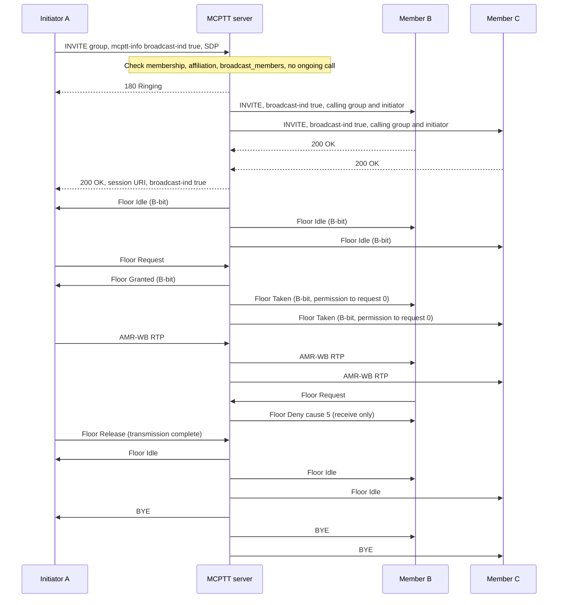

# Broadcast group call tests

These tests cover **on-network, on-demand broadcast group calls** on a prearranged group (TS 23.379 §10.6.2.5, TS 24.379 §4.12 and §6.2.8.2, TS 24.380 broadcast floor rules). A broadcast group call is a group call in which only the initiator transmits, and the call ends when that transmission completes. The recorded results cover the implemented subset below, not complete broadcast conformance. Group-broadcast and user-broadcast groups follow a project profile; emergency and imminent-peril broadcast follow a local Floor Indicator policy. Pre-established and off-network broadcast are not implemented; see [coverage gaps](#coverage-gaps).

Back to the [test index by call type](../MCPTT_TEST.md).

## Implemented profile

| Step | Behavior | Reference |
|---|---|---|
| Initiation | `call broadcast` sends the normal prearranged group INVITE, with `<broadcast-ind>true</broadcast-ind>` added to `mcptt-info`. | 24.379 §6.2.8.2 step 1 |
| Authorization | Any member of the group may broadcast, as in 24.379 §4.12. The optional `call_policy.broadcast_members` list can restrict this; anyone else gets 403 with warning `100 function not allowed due to broadcast group call not authorised`. A broadcast may also be an emergency or imminent-peril call (with an alert), authorised by the group `priority_policy` like any group call. | §4.12 |
| Conflict | A broadcast request while a non-broadcast call is running on the group gets 486 with warning `100 function not allowed due to group call in progress`. It never takes over the running call. | — (group-broadcast preemption not implemented) |
| Fan-out | Affiliated members, and late entrants, receive the INVITE with `broadcast-ind` true, the calling group and the initiator. The initiator's 200 OK also carries `broadcast-ind`. | 23.379 §10.6.2.5.2 step 1 |
| Receive only | The server denies a floor request from anyone but the initiator with Floor Deny cause #5 (Receive only), before it reaches arbitration. Users listed in `call_policy.broadcast_overriders` are the exception: their request reaches arbitration with preemptive rank 1, revokes the initiator (cause 4) and takes over the transmission. | 24.380 §6.3.5.3.4; 23.379 §10.6.2.5 NOTE 3 |
| Floor coding | Every floor message in the session sets the Floor Indicator B-bit (0x4000) instead of the A-bit, together with the D-bit (0x5000) in an emergency broadcast or the E-bit (0x4800) in an imminent-peril broadcast. No other call-type combination is used. Floor Taken carries Permission to Request = 0. | 24.380 §8.2.3.15 (combinations are local policy); §6.3.4 Floor Taken |
| Release | Once the initiator has been granted the floor, the call is released for everyone as soon as neither the initiator nor an overrider holds it. That happens on Floor Release, revoke or media timeout. If the initiator leaves, the call also ends. | 23.379 §10.6.2.5.2 step 3; 24.379 §6.3.8.1 |
| Conference events | Clients do not subscribe. A conference SUBSCRIBE gets 480 with warning `105 subscription not allowed in a broadcast group call`. | 24.379 §10.1.3.4.1 |
| Priority updates | The initiator may upgrade or cancel emergency or imminent peril with a re-INVITE; the answer keeps `broadcast-ind`. A receiver's priority re-INVITE gets 403 `100 function not allowed due to priority change by a broadcast group call receiver`. The group's priority state outlives the call, as for any group call. | Local policy |
| Hierarchies (project profile) | A GMS group of `type` `group-broadcast` (with `subordinate_groups`) or `user-broadcast` carries broadcast calls only; a normal call gets 403 `100 … broadcast group requires broadcast-ind`. The broadcast releases ongoing non-emergency calls on the subordinate groups, or of the listed users, and waits until they have left (at most 5 s). It then invites the affiliated members of the subordinate groups (or the users), with `<associated-group-id>` naming the group each is reached through. Subordinate groups and users in an emergency call are neither preempted nor invited. TS 24.379 §4.12 defines no stage-3 procedure for these groups, so this encoding is project-defined. | 23.379 §10.6.2.5.2.1–.2 |

### Client commands and status

```bash
mcx-client --config FILE --command 'call broadcast'                  # initiator
mcx-client --config FILE --command 'call broadcast emergency'        # or: call broadcast imminent
mcx-client --config FILE --command 'imminent on'                     # initiator, in the call
mcx-client --config FILE --command 'ptt /artifacts/speech/alpha.wav' # initiator transmits; call ends after
mcx-client --config FILE --command 'ptt /artifacts/speech/bravo.wav' # a receiver: denied, cause 5
mcx-client --config FILE --command conference-subscribe             # diagnostic: force a conference SUBSCRIBE
```

`call_type` is `broadcast` on every leg. After a Floor Taken or Deny, the status file reports `floor_indicator` (16384 means B-bit; 20480 B+D; 18432 B+E), `permission_to_request` and `last_floor_reject_cause`. After a rejected setup it reports `last_call_failure` (`status`, `warning`). `conference-subscribe` is a test aid only; a conformant client never subscribes during a broadcast.

## Separate four-client fixture

```bash
docker build -t openmcx:0.3-broadcast -f docker/Dockerfile .
python3 tools/prepare-prearranged-test.py --directory artifacts/broadcast-lab --project openmcx-broadcast \
  --debug-sip --broadcast --image openmcx:0.3-broadcast
mkdir -p artifacts/broadcast-lab/artifacts/speech
cp artifacts/speech/{alpha,bravo}.wav artifacts/broadcast-lab/artifacts/speech/
.cache/deps/docker-compose-linux-x86_64 -p openmcx-broadcast -f artifacts/broadcast-lab/compose.json up -d
```

`--broadcast` sets `call_policy.broadcast_members` to client-a and client-b. Only client-c's rejection depends on it. Every client is a member of the first group, and client-a initiates the broadcasts.

Capture the server namespace, then run and verify:

```bash
SERVER=$(.cache/deps/docker-compose-linux-x86_64 -p openmcx-broadcast -f artifacts/broadcast-lab/compose.json ps -q mcptt-server)
docker run --rm --name openmcx-broadcast-capture --network "container:$SERVER" --cap-drop ALL --cap-add NET_RAW \
  openmcx-dev:0.1 tcpdump -Z root -i eth0 -U -s 0 -w - '(udp and not port 53) or tcp port 5060' \
  > artifacts/broadcast-lab/artifacts/integration/broadcast-call.pcap &
python3 tests/integration/broadcast_call_scenario.py \
  --compose artifacts/broadcast-lab/compose.json --artifacts artifacts/broadcast-lab/artifacts
docker stop openmcx-broadcast-capture
python3 tests/integration/verify_broadcast_call.py artifacts/broadcast-lab/artifacts/integration/broadcast-call.pcap \
  --service sip:mcptt@mcx.test --output artifacts/broadcast-lab/artifacts/integration/broadcast-call-sip-wire.json
python3 tools/inspect-pcap.py artifacts/broadcast-lab/artifacts/integration/broadcast-call.pcap \
  artifacts/broadcast-lab/artifacts/integration/broadcast-call-floor-wire.json
```

`verify_broadcast_call.py` does not need tshark. It reuses the SIP reassembly from `verify_private_call.py` and decodes the floor messages itself. It requires debug (clear) SIP.

## Performed tests

Recorded on **2026-09-21** against image `openmcx:0.3-broadcast` (`8041823d997c`), built from branch `feat/mcptt-phase1` (uncommitted, on top of `d8f5636`). The fixture ran clear media with debug SIP over TCP. Every report below records **PASS**. The scenario run made 32 assertions: 29 numbered, plus readiness, idle-start and unchanged-server checks. All ran on one server instance.

| ID | Scenario | Assertions | Result evidence |
|---|---|---|---|
| BC-01 | `call broadcast` reaches all four clients; `call_type` broadcast on every leg; initiator recorded by the server | 1 | [Scenario report](../../artifacts/broadcast-lab/artifacts/integration/broadcast-call-results.json) |
| BC-02 | No client subscribes to conference events | 1 | Same report |
| BC-03 | A receiver's request on an idle floor is denied with cause 5 | 1 | Same report |
| BC-04 | Initiator granted; receivers see Floor Taken with B-bit and Permission to Request 0; a receiver's request during transmission is denied with cause 5; all three receivers get the speech (337 RTP packets each in the capture); the initiator receives no media | 5 | Same report |
| BC-05 | The end of the transmission releases the call for everyone, with no hangup command (0.15 s after the initiator stopped talking) | 2 | Same report |
| BC-06 | A forced conference SUBSCRIBE is rejected with 480; the initiator hanging up before talking ends the broadcast | 3 | Same report |
| BC-07 | An initiator outside `broadcast_members` is rejected with 403; no session is created | 2 | Same report |
| BC-08 | A broadcast while a normal group call runs is rejected with 486 ("group call in progress"); the running call is undisturbed | 4 | Same report |
| BC-09 | A normal call afterwards keeps normal floor rules: another member is granted, Floor Taken has the A-bit and Permission to Request 1, and speech is delivered | 5 | Same report |
| BC-10 | Late entry: a member who affiliates during a broadcast joins as a receiver, gets the speech, and the call is released when the transmission ends | 5 | Same report |
| BC-11 | SIP and floor wire checks (15): `broadcast-ind` on the originating INVITE, 9 fan-out INVITEs and the 200 OK; normal INVITEs omit it; 403, 486, and 480 with warning 105; server-originated BYEs release the initiators; B-bit on broadcast Granted/Taken/Deny/Idle and A-bit on normal ones; Permission to Request and Deny cause rules with zero violations | 15 | [SIP/floor wire report](../../artifacts/broadcast-lab/artifacts/integration/broadcast-call-sip-wire.json) |
| BC-12 | Independent floor/RTP decode: every floor message type decodes; 11 Audio SSRC fields validated; per-receiver RTP relay counts | decoder | [Floor wire report](../../artifacts/broadcast-lab/artifacts/integration/broadcast-call-floor-wire.json) |
| BC-13 | Regression on the same image: prearranged lifecycle (21 checks), reject/CANCEL/timeout/refresh (15 checks), and the full private-call scenario (53 checks, run after adding the private-call policies to this fixture) | 89 | [Lifecycle](../../artifacts/broadcast-lab/artifacts/integration/prearranged-results.json), [failure](../../artifacts/broadcast-lab/artifacts/integration/prearranged-failure-results.json), [private](../../artifacts/broadcast-lab/artifacts/integration/private-call-results.json) |
| BC-14 | Unit tests: `test_floor` (literal B-bit Floor Taken with Permission to Request 0, Deny cause 5, rejection of B+A and B+D bits) and `test_protocol` (`broadcast-ind` round trip, absent means non-broadcast); native suite 17/17 | native | `tools/mcx test` |

The capture of every broadcast scenario is [broadcast-call.pcap](../../artifacts/broadcast-lab/artifacts/integration/broadcast-call.pcap). The regression runs came after it and are not included. [Container identities](../../artifacts/broadcast-lab/artifacts/integration/broadcast-containers.txt) record the deployment. TShark was unavailable, so external Wireshark dissection was not run.

### Rerun with hierarchies and override — 2026-09-22

Image `openmcx:0.17` (`7a42efef3b69`), fixture `--broadcast`, which adds a group-broadcast group (initiator a; subordinates are both prearranged groups), a user-broadcast group (b, c, d), an emergency policy for c on the second group, and client-d as overrider. The scenario made **56 assertions**, all **PASS**; BC-01–BC-10 repeat the earlier scenarios. SIP wire checks: 17, adding `associated-group-id` and the hierarchy 403. Evidence: `artifacts/final-broadcast/artifacts/integration/`.

| ID | Scenario | Assertions |
|---|---|---|
| BC-15 | Group-broadcast (S5): a normal call on the hierarchy group → 403; a broadcast releases the ongoing subordinate call and reaches all subordinate members through `associated-group-id`; receivers in both subordinate groups get the speech; release at transmission end; a subordinate group in an emergency call is neither preempted nor invited and its call continues | 10 (+3 setup) |
| BC-16 | User-broadcast (S5): the users' ongoing call is released and they receive the broadcast through their own group; a non-member is not invited | 5 |
| BC-17 | Override (S6): an unauthorised receiver is still denied with cause 5; the authorised overrider takes the floor from the initiator (revoke), receivers get its speech, and the call ends with its transmission | 6 |

### Emergency and imminent-peril broadcast (H7) — 2026-09-22

Image `openmcx:0.22-h7` (`ce0e1df78d04`), fixture `--broadcast`, which now also lets client-a and client-b raise and cancel emergency and imminent peril on the first group. The scenario made **72 assertions**, all **PASS**; BC-01–BC-17 repeat the earlier scenarios. SIP and floor wire checks: 21, all **PASS** with zero violations. Evidence: `artifacts/h7-broadcast-lab/artifacts/integration/` ([scenario](../../artifacts/h7-broadcast-lab/artifacts/integration/broadcast-call-results.json), [wire](../../artifacts/h7-broadcast-lab/artifacts/integration/broadcast-call-sip-wire.json), [capture](../../artifacts/h7-broadcast-lab/artifacts/integration/broadcast-call.pcap)).

| ID | Scenario | Assertions |
|---|---|---|
| BC-18 | `call broadcast emergency`: every member joins in emergency state; receivers see Floor Taken with B+D and Permission to Request 0; a receiver is still denied with cause 5; all receivers get the speech; release at transmission end; the group stays in emergency until the initiator cancels it | 7 |
| BC-19 | In-dialog imminent peril: a receiver's `imminent on` is refused with 403 and changes nothing; the initiator's upgrade reaches every member; Floor Taken carries B+E; the next broadcast inherits the group state; the initiator cancels it in-dialog | 9 |
| BC-20 | Wire (4 new of 21): emergency broadcast INVITE with `broadcast-ind`, `emergency-ind` and Resource-Priority; fan-out INVITEs with both indications; the receiver's 403; broadcast floor frames with B+D (13) and B+E (12), and none with D+E | 4 |
| BC-21 | External dissection: tshark 4.2.2 decodes 0x5000 (16 frames) and 0x4800 (14) with zero expert diagnostics | tshark |
| BC-22 | Unit cases in `test_floor`: B+D and B+E encode; D+E, A+D and B+C are refused; `floor_call_type_bits` for every combination | native |

## High-level call flow

Registration, service authorization and affiliation come before this flow. Each SIP arrow passes through Kamailio, which is omitted here. Floor ACKs are also omitted; they work as in the [group-call flow](PREARRANGED_TEST.md#high-level-call-flow). C stands for any further receiver.



The server sends the BYEs as soon as the initiator no longer holds the floor, with no hangup command from any client. A late entrant gets the same `broadcast-ind` INVITE and joins as a receiver.

## Physical-setup validation — not yet performed

| ID | Physical test to perform | What to validate and retain |
|---|---|---|
| BC-P01 | Broadcast to four or more real devices | Receive-only indication on each device, audio quality, automatic end-of-call indication |
| BC-P02 | Receiver PTT press during a broadcast | User feedback for the cause-5 denial; no transmission leaks |
| BC-P03 | Initiator loses coverage mid-broadcast | Release via media timeout or revoke; every receiver cleaned up |
| BC-P04 | Independent implementation | `broadcast-ind` handling, B-bit and Permission to Request interpretation by another vendor's client or server |

## Coverage gaps

The blockers and implementation guide gives the blocker, prerequisites and implementation outline for each item.

| Area | Gap |
|---|---|
| Hierarchy interoperability | Group-broadcast and user-broadcast calls follow a project profile (`<associated-group-id>`); TS 24.379 §4.12 defines no stage-3 procedure, so no interoperability can be claimed. |
| Override policy | Any listed overrider may override; there is no ranking among overriders, and a second override is not tested. |
| Emergency / imminent broadcast | Implemented as a local Floor Indicator policy (B with D or E). TS 24.379 defines no stage-3 procedure for it, so another vendor may refuse or display these calls differently. Only the initiator may change the priority in-dialog, and receivers stay receive-only. Emergency broadcast on a group-broadcast or user-broadcast group was not tested. |
| Authorization source | The optional `broadcast_members` list comes from server or GMS `call_policy` JSON, not a TS 24.481/24.484 XML document. By default any member may broadcast, as §4.12 describes for this release. |
| Pre-established sessions, chat model, functional aliases | A broadcast in a REFER `body` on a pre-established session (§6.2.8.2 step 2), chat-group broadcast and functional-alias broadcast are not implemented. |
| Off-network broadcast | GROUP CALL BROADCAST messages and timers TFB1–TFB3 (§10.3) are not implemented. |
| Protected media | Broadcast was tested with clear media only. The protected group profile applies unchanged but was not exercised with broadcast. |
| Multiple servers | The broadcast scenario passes on the H2 split system. |
| Wire qualification | In-repository decoders and tshark 4.2.2 dissection; no independent-peer run. |
