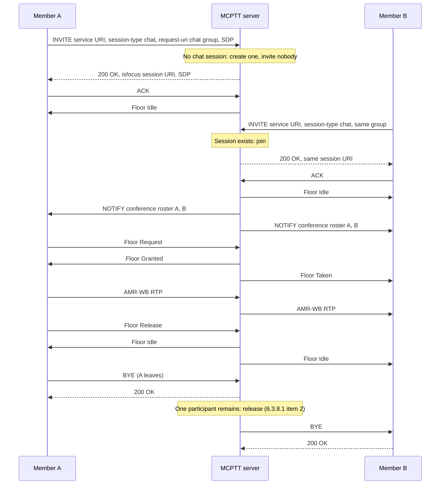

# Chat group call tests

These tests cover **on-network, on-demand chat group calls** (TS 23.379 §10.6.2.3.1.2, TS 24.379 §10.1.2). In a chat group call each affiliated member joins the group's session individually. The first join creates the session, and the server never invites anyone. The recorded results cover the implemented subset below, not complete chat-group conformance. Emergency and imminent-peril chat calls, implicit affiliation and chat calls on regroups and temporary groups are included; pre-established sessions and broadcast in chat are not implemented; see [coverage gaps](#coverage-gaps).

Back to the [test index by call type](../MCPTT_TEST.md).

## How chat works

- **Group type.** A GMS group marked `"type": "chat"` is a chat group. A group without a type is prearranged, and the GMS rejects unknown types.
- **Joining.** Each affiliated member runs `chat` on its own. The first member creates the session and later members join it. The server never invites anyone, and it answers each join with 200 straight away, carrying the shared session URI.
- **Checks.** A chat request on a prearranged group gets 403 with warning 117; a prearranged request on a chat group gets 403 with warning 118. A join beyond `max_participants` gets 486 with warning 122.
- **No initiator.** The member who created the session has no special role and may leave and rejoin while others stay.
- **Release.** The session ends when only one participant remains after someone else had joined, after inactivity (which also covers a lone first joiner), or at the maximum call length.
- **Rosters.** Participants get conference roster updates on every join and leave.
- **Not supported.** Broadcast requests in a chat session get 403.

Compare a prearranged group call, where one member's `call` makes the server invite every affiliated member, and ending the call can follow the initiator.

## Implemented profile

| Step | Behavior | Reference |
|---|---|---|
| Group type | A GMS group carries `"type": "chat"`. When the type is absent the group is prearranged, and the GMS rejects unknown types. | 24.481 group document (JSON projection) |
| Join / initiate | The client's `chat` command sends an INVITE to the MCPTT service URI with `<session-type>chat</session-type>` and the group in `mcptt-request-uri`. Initiating and joining use the same request. | 24.379 §10.1.2.2.1.1 |
| Admission | An unaffiliated group member is affiliated implicitly and notified by the affiliation NOTIFY; the affiliation is undone if the join is then rejected. A non-member gets 403 with warning 120. The member must pass the group's `initiate_members`/`join_members` policy and offer acceptable SDP. | §10.1.2.4.1 steps 6, 10, 13; §9.2.2.3.6–8 |
| Group restrictions | A group with `preconfigured_use_only` gets 403 `167 call is not allowed on the preconfigured group`; a group marked `regrouped` gets 403 `148 group is regrouped`. | §10.1.2.4.1 steps 4b–4c |
| Call-type check | A chat request on a prearranged group gets 403 with warning `117 the group identity indicated in the request is a prearranged group`. A prearranged request on a chat group gets 403 with warning `118 … is a chat group`. | §4.4.2 warnings 117/118 |
| Session | If no session is running, the first INVITE creates one and receives 200 at once. Later INVITEs join the same session and get the same `isfocus` session URI. There is no 180 and no fan-out. | §10.1.2.4.1 steps 11, 16–20 |
| Capacity | The group `call_policy.max_participants` limit applies; a join beyond it gets 486 with warning `122 too many participants`. A joiner with a higher `user_priorities` value, or with emergency or imminent peril, displaces the lowest-priority participant instead (local policy). | §10.1.2.4.1 step 12 a–b |
| Emergency / imminent peril | `chat emergency`, `chat imminent`, or `emergency on` / `imminent on` in the session. These are validated against the group `priority_policy` (403 when unauthorised). Entering either state re-INVITEs the joined participants and INVITEs affiliated members who have not joined, up to `max_participants`. Invitations carry `session-type` chat, the indicator and Resource-Priority. | §10.1.2.4.1 steps 14–15 |
| Conference events | Participants subscribe as for prearranged calls. Every join and leave triggers a NOTIFY with the updated roster. | §10.1.2.4.1 step 26 |
| Floor and media | Normal single-talker floor control: A-bit, Permission to Request 1, AMR-WB relay. | 24.380 |
| Release | There is no initiator policy, so the creator may leave and rejoin. The session is released when it becomes empty, or when one participant remains after a second had joined. It is also released on inactivity (`inactivity_timeout_ms`, which also releases a lone first joiner) and at `maximum_duration_ms`. | §6.3.8.1 items 1, 2, 5 |
| Not permitted | A chat INVITE with a broadcast indication gets 403 (chat-model broadcast is set up through floor control, which is not implemented). | — |

### Client commands

```bash
mcx-client --config FILE --command 'group sip:operations-chat@mcx.test'  # select and affiliate to the chat group
mcx-client --config FILE --command chat                                  # create or join the chat session
mcx-client --config FILE --command 'chat emergency'                      # or: chat imminent
mcx-client --config FILE --command 'call force'                          # test aid: normal call while unaffiliated (403/120)
mcx-client --config FILE --command 'ptt /artifacts/speech/alpha.wav'
mcx-client --config FILE --command hangup                               # leave; others stay unless only one remains
```

`call_type` is `chat` on every leg. A rejected join reports `last_call_failure` (`status`, `warning`). The group must be listed in the client's `mcptt.allowed_groups`.

## Separate four-client fixture

```bash
docker build -t openmcx:0.4-chat -f docker/Dockerfile .
python3 tools/prepare-prearranged-test.py --directory artifacts/chat-lab --project openmcx-chat \
  --debug-sip --chat --image openmcx:0.4-chat
mkdir -p artifacts/chat-lab/artifacts/speech
cp artifacts/speech/{alpha,bravo}.wav artifacts/chat-lab/artifacts/speech/
.cache/deps/docker-compose-linux-x86_64 -p openmcx-chat -f artifacts/chat-lab/compose.json up -d
```

`--chat` adds `sip:operations-chat@mcx.test` of type `chat` with all four users as members. Its `call_policy` is `max_participants=3` and `inactivity_timeout_ms=20000`, and it is added to every client's `allowed_groups`. The prearranged group stays available for the call-type checks.

Capture the server namespace, then run and verify:

```bash
SERVER=$(.cache/deps/docker-compose-linux-x86_64 -p openmcx-chat -f artifacts/chat-lab/compose.json ps -q mcptt-server)
docker run --rm --name openmcx-chat-capture --network "container:$SERVER" --cap-drop ALL --cap-add NET_RAW \
  openmcx-dev:0.1 tcpdump -Z root -i eth0 -U -s 0 -w - '(udp and not port 53) or tcp port 5060' \
  > artifacts/chat-lab/artifacts/integration/chat-call.pcap &
python3 tests/integration/chat_call_scenario.py \
  --compose artifacts/chat-lab/compose.json --artifacts artifacts/chat-lab/artifacts
docker stop openmcx-chat-capture
python3 tests/integration/verify_chat_call.py artifacts/chat-lab/artifacts/integration/chat-call.pcap \
  --service sip:mcptt@mcx.test --chat-group sip:operations-chat@mcx.test \
  --output artifacts/chat-lab/artifacts/integration/chat-call-sip-wire.json
python3 tools/inspect-pcap.py artifacts/chat-lab/artifacts/integration/chat-call.pcap \
  artifacts/chat-lab/artifacts/integration/chat-call-floor-wire.json
```

## Performed tests

Recorded on **2026-09-21** against image `openmcx:0.4-chat` (`8bbbd3fed314`), built from branch `feat/mcptt-phase1` (uncommitted, on top of `d8f5636`). The fixture ran clear media with debug SIP over TCP. Every report below records **PASS**. The scenario run made 35 assertions: 31 numbered, plus readiness, idle-start, chat affiliation and unchanged-server checks. All ran on one server instance.

| ID | Scenario | Assertions | Result evidence |
|---|---|---|---|
| CH-01 | The first joiner creates a chat session alone; no other member is invited (checked for 2 s) | 2 | Scenario report (`artifacts/chat-lab/artifacts/integration/chat-call-results.json`) |
| CH-02 | A second member joins the same session URI; both conference rosters list both members | 2 | Same report |
| CH-03 | Floor contention (competing request denied) and two-way decoded speech (337 and 355 RTP packets relayed in the capture) | 7 | Same report |
| CH-04 | A third member joins and the roster shows three; a fourth join beyond `max_participants` gets 486 with warning 122 | 3 | Same report |
| CH-05 | The creator leaves and the session continues with the same URI and an updated roster; the creator rejoins it | 3 | Same report |
| CH-06 | After members leave until one remains, the server releases that last participant | 2 | Same report |
| CH-07 | A lone joiner is released by the 20 s inactivity timer (observed 20.04 s) | 2 | Same report |
| CH-08 | Prearranged request on the chat group → 403 warning 118; chat request on the prearranged group → 403 warning 117 | 3 | Same report |
| CH-09 | A chat session and a prearranged group call run concurrently with independent floor owners; ending the group call leaves the chat session, which then releases when one participant remains | 7 | Same report |
| CH-10 | SIP and floor wire checks (11): chat INVITEs to the service URI; zero server-originated chat INVITEs; 200 without 180 and an `isfocus` session Contact on every join; 4 joins sharing one session URI; warnings 122, 117 and 118; conference NOTIFYs for the chat group; 3 server-originated releases; A-bit floor with Permission to Request 1 | 11 | SIP/floor wire report (`artifacts/chat-lab/artifacts/integration/chat-call-sip-wire.json`) |
| CH-11 | Independent floor/RTP decode: Request, Granted, Taken, Deny, Release, Idle and ACK; 8 Audio SSRC fields validated | decoder | Floor wire report (`artifacts/chat-lab/artifacts/integration/chat-call-floor-wire.json`) |
| CH-12 | Regression on the same image, run after adding the broadcast and private-call policies to this fixture: prearranged lifecycle 21, failure/refresh 15, broadcast 32, private call 53 | 121 | Lifecycle (`artifacts/chat-lab/artifacts/integration/prearranged-results.json`), failure (`artifacts/chat-lab/artifacts/integration/prearranged-failure-results.json`), broadcast (`artifacts/chat-lab/artifacts/integration/broadcast-call-results.json`), private (`artifacts/chat-lab/artifacts/integration/private-call-results.json`) |
| CH-13 | Unit and service tests: Go `TestGMSServesChatGroupTypeAndRejectsUnknownTypes`; native suite 17/17; Go tests pass | native/Go | `tools/mcx test` |

The capture of every chat scenario is chat-call.pcap (`artifacts/chat-lab/artifacts/integration/chat-call.pcap`); the regression runs came after it. Container identities (`artifacts/chat-lab/artifacts/integration/chat-containers.txt`) record the deployment. TShark was unavailable, so external Wireshark dissection was not run.

### Rerun with emergency, implicit affiliation and chat variants — 2026-09-22

Image `openmcx:0.17` (`7a42efef3b69`), fixture `--chat` (clear media, debug SIP), one server instance. The scenario made **67 assertions**, all **PASS**. CH-01–CH-09 repeat the earlier scenarios; the three blocks below are new. The run also covered the capture's SIP wire checks (12, updated to allow priority invitations) and floor decode (3,771 packets, 8 Audio SSRC fields). Evidence: `artifacts/final-chat/artifacts/integration/` (`chat-call-results.json`, `chat-call-sip-wire.json`, `chat-call-floor-wire.json`, `capture.pcap`).

| ID | Scenario | Assertions |
|---|---|---|
| CH-14 | Emergency and imminent-peril chat (S11): unauthorised `chat emergency` → 403; an emergency join invites affiliated members up to `max_participants` and they learn the state; nobody beyond the limit is invited; cancellation returns everyone to normal; an imminent-peril upgrade of a two-member session invites the next member | 13 |
| CH-15 | Implicit affiliation (S12): an unaffiliated normal call → 403/120 (`call force`); an unaffiliated `chat` join is accepted and affiliates the member; a join refused at the limit (486/122) leaves no affiliation behind | 11 |
| CH-16 | Chat variants (S13): 403/167 on a preconfigured-use-only group, 403/148 on a regrouped group; at the limit a higher-priority joiner displaces exactly one participant | 8 |

The same image passed the chat scenario again in the combined lab (see the [test index](../MCPTT_TEST.md)).

## High-level call flow

Registration, service authorization and affiliation to the chat group come before this flow. Each SIP arrow passes through Kamailio, which is omitted here. Floor ACKs and conference SUBSCRIBE/200 are also omitted.



With three or more participants a departure only updates the roster. The creator has no special role and may leave and rejoin.

## Physical-setup validation — not yet performed

| ID | Physical test to perform | What to validate and retain |
|---|---|---|
| CH-P01 | Members join and leave over time on real devices | Join latency, roster display, audio from mid-session joins |
| CH-P02 | Capacity at the deployment's `max_participants` | Rejection feedback (warning 122) and resource release |
| CH-P03 | Network loss while joined | Session survives others' departures; recovery and rejoin |
| CH-P04 | Independent implementation | Chat request, 117/118 handling and roster interpretation by another vendor |

## Coverage gaps

The blockers and implementation guide describes how to implement each item.

| Area | Gap |
|---|---|
| Emergency timing | The chat emergency state uses the group emergency timer; the SIP UPDATE correction of a missing Resource-Priority (§6.3.3.1.8) is not implemented. The request is rejected instead. |
| Multiple servers | The chat scenario passes with separate participating and controlling servers, including implicit affiliation at the participating server (H2). |
| Temporary and regrouped chat groups | Chat calls on a regroup (§10.1.2.4.1 steps 5 and 5a; [regroup tests](REGROUP_TEST.md), RC-01 to RC-06) and on a temporary group formed by the GMS ([temporary group tests](TEMPORARY_GROUP_TEST.md), TG-08) are implemented. Step 11b, the INVITE to the non-controlling function of each other constituent group, is not. |
| Release interpretation | "Only one or no participants" (§6.3.8.1 item 2) is applied only after a second member has joined, so a first joiner can wait until the inactivity timer. This is a deliberate reading of the spec. |
| Broadcast in a chat group | Rejected. The 23.379 NOTE says chat-model broadcast is set up through floor control, which is not implemented. |
| Pre-established sessions | Chat over a pre-established session (§10.1.2.2.2) is not implemented; see H8 in the blocker guide. |
| Group document | The GMS XML group document carries type, restrictions, limit and member priorities, but the server enforces the same values from its JSON projection. |
| Protected media | Chat was tested with clear media only. The protected group profile applies unchanged but was not exercised with chat. |
| Wire qualification | In-repository decoders only; no external Wireshark dissection or independent-peer run. |
