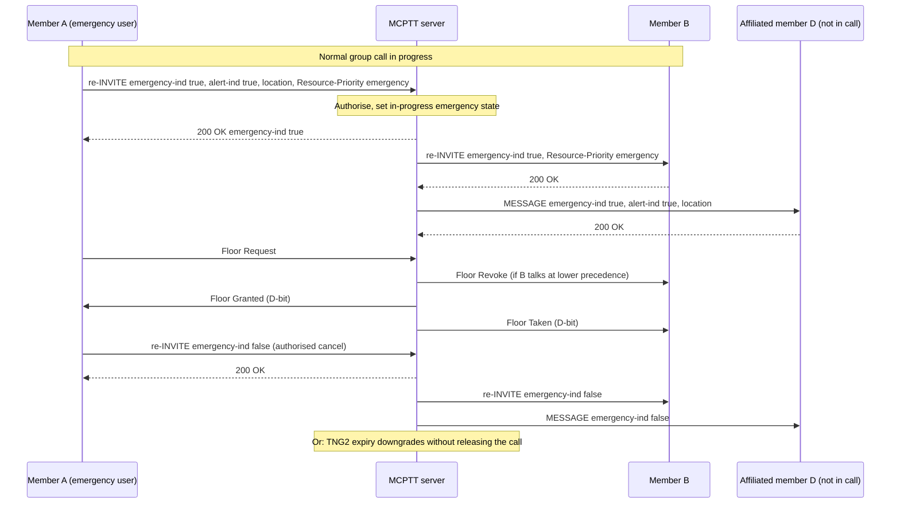

# Emergency call tests

These tests cover **MCPTT emergency calls**: the on-network emergency group call on a prearranged group, emergency alerts, the in-progress emergency group timer (TNG2), and the emergency variants of the other call types (TS 23.379 §10.6.2.6, TS 24.379 §4.6, §6.2.8, §6.3.3.1). The recorded results cover the implemented subset below, not complete emergency conformance. GPS/LMS location acquisition and emergency state that persists across a server restart are not implemented; see [coverage gaps](#coverage-gaps).

Back to the [test index by call type](../MCPTT_TEST.md). Related: [imminent-peril calls](IMMINENT_PERIL_CALL_TEST.md) and [first-to-answer calls](FIRST_TO_ANSWER_TEST.md).

## How emergency calls work

- **Authorization first.** Each group's `priority_policy` lists who may start (`emergency_users`) or cancel (`emergency_cancel_users`) an emergency, and who may send (`alert_users`) or cancel (`alert_cancel_users`) an emergency alert. Anyone else gets 403.
- **Starting.** A member either starts a new call with `call emergency`, or upgrades a running call with `emergency on` (an in-dialog re-INVITE). The request carries `emergency-ind` true, `alert-ind` true or false, and the emergency `Resource-Priority`.
- **In-progress emergency state.** The server sets the group's in-progress emergency state. It re-INVITEs every participant with the new state and emergency Resource-Priority, and tells affiliated members outside the call by SIP MESSAGE. Late entrants inherit the state. An emergency overrides imminent peril.
- **Floor precedence.** Floor messages carry the Floor Indicator D-bit (0x1000). An emergency originator preempts a numeric-priority talker (Floor Revoke), and emergency speakers take precedence over ordinary ones.
- **Emergency alert.** `alert on` sends a SIP MESSAGE with `alert-ind` true and an encoded location (`CurrentCoordinate`). The alert reaches every authorised affiliated member, and a member affiliating later: by a late alert MESSAGE while the group has no call (TS 24.379 §12.1.3.4), or, while a call is ongoing, by the late-entry INVITE (§10.1.1.4.6, which follows §10.1.1.4.1), with no MESSAGE. When the alert comes with the upgrade that puts the group into the in-progress emergency state, the participants learn of it from the re-INVITE and only the members not in the call get a MESSAGE (§10.1.1.4.7 step 6 d)); when a further user declares an emergency while the group is already in that state, every other affiliated member gets one MESSAGE (step 6 c)). It can be cancelled by its originator or by an authorised third party (`alert off <originator>`).
- **Ending.** `emergency off` by an authorised user returns the call to normal with an explicit `emergency-ind` false. Cancellation is refused while another emergency user is transmitting. If nobody cancels, the TNG2 timer (`emergency_timeout_ms`) downgrades the group to normal without releasing the call.
- **Other call types.** Private, first-to-answer, chat and ad hoc calls have their own emergency procedures (table below).

## Emergency variants by call type

| Call type | Procedure | Tests |
|---|---|---|
| Prearranged group call | Emergency group call, alerts, TNG2 (this document) | EM-01–EM-09 below |
| Private call | Emergency private call with MEPC/MEPP/MPEA states; in-dialog upgrade and cancellation; alert withdrawal by SIP INFO (§6.2.8.3, §11.1.1.4.3–6) | [PC-18](PRIVATE_CALL_TEST.md#emergency-private-call), 12 checks in this run |
| First-to-answer call | Emergency first-to-answer call; invitees save and restore MEPP (§11.1.1.2.1.2 step 3b) | [FE-01–FE-09](FIRST_TO_ANSWER_TEST.md#performed-tests) |
| Chat group call | Emergency join invites affiliated members who have not joined (§10.1.2.4.1 step 14) | [CH-14](CHAT_CALL_TEST.md), 5 emergency checks in this run |
| Ad hoc group call | Emergency ad hoc call with TNG2 release, and ad hoc emergency alert groups (§6.2.8.1.21–27, §17.4.2.2 steps 7A–7B, 14A) | [AH-15, AH-17](ADHOC_CALL_TEST.md), 4 + 9 emergency checks in this run |
| Broadcast group call | `call broadcast emergency`, or an in-dialog upgrade by the broadcast initiator; Floor Indicator B+D (local policy); receivers stay receive-only | [BC-18](BROADCAST_CALL_TEST.md#emergency-and-imminent-peril-broadcast-h7--2026-09-22) |

## Implemented profile (emergency group call)

| Step | Behavior | Reference |
|---|---|---|
| Request | `emergency-ind` true, with `alert-ind` true (plus a location body) or false, and the emergency `Resource-Priority`, on an initial INVITE or an in-dialog re-INVITE | 24.379 §6.2.8.1.1–2 |
| Authorization | Group `priority_policy.emergency_users`; if unauthorised → 403 with the current state. An unauthorised alert on an authorised emergency → 200 with warning 149, then a SIP INFO withdrawing the alert. | §6.3.3.1.13, §6.3.3.1.18 |
| Resource-Priority | Must match the requested or in-progress state; if not → 403 | §6.3.3.1.19 |
| Group state | In-progress emergency state per group; participants are re-INVITEd, and non-participants are notified by SIP MESSAGE | §6.3.3.1.6, §6.3.3.1.11 |
| Imminent peril during an emergency | Answered 200 with warning 149; a post-ACK SIP INFO confirms emergency precedence | §10.1.1.4.1 step 23 |
| Floor | D-bit on all floor messages; emergency originator > imminent originator > permitted numeric preemptor > ordinary; Floor Revoke on preemption | 24.380 §6.3.4.4.7, §8.2.3.15 |
| Alert | SIP MESSAGE with `alert-ind` and `mcptt-location-info` (encoded TS 23.032 coordinates); delivered to authorised affiliated members; to a later affiliating member as a late alert MESSAGE when the group has no call, otherwise in the late-entry INVITE; originator or authorised third-party cancellation | §6.2.8.1.3–6, §6.3.3.1.12 |
| Cancellation | `emergency-ind` false from `emergency_cancel_users`; refused while another emergency user transmits | §6.2.8.1.7, §6.3.3.1.10 |
| TNG2 | `emergency_timeout_ms` expiry downgrades the group to normal and keeps the call | §6.3.3.1.16 |

### Client commands

```bash
mcx-client --config FILE --command 'call emergency'    # new emergency group call
mcx-client --config FILE --command 'emergency on'      # upgrade the current call; 'emergency off' cancels
mcx-client --config FILE --command 'alert on'          # emergency alert with the configured location
mcx-client --config FILE --command 'alert off sip:alice.mcptt@mcx.test'   # third-party alert cancellation
```

Status reports `priority` (normal, imminent or emergency), `alerts`, `alert_locations` and pending procedures. The server status shows `group_priority` per group. Emergency alerts need `mcptt.emergency_location` (synthetic encoded fields in the fixture); see the location profile.

## Separate four-client fixture

```bash
docker build -t openmcx:0.18-emergency -f docker/Dockerfile .
python3 tools/prepare-prearranged-test.py --directory artifacts/emergency-lab --project openmcx-emergency \
  --debug-sip --floor-queue --priority --image openmcx:0.18-emergency
mkdir -p artifacts/emergency-lab/artifacts/speech
cp artifacts/speech/{alpha,bravo}.wav artifacts/emergency-lab/artifacts/speech/
.cache/deps/docker-compose-linux-x86_64 -p openmcx-emergency -f artifacts/emergency-lab/compose.json up -d
```

`--priority` authorises client-a and client-b for emergency, imminent peril and alerts. Only client-a may cancel alerts. client-b is a permitted numeric preemptor at priority 75 or higher. The fixture also sets the Resource-Priority values (normal `mcpttp.0`, imminent `mcpttp.10`, emergency `mcpttp.15`) and `emergency_timeout_ms=300000`.

```bash
python3 tests/integration/prearranged_priority_scenario.py \
  --compose artifacts/emergency-lab/compose.json --artifacts artifacts/emergency-lab/artifacts --project openmcx-emergency
python3 tests/integration/verify_group_priority.py artifacts/emergency-lab/artifacts/integration/group-priority.pcap \
  --service sip:mcptt@mcx.test --emergency-priority mcpttp.15 --imminent-priority mcpttp.10 \
  --output artifacts/emergency-lab/artifacts/integration/group-priority-sip-wire.json
# TNG2: temporarily set priority_policy.emergency_timeout_ms to 8000 in generated/site.json, restart gms, then:
python3 tests/integration/prearranged_priority_scenario.py \
  --compose artifacts/emergency-lab/compose.json --artifacts artifacts/emergency-lab/artifacts \
  --project openmcx-emergency --timer-only
```

Capture the server namespace during the first run, as for the other call types.

## Performed tests

Recorded on **2026-09-22** against image `openmcx:0.18-emergency` (`18502ee52297`), built from branch `feat/mcptt-phase1` (uncommitted changes on top of `4fdfc8c`). The fixture ran clear media with debug SIP. Every report records **PASS**. The group priority run made 43 assertions on one server instance; the rows below group them, and rows 1–10, 36 and 43 are setup, numeric preemption and cleanup. The other call types' emergency checks come from the combined run of all call types on the same image.

| ID | Scenario | Checks | Result evidence |
|---|---|---|---|
| EM-01 | An emergency initial call reaches all participants with the emergency state; the call closes while the group emergency persists; a standalone cancellation receipt restores the group state | 3 | [Priority report](../../artifacts/emergency-lab/artifacts/integration/prearranged-priority-results.json) |
| EM-02 | Alert before the upgrade; the encoded alert location reaches participants; an imminent call is upgraded to emergency; emergency precedence is confirmed by post-ACK INFO | 4 | Same report |
| EM-03 | Unauthorised emergency cancellation rejected; a late entrant inherits the emergency state | 2 | Same report |
| EM-04 | A numeric preemptor takes the idle emergency-group floor; the emergency originator preempts its grant and media; emergency speech received and released | 5 | Same report |
| EM-05 | A second authorised emergency indication is accepted and that user transmits; cancellation is refused while they transmit | 4 | Same report |
| EM-06 | Authorised cancellation restores the normal call; an independent alert is cancelled after the downgrade | 2 | Same report |
| EM-07 | Unauthorised emergency activation leaves the call normal; an unauthorised alert is rejected | 2 | Same report |
| EM-08 | An independent alert is delivered without upgrading the call and its location reaches everyone; unauthorised self-cancellation refused; authorised third-party cancellation confirmed | 4 | Same report |
| EM-09 | TNG2 (8 s test value) downgrades the group without releasing the session | 7 | [Timer report](../../artifacts/emergency-lab/artifacts/integration/prearranged-priority-timer-results.json) |
| EM-10 | SIP and floor wire checks (10): emergency and imminent requests carry their indications and Resource-Priority; an in-dialog emergency upgrade; server propagation with Resource-Priority; explicit `emergency-ind` false on cancellation; 403 for unauthorised requests; alert MESSAGEs with location and alert cancellation; INFO correction; floor D-bit (33 messages) and E-bit (4) | 10 | [Wire report](../../artifacts/emergency-lab/artifacts/integration/group-priority-sip-wire.json), [capture](../../artifacts/emergency-lab/artifacts/integration/group-priority.pcap) |
| EM-11 | Emergency variants in the combined run: emergency private (PC-18, 12), emergency chat (CH-14, 5), emergency ad hoc with TNG2 (AH-15, 4), ad hoc emergency alert (AH-17, 9), emergency first-to-answer (FE-01–FE-09, 29 + 10 wire) | 69 | [Private](../../artifacts/fta-lab/artifacts/integration/private-call-results.json), [chat](../../artifacts/fta-lab/artifacts/integration/chat-call-results.json), [ad hoc](../../artifacts/fta-lab/artifacts/integration/adhoc-call-results.json), [first-to-answer](../../artifacts/fta-lab/artifacts/integration/first-to-answer-emergency-results.json) |

[Container identities](../../artifacts/emergency-lab/artifacts/integration/emergency-containers.txt) record the deployment. Earlier runs of the same scenario on protected media are recorded as PGC-11/12/15/21 in the [emergency and protected tests](EMERGENCY_PROTECTED_TEST.md).

## High-level call flow

Registration, service authorization and affiliation come before this flow. Kamailio and floor ACKs are omitted.



## Physical-setup validation — not yet performed

| ID | Physical test to perform | What to validate and retain |
|---|---|---|
| EM-P01 | Emergency activation and cancellation on real devices | Emergency indication, alert display with real location, preemption of the current speaker |
| EM-P02 | Radio/core priority | Resource-Priority mapped to bearer QoS under congestion; SIP priority alone is insufficient evidence |
| EM-P03 | GPS-derived alert location | Real encoded coordinates, freshness and accuracy |
| EM-P04 | Independent implementation | Emergency and alert signaling, Resource-Priority and floor D-bit with another vendor |

## Coverage gaps

The blockers and implementation guide describes each item.

| Area | Gap |
|---|---|
| Emergency broadcast | Implemented as a local Floor Indicator policy (B+D); no stage-3 procedure exists, so interoperability cannot be claimed. Only the initiator may change the priority in-dialog. |
| Location | The alert carries the configured `emergency_location`, not a reported position. Location triggers, including the emergency ones, are covered in the [location tests](LOCATION_TEST.md), and encrypted location XML in the [XML protection tests](XML_PROTECTION_TEST.md). Positions are simulated; there is no GPS acquisition or freshness check. |
| Persistence | Emergency state is held in memory; a server restart loses it. |
| Multiple servers | With separate participating and controlling servers (H2 split system) the group emergency scenario (43 checks) and the emergency private, first-to-answer, chat, broadcast and ad hoc variants pass. |
| Radio priority | Resource-Priority is signalled but not mapped to network QoS in this lab. |
| Wire qualification | In-repository decoders only; no independent-peer run. |
