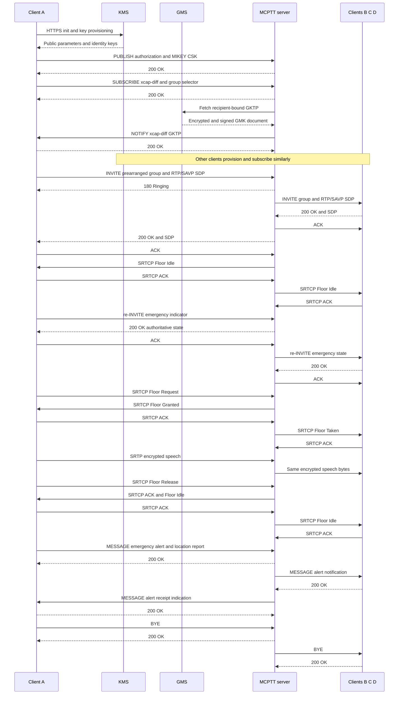

# Emergency and protected group-call tests

Single-system, on-network, on-demand **prearranged group calls**, using four clients. These tests do not certify every MCPTT procedure or third-party interoperability.

## Running the tests

The protected lifecycle runs in the `protected-prearranged` lab of the regression:

```bash
tools/regress.py --images <tag> --client-image openmcx-client:<tag> --select =protected-prearranged
```

The floor and priority scenarios on protected media run by hand on a prepared lab. The numeric key-parameter IEI
below is an explicit **local test profile**, not an assigned standard value. The preparation command needs a new
directory:

```bash
python3 tools/prepare-prearranged-test.py \
  --directory artifacts/protected-lab --project openmcx-protected --images <tag> --client-image openmcx-client:<tag> \
  --debug-sip --floor-queue --priority --protected --key-parameters-iei 0x79
mkdir -p artifacts/protected-lab/artifacts/speech
cp artifacts/speech/{alpha,bravo}.wav artifacts/protected-lab/artifacts/speech/
.cache/deps/docker-compose-linux-x86_64 -p openmcx-protected \
  -f artifacts/protected-lab/compose.json up -d --wait
```

Run each scenario with these arguments:

```bash
python3 tests/integration/prearranged_scenario.py \
  --compose artifacts/protected-lab/compose.json \
  --artifacts artifacts/protected-lab/artifacts --project openmcx-protected
python3 tests/integration/prearranged_floor_scenario.py \
  --compose artifacts/protected-lab/compose.json \
  --artifacts artifacts/protected-lab/artifacts --project openmcx-protected
python3 tests/integration/prearranged_priority_scenario.py \
  --compose artifacts/protected-lab/compose.json \
  --artifacts artifacts/protected-lab/artifacts --project openmcx-protected
```

| Scenario | What is checked |
|---|---|
| Key provisioning | HTTPS KMS initialisation and key provisioning; client-server CSK publication; recipient-bound GKTP subscriptions and notifications |
| Protected lifecycle | Third-client late entry, leave and rejoin, two concurrent groups, decoded speech and independent teardown |
| Protected floor | Queue query, cancel and requeue, acknowledged SRTCP, queued-grant confirmation, speech and abandoned-grant cleanup |
| Priority | Numeric and emergency preemption; normal, imminent and emergency transitions; late entry; permission rejection; alert receipt and cancellation |
| Emergency timeout | Separate `--timer-only` run with a short `emergency_timeout_ms`; the downgrade must keep the established call |
| Negative crypto | Published vectors, wrong recipient or key, tamper, replay, stale group-key rollback, expiry and SSRC reuse; live SRTP/SRTCP replay and tamper injection with continued valid speech |
| SIP peer isolation | A matching CANCEL from another client certificate is rejected; the originating peer remains accepted |

The scenarios write their results and captures under the lab's `artifacts/integration/`. A lab capture contains
signalling; do not publish it unreviewed.

Client control commands include `call emergency`, `call imminent`,
`emergency on|off`, `imminent on|off`, `alert on|off`,
`alert off <originator MCPTT URI>` and `priority <0..99>`.
Alert activation requires `mcptt.emergency_location`: explicitly supplied,
already-encoded TS 23.032 24-bit latitude/longitude fields. The fixture values
are synthetic; see the [location tests](LOCATION_TEST.md).
The server checks each operation against the group's configured authorisation
policy; setting a client flag does not grant permission.

Use `--check-key-refresh` on the lifecycle scenario to wait for a real GKTP renewal and verify that explicitly deaffiliated clients remain detached.

The independent [wire verifier](../integration/verify_protected.py) reads raw UDP bytes and checks RTP/SAVP negotiation, CSK publication, GKTP delivery, protected packet layout and byte-identical encrypted relay. It does not decrypt packets or claim cryptographic authentication from the capture alone. Client decoded audio and native negative tests provide separate evidence.

```bash
MCX_TSHARK=/path/to/tshark python3 tests/integration/verify_protected.py \
  artifacts/protected-lab/artifacts/integration/<capture>.pcap \
  --output artifacts/protected-lab/artifacts/integration/protected-wire-verification.json
```

## High-level flow

SIP arrows pass through Kamailio. B represents each other participating client. Authentication challenges, retries and conference subscriptions are omitted here; the capture contains them.



The server terminates each client's floor protection but relays group media without the group media key. Debug mode disables SIP TLS only; KMS and common-service HTTPS remain protected, and SRTP/SRTCP remain encrypted. Wireshark cannot decode encrypted floor fields without the corresponding key material.
