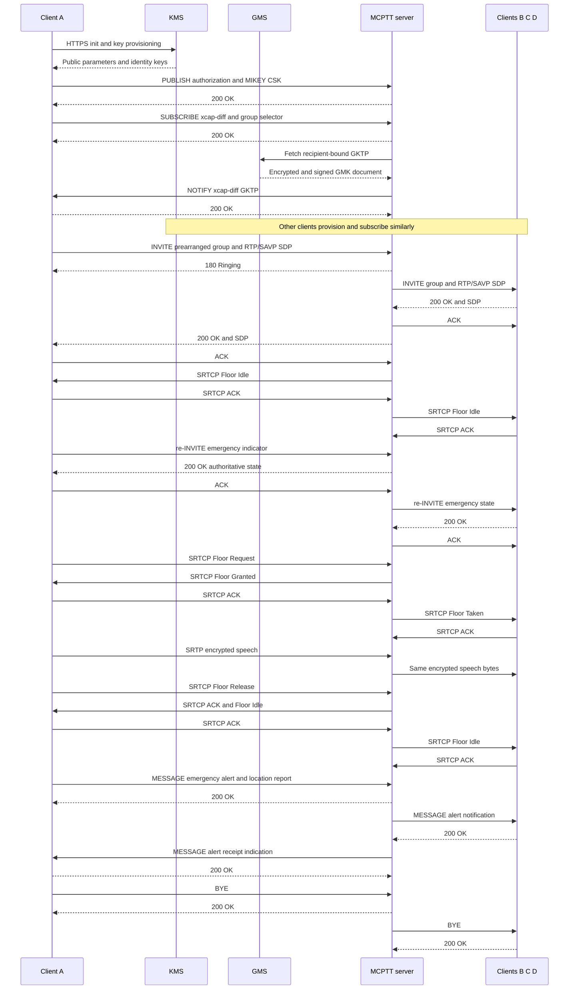

# Emergency and protected group-call tests

Single-system, on-network, on-demand **prearranged group calls**, using four clients. These tests do not certify every MCPTT procedure or third-party interoperability.

## Verified results — 2026-09-21

The final application image is `8d2c91f1439c`. The native suite passed all 16 tests, and all Go package tests passed. The final image rebuild also passed its 15 native tests (the image build excludes SCTP).

| Final-image scenario | Result |
|---|---|
| Protected TLS lifecycle with four clients | 21 checks passed |
| Protected TLS priority, emergency and location | 43 checks passed |
| Protected TLS floor procedures | 19 checks passed |
| Protected TLS rejection, cancellation, timeout and session survival | 15 checks passed |
| Protected debug-SIP priority/emergency | 43 checks passed |
| Live SRTP/SRTCP replay and tamper injection | 16 checks passed; valid speech continued |
| Debug-SIP refresh capture | 2 accepted refreshes and 7 conference notifications verified |

See the final TLS reports and capture (`artifacts/protected-tls-lab/artifacts/integration`) (`passed-image7-*-results.json`, `protected-tls-image7.pcap`), live negative report (`artifacts/protected-lab/artifacts/integration/protected-negative-results.json`), and refresh wire report (`artifacts/protected-lab/artifacts/integration/protected-refresh-v7-wire.json`).

The preceding image6 protected lifecycle run additionally passed a real GKTP renewal check with manual deaffiliation preserved. Its independent wire report (`artifacts/protected-lab/artifacts/integration/protected-v6-wire-verification.json`) verified 692 byte-identical encrypted relays, 38 SRTCP packets, 8 negotiated protected legs, 4 CSK publications and 10 GKTP notifications. Separate tests passed all 7 emergency-timeout checks and 14 SIP/HTTPS security probes. TLS captures remain encrypted; the debug-SIP capture provides the accepted-refresh wire evidence.

## Run a separate lab

The preparation command requires a new directory. The numeric key-parameter IEI below is an explicit **local test profile**, not an assigned standard value; see the security audit.

```bash
docker build -t openmcx:0.1 -f docker/Dockerfile .
python3 tools/prepare-prearranged-test.py \
  --directory artifacts/protected-lab --project openmcx-protected \
  --debug-sip --floor-queue --priority --protected --key-parameters-iei 0x79
mkdir -p artifacts/protected-lab/artifacts/speech
cp artifacts/speech/{alpha,bravo}.wav artifacts/protected-lab/artifacts/speech/
.cache/deps/docker-compose-linux-x86_64 -p openmcx-protected \
  -f artifacts/protected-lab/compose.json up -d --wait
```

Run each scenario with these arguments:

```bash
python3 tests/integration/prearranged_scenario.py \
  --compose artifacts/protected-lab/compose.json \
  --artifacts artifacts/protected-lab/artifacts --project openmcx-protected
python3 tests/integration/prearranged_floor_scenario.py \
  --compose artifacts/protected-lab/compose.json \
  --artifacts artifacts/protected-lab/artifacts --project openmcx-protected
python3 tests/integration/prearranged_priority_scenario.py \
  --compose artifacts/protected-lab/compose.json \
  --artifacts artifacts/protected-lab/artifacts --project openmcx-protected
```

| Scenario | Evidence |
|---|---|
| Key provisioning | HTTPS KMS initialization/key provisioning; client-server CSK publication; recipient-bound GKTP subscriptions and notifications |
| Protected lifecycle | Third-client late entry, leave/rejoin, two concurrent groups, decoded speech and independent teardown |
| Protected floor | Queue query/cancel/requeue, acknowledged SRTCP, queued-grant confirmation, speech and abandoned-grant cleanup |
| Priority | Numeric and emergency preemption; normal/imminent/emergency transitions; late entry; permission rejection; alert receipt and cancellation |
| Emergency timeout | Separate `--timer-only` run with an isolated short `emergency_timeout_ms`; downgrade must retain the established call |
| Negative crypto | Published vectors, wrong recipient/key, tamper, replay, stale group-key rollback, expiry and SSRC reuse; live SRTP/SRTCP replay/tamper injection with continued valid speech |
| SIP peer isolation | A matching CANCEL from another client certificate is rejected; the originating peer remains accepted |

Results and captures are in protected integration artifacts (`artifacts/protected-lab/artifacts/integration`) and priority integration artifacts (`artifacts/priority-lab/artifacts/integration`). These private lab captures contain signaling; do not publish them unreviewed.

Client control commands include `call emergency`, `call imminent`,
`emergency on|off`, `imminent on|off`, `alert on|off`,
`alert off <originator MCPTT URI>` and `priority <0..99>`.
Alert activation requires `mcptt.emergency_location`: explicitly supplied,
already-encoded TS 23.032 24-bit latitude/longitude fields. The fixture values
are synthetic; see the location profile.
The server checks each operation against the group's configured authorization
policy; setting a client flag does not grant permission.

Use `--check-key-refresh` on the lifecycle scenario to wait for a real GKTP renewal and verify that explicitly deaffiliated clients remain detached.

The independent [wire verifier](../integration/verify_protected.py) reads raw UDP bytes and checks RTP/SAVP negotiation, CSK publication, GKTP delivery, protected packet layout and byte-identical encrypted relay. It does not decrypt packets or claim cryptographic authentication from the capture alone. Client decoded audio and native negative tests provide separate evidence.

```bash
MCX_TSHARK=/path/to/tshark python3 tests/integration/verify_protected.py \
  artifacts/protected-lab/artifacts/integration/protected-v6.pcap \
  --output artifacts/protected-lab/artifacts/integration/protected-v6-wire-verification.json
```

## High-level flow

SIP arrows pass through Kamailio. B represents each other participating client. Authentication challenges, retries and conference subscriptions are omitted here; the capture contains them.



The server terminates each client's floor protection but relays group media without the group media key. Debug mode disables SIP TLS only; KMS and common-service HTTPS remain protected, and SRTP/SRTCP remain encrypted. Wireshark cannot decode encrypted floor fields without the corresponding key material.
