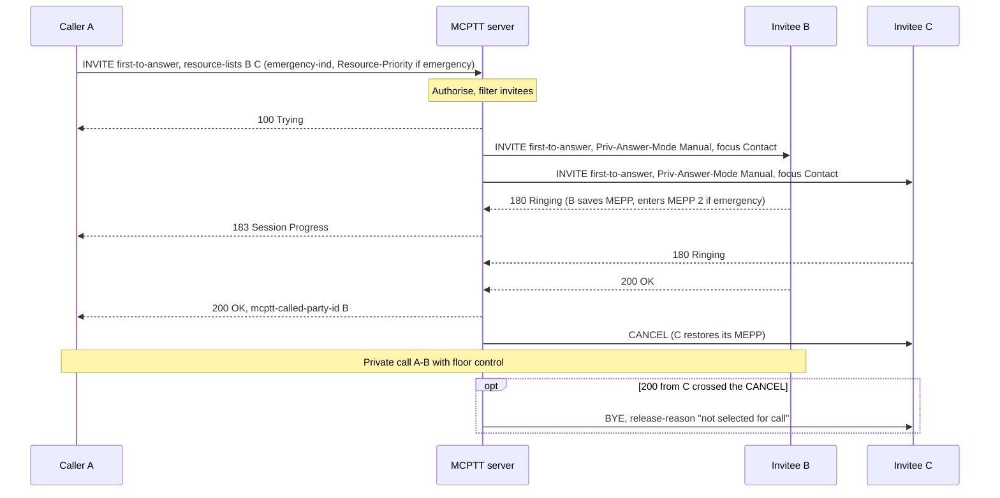

# First-to-answer call tests

These tests cover **on-network, on-demand first-to-answer calls with floor control** (TS 23.379 §10.7, TS 24.379 §11.1.1). The caller invites two or more users at once, and the call continues as a private call with whichever invitee answers first. Emergency first-to-answer calls are included. The tests cover the implemented subset below, not complete conformance. First-to-answer over a pre-established session and off-network first-to-answer are not implemented; PCK protection is covered in the [protected private-call tests](PROTECTED_PRIVATE_CALL_TEST.md); see [coverage gaps](#coverage-gaps).

Back to the [test index by call type](../MCPTT_TEST.md). Related: [private calls](PRIVATE_CALL_TEST.md), [emergency calls](EMERGENCY_CALL_TEST.md), [functional aliases](FUNCTIONAL_ALIAS_TEST.md).

## How first-to-answer works

- **Setup.** The caller runs `first-to-answer <MCPTT ID> <MCPTT ID> …`. The client sends an INVITE to the service URI with `session-type` first-to-answer and a `resource-lists` body naming two or more invitees.
- **Authorization.** The caller's private-call ruleset needs `first_to_answer` (`<allow-request-first-to-answer-call>`), otherwise 403/156. Invitees outside a `<PrivateCall>` list are dropped, and if none remain the caller gets 403/153. Each invitee's own ruleset is also applied (127/159).
- **Ringing everyone.** The server invites every remaining invitee with `Priv-Answer-Mode: Manual`, so every invitee rings even if its local mode is automatic. The caller gets 183 Session Progress once any invitee rings.
- **First answer wins.** The first invitee to send 200 becomes the call peer. The caller's 200 names that user in `<mcptt-called-party-id>`. Every other invitee is cancelled, or, if its 200 crossed the CANCEL, released by BYE with `release-reason` "not selected for call". Concurrent answers select exactly one invitee.
- **Declines.** A decline leaves the others ringing. If all invitees decline, the caller gets 480; the caller can also cancel everyone.
- **Afterwards.** The call is an ordinary [private call](PRIVATE_CALL_TEST.md): floor control, speech and release.
- **Emergency first-to-answer.** Adding `emergency` (and `alert`) makes it an emergency private call to each invitee: `emergency-ind`, emergency Resource-Priority and the floor D-bit. Only invitees the caller may make emergency calls to are invited. Each invitee saves its MEPP state and restores it if cancelled, declined or released as not selected. Once a peer is selected, the emergency can be cancelled or upgraded in-dialog.

## Implemented profile

| Step | Behavior | Reference |
|---|---|---|
| Originating INVITE | `session-type` first-to-answer, a `resource-lists` body with two or more MCPTT IDs; optional `emergency-ind`/`alert-ind`, location and Resource-Priority | 24.379 §11.1.1.2.1.1 steps 3, 10, 15 |
| Authorization | 107 (no private calls), 156 (no first-to-answer), 145 (list), `<PrivateCall>` filtering with 153 when empty; invitee rules 127/159 | §11.1.1.3.1.1 steps 10–12, 15a; §11.1.1.3.1.2 |
| Emergency authorization | Invitees filtered to authorised emergency recipients (`emergency_recipients`/`emergency_any`); none → 403 with `emergency-ind` false; an alert not authorised for every invitee → 200 with warning 149 and a SIP INFO withdrawal | §6.3.3.1.13.2, §6.3.3.1.14, §6.3.3.1.18 |
| Invitee INVITEs | `session-type` first-to-answer, `Priv-Answer-Mode: Manual`, `isfocus` Contact; emergency state and Resource-Priority when requested | §11.1.1.4.1 steps 2–3 |
| Progress and selection | 183 to the caller on the first 180; the first 200 selects the peer; the 200 carries `mcptt-called-party-id` and the emergency/alert state | §11.1.1.4.2 |
| Others | CANCEL before answer; BYE with `release-reason` "not selected for call" after a crossing 200 | §11.1.1.4.2 |
| Invitee MEPP | Saved on an emergency first-to-answer INVITE, set to MEPP 2 while ringing, and restored on CANCEL, decline or a "not selected" BYE | §11.1.1.2.1.2 steps 3b–3c |
| After selection | In-dialog emergency upgrade or cancellation as for a private call | §11.1.1.4.3–6 |

### Client commands

```bash
mcx-client --config FILE --command 'first-to-answer sip:bob.mcptt@mcx.test sip:client-c.mcptt@mcx.test'
mcx-client --config FILE --command 'first-to-answer sip:bob.mcptt@mcx.test sip:client-c.mcptt@mcx.test emergency alert'
mcx-client --config FILE --command answer          # at an invitee; reject declines
mcx-client --config FILE --command 'emergency off alert'   # after selection
```

Status reports `first_to_answer`, `private_peer` (set from the answer) and `call_state` = `progress` after 183. It also reports `private_emergency_state`, `private_priority_state` and `private_alert_state` (MEPC, MEPP, MPEA), and `private_priority_restored` after an invitee's MEPP was restored.

## Running the tests

The first-to-answer checks of the private-call scenario (PC-16) run in the `call-types` lab, and the emergency
first-to-answer scenario in the `first-to-answer` lab of the regression:

```bash
tools/regress.py --images <tag> --client-image openmcx-client:<tag> --select =first-to-answer
tools/regress.py --images <tag> --client-image openmcx-client:<tag> --select =call-types
```

Both labs use `--private-call`. client-a may originate first-to-answer and emergency private calls to anyone, and its
`<PrivateCall>` list is {b, c}. client-b has no first-to-answer permission, and client-d has no private-call
permission. The emergency scenario temporarily narrows client-a's ruleset in the CMS for its recipient checks and
always restores the original configuration. Over debug TCP SIP the emergency run also captures at the MCPTT server and
checks the capture with `tests/integration/verify_first_to_answer_emergency.py`.

## Checks

FA-01 to FA-05 are the PC-16 checks of the [private-call scenario](PRIVATE_CALL_TEST.md); FE-01 to FE-09 come from the
emergency first-to-answer scenario and its capture.

| ID | What is checked |
|---|---|
| FA-01 | Both invitees ring despite their automatic local mode; the caller sees 183; the first answerer becomes the peer, the other is cancelled, and speech flows |
| FA-02 | Either invitee may win; the loser is cancelled; callee hangup releases the call |
| FA-03 | One decline leaves the other ringing; all declining fails with 480; the caller CANCEL clears every invitee |
| FA-04 | Concurrent answers select exactly one invitee, and the concurrent loser is released |
| FA-05 | `<PrivateCall>` filtering: only the listed invitee rings; 403/156, 403/107 and 403/153 leave no session |
| FE-01 | Emergency first-to-answer: both invitees ring with MEPP 2; the caller is in MEPC 2 |
| FE-02 | Selection: the caller reaches MEPC 3 / MEPP 2 / MPEA 3; the unselected invitee is cancelled and restores MEPP 1; the peer keeps MEPP 2 and the caller's alert; the server keeps the emergency state |
| FE-03 | The peer sees Floor Taken with the emergency D-bit |
| FE-04 | After selection, the in-dialog cancellation returns both parties to MEPP 1 |
| FE-05 | The other invitee may win; the first is cancelled and restores MEPP |
| FE-06 | A decline restores the decliner's MEPP and leaves the other invitee ringing; the caller CANCEL clears it |
| FE-07 | Only the authorised emergency recipient is invited; with none authorised → 403 and the caller back to MEPC 1 |
| FE-08 | An alert not authorised for every invitee is withdrawn (MPEA 1) while the emergency call proceeds |
| FE-09 | Wire: emergency-ind, Resource-Priority `mcpttp.15` and two or more invitees on originating INVITEs; alert with location; invitee INVITEs with emergency-ind, Resource-Priority and `Priv-Answer-Mode: Manual`; the 200 names the selected invitee and confirms `emergency-ind`; 403 with `emergency-ind` false; 200 with warning 149 and the INFO withdrawal; unselected invitees cancelled; in-dialog cancellation re-INVITE; every floor message (client and server) carries the D-bit |

## High-level call flow

Kamailio is omitted.



## Coverage gaps

| Area | Gap |
|---|---|
| PCK protection | Covered in the [protected private-call tests](PROTECTED_PRIVATE_CALL_TEST.md) (PP-05, and this scenario's emergency run on the protected fixture). |
| Multiple servers | Covered: first-to-answer calls, including the emergency first-to-answer scenario, also run with separate participating and controlling servers. |
| Emergency to a functional alias | Refused. First-to-answer to an alias without emergency is covered in the [functional-alias tests](FUNCTIONAL_ALIAS_TEST.md). |
| Emergency timer | None: TS 24.379 defines no on-network private emergency timer (the TFP timers are off-network). |
| Pre-established and off-network | Not in present edition. |
| Wire qualification | In-repository decoders only; no independent-peer run. |
