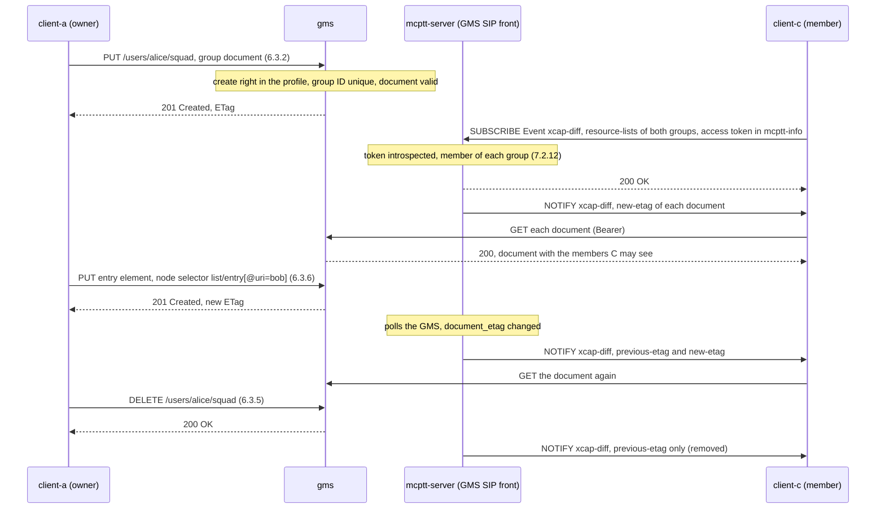

# Group management tests

These tests cover **writes to group documents** and **subscriptions to their changes** (TS 24.481 V19.3.0 §6.3.2 to §6.3.13, with XCAP of RFC 4825 and xcap-diff of RFC 5874 and RFC 5875), within one system. What the tests do not cover is listed under [coverage gaps](#coverage-gaps).

Back to the [test index by call type](../MCPTT_TEST.md).

## Implemented profile

| Procedure | Behavior | Reference |
|---|---|---|
| Documents | A group document lives in the users tree of the XUI that created it (`org.openmobilealliance.groups/users/{XUI}/{document}`), and is also addressed by its group ID (`global/byGroupID/{group}`). The groups of the site configuration are the initial documents, with no owner. Documents persist in the GMS data volume. | §7.2.10.2, RFC 4825 |
| Creation | HTTP PUT in the requester's own users tree, by a user whose profile allows group creation. A group ID already in use, or outside the provider's domain, is refused 409 with a `<uniqueness-failure>` offering an `<alt-value>`. | §6.3.2 |
| Changes | Replace or delete the document; create, replace, fetch or delete an element or an attribute through a node selector (`~~`, with position and attribute predicates, `@attribute`, `namespace::*` and `xmlns()` bindings). If-Match is honoured (412), and each change must leave a document that conforms to the schema and the constraints (see [schema validation](#schema-validation)). The group ID and the regrouped state cannot be changed, and a regrouped group's document cannot be deleted. | §6.3.4 to §6.3.12, §7.2.7 |
| Authorization | The owner of the users tree may change its documents. Others may change a document only under the provider's policy: the user profile's `group_management` (`create`, and `manage` naming groups or `*`). Everyone else reads what §7.2.12 allows: the owner and managers the whole document; a member the document with its own entry, or with the whole list when `<on-network-allow-getting-member-list>` is granted. | §7.2.12 |
| Change tracking | Every change bumps the group's version. The servers read the version and the document's entity tag from the GMS. | |
| Subscriptions | The MCPTT server is the SIP front of the GMS, and its PSI serves as both the subscription proxy PSI and the PSI for accessing documents. A client SUBSCRIBEs `Event: xcap-diff` with its access token (mcptt-info) and a resource list of group document references. A member is admitted (§7.2.12); anyone else is refused 403. The first NOTIFY carries the entity tag of every document. Later NOTIFYs carry each change (`previous-etag` and `new-etag`) and each removal (`previous-etag` only). The subscription ends at its expiry or when unsubscribed (Expires 0). | §6.3.13.2.1, §6.3.13.3.2.2 |
| MCS server subscriptions | The MCData server subscribes, as an MCS server, to the document of each group it reads: one SUBSCRIBE per group to the MCPTT server's PSI, with a resource list naming the group document and `P-Asserted-Service` of the MCPTT ICSI. The SIP core asserts the MCData server's PSI, which the MCPTT server accepts from `mcptt.mcs_servers` for any group of the system. The MCData server keeps the documents of its active subscriptions and drops one when a NOTIFY names it, then reads it again when it next needs it. | §6.3.13.2.2 |
| Content server | The content server reads the GMS's current view of this system's groups (`/internal/group`) for reception control, so a group created or changed with XCAP counts; the site configuration answers only when the GMS cannot be reached. | §6.3.2 to §6.3.12 |
| Service configuration | Each client subscribes, after its service authorization, to its own user profile document through the CMS's subscription proxy function: a SUBSCRIBE `Event: xcap-diff` to its MCPTT server's PSI with its access token and a resource list naming `org.3gpp.mcptt.user-profile/users/{MCPTT ID}/mcptt-user-profile-{index}.xml`. A user may follow only its own profile (403). The front reads the document's entity tag from the CMS every 2 s and notifies a change; the client reads the profile again. An administrator (`config_management`) may read and replace another user's profile document with XCAP PUT (If-Match honoured, MIME type `application/vnd.3gpp.mcptt-user-profile+xml`); the CMS validates it (see [schema validation](#schema-validation)), stores it in its data directory and serves it from then on. | TS 24.484 V19.4.0 §6.3.13, §6.3.3, §6.3.4 |
| Schema validation | See [schema validation](#schema-validation). | RFC 4825 §8.2.5, TS 24.481 §7.2.4, §7.2.7, §7.3.3, TS 24.484 §8.3.2.3, §8.3.2.6 |

### Schema validation

The GMS and the CMS check every document they are asked to store, in the order of RFC 4825 §8.2.5: first the encoding and well-formedness, then the schema, then the constraints of the application usage. A refusal is 409 with an `application/xcap-error+xml` body naming the error element.

| Document | Schema | Constraints (409 `<constraint-failure>` with the phrase of the specification) |
|---|---|---|
| Group document (every write of §6.3.2 to §6.3.12, on the resulting document) | OMA-SUP-XSD_poc_listService-V1_0_2 with the OMA XDM extensions and common policy, IETF common-policy and resource-lists, and the MCS extensions of TS 24.481 §7.2.4.2 | OMA-TS-XDM_Group-V1_1_1 §5.1.6: one `<list-service>`, duplicate entry, entry URI syntax, `<external>` of another type or user, complex rules, the `<ruleset>` position, automatic group advertisement, search; TS 24.481 §7.2.7: `<on-network-invite-members>` without `<on-network-maximum-duration>`. The group URI keeps its `<uniqueness-failure>` |
| GMOP group regroup creation (§6.3.14) | TS 24.481 §7.3.3, with the group document schema for the group it carries | The group document's constraints |
| MCPTT user profile (replacement, TS 24.484 §6.3.4) | TS 24.484 §8.3.2.3, with the UE initial configuration (§7.2.2.3) and MCData user profile (§10.3.2.3) schemas it uses | §8.3.2.6: "Wrong User Profile URI", "Priority value out of range", "Invalid Discovery Group ID", "Invalid User Info ID" |

The errors: `<not-utf-8>`, `<not-well-formed>` (also for a DTD or entity declaration), `<schema-validation-error>` (a document that fails the schema, has another root element, or holds an element of a namespace whose schema the server has but which that schema does not define). A profile replacement with another MIME type is refused 415 (RFC 4825 §8.2.1).

The schemas are embedded in `mcx-common` and compiled with libxml2; nothing is fetched. The 3GPP schemas are taken from the specifications (clauses in `dependencies/lock.json`); the OMA, IETF and W3C ones were downloaded from their publishers. `dependencies/lock.json` lists each file with its source and SHA-256. The GMS and the CMS also check the documents they generate from the site configuration, and do not start if one does not conform.

The CMS serves the user profile of TS 24.484 §8.3.2.3: the rights are boolean elements of the `<cp:ruleset>` actions (the Release 13 ones directly, the later ones in `<anyExt>`), the groups are in `<OnNetwork>`/`<MCPTTGroupInfo>`, and `<IncomingPrivateCallList>` is in the `<anyExt>` of `<OnNetwork>`. What the schema cannot express (MC ID, SIP URI, client ID, several or "any" emergency private call and alert recipients) is in the namespace `urn:openmcx:ns:userProfile:1.0`, which §8.3.2.1 item 12 allows.

### Local choices

| Choice | Reason |
|---|---|
| The MCPTT server fronts the GMS for SIP; the GMS stays an HTTP service | The GMS of this lab has no SIP stack. The MCPTT server already fronts it for GKTP subscriptions. |
| Changes are detected by polling the GMS (`mcptt.document_poll_ms`, 2 s by default) | The GMS has no SIP to push them. |
| The provider policy of §7.2.12 is the profile's `group_management` object | §7.2.12 leaves it to "MCS service provider policy". |
| A NOTIFY names the changed documents only; the client reads them again with an XCAP GET | RFC 5875 allows either. The group documents are small, and their content depends on who reads them. |
| The MCData server subscribes once per group, and refreshes with a new subscription | §6.3.13.2.2 allows one or more documents per subscription. One per group avoids re-SUBSCRIBEs with a modified list inside the dialog. |
| The MCPTT server's PSI also serves as the PSI of the CMS's subscription proxy function, and the CMS is polled for entity tags | As for the GMS: the CMS of this lab has no SIP stack. |
| A replaced user profile document changes what the client reads; the servers keep enforcing the configured policy | The servers read the CMS's internal JSON view of the configured rights; mapping every profile element back to it is not implemented. |
| An MCS server is recognised by the PSI the SIP core asserts for it, from `mcptt.mcs_servers` | §6.3.13.2.2 has the server assert its PSI; the lab's SIP core replaces the identity of an application server's request with the server's own. |

### Client commands

```bash
mcx-client --config FILE --command 'group-create <document> <group ID> <member>...'   # with the member-list rule of 7.2.12
mcx-client --config FILE --command 'group-member add|remove <group ID> <member>'
mcx-client --config FILE --command 'group-delete <document>'
mcx-client --config FILE --command 'group-subscribe <group ID>...'
mcx-client --config FILE --command 'group-unsubscribe'
```

The client status has `xcap_last` (the last XCAP request and its answer), `group_subscription_result`, and `group_documents` (per group: notifications, entity tag, removal, and the members read after each change). The MCPTT server status has `group_document_subscriptions`: counters, subscriptions, and onward subscriptions.

## Call flows

### Creation, change and notification within one system (GM-01 to GM-07)

XCAP requests pass through the HTTP proxy, and SIP through the SIP core; both are omitted.



## Running the tests

The group management scenario and the XCAP schema scenario run in the `group-management` lab, and the MCData server's
group document subscription in the `group-management-mcdata` lab of the regression:

```bash
tools/regress.py --images <tag> --client-image openmcx-client:<tag> --select =group-management
tools/regress.py --images <tag> --client-image openmcx-client:<tag> --select =group-management-mcdata
```

`--group-management` gives these rights:

| System | User | Rights |
|---|---|---|
| Single system | client-a | May create groups |
| Single system | client-b | Manages the provisioned group |
| Single system | client-c, client-d | No management rights |

## Checks

### Group documents

| ID | What is checked |
|---|---|
| GM-00 | Every client is authorised |
| GM-01–GM-02 | Creation in the creator's own tree (201); a group ID in use refused 409 with a `<uniqueness-failure>` and an `<alt-value>`; a user without the right refused 403 |
| GM-03 | A member subscribes to two groups (200); the first NOTIFY carries both documents and the member reads them |
| GM-04 | The owner adds a member and a manager of the provisioned group removes one; each change is notified with a new entity tag |
| GM-05 | A member who does not manage the group, and a manager of another group, are refused 403 |
| GM-06 | A user who is no longer a member cannot subscribe (403) |
| GM-07 | The owner deletes the document; the subscriber is notified of the removal |

The Go unit tests cover the XCAP selector, writes, authorisation and persistence.

### MCS server subscriptions and service configuration

| ID | What is checked | Lab |
|---|---|---|
| MCS-01 | The first group SDS makes the MCData server subscribe to the group document at the MCPTT server's PSI; the MCPTT server accepts the MCData server's PSI as subscriber and notifies the full state | `group-management-mcdata` |
| MCS-02 | Later group SDSs are answered from the kept document | `group-management-mcdata` |
| MCS-03 | A member removed with XCAP by the group's manager is notified to the MCData server, which drops its copy and reads the document again for the next SDS | `group-management-mcdata` |
| CFG-01 | client-b subscribed to its user profile document through the CMS's subscription proxy and received the initial notification | `group-management` |
| CFG-02 | client-c, without the administrator right, cannot read or replace client-b's profile: 403 | `group-management` |
| CFG-03 | The administrator client-a removes an action from client-b's profile with XCAP PUT: 200 | `group-management` |
| CFG-04 | client-b is notified and reads its changed profile, which no longer grants that action | `group-management` |

The Go test `TestCMSProfileUpdateByAdministrator` covers the refusals (another user, a document for another MCPTT ID, a
document that is not a user profile), the new entity tag, and the update surviving a restart of the CMS. The MCPTT
server backs off from a common service that does not answer for 10 s, so the document subscriptions do not stall it
while that service restarts. CFG-03 and CFG-04 revoke a right by setting its `<cp:actions>` element to false.

### Schema validation

The scenario `xcap_schema_scenario.py` runs in the `group-management` lab. A probe in client-a's container signs in as
client-a and sends the XCAP requests itself, so that the documents can be malformed on purpose.

| ID | What is checked |
|---|---|
| XS-00 | The GMS and the CMS started: they checked every group and user profile document they generate from the lab configuration against the schemas |
| XS-01, XS-12 | A conforming group document (entry with `<user-priority>`, member-list rule, `<supported-services>` with `<mcptt-speech>`, `<protect-media>`) is created (201); a conforming entry is added (201) and the document deleted (200) |
| XS-02 | A body that is not well-formed: 409 `<not-well-formed>` |
| XS-03 to XS-06 | 409 `<schema-validation-error>`: an `<entry-ref>` (OMA §5.1.6), `<protect-media>sometimes`, an element the mcpttGroupInfo schema does not define, `<list-service>` children out of order |
| XS-07 to XS-09 | 409 `<constraint-failure>`: two `<list-service>` elements, a duplicate entry, a rule with two identity conditions, each with the OMA phrase |
| XS-10 | An element PUT whose resulting document does not conform (`<user-priority>high`): 409 `<schema-validation-error>` |
| XS-11 | A GMOP group regroup creation request with an empty `<group>` (§7.3.3): 409 `<schema-validation-error>` |
| XS-13 | The CMS serves the profile as `application/vnd.3gpp.mcptt-user-profile+xml` in `urn:3gpp:mcptt:user-profile:1.0` with the user's `XUI-URI`; the administrator reads client-b's |
| XS-14 | A profile replacement with another MIME type: 415 |
| XS-15 to XS-17 | 409 `<not-well-formed>` for a truncated profile, `<schema-validation-error>` for `<Status>maybe` and for an element the schema does not define |
| XS-18, XS-19 | 409 `<constraint-failure>` "Wrong User Profile URI" and "Priority value out of range" (§8.3.2.6) |
| XS-20 | The conforming profile is accepted (200) |

Go unit tests: `TestGroupDocumentValidationErrors`, `TestCMSProfileUpdateByAdministrator`,
`TestGeneratedGroupDocumentsConform`, `TestGeneratedProfileDocumentsConform`, `TestValidatorRefusesExternalEntities`.

## Coverage gaps

| Area | Gap |
|---|---|
| GKTP documents | Subscriptions to `<GKTPs>` elements keep their own path (the protected-call tests). A resource list mixing GKTP and group document references is not split. |
| MCS server subscriptions | The MCData server subscribes (§6.3.13.2.2). The MCPTT server, which fronts the GMS itself, reads group documents from the GMS when it needs them. |
| Temporary groups | The GMS forms temporary groups (§6.3.14, §6.3.15; [temporary group tests](TEMPORARY_GROUP_TEST.md)). A GMS owning a constituent group reads the temporary group's document when it needs it; it does not subscribe to it (§6.3.13.2.3). |
| Identity hiding | The CSK protection of the subscription's bodies (§6.3.13.2.1 step d) is not applied. |
| Service configuration | Only the user profile document is subscribed to and can be replaced: the UE initial configuration and the service configuration document, the MCS server's subscription to the service configuration document (§6.3.13.2.3), element and attribute operations (§6.3.6 to §6.3.12) and identity hiding are not implemented. The profile is at the lab path `org.3gpp.mcptt.user-profile/users/{MCPTT ID}/mcptt-user-profile-{index}.xml`, not `org.3gpp.mcptt.user-profile/…/mcptt-user-profile-<index>.xml` (§8.3.1A), so the document name constraint of §8.3.2.6 is not checked; the `<Pre-selected-indication>` constraint cannot arise with one profile per user. The servers keep enforcing the configured rights. |
| Schema validation | The OMA XDM 2.1 extensions (`urn:oma:xml:xdm:2.1extensions`, which need the geopriv schemas) are not loaded, so their elements pass the lax wildcards unchecked. The structure rules of TS 24.484 §8.3.2.1 that the schema does not express (for example a `<ProSeUserID-entry>` beside the emergency private call recipient) are not enforced, and the generated profile does not carry the off-network and ProSe elements the lab has no values for. |
| XCAP | Access permission documents of OMA XDM Core are not implemented. |
