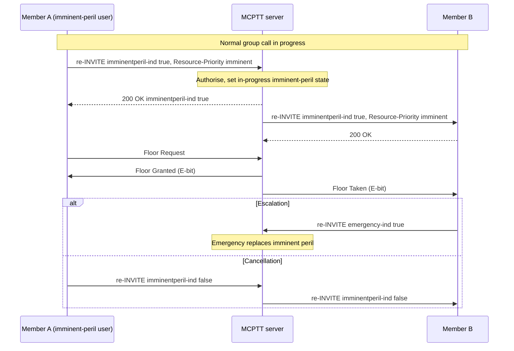

# Imminent-peril group call tests

These tests cover **MCPTT imminent-peril group calls**: a group call raised to a priority below emergency when a group member is in imminent danger (TS 23.379 §10.6.2.7, TS 24.379 §4.6, §6.2.8.1.9–13). Imminent peril applies to group calls only (prearranged, chat and ad hoc); a private call has no imminent-peril state. The recorded results cover the implemented subset below, not complete conformance. Persistence across a server restart is not implemented; see [coverage gaps](#coverage-gaps).

Back to the [test index by call type](../MCPTT_TEST.md). Related: [emergency calls](EMERGENCY_CALL_TEST.md).

## How imminent-peril calls work

- **Authorization.** The group `priority_policy` lists who may start (`imminent_users`) and cancel (`imminent_cancel_users`) imminent peril. Anyone else gets 403.
- **Starting.** A member starts a new call with `call imminent`, or raises a running call with `imminent on` (an in-dialog re-INVITE). The request carries `imminentperil-ind` true and the imminent-peril `Resource-Priority` (below emergency, above normal).
- **In-progress imminent-peril state.** The server sets the group's in-progress imminent-peril state and re-INVITEs every participant with it. Late entrants inherit the state. In a chat group, entering imminent peril also invites affiliated members who have not joined.
- **Below emergency.** An emergency overrides imminent peril: the group moves to emergency and the imminent state is cleared. An imminent request while an emergency is in progress is answered with warning 149, and a SIP INFO confirms that the emergency takes precedence.
- **Floor.** Floor messages carry the Floor Indicator E-bit (0x0800). An imminent-peril originator ranks below an emergency originator and above a permitted numeric preemptor.
- **Ending.** `imminent off` by an authorised user returns the call to normal with an explicit `imminentperil-ind` false, or the call ends normally. Unlike emergency, there is no imminent-peril timer.

## Imminent-peril variants by call type

| Call type | Procedure | Tests |
|---|---|---|
| Prearranged group call | Imminent-peril initial call, upgrade from normal, upgrade to emergency, cancellation (this document) | IP-01–IP-05 below |
| Chat group call | An imminent upgrade invites the next affiliated member; joined and invited members learn the state; cancellation (§10.1.2.4.1 step 15) | [CH-14](CHAT_CALL_TEST.md), 4 imminent checks in this run |
| Ad hoc group call | Imminent-peril ad hoc call established and released (§6.2.8.1.25) | [AH-15](ADHOC_CALL_TEST.md), 2 imminent checks in this run |
| Private and first-to-answer calls | Not applicable: TS 24.379 defines no imminent-peril private call; such requests get 403 | — |
| Broadcast group call | `call broadcast imminent`, or an in-dialog upgrade by the broadcast initiator; Floor Indicator B+E (local policy) | [BC-19](BROADCAST_CALL_TEST.md#emergency-and-imminent-peril-broadcast-h7--2026-09-22) |

## Implemented profile

| Step | Behavior | Reference |
|---|---|---|
| Request | `imminentperil-ind` true and the imminent `Resource-Priority` on an initial INVITE or an in-dialog re-INVITE | 24.379 §6.2.8.1.9–10 |
| Authorization | `priority_policy.imminent_users`; if unauthorised → 403, and the call stays normal | §6.3.3.1.13.6 |
| Group state | In-progress imminent-peril state per group; participants re-INVITEd with Resource-Priority; late entrants inherit it | §6.3.3.1.15 |
| Emergency precedence | An emergency upgrade clears imminent peril; an imminent request during an emergency gets 200 with warning 149 and a post-ACK SIP INFO | §10.1.1.4.1 steps 14–15, 23 |
| Floor | E-bit on floor messages; imminent originator ranks between emergency originator and permitted numeric preemptor | 24.380 §8.2.3.15 |
| Cancellation | `imminentperil-ind` false from `imminent_cancel_users` | §6.2.8.1.11–12 |

### Client commands

```bash
mcx-client --config FILE --command 'call imminent'   # new imminent-peril group call
mcx-client --config FILE --command 'imminent on'     # raise the current call; 'imminent off' cancels
mcx-client --config FILE --command 'chat imminent'   # imminent-peril chat group call
```

Status reports `priority` = `imminent` while the state is in progress.

## Fixture and commands

Imminent peril runs in the same fixture and scenario as the [emergency group call](EMERGENCY_CALL_TEST.md#separate-four-client-fixture). `--priority` authorises client-a and client-b for imminent peril, with Resource-Priority `mcptt.10`. The chat and ad hoc variants run in the combined run of all call types (`tests/integration/run_all_call_types.sh`).

## Performed tests

Recorded on **2026-09-22** against image `openmcx:0.18-emergency` (`18502ee52297`), built from branch `feat/mcptt-phase1` (uncommitted changes on top of `4fdfc8c`). Every report records **PASS**. The IDs below select the imminent-peril checks from the 43-check group priority run and from the combined run.

| ID | Scenario | Checks | Result evidence |
|---|---|---|---|
| IP-01 | An imminent-peril initial call reaches all participants with the imminent state; it is downgraded and closes | 3 | [Priority report](../../artifacts/emergency-lab/artifacts/integration/prearranged-priority-results.json) |
| IP-02 | A normal call is upgraded to imminent peril | 1 | Same report |
| IP-03 | Emergency precedence: an imminent call is upgraded to emergency, and a post-ACK INFO confirms that the emergency takes precedence | 2 | Same report |
| IP-04 | Unauthorised imminent activation leaves the call normal | 1 | Same report |
| IP-05 | Wire: imminent requests carry `imminentperil-ind` and Resource-Priority `mcptt.10`; the server propagates the state with Resource-Priority; floor E-bit on 4 messages | part of 10 | [Wire report](../../artifacts/emergency-lab/artifacts/integration/group-priority-sip-wire.json), [capture](../../artifacts/emergency-lab/artifacts/integration/group-priority.pcap) |
| IP-06 | Imminent-peril chat (CH-14, 4) and imminent-peril ad hoc (AH-15, 2) in the combined run | 6 | [Chat](../../artifacts/fta-lab/artifacts/integration/chat-call-results.json), [ad hoc](../../artifacts/fta-lab/artifacts/integration/adhoc-call-results.json) |

## High-level call flow

Kamailio and floor ACKs are omitted.



## Physical-setup validation — not yet performed

| ID | Physical test to perform | What to validate and retain |
|---|---|---|
| IP-P01 | Imminent-peril activation, escalation and cancellation on real devices | User indication, precedence below emergency, cancellation |
| IP-P02 | Radio/core priority | Imminent Resource-Priority mapped to QoS under load |

## Coverage gaps

| Area | Gap |
|---|---|
| Imminent-peril broadcast | Implemented as a local Floor Indicator policy (B+E); no stage-3 procedure exists, so interoperability cannot be claimed. |
| Persistence | Held in memory; lost on server restart. |
| Multiple servers | The imminent-peril chat, ad hoc and broadcast variants pass on the H2 split system. |
| Radio priority | Signalled but not mapped to network QoS in this lab. |
