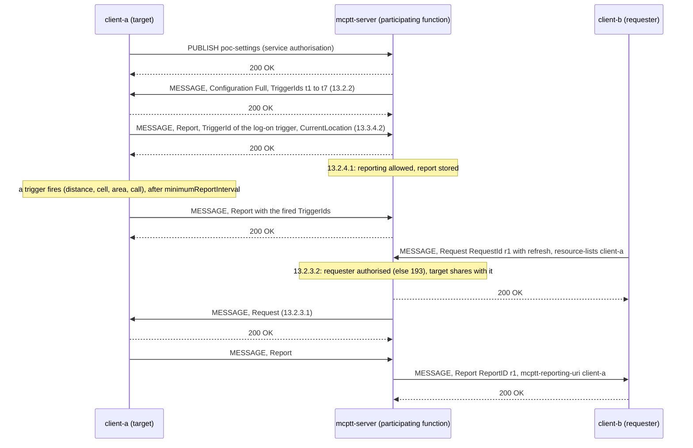
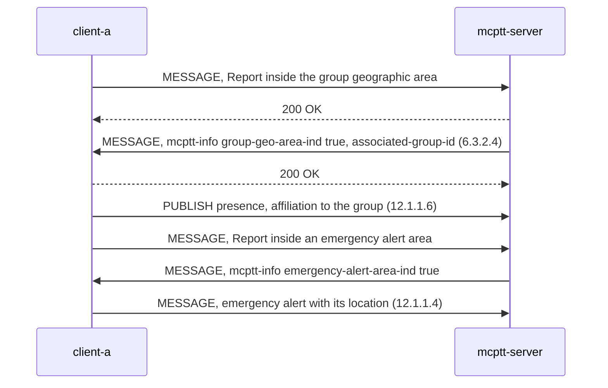

# Location management tests

These tests cover **location management for MCPTT** (TS 23.280 §10.9; stage 3 in TS 24.379 V19.7.0 clause 13, §6.3.2.4, §12.1.1.4 and §12.1.1.6). The participating function configures each client's location reporting, receives its reports, answers authorised users' requests, and acts on emergency alert areas and group geographic areas. The [SEAL location management server](#seal-location-management-server-sl-01-to-sl-06) of TS 24.545 serves the MCPTT server. The same procedures for MCData are in [MCData location tests](../mcdata/MCDATA_LOCATION_TEST.md). What the tests do not cover is listed under [coverage gaps](#coverage-gaps).

Back to the [test index by call type](../MCPTT_TEST.md).

## Implemented profile

| Step | Behavior | Reference |
|---|---|---|
| Body | `application/vnd.3gpp.mcptt-location-info+xml`: `<Configuration>` (ConfigScope Full or Update, the requested location information, every triggering criterion of Annex F.3, and `<EmergencyTriggeringCriteria>` in its `<anyExt>`), `<Request>` (RequestId, refresh, `<LocationFilter>`) and `<Report>` (ReportID, ReportType, TriggerIds, `<mcptt-reporting-uri>`, `<CurrentLocation>`). Coordinates are coded as in TS 23.032 §6.1 to §6.4. Unknown elements are ignored. | 24.379 Annex F.3 |
| Configuration | Upon successful service authorisation, the participating function sends each client the configuration from its user profile (`location.configuration`) or the server's `mcptt.location.configuration`. The MESSAGE carries an mcptt-info naming the user, the icsi-ref Accept-Contact and P-Asserted-Service. TriggerIds are numbered in order, so a user authorised again keeps the same ones. The function stores what it sent. | §13.2.2 |
| Client triggers | The client applies Full and Update configurations and starts the minimumReportInterval timer. It evaluates cell, tracking area, PLMN, MBMS SA, MBSFN, 5G MBSFSA, 5G tracking area and RAT changes; periodic reports; travelled distance; the signalling events (log-on, non-emergency group and private calls, configuration received, functional alias activation and deactivation); geographical area entry and exit (polygons and ellipsoid arcs, with inner and outer border widths); and the adaptive time and distance trigger. In an emergency (emergency or imminent peril call, emergency private call, emergency alert) it switches to the emergency information and triggers. A configuration that requests nothing cancels reporting. | §13.3.2.1, §13.3.4.1, Annex F.3.3 |
| Reports | A single-bodied MESSAGE to the configuration's P-Asserted-Identity, with the g.3gpp.mcptt Accept-Contact. It carries the fired TriggerIds, a `locTimestamp` and the requested location. An emergency alert carries the current coordinate instead of a configured one. | §13.3.4.2, §6.2.9.1 |
| Reception | Reports are authorised against the profile (`location.report`); a refused one gets 403. The last report per user is stored. | §13.2.4.1 |
| Requests | An authorised user (`location.request`) names users in a resource-lists body, or a functional alias in `<location-of-functional-alias-URI>`. The participating function answers from the stored report, or first asks the client (§13.2.3.1) when nothing is stored, the report is older than `max_age_ms` or refresh is set. It waits `wait_ms` for the answer. A `<LocationFilter>` is evaluated against the area its TriggerId names in the target's configuration. A target that does not share its location with the requester (`location.share_with`) is silently ignored. The report goes to the requester with its RequestId as ReportID and `<mcptt-reporting-uri>`. | §13.2.3.2, §13.3.3.2 |
| Configuration changes | An authorised user (`location.configure`) sends a `<Configuration>` for listed users. Missing TriggerIds are assigned once for all of them. The new configuration is sent to each target, naming the requester in `<mcptt-calling-user-id>`. | §13.2.2A, §13.3.2.2 |
| Refusals | No resource list and no alias: 403 warning 192. Requesting without the right: 403 warning 193. Configuring without the right: 403 warning 194. A requester unknown to the participating function: 404 warning 141. | §13.2.3.2, §13.2.2A |
| Users of another participating function | A request or configuration for a user served by another participating function goes there as a copy, naming only that user and the requester. The other function answers to this function's PSI, and the report is passed on to the requester by its ReportID. The serving function is the peer the user is registered through, or `mcptt.location.peers` (by MCPTT ID or `@domain`). | §13.2.2A step 7b, §13.2.2B, §13.2.3.2 step 7A a, §13.2.3.3, §13.2.4.2 |
| Areas | `mcptt.location.emergency_alert_areas` and `mcptt.location.group_areas` (group ID → area, for members) are checked on every report. An entry or exit is notified with `<emergency-alert-area-ind>`, or with `<group-geo-area-ind>` and `<associated-group-id>`, and recorded on 200. The first position counts as an entry into the areas it is in. On an emergency alert area entry the client raises an emergency alert, unless already in the emergency state. On a group area entry or exit it affiliates or de-affiliates. | §6.3.2.4, §12.1.1.4, §12.1.1.6 |
| Relayed requests | A location request or configuration inside a request relayed to a client is removed. | §13.2.5 |

### Local choices

| Choice | Reason |
|---|---|
| Rights in the user profile's `location` object (`request`, `configure`, `report`, `share_with`) | TS 24.379 leaves the authorisation out of scope (§13.2.2A NOTE 2, §13.2.3.2 NOTES 2 and 4). |
| An arc's `<Radius>` in metres; its angles coded as in TS 23.032 (offset 2N°, included 2(N+1)°) | Annex F.3 names only the element types. |
| The first position fires no area trigger at the client; at the participating function it counts as an entry | The client's triggers fire on a change; the notifications of §6.3.2.4 tell a client it is in an area. |
| The log-on trigger fires when the configuration of that log-on arrives | The configuration follows service authorisation (§13.2.2). |
| The schema's `<AddaptiveTrigger>` is sent; `<AdaptiveTrigger>` is accepted too | The schema and the semantics spell it differently. |
| A report for a requester served by another participating function is addressed to that user's public user identity, not the PSI of its participating function | §13.2.3.3 step 4 v A names the PSI, but every participating function of a system shares it. The user's identity reaches the right function, which passes the report on by its ReportID (§13.2.4.2). |

### Client commands

```bash
mcx-client --config FILE --command 'location position 48.01 2.0 [altitude]'
mcx-client --config FILE --command 'location radio cell 208010000000000000000000000000000001'
mcx-client --config FILE --command 'location report'
mcx-client --config FILE --command 'location request [refresh] [filter <TriggerId> in|out] [fa <alias>] <MCPTT ID>...'
mcx-client --config FILE --command 'location configure <MCPTT ID>[,<MCPTT ID>] {"scope": "update", "triggers": [{"periodic": 2}]}'
```

The client status has `location` (configuration, pending triggers, sent and received reports, area notices), `location_last_request` and `location_last_result`. The server status has `location` (counters, and per user the stored configuration, last report and acknowledged areas).

## Call flows

### Configuration, reports and a request with refresh (LOC-01 to LOC-11)

SIP passes through the SIP core, which is omitted. The location body is `application/vnd.3gpp.mcptt-location-info+xml`.



### An area notice (LOC-16 and LOC-17)



## SEAL location management server (SL-01 to SL-06)

The LMS role is also the **SEAL location management server** (SLM-S) of TS 24.545 V19.4.0 over HTTP (TS 23.280 §10.9.3, TS 23.434 §9.3). It works alongside the participating functions' location procedures above; it does not replace them. The body is `application/vnd.3gpp.seal-location-info+xml` (namespace `urn:3gpp:ns:sealLocationInfo:1.0`). A position is carried as `<threebytes>` values coded as in TS 23.032 §6.1.

| Step | Behavior | Reference |
|---|---|---|
| Configuration | A client reads its own location reporting configuration with its access token (`GET /seal-lm/v1/users/{MCPTT ID}/configuration`, through the HTTP proxy at `/lms`). The configuration requests the coordinate, sets a `<periodic-report>` trigger (2 s in the labs) and a `<minimum-interval-length>`, and gives the report and history URIs. The server builds these URIs from the proxy's host and removed prefix. Another user's configuration is refused 403. | 6.2.2.3.1 |
| Reports | The client reports its position on the trigger (`<report>` with `<trigger-id>`, `<current-geographical-coordinate>`, `<timestamp>`). A report for another user is refused 403. The server keeps the latest position and a history of each user (100 positions). | 6.2.2.2.2, 6.2.2.3.2 |
| History | While offline, the client stores the positions its trigger produces. Back online, it sends them in a `<history-loc-result-report>`. They go into the history without replacing the latest reported position, and the subscribers are notified of them with trigger-id `history`. | 6.2.20.2, 6.2.20.3; TS 23.280 §10.9.3.9 |
| Subscription | An MC service server of this system subscribes with its server credentials, naming itself in `<identity>`. It gives the users, `<time-interval-length>` and `<expiry-time>`. The answer carries `<subscription-identifier>`, the accepted expiry and, when some users were left out, the users kept. A server not in `seal_lm.val_servers` is refused 403. `<expiry-time>` 0 with the identifier deletes the subscription. | 6.2.6.2.2 |
| Notification | At most once per interval (TLM-2), the subscriber gets the positions reported since the last notification, each as a `<loc-info-report>` with its timestamp. The latest known position comes at once. At TLM-1 the subscriber is told the subscription ended (`<expiry-time>` 0). | 6.2.6.2.1.3, 6.2.6.2.1.4, 6.2.7.2 |
| On demand | An MC service server asks for users' latest positions. With `<history/>` in `<anyExt>` (project extension), the stored history comes too. | 6.2.8.2; TS 23.280 §10.9.3.9 |

### Local choices

| Choice | Reason |
|---|---|
| The Request-URIs are `/seal-lm/v1/…`. The report and history URIs go in `<anyExt>` of the configuration (project namespace `urn:openmcx:ns:sealLocation:1.0`). | TS 24.545 leaves the URIs to the vertical application's usage and gives no element for them. |
| The notifications of 6.2.7.2 c) reach the MCPTT server on a long-poll channel it opens at the SLM-S (`POST /seal-lm/v1/notifications?val=…&wait=8`), with each notification carried unchanged. | The MCPTT server has no HTTP listener, and the SLM-S no SIP; the MCData message store uses the same kind of channel. |
| An on-demand request is answered from the stored positions, without asking the client for a fresh report (6.2.3). | TS 23.280 §10.9.3.6.2 step 3 allows either, depending on the configuration. |
| The MC service server is authenticated with its server credentials and trusted for any user of its system. | TS 23.280 §10.9.3.5 NOTE 2: the MC service server is implicitly trusted. |
| `<expiry-time>` in a request is read by its magnitude (the schema makes it non-positive); the answer gives the accepted number of seconds. | The schema and the procedure text disagree; the value is a duration either way. |

### Commands

```bash
mcx-client --config FILE --command 'seal start|offline|online|stop'
openmcx-mcptt-server --config FILE --command 'seal-subscribe <MCPTT ID>[,...] [interval] [expiry]'
openmcx-mcptt-server --config FILE --command 'seal-unsubscribe'
openmcx-mcptt-server --config FILE --command 'seal-locate [history] <MCPTT ID>[,...]'
```

The client records `seal` in its status (the configuration, and the reports sent, stored and sent as history). The server records `seal` with the subscription, the latest position of each user (`via` notification or request) and the history positions it was given.

## Run a separate lab

```bash
docker build -t openmcx:0.68-loc -f docker/Dockerfile .
python3 tools/prepare-prearranged-test.py --directory artifacts/location-lab --project openmcx-location \
  --debug-sip --priority --location --image openmcx:0.68-loc
mkdir -p artifacts/location-lab/artifacts/{speech,integration} && cp artifacts/speech/{alpha,bravo}.wav artifacts/location-lab/artifacts/speech/
C=".cache/deps/docker-compose-linux-x86_64 -p openmcx-location -f artifacts/location-lab/compose.json"
$C up -d --wait mcptt-server
docker run -d --rm --name openmcx-location-capture --network "container:$($C ps -q mcptt-server)" --cap-drop ALL --cap-add NET_RAW \
  openmcx-dev:0.1 tcpdump -Z root -i eth0 -U -s 0 -w /tmp/c.pcap 'tcp port 5060'
$C up -d --wait
python3 tests/integration/location_scenario.py --compose artifacts/location-lab/compose.json \
  --artifacts artifacts/location-lab/artifacts --project openmcx-location
docker cp openmcx-location-capture:/tmp/c.pcap artifacts/location-lab/artifacts/integration/location.pcap; docker stop openmcx-location-capture
python3 tests/integration/verify_location.py artifacts/location-lab/artifacts/integration/location.pcap \
  --service sip:mcptt@mcx.test --output artifacts/location-lab/artifacts/integration/location-wire.json
```

`--location` sets up the following. It also configures the MCData server, for the [MCData location tests](../mcdata/MCDATA_LOCATION_TEST.md).

| Item | Setting |
|---|---|
| Reporting configuration | `t1` log-on, `t2` group call, `t3` 250 m, `t4` and `t5` entry into and exit from a zone north of the clients (borders 10 m), `t6` any cell change; the emergency trigger `t7` every 2 s; coordinates and the serving ECGI, at most one report a second |
| client-a | May request and change others' location reporting |
| client-b | Shares with anyone |
| client-c | Shares with client-b only |
| client-d | May not report |
| Areas | An emergency alert area and the group's geographic area, north-east of the clients |
| Positions | The clients start 750 m apart along 48° N |


## Performed tests

Recorded on **2026-09-25** against image `openmcx:0.68-loc` (`088f3e9629d4`), built from branch `mcptt-mcdata`. Every report records **PASS**.

| ID | Checks | Evidence |
|---|---|---|
| LOC-01–LOC-02 | Configuration after service authorisation (TriggerIds t1 to t7); the log-on report of each client, stored with its coordinate | [Scenario report](../../artifacts/loc-lab-f2/artifacts/location.json) |
| LOC-03 | A user whose profile denies reporting is refused 403 and nothing is stored | Same report |
| LOC-04–LOC-07 | Travelled distance, zone entry and exit with border widths, cell change with the serving ECGI, a group call | Same report |
| LOC-08–LOC-11 | A request answered with the RequestId and the reporting user; refresh through a request to the client; LocationFilter in and out; a user who does not share is not reported | Same report |
| LOC-12–LOC-14 | Refusals 193, 192 and 194 | Same report |
| LOC-15 | An authorised Update adds a periodic trigger; the target reports on it | Same report |
| LOC-16 | Group geographic area: entry recorded; exit de-affiliates the client; entry affiliates it again | Same report |
| LOC-17 | Emergency alert area: entry raises the client's alert; Emergency reports on the emergency trigger; exit recorded | Same report |
| SL-01–SL-06 | The SEAL location management server: bob's client reads its configuration and reports every 2 s; the MCPTT server subscribes to bob, carol and dave, and is notified of bob's positions, including after he moves; an on-demand request; offline, bob's client stores its positions and sends them as history, which reaches the server; on demand with history; unsubscription (11 checks) | `location.json` of the `location` lab |

The location scenario passed 39 checks. `verify_location.py` passed 14 wire checks (W-00 to W-07) on the capture of the server namespace ([result](../../artifacts/loc-lab-f2/artifacts/integration/location-wire.json)): 7 configurations, 9 requests and 29 reports, with the emergency alert's own location told apart.

The SEAL checks were recorded on **2026-09-26** against image `openmcx:item7-b` (`f190af423284`): the location scenario passed 50 checks. The Go unit tests cover the SLM-S. The C++ unit tests cover the location-info documents.

Regression on the same image: `run_all_call_types.sh` (8 call types) passed. On the binaries of this change (a layered test image), the priority scenario, the six MCData scenarios clear and with signalling and XML protection and the protected MCData scenario also passed.

## Coverage gaps

| Area | Gap |
|---|---|
| Location in XML protection | MCPTT location content is encrypted with the rest of the MCPTT XML when XML protection is on ([XML protection tests](XML_PROTECTION_TEST.md)); no location scenario runs with it. MCData location XML is encrypted when protection is on. |
| SEAL location management | The SLM-S is implemented over HTTP for configuration, periodic reports, history reports, subscriptions, notifications, and on-demand requests (see above). Not implemented: CoAP (6.2.x.4, 6.2.x.5), the SIP-based subscription (6.2.6.2.1), triggers other than the periodic one, on-demand reports fetched from the client (6.2.3), location-based queries (6.2.9), location area monitoring, registration, adaptive configuration and the other procedures from 6.2.10 on, group-based subscriptions (TS 23.280 §10.9.3.5 step 3), and the MCData server as a subscriber. The participating functions still configure the clients' clause 13 location reporting on their own. |
| Radio information | The UE's position and radio identities are simulated by commands. No real positioning, cell measurements or neighbour lists are available, and P-Access-Network-Info is not used. RRC_INACTIVE parameters of the adaptive trigger are not evaluated. |
| Group areas | The client affiliates to, or de-affiliates from, its configured group only. A notice for another group is recorded but not acted on. |
| Report in another request | A report always travels in its own MESSAGE (§13.3.4.2 allows adding it to a request the client sends anyway). |
| Functional alias target | A request naming `<location-of-functional-alias-URI>` covers the users who activated the alias at this server. The owning server's status determination (§9A.2.2.2.7) is not queried. |
| Off-network | Off-network location (TS 24.379 clause 13 has no off-network procedures; TS 23.280 §10.9 is on-network) is not applicable. |
