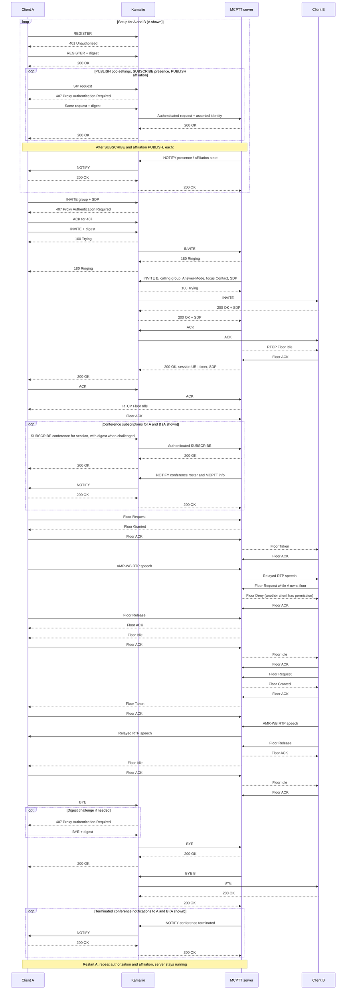

# MCPTT two-participant group call

Client A calls a prearranged group containing A and B. A speaks while B's competing
floor request is denied; B then speaks. Both clients receive decoded AMR-WB audio,
the call ends, and A restarts and reaffiliates without restarting the server.

## Kamailio changes

**Configuration only; no upstream Kamailio source patch.**
[`kamailio.cfg`](../../docker/kamailio.cfg) and
[`compose.debug.yaml`](../../compose.debug.yaml) enable explicit `SIP_DEBUG_NO_TLS`:

- Debug: SIP over TCP/5060, corresponding server route and health check; server
  identity and dialog ACK checks use source addresses on the isolated lab network.
- Default: mutually verified SIP TLS/5061. SIP digest, From checks and asserted
  identity handling remain active in debug mode. HTTPS services remain encrypted.
- Public session Contacts use loose routing mode 1 and resolve to the application
  server for ACK, BYE and refresh requests.
- Earlier configuration also set `tls_threads_mode=2` for OpenSSL 3 and disabled
  DNS caching so recreated Docker service addresses are resolved again.

## Setup outside the SIP diagram

These application exchanges are verified from implementation and service tests;
HTTPS bodies are not readable in the SIP captures.

| Path | Messages |
|---|---|
| Each client → IdMS | GET discovery → 200; GET authorize (PKCE) → 200; POST login → 302/code; POST token → 200; GET JWKS → 200 |
| Each client → HTTP proxy → CMS/GMS | GET user profile and group document → 200 |
| Server → IdMS / user database | POST token introspection → 200; Diameter Data-Pull-Request/Answer (DPR/DPA) over SCTP during service authorization |
| Server → GMS | Group-policy GET/200 during affiliation, call admission and floor checks; periodic revalidation during the call |

The server and database establish their Diameter peer connection before the call.
LMS and KMS do not participate in this clear-media test.

## High-level message flow

Setup repeats for both clients; A represents either client in the setup loop.
All SIP hops through Kamailio are shown. Repeated packets, concurrent ordering,
TCP acknowledgements and individual RTP packets are collapsed for readability.
Floor ACKs are enabled. SIP ACK and RTCP Floor ACK are distinct messages.
See [extended prearranged tests](PREARRANGED_TEST.md) for membership, queueing and simultaneous groups.



Fanout acceptance precedes the originator's final answer. Independent conference
and floor notifications can interleave. The restart check runs after capture stops;
idempotent teardown prevents the former duplicate BYE transaction.

## Run and inspect

```bash
# From the repository root, after building/provisioning the lab:
tools/mcx compose -f compose.debug.yaml up -d --force-recreate sip-core mcptt-server client-a client-b
tools/mcx test
MCX_TSHARK=/path/to/tshark tools/test-lab --disable-tls
```

`MCX_TSHARK` is optional when `tshark` is on PATH. The result explicitly records
whether external dissection ran. Wireshark filters: `sip`, `rtcp`, `rtp`.
If floor traffic is not automatically recognized, decode UDP/5000 and UDP/5002
as RTCP for the default lab configuration.

Latest verified run: **11/11 native tests and Go tests passed; two-way speech,
floor contention, teardown and restart passed. TShark 4.6.4 decoded all 29 floor
packets with zero expert diagnostics.** This validates the tested lab subset,
not full MCPTT conformance.

- Server SIP + RTP + floor capture (`artifacts/integration/mcptt-debug.pcap`)
- SIP-core capture, including registration (`artifacts/integration/sip-debug.pcap`)
- Wire/dissector results (`artifacts/integration/wire-debug-results.json`)
- Speech results (`artifacts/integration/speech-debug-results.json`)
- Restart results (`artifacts/integration/restart-debug-results.json`)

Capture files are written by the host user with private artifact permissions.
