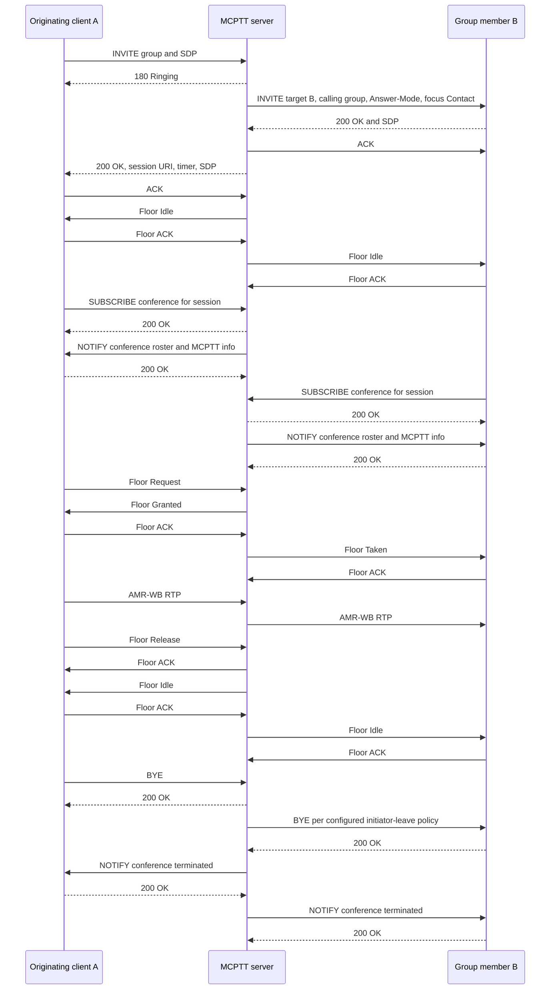

# Prearranged group call tests

These tests exercise **on-network, on-demand prearranged group calls**. A two-member group remains a group call, not a private call. They do not certify complete MCPTT or all prearranged-call variants; remaining scope is explicit.

## Running the tests

The lifecycle scenario runs in the `smoke` lab, the failure and refresh scenario in the `call-types` lab, and the queued
floor scenario in the `floor-queue` lab of the regression:

```bash
tools/regress.py --images <tag> --client-image openmcx-client:<tag> --select =smoke
tools/regress.py --images <tag> --client-image openmcx-client:<tag> --select =call-types
tools/regress.py --images <tag> --client-image openmcx-client:<tag> --select =floor-queue
```

| Scenario | What is checked |
|---|---|
| Lifecycle | Two-member setup, third-member late entry, participant leave, rejoin using the same session URI, exact conference rosters, initiator-policy teardown |
| Concurrent groups | Separate session identities and member sets, simultaneous floor owners and speech delivery, independent teardown |
| Failure and refresh | Manual rejection, caller CANCEL, unanswered setup timeout, cleanup, a pre-established session setup refused with 403 warning 100 (TS 24.379 §8.2.2 step 5), established call surviving its first 90-second SIP session timer refresh |
| Queued floor | Queue-position query, cancellation before release timeout, requeue, explicit queued-grant confirmation, speech, abandoned grant without transmitted RTP |

Each lab writes its JSON results under its `artifacts/integration/`. Speech packet counts alone do not exclude cross-group mixing; correlate captured RTP streams with source/destination endpoints for that assertion. A live call alone does not prove session refresh: the wire verifier checks the request and accepted response.

## High-level call flow

Registration, service authorization and affiliation precede this diagram. Each SIP arrow passes through Kamailio. Authentication challenges/retries and per-message TCP acknowledgements are omitted; floor ACKs are shown explicitly.



Membership changes produce further conference notifications. The queue scenario adds Floor Queue Position Info, Floor Queue Position Request and queued Floor Granted; a client must confirm a queued grant before sending speech. The refresh scenario includes in-dialog UPDATE/200 transactions. Scheduling can interleave independent notifications and floor packets differently from this diagram.
