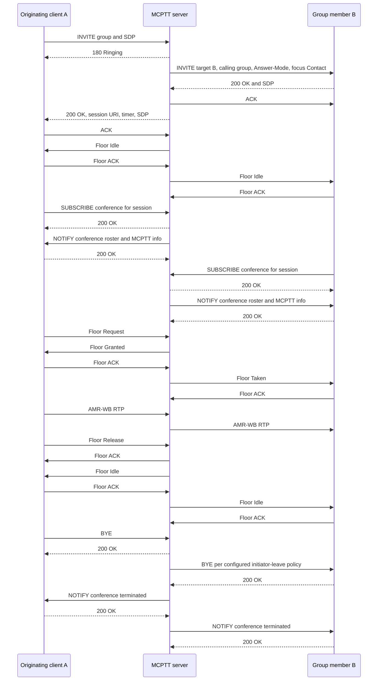

# Prearranged group-call regression

These tests exercise **on-network, on-demand prearranged group calls**. A two-member group remains a group call, not a private call. They do not certify complete MCPTT or all prearranged-call variants; remaining scope is explicit.

## Separate four-client lab

For a fresh fixture (the preparation command refuses to overwrite an existing directory):

```bash
docker build -t openmcx:0.1 -f docker/Dockerfile .
python3 tools/prepare-prearranged-test.py --debug-sip --floor-queue
mkdir -p artifacts/prearranged-lab/artifacts/speech
cp artifacts/speech/{alpha,bravo}.wav artifacts/prearranged-lab/artifacts/speech/
.cache/deps/docker-compose-linux-x86_64 -p openmcx-prearranged \
  -f artifacts/prearranged-lab/compose.json up -d
```

Run the scenarios in this order:

```bash
python3 tests/integration/prearranged_scenario.py \
  --compose artifacts/prearranged-lab/compose.json --artifacts artifacts/prearranged-lab/artifacts
python3 tests/integration/prearranged_failure_scenario.py \
  --compose artifacts/prearranged-lab/compose.json --artifacts artifacts/prearranged-lab/artifacts
python3 tests/integration/prearranged_floor_scenario.py \
  --compose artifacts/prearranged-lab/compose.json --artifacts artifacts/prearranged-lab/artifacts
```

| Scenario | Assertions |
|---|---|
| Lifecycle | Two-member setup, third-member late entry, participant leave, rejoin using the same session URI, exact conference rosters, initiator-policy teardown |
| Concurrent groups | Separate session identities and member sets, simultaneous floor owners and speech delivery, independent teardown |
| Failure and refresh | Manual rejection, caller CANCEL, unanswered setup timeout, cleanup, a pre-established session setup refused with 403 warning 100 (TS 24.379 §8.2.2 step 5; added 2026-09-22, image `openmcx:0.23-preest`), established call surviving its first 90-second SIP session timer refresh |
| Queued floor | Queue-position query, cancellation before release timeout, requeue, explicit queued-grant confirmation, speech, abandoned grant without transmitted RTP |

JSON results are under `artifacts/prearranged-lab/artifacts/integration/`. Speech packet counts alone do not exclude cross-group mixing; correlate captured RTP streams with source/destination endpoints for that assertion. A live call alone does not prove session refresh: the wire verifier checks the request and accepted response.

## High-level call flow

Registration, service authorization and affiliation precede this diagram. Each SIP arrow passes through Kamailio. Authentication challenges/retries and per-message TCP acknowledgements are omitted; floor ACKs are shown explicitly.



Membership changes produce further conference notifications. The queue scenario adds Floor Queue Position Info, Floor Queue Position Request and queued Floor Granted; a client must confirm a queued grant before sending speech. The refresh scenario includes in-dialog UPDATE/200 transactions. Scheduling can interleave independent notifications and floor packets differently from this diagram.

## Captured evidence

- [Lifecycle and simultaneous groups](../../artifacts/prearranged-lab/artifacts/integration/prearranged-results.json)
- [Reject, CANCEL, timeout and refresh](../../artifacts/prearranged-lab/artifacts/integration/prearranged-failure-results.json)
- [Queued-floor behavior](../../artifacts/prearranged-lab/artifacts/integration/prearranged-floor-results.json)
- [SIP and media-isolation verification](../../artifacts/prearranged-lab/artifacts/integration/prearranged-v6-wire.json)
- [Floor field and TShark checks](../../artifacts/prearranged-lab/artifacts/integration/prearranged-v6-floor-wire.json)
- [Clear SIP, RTP and RTCP capture](../../artifacts/prearranged-lab/artifacts/integration/prearranged-v6.pcap)

The v6 capture contains 98 RTCP messages with zero TShark expert diagnostics, two accepted SIP refreshes and 46 conference notifications. Queue cancellation completed in 197 ms; an unconfirmed queued grant sent no RTP. These results establish the scenarios above, not complete standards coverage.
