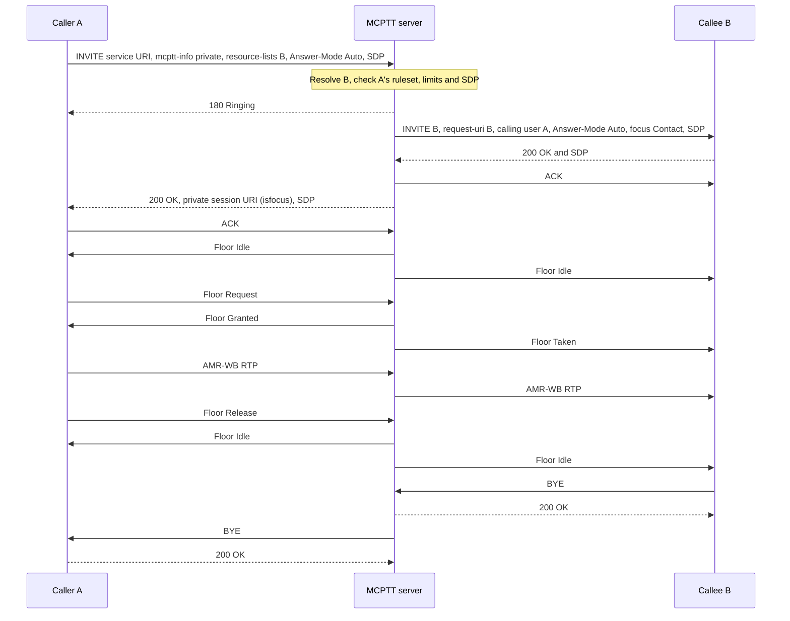
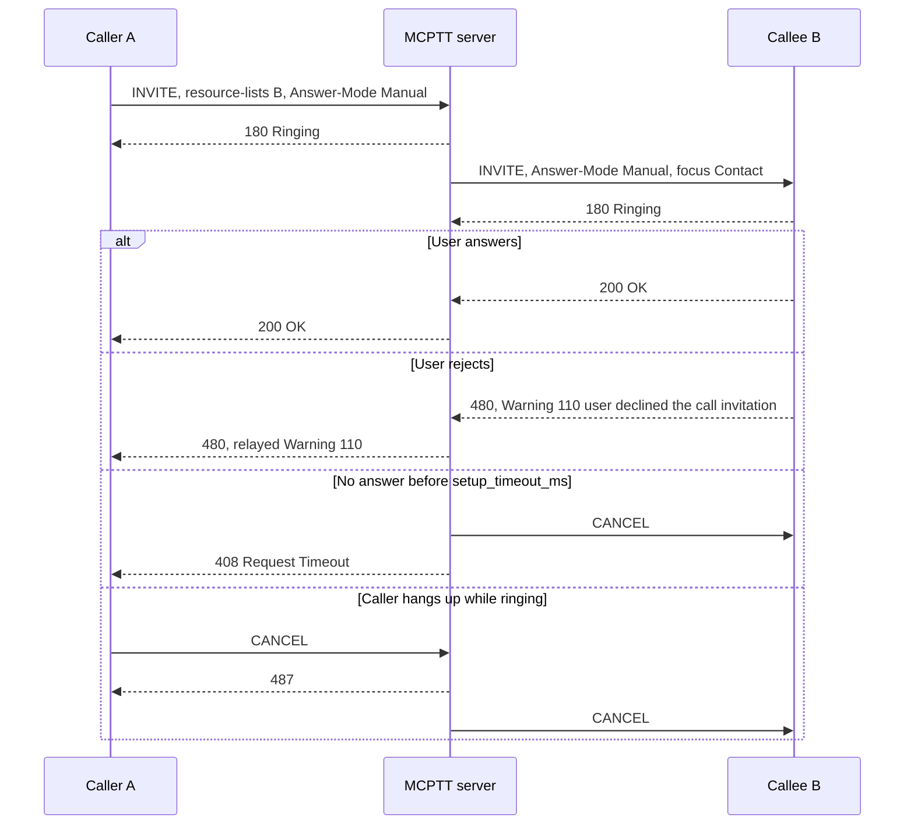
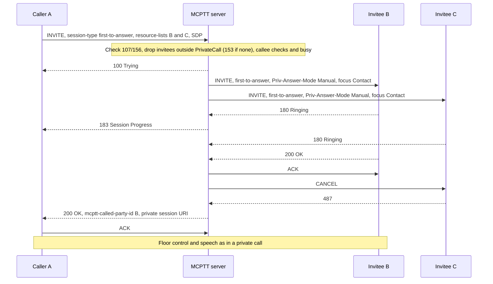

# Private call tests

These tests cover **on-network, on-demand private calls with floor control** between two MCPTT users (TS 23.379 §10.7, TS 24.379 §11.1.1). The recorded results cover the implemented subset below. They do not certify complete private-call conformance. [First-to-answer calls](#first-to-answer-call), [emergency private calls](#emergency-private-call) and the [private call services](#private-call-services) are covered. Announced transfer, pre-established and off-network private calls are not implemented; see [coverage gaps](#coverage-gaps).

Back to the [test index by call type](../MCPTT_TEST.md).

## Implemented profile

The single MCPTT server acts as both the originating participating function and the controlling function. There is no group, and group affiliation is not required.

| Step | Behavior | Reference |
|---|---|---|
| Originating INVITE | The client sends an INVITE to the MCPTT service URI. It carries `mcptt-info` with `<session-type>private</session-type>` and the calling user, plus an `application/resource-lists+xml` body naming exactly one called MCPTT ID. It includes `Answer-Mode: Auto`/`Manual` or `Priv-Answer-Mode: Auto`. | 24.379 §11.1.1.2.1.1 steps 1–14 |
| Called party | A missing body, several entries, several lists, or the caller's own ID → 403 with warning `145 unable to determine called party`. | §11.1.1.3.1.1 steps 8–9, §11.1.1.4.2 steps 3–4 |
| Authorization | The server reads the caller's private-call ruleset from the CMS (below). It rejects with 403 and warning 107, 125, 126, 143 or 144. An unregistered callee → 480. | §11.1.1.3.1.1 steps 10–11 |
| Called-party authorization | The server then reads the callee's ruleset. A callee marked `callable: false` → 403 `127 user not authorised to be called in private call`. A caller missing from the callee's `incoming_from` list (unless `incoming_any`) → 403 `159 user not authorised to be called by this originating user`. | §11.1.1.3.1.2 steps 8–9 |
| Limits | `max_calls` private calls per user. A caller at the limit → 486 with warning `124`. A callee at the limit → 486. | §4.4.2 warning 124 |
| Terminating INVITE | The server sends an INVITE to the callee with `mcptt-request-uri` = callee, the calling user, the forwarded `Answer-Mode`/`Priv-Answer-Mode`, and an `isfocus` Contact holding the private session URI. It has no `resource-lists` body. | §11.1.1.4.1 steps 1–5 |
| Commencement | Automatic mode answers with 200. Manual mode rings (180) until the user runs `answer`. `reject` → 480 with warning `110 user declined the call invitation`. `Priv-Answer-Mode: Auto` forces automatic mode even when the callee is set to manual. | §6.2.3.1.1, §6.2.3.2.1 |
| Outcome relay | The caller gets 200 once the callee answers. The callee's 480/486/488/603 and its Warning are relayed. An unanswered call gets 408 at `setup_timeout_ms`, and the callee's leg is cancelled. | §11.1.1.4.1 |
| Floor and media | One talker at a time over the two legs, with the same RTCP floor control and AMR-WB relay as group calls. No floor-priority negotiation. | 24.380 |
| Release | Either party's BYE ends both legs. `maximum_duration_ms` is the private call timer. `inactivity_timeout_ms` also applies. Every 2 s the server rechecks both rulesets and both parties' service authorization, and withdrawal releases the call. | §11.1.1.4.1 step 10, §11.1.3, §11.1.4 |

### User-profile ruleset (CMS)

The CMS serves the private-call subset of the TS 24.484 `<ruleset>` as `private_call` on the internal user resource. If an element is absent, the action is not authorized, as in the profile schema. `callable` is the exception: only an explicit `false` makes a user uncallable, so existing profiles keep working.

| JSON field | Profile element | Rejection when not granted |
|---|---|---|
| `allow` | `<allow-private-call>` | 403 `107 user not authorised to make private calls` |
| `automatic_commencement` | `<allow-automatic-commencement>` | 403 `125 … automatic commencement` (on `Answer-Mode: Auto`) |
| `manual_commencement` | `<allow-manual-commencement>` | 403 `126 … manual commencement` (on `Answer-Mode: Manual`) |
| `force_auto_answer` | force automatic commencement | 403 `143 not authorised to force auto answer` (on `Priv-Answer-Mode: Auto`) |
| `targets`, `any_target` | `<PrivateCall>` entries; permission to call users outside them | 403 `144 user not authorised to call this particular user`; for a first-to-answer call, unlisted invitees are dropped and 403 `153` is returned if none remain |
| `first_to_answer` | `<allow-request-first-to-answer-call>` | 403 `156 user not authorised to originate a first-to-answer call` |
| `callable` (callee) | Unable to participate in private calls when `false` | 403 `127 user not authorised to be called in private call` |
| `incoming_from`, `incoming_any` (callee) | `<IncomingPrivateCallList>` entries; permission to receive calls from users outside them | 403 `159 user not authorised to be called by this originating user` |
| `emergency`, `emergency_recipients` / `emergency_any`, `emergency_cancel` | `<allow-emergency-private-call>` with `<MCPTTPrivateRecipient>` UsePreConfigured / LocallyDetermined; `<allow-cancel-private-emergency-call>` | 403 `emergency private call not authorized` (body `emergency-ind` false); cancellation 403 with `emergency-ind` true |
| `alert`, `alert_recipients` / `alert_any`, `alert_cancel` | `<allow-activate-emergency-alert>` with `<PrivateEmergencyAlert>`; `<allow-cancel-emergency-alert>` | Call admitted with warning 149 and a SIP INFO withdrawing the alert |
| `callback`, `callback_cancel` | `<allow-request-private-call-call-back>`, `<allow-cancel-private-call-call-back>` | 403 `151` / `152` |
| `remote_init` | `<allow-request-remote-init-private-call>` | 403 `158` |
| `transfer` | `<allow-call-transfer>` (the requester must be in an established private call with the transferred user) | 403 `170` |
| `forward_manual` | `<allow-call-fwd-manual-any>` (the requester must have the forwarded call ringing) | 403 `173` |
| `forward_immediate` (callee) | Immediate forwarding target | The caller gets 480 `175 call is forwarded` and a forward request |
| `forward_no_answer`, `forward_no_answer_timeout_ms` (callee) | Forwarding target on no answer, and `<call-forwarding-no-answer-timeout>` (TNP1, default 20000) | After TNP1 the invitation is cancelled and the caller gets 480/175 and a forward request with reason `no-answer`; an unregistered callee is forwarded at once |

Provision it per user in [`config/lab.json`](../../config/lab.json) (targets are local MCPTT user names). The default lab grants alice and bob private calls to each other. The server's `mcptt.private_call` object sets `setup_timeout_ms` (default 30000), `max_calls` (default 1), `inactivity_timeout_ms` and `maximum_duration_ms`.

### Client commands

```bash
mcx-client --config FILE --command 'private sip:bob.mcptt@mcx.test auto'        # Answer-Mode: Auto
mcx-client --config FILE --command 'private sip:bob.mcptt@mcx.test manual'      # Answer-Mode: Manual
mcx-client --config FILE --command 'private sip:bob.mcptt@mcx.test force-auto'  # Priv-Answer-Mode: Auto
mcx-client --config FILE --command 'first-to-answer sip:bob.mcptt@mcx.test sip:carol.mcptt@mcx.test'
mcx-client --config FILE --command answer        # or: reject (480 + warning 110)
mcx-client --config FILE --command 'ptt /artifacts/speech/alpha.wav'
mcx-client --config FILE --command hangup
```

If you omit the mode, the client uses `mcptt.private_call_mode` (default `auto`). `answer-mode manual` makes the callee ring unless the caller forces automatic mode. The status file reports `call_type`, `private_peer`, `first_to_answer` and, after a failed attempt, `last_call_failure` (`status`, `warning`). While a first-to-answer call rings, the caller's `call_state` is `progress`; `private_peer` is set from the answer.

## Separate four-client fixture

The preparation script refuses to overwrite an existing directory. The `--image` option leaves other labs' image tags alone.

```bash
docker build -t openmcx:0.8-fta -f docker/Dockerfile .
python3 tools/prepare-prearranged-test.py --directory artifacts/private-lab --project openmcx-private \
  --debug-sip --private-call --private-refresh --image openmcx:0.8-fta
mkdir -p artifacts/private-lab/artifacts/speech
cp artifacts/speech/{alpha,bravo}.wav artifacts/private-lab/artifacts/speech/
.cache/deps/docker-compose-linux-x86_64 -p openmcx-private -f artifacts/private-lab/compose.json up -d
```

`--private-call` gives each user a different ruleset, so every rejection branch can be reached. It sets `setup_timeout_ms=5000`, `max_calls=1` and `maximum_duration_ms=30000`. `--private-refresh` raises the private call timer to 70 s and inactivity to 120 s, so the PC-12 call outlasts the 45 s refresh point of the 90 s SIP session timer.

| User | Ruleset |
|---|---|
| client-a | All commencement modes, force auto answer and first-to-answer; `<PrivateCall>` = {b, c} |
| client-b | Automatic and manual; any target; no force auto answer or first-to-answer |
| client-c | Automatic only; any target; accepts incoming private calls only from a (`incoming_from`) |
| client-d | No private-call authorization; `callable: false` |

Capture the server namespace, then run and verify:

```bash
SERVER=$(.cache/deps/docker-compose-linux-x86_64 -p openmcx-private -f artifacts/private-lab/compose.json ps -q mcptt-server)
docker run --rm --name openmcx-private-capture --network "container:$SERVER" --cap-drop ALL --cap-add NET_RAW \
  openmcx-dev:0.1 tcpdump -Z root -i eth0 -U -s 0 -w - '(udp and not port 53) or tcp port 5060' \
  > artifacts/private-lab/artifacts/integration/private-call.pcap &
python3 tests/integration/private_call_scenario.py \
  --compose artifacts/private-lab/compose.json --artifacts artifacts/private-lab/artifacts
docker stop openmcx-private-capture
python3 tests/integration/verify_private_call.py artifacts/private-lab/artifacts/integration/private-call.pcap \
  --service sip:mcptt@mcx.test --require-refresh --output artifacts/private-lab/artifacts/integration/private-call-sip-wire.json
python3 tools/inspect-pcap.py artifacts/private-lab/artifacts/integration/private-call.pcap \
  artifacts/private-lab/artifacts/integration/private-call-floor-wire.json
```

`verify_private_call.py` reassembles TCP/5060 itself and does not need tshark. It requires debug (clear) SIP. Use `--require-refresh` only with a `--private-refresh` fixture.

## Performed tests

Recorded on **2026-09-21** against image `openmcx:0.8-fta` (`6e367912416c`), built from branch `feat/mcptt-phase1` on top of `7a41a2f` with the S1–S3 changes. The fixture was prepared with `--private-call --private-refresh`, clear media, and debug SIP over TCP. Every report below records **PASS**. The scenario run made 83 assertions (80 numbered, plus readiness, idle-start and unchanged-server checks) on one server instance. It superseded the earlier run on image `openmcx:0.2-private`, which made 53 assertions.

| ID | Scenario | Assertions | Result evidence |
|---|---|---|---|
| PC-01 | Automatic commencement: exactly two private legs, calling/called identities, same-group members not invited, no conference subscription | 3 | [Scenario report](../../artifacts/private-lab/artifacts/integration/private-call-results.json) |
| PC-02 | Two-way decoded speech (355/337 packets), competing request denied, non-participants receive nothing (checked against a baseline), callee hangup ends both legs, session URI cleared | 10 | Same report |
| PC-03 | Manual commencement: callee rings, `answer` makes the call active, caller hangup | 3 | Same report |
| PC-04 | Manual decline: callee `reject` → caller receives 480 with warning 110; session cleaned up | 3 | Same report |
| PC-05 | `Priv-Answer-Mode: Auto` answers even though the callee is set to manual | 2 | Same report |
| PC-06 | Local manual setting rings despite a requested `Answer-Mode: Auto`; caller CANCEL (487) clears the callee | 2 | Same report |
| PC-07 | Unanswered call → 408 at the 5 s setup timer (observed 5.26 s); callee cleared | 3 | Same report |
| PC-08 | Caller authorization 107/126/143/144 and unregistered callee 480. Called-party authorization: 403/127 for a `callable: false` callee and 403/159 for a caller missing from `incoming_from`, while a listed caller reaches that callee. Rejected calls never reach the callee | 10 | Same report |
| PC-09 | At `max_calls`: calls to a busy callee and a busy caller → 486; established call unaffected | 5 | Same report |
| PC-10 | A private call alongside an independent group call: separate sessions, concurrent floor owners, ending the private call keeps the group call | 7 | Same report |
| PC-11 | A deaffiliated callee is still reachable by private call | 4 | Same report |
| PC-12 | The private call timer (70 s with `--private-refresh`) releases the call while speech flows (observed 69.93 s), so the call spans the 45 s refresh point | 2 | Same report |
| PC-13 | SIP wire (37 checks). Private calls: one `resource-lists` entry per originating INVITE; terminating INVITE identities and `isfocus` Contact; commencement headers forwarded; clear SDP; warnings 107/126/143/144/127/159, 408, 486 and 480; callee decline on the terminating leg; no conference SUBSCRIBE; BYE answered 200. **Refresh (S2):** two in-dialog refreshes on private dialogs answered 200 with `Session-Expires`. **First-to-answer:** two or more invitees, `Priv-Answer-Mode: Manual`, 183 before 200, `mcptt-called-party-id` names an invitee, unselected invitees cancelled, any loser BYE carries `not selected for call`, 480/153/156 | 37 | [SIP wire report](../../artifacts/private-lab/artifacts/integration/private-call-sip-wire.json) |
| PC-14 | Floor/RTP decoding: all floor types decode; 12 Audio SSRC fields validated over 4,276 packets | decoder | [Floor wire report](../../artifacts/private-lab/artifacts/integration/private-call-floor-wire.json) |
| PC-15 | Regression on the same image. In the private lab: prearranged lifecycle 21 and failure/refresh 15. In a combined fixture (`--private-call --broadcast --chat --adhoc`, one server instance): prearranged 21, failure 15, broadcast 32, private 83, chat 35, ad hoc 44 | 266 | [Lifecycle](../../artifacts/private-lab/artifacts/integration/prearranged-results.json), [failure](../../artifacts/private-lab/artifacts/integration/prearranged-failure-results.json), [combined lab](../../artifacts/combined-lab/artifacts/integration/) |
| PC-16 | First-to-answer (S3): both invitees ring in forced manual mode while their local mode is automatic; the caller sees 183; the first answerer becomes the peer and gets speech, and the other is cancelled; either invitee may win; one decline leaves the other ringing, and all declining → 480; caller CANCEL clears every invitee; concurrent answers select exactly one invitee; an unlisted invitee is filtered out; 403/156, 403/107 and 403/153 | 26 | [Scenario report](../../artifacts/private-lab/artifacts/integration/private-call-results.json) |
| PC-17 | Unit and service tests: `test_private_call` (ruleset branches, callee checks 127/159, first-to-answer 145/107/156/153 and filtering), `test_protocol` (`mcptt-called-party-id`, `release-reason`), Go `TestCMSServesCalleePrivateCallPolicy`; native suite 17/17 and Go tests pass | native/Go | `tools/mcx test` |

The capture of every scenario is [private-call.pcap](../../artifacts/private-lab/artifacts/integration/private-call.pcap). An earlier run on this image (kept in `artifacts/private-lab/run1/`) hit the concurrent-answer race: the losing invitee's 200 crossed the CANCEL and was released by BYE with `<release-reason>not selected for call</release-reason>`. That run follows a SIP-engine fix. Before the fix, a run on `openmcx:0.7-fta` left the losing invitee connected, because PJSIP does not end a call whose 2xx crosses the CANCEL. [Container identities](../../artifacts/private-lab/artifacts/integration/private-containers.txt) record the deployment. TShark was unavailable, so external Wireshark dissection was not run.

### Emergency private calls and private call services — 2026-09-22

Image `openmcx:0.17` (`7a42efef3b69`). The `--private-call --private-refresh` run made **95 assertions**, all **PASS**: PC-01–PC-12 and PC-16 as above (session refresh again spanned by a 69.9 s call), plus PC-18 below. Its SIP wire check (45 checks) adds the emergency checks: emergency-ind and Resource-Priority on setup, in-dialog upgrade and downgrade, 403 carrying the unchanged state, the INFO alert correction and warning 149. The floor decode covered 4,398 packets with 12 Audio SSRC fields. The separate `--private-call --private-services` run made **32 assertions**, all **PASS**. Evidence: `artifacts/final-private/` and `artifacts/final-services/` (`…/artifacts/integration/`).

| ID | Scenario | Assertions |
|---|---|---|
| PC-18 | Emergency private call (S4): authorised emergency call with alert (caller MEPC 3 / MEPP 2 / MPEA 3; callee MEPP 2 with the caller's alert); unauthorised cancellation rejected with MEPP restored; authorised cancellation of call and alert; in-dialog upgrade; release resets the states; unauthorised emergency calls rejected (no permission, recipient not preconfigured); an unauthorised alert withdrawn by SIP INFO (MPEA 1) while the emergency call proceeds | 12 |
| PS-01 | Call-back: the target stores the request with its urgency, the requester entry reaches PCCB-I3, and fulfilment rings the requester in manual mode; both entries are deleted | 6 |
| PS-02, PS-03 | Call-back cancellation removes both entries; unauthorised request → 403/151 | 3 |
| PS-04, PS-05 | Remotely initiated call: the remote user calls the requested target and the requester is told of success; unauthorised request → 403/158 | 4 |
| PS-06, PS-06b, PS-07 | Transfer: the transferred user keeps its call with the requester while it calls the target, ends up in a call with the target, and the requester is told of success and leaves; a failed transfer leaves the requester and the transferred user in their call; unauthorised transfer → 403/170 | 9 |
| PS-08 | Manual forwarding: the ringing callee forwards, the caller gets 480/175, reaches the target, and the forwarding user is told of success | 5 |
| PS-09 | Immediate forwarding: 480/175, the forwarding user is never rung, and the caller reaches the forwarding target | 4 |
| PS-10 | Client-side profile enforcement (S10): a client with enforcement on refuses a call-back its downloaded `<ruleset>` does not grant, and nothing reaches the target | 2 |

The combined all-call-type run on the same image is listed in the [test index](../MCPTT_TEST.md).

### Announced transfer, forwarding on no answer and application priority — 2026-09-25

Image `openmcx:item4-e` (`132768e2c262`), built from branch `mcptt-mcdata` on `e55382c` with these changes. The `--private-call --private-services` scenario made **53 assertions**, all **PASS**, in `tools/regress.py --select mcptt` (21 labs, all passing). The fixture adds client-d's forwarding on no answer to client-a with a 3 s TNP1, and a user `offline` that never registers and forwards to client-a on no answer; client-a may call client-d.

| ID | Scenario | Assertions |
|---|---|---|
| PS-04a | Remotely initiated private call with `<ric-app-level-priority>` mcptt.6: the remote user's call is placed, and the server accepts its Resource-Priority for that call | 3 |
| PS-11 | Forwarding on no answer: client-b calls client-d, which rings; after TNP1 (measured 3.0 s) client-b gets 480/175 and a forward request with reason no-answer, client-d's invitation is cancelled, client-b reaches client-a, and the server reports the expiry | 7 |
| PS-12 | A call to the unregistered user `offline` is forwarded at once with reason no-answer, and the caller reaches the forwarding target | 3 |
| PS-13 | Announced transfer: client-a holds its call with client-b (the server holds the leg) and calls client-d, whose answer returns its dialog; both calls coexist. `transfer complete`: client-b's call with Replaces replaces client-a's call at client-d, client-d reports the replaced dialog, and client-a is told of success and has left both calls | 8 |

A first run of PS-13 crashed client-a on a PJSIP assertion: client-a's BYE to the target crossed the server's BYE ending the replaced call, and the response to client-a's BYE then reached a session PJSIP had destroyed. The SIP engine now keeps its reference to a session it ends until that BYE's transaction ends.

## High-level call flows

Registration and service authorization come before these flows. Each SIP arrow passes through Kamailio, which is omitted here. Digest challenges and TCP acknowledgements are also omitted.

### Automatic commencement, speech and release



Floor ACKs work as in the [group-call flow](PREARRANGED_TEST.md#high-level-call-flow) and are omitted here. There is no conference subscription. Either party's BYE, the private call timer, inactivity, or withdrawn authorization releases both legs.

### Manual commencement: answer, decline and timeout



`Priv-Answer-Mode: Auto` skips the ringing branch at the callee. An authorization failure (warnings 107, 125, 126, 143, 144, 145, and the callee-side 127 and 159) returns 403 to the caller before any INVITE reaches the callee.

### Emergency private call

TS 24.379 §6.2.8.3 and §11.1.1.4.3–6. `private <id> [mode] emergency [alert]` sends `emergency-ind` true (and `alert-ind`) with the emergency Resource-Priority. With an alert, it also sends a location. The server authorises the call against the caller's ruleset and keeps the in-progress emergency state for the call; it sets the floor D-bit and carries Resource-Priority to the callee. During the call, `emergency on|off [alert]` sends an in-dialog re-INVITE: the server authorises it, answers, and re-INVITEs the other party with the new state. An unauthorised cancellation gets 403 carrying the unchanged state. An unauthorised alert on an authorised emergency call is answered 200 with warning 149 and withdrawn by a SIP INFO. The client reports the MEPC, MEPP and MPEA states (`private_emergency_state`, `private_priority_state`, `private_alert_state`).

### Private call services

TS 24.379 §11.1.5, §11.1.7, §11.1.8 and §11.1.9. Each request is a MESSAGE to the service URI with `<request-type>` in `<anyExt>` and a one-entry `resource-lists` body. The server checks the requester's ruleset and relays the request to that user with the requester as `mcptt-calling-user-id`. Responses (`<response-type>`) are relayed back the same way.

| Service | Flow |
|---|---|
| Call-back | `callback <id> [urgency]`: the target stores the request (PCCB-R2) and responds, and the requester's entry becomes PCCB-I3. `callback-fulfil <id>` calls back in manual commencement; both entries are deleted when the call is set up. `callback-cancel <id>` removes both. |
| Remotely initiated call | `remote-call <remote> <target> [mode] [silent]`: the remote user places a private call to the target in the requested commencement mode and reports `remotely-initiated-call-outcome` (except when the requester was the target). |
| Transfer (unannounced) | `transfer <id>` during a private call: the server caches the transfer. The transferred user keeps its call with the requester (§11.1.8.2.2), calls the target with `call-transfer-ind` true and reports `transfer-call-outcome`. On success the requester ends the call with the transferred user (§11.1.8.2.1 step 2); on failure the call goes on. The transferred user is briefly in two private calls, so the private-services lab allows two (`max_calls` 2, N10). |
| Transfer (announced) | §11.1.8.2.3. `transfer <id> announced` puts the call on hold with a re-INVITE whose offer is `sendonly` (RFC 5359 §2.1); the server answers `recvonly` and sends no media or floor control on the held leg, which does not count against `max_calls`. The requester then calls the target with `<transfer-announced-ind>` true. The target's 200 OK carries `<replaces-header-value>`: its dialog's Call-ID, the caller's from-tag and its own to-tag (§6.2.3.1.1 step 7a), which the server returns to the requester. `transfer <id> complete` sends the transfer request with that value; the transferred user keeps the held call and calls the target with `call-transfer-ind` and an RFC 3891 Replaces header. The server admits the call although the target is in the announcing call, and passes Replaces on; the target accepts the new call without alerting and ends the replaced one. On success the requester ends the held call with the transferred user and the call with the target (§11.1.8.2.1 step 2a). `transfer <id> cancel` ends the call with the target and resumes the held call. |
| Manual forwarding | `forward <id>` while an incoming private call rings: the server caches the forwarding and relays the request to the caller, and the callee declines with 480 `175 call is forwarded`. The caller calls the target with `call-forwarding-ind` true and reports `forwarding-call-outcome`. |
| Immediate forwarding | A callee with `forward_immediate` is never rung. The caller gets 480/175 and a forward request (`forwarding-reason` immediate), then calls the forwarding target. |
| Forwarding on no answer | §6.3.2.5. For a callee with `forward_no_answer`, TNP1 starts when the invitation is sent and stops when the callee answers. On expiry the server cancels the invitation, answers the caller 480/175 and sends a forward request with `forwarding-reason` no-answer; the caller calls the forwarding target. A callee that is not registered is forwarded at once (§11.1.1.3.1.2 step 6). A forwarded call is not forwarded again. |

A transferred or forwarded call is admitted only with a matching cached mapping (within 60 s); otherwise it gets 403/170 or 403/173. Such calls, and calls to a functional alias, are exempt from the caller's `<PrivateCall>` list, including in later revalidation.

### First-to-answer call

TS 24.379 §11.1.1: the caller names two or more users. Every permitted invitee rings, and the first to answer becomes the private-call peer.



If C's 200 crosses the CANCEL, the server acknowledges it and sends BYE with `<release-reason>not selected for call</release-reason>`. If every invitee declines, the caller gets 480; the individual declines are not relayed. A caller CANCEL cancels every invitee.

## Physical-setup validation — not yet performed

This work is proposed for physical clients and a deployed network. None of it is marked passed by the lab results above.

| ID | Physical test to perform | What to validate and retain |
|---|---|---|
| PC-P01 | Real-device private call in each commencement mode | Ringing and answer UI, decline, forced auto answer, button-to-grant and mouth-to-ear delay, audio quality |
| PC-P02 | Private call during an active group call on another device pair | Isolation, concurrent floors, correct audio routing at the endpoints |
| PC-P03 | Network impairment and recovery | Loss/jitter/outage during setup, ringing and talk bursts; cleanup of half-established legs |
| PC-P04 | Policy change during a live call | CMS withdrawal of authorization or target list; the call is released within the revalidation interval |
| PC-P05 | Independent implementation | Selected scenarios against an independently implemented client/server; compare `resource-lists`, `mcptt-info`, commencement headers and warnings |

## Coverage gaps

"Not implemented" is separate from "not validated" here. The blockers and implementation guide gives the blocker, prerequisites and implementation outline for each item.

| Area | Gap |
|---|---|
| Private-call media protection | Implemented on one MCPTT server ([protected private-call tests](PROTECTED_PRIVATE_CALL_TEST.md)), on a split system with an SPK per pair of servers ([split protected tests](PROTECTED_SPLIT_TEST.md)). |
| Emergency private variants | Emergency calls to a functional alias are refused. Emergency first-to-answer calls are implemented; see the [first-to-answer tests](FIRST_TO_ANSWER_TEST.md). TS 24.379 defines no on-network private emergency timer (the TFP timers are off-network). |
| First-to-answer variants | PCK protection by the answering invitee is covered in the [protected private-call tests](PROTECTED_PRIVATE_CALL_TEST.md). First-to-answer calls to a functional alias are covered in the [functional-alias tests](FUNCTIONAL_ALIAS_TEST.md). |
| Private call services | The forwarding-settings MESSAGE (`forward-private-call-settings-request`), and the `<forwarding-other-list>` check (warning 174) are not implemented. Private calls without floor control (§11.1.2) have their own [test document](PRIVATE_NO_FLOOR_TEST.md). TNP1 runs where the called user's private-call policy is applied (the combined server or the controlling function), with immediate forwarding, rather than only at the terminating participating function. Announced transfer is exercised on one server: the target's `<replaces-header-value>` names its dialog with the server, which Replaces matches by Call-ID. |
| Ambient listening | Implemented separately; see the [ambient listening tests](AMBIENT_LISTENING_TEST.md). |
| Pre-established sessions | Private calls over a pre-established session (§11.1.1.2.2) need resource sharing (H8); session-addressed rejoin is not implemented. |
| Called-party authorization | Warnings 127 and 159 are evaluated by the controlling server, and again by the terminating participating server when the called user is served elsewhere. `<ListOfAllowedFAsToBeCalledFrom>` (functional aliases) is not. |
| Multiple servers | The private-call and private-services scenarios pass with separate participating and controlling servers (H2). |
| Off-network | Off-network private calls (§11.2) are not implemented. |
| Profile transport | The ruleset comes from the CMS internal JSON resource, not a complete TS 24.484 XCAP user-profile document. The client does not read it. |
| Wire qualification | The SIP and floor checks use in-repository decoders, and the private-call floor frames were dissected by tshark 4.2.2 with no expert diagnostics (H6). Independent-peer interoperability has not been performed. |
