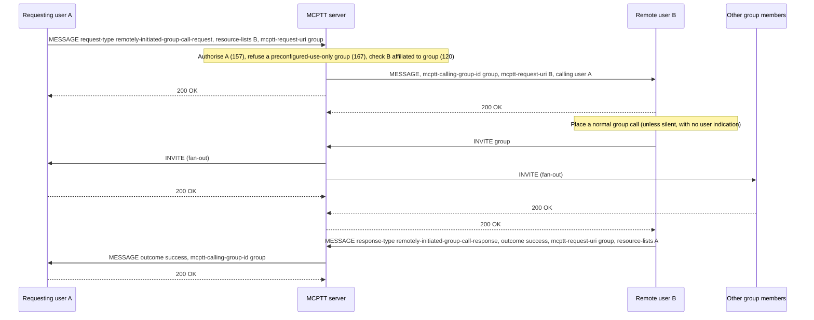

# Remotely initiated call tests

These tests cover **remotely initiated calls**: one authorised user asks another user's device, by SIP MESSAGE, to place a call on their behalf (TS 24.379 §10.1.5 group, §11.1.7 private). The remote user's device originates a normal call and reports the outcome back to the requester. The tests cover the implemented subset below, not complete conformance. Pre-established sessions are not implemented; see [coverage gaps](#coverage-gaps).

Back to the [test index by call type](../MCPTT_TEST.md). Related: [private calls](PRIVATE_CALL_TEST.md), [prearranged group calls](PREARRANGED_TEST.md).

## How remotely initiated calls work

- **Request.** The requesting user sends a SIP MESSAGE to the service URI carrying a `request-type` (`remotely-initiated-group-call-request` or `remotely-initiated-private-call-request`), a `resource-lists` body naming the **remote user** to act, and — for a group call — the targeted group in `<mcptt-request-uri>`. A `notify-remote-user` flag says whether the remote user may be told.
- **Authorization.** The server checks the requester's ruleset: `allow-request-remote-init-group-call` (else 403/157) or `allow-request-remote-init-private-call` (else 403/158). For a group request it also acts as the controlling function: calls on a `<preconfigured-group-use-only>` group are refused (403/167), and the remote user must be affiliated to the group (else 403/120).
- **Relay.** The server relays the request to the remote user, moving the group into `<mcptt-calling-group-id>` and setting `<mcptt-request-uri>` to the remote user (§10.1.5.4 step 7a).
- **Application priority.** The request may carry `<ric-app-level-priority>`, an RFC 8101 `namespace.priority` value (§10.1.5.2.1 step 3dD, §11.1.7.2.1). The remote user's device puts it in the Resource-Priority header of the call it places (§10.1.5.2.2 step 2b, §11.1.7.2.2 step 3b). The server otherwise accepts only the provisioned normal, emergency and imminent peril values; it remembers the value of each request it relays and accepts it once, on the follow-up call to the requested group or user within 60 s. The emergency and imminent peril values stay reserved for those calls.
- **Remote origination.** The remote user's device places the call — a normal group call to the targeted group, or a private call to the target in the requested commencement mode. When `notify-remote-user` is false the device does not indicate the request to its user; the lab still records it in the status file and event log so the test harness can verify it.
- **Outcome.** The remote user's device sends a response MESSAGE back to the requester with `remotely-initiated-call-outcome` = success or fail. For a group call the response names the called group in `<mcptt-request-uri>`, and the server moves it to `<mcptt-calling-group-id>` when relaying, as for the request. Success is reported when the placed call reaches a provisional or 2xx response; a busy or unauthorised remote user reports fail. (For a private call, no report is sent when the requester itself was the successfully called target.)

## Variants

| Variant | Command | Detail | Tests |
|---|---|---|---|
| Remotely initiated **group** call | `remote-group-call <remote> <group> [silent] [priority=<ns.value>]` | The remote user places a prearranged group call to the group and becomes its initiator (§10.1.5) | RG-01–RG-11 below |
| Remotely initiated **private** call | `remote-call <remote> <target> [auto\|manual\|force-auto] [silent] [priority=<ns.value>]` | The remote user places a private call to the target in the requested commencement mode (§11.1.7) | [PS-04, PS-04a, PS-05](PRIVATE_CALL_TEST.md#private-call-services) |

## Implemented profile (group variant)

| Step | Behavior | Reference |
|---|---|---|
| Request | SIP MESSAGE to the service URI: `request-type` remotely-initiated-group-call-request, `resource-lists` = remote user, `<mcptt-request-uri>` = group, `notify-remote-user` true/false | 24.379 §10.1.5.2.1 |
| Client check | The requesting client refuses a group whose document has `<preconfigured-group-use-only>` true. The group server serves documents to members only, so for other groups the server decides | §10.1.5.2.1 step 1A |
| Requester authorization | `allow-request-remote-init-group-call`; else 403 `157 user not authorised to request a remotely initiated group call` | §10.1.5.3.1 step 3 |
| Preconfigured-use-only group | 403 `167 call is not allowed on the preconfigured group`, for the request and the response | §10.1.5.4 step 2A |
| Controlling check | The remote user must be affiliated to the group; else 403 `120 user is not affiliated to this group` | §10.1.5.4 step 3 |
| Application priority | `<ric-app-level-priority>` relayed unchanged; the remote user's INVITE carries it as Resource-Priority, accepted for that follow-up call only | §10.1.5.2.1 step 3dD; §10.1.5.2.2 step 2b |
| Relay | The group moves to `<mcptt-calling-group-id>`, `<mcptt-request-uri>` becomes the remote user, `<mcptt-calling-user-id>` the requester | §10.1.5.4 step 7 |
| Remote origination | The remote user places a normal prearranged group call (10.1.1.2.1.1); `notify-remote-user` false suppresses user indication | §10.1.5.2.2 |
| Outcome | Response MESSAGE with `remotely-initiated-call-outcome` success or fail and the called group in `<mcptt-request-uri>`; the server relays it to the requester with the group in `<mcptt-calling-group-id>` | §10.1.5.2.2 step 1e; §10.1.5.4 step 7 |

The group-call ruleset is served by the CMS as `group_call` on the internal user resource and as the `<allow-request-remote-init-group-call>` action in the user profile document. Provision it per user in `config/lab.json` with `"group_call": {"remote_init": true}`.

### Client commands and status

```bash
mcx-client --config FILE --command 'remote-group-call sip:bob.mcptt@mcx.test sip:operations@mcx.test'
mcx-client --config FILE --command 'remote-group-call sip:bob.mcptt@mcx.test sip:operations@mcx.test silent'
mcx-client --config FILE --command 'remote-group-call sip:bob.mcptt@mcx.test sip:operations@mcx.test priority=mcptt.5'
mcx-client --config FILE --command 'remote-call sip:bob.mcptt@mcx.test sip:carol.mcptt@mcx.test manual'
```

The requester's status shows `service_outcomes["remotely-initiated-group-call-response"]` (success/fail) and `last_service_result` (the MESSAGE status, e.g. 403 with warning 157 or 120). The remote user records `service_outcomes["remote-group"]`.

## Running the tests

The group variant runs in the `call-types` lab (one server) and the `call-types-split` lab (separate participating and
controlling servers) of the regression; the private variant is part of the [private call services](PRIVATE_CALL_TEST.md#private-call-services)
in the `private-services` lab:

```bash
tools/regress.py --images <tag> --client-image openmcx-client:<tag> --select =call-types
```

The lab's `--private-call` option grants client-a `group_call.remote_init`; clients b–d do not have it, so they are the unauthorised cases. It also defines the preconfigured-use-only group `<group>-ric-preconf` with members b, c and d but not a: the group management server serves a group document to members only, so client-a's request for that group reaches the server (167), while member client-c refuses it itself (step 1A).

Over debug TCP SIP the run also captures at the MCPTT server and checks the capture with
`tests/integration/verify_remote_group_call.py`.

## Checks

| ID | What is checked |
|---|---|
| RG-01 | Authorised request: the remote user (client-b) places the group call, all four members join, the remote user is the initiator (not the requester), and both sides record success |
| RG-02 | Speech in the resulting call reaches the other members; floor release; teardown |
| RG-03 | A silent request (`notify-remote-user` false) still establishes the call and reports success |
| RG-04 | An unauthorised requester (client-c, no `group_call` ruleset) is rejected with 403/157 and no call is created |
| RG-05 | A request naming a group the remote user is not affiliated to is rejected with 403/120 |
| RG-06 | A busy remote user reports failure to the requester without disturbing its own call |
| RG-07 | SIP wire checks: originating requests to the service URI with one resource-lists remote user and the group in `mcptt-request-uri`; `notify-remote-user` true and silent both present; the relayed request carries the group in `mcptt-calling-group-id` and the remote user in `mcptt-request-uri`; responses name the called group in `mcptt-request-uri`; the relayed response carries the group in `mcptt-calling-group-id` and the requester in `mcptt-request-uri`; 200 OK to accepted requests; 157, 120 and 167 rejections; success and fail response outcomes; a normal group INVITE from the remote user; `<ric-app-level-priority>` relayed unchanged to the remote user, whose group INVITE carries it as Resource-Priority |
| RG-09 | A request with `<ric-app-level-priority>` mcptt.5: the call is placed and reported as a success, the remote user's INVITE carries Resource-Priority mcptt.5, and the server accepts it for that user and group |
| RG-10 | A request for the preconfigured-use-only group from client-a, which is not a member and so cannot read its document, is rejected 403/167 and creates no call |
| RG-11 | Member client-c refuses the same request itself (step 1A), and no MESSAGE reaches the server |

The private variant's priority is PS-04a in the [private call services](PRIVATE_CALL_TEST.md#private-call-services).

## High-level call flow (group variant)

Kamailio and floor detail are omitted. The requester A and remote user B are both served by the one combined MCPTT server.



## Coverage gaps

| Area | Gap |
|---|---|
| Targeted group vs the remote user's group | The lab configures one group per client, so the remote user places the call only to its own affiliated group. A remote user asked to call a different group it is not affiliated to returns 120. |
| Pre-established sessions | Remotely initiated calls over a pre-established session (§10.1.5.2.2 step 3): not in present edition. |
| Multiple servers | Covered: both variants also run with separate participating and controlling servers. |
| Wire qualification | In-repository decoders only; no independent-peer run. |
