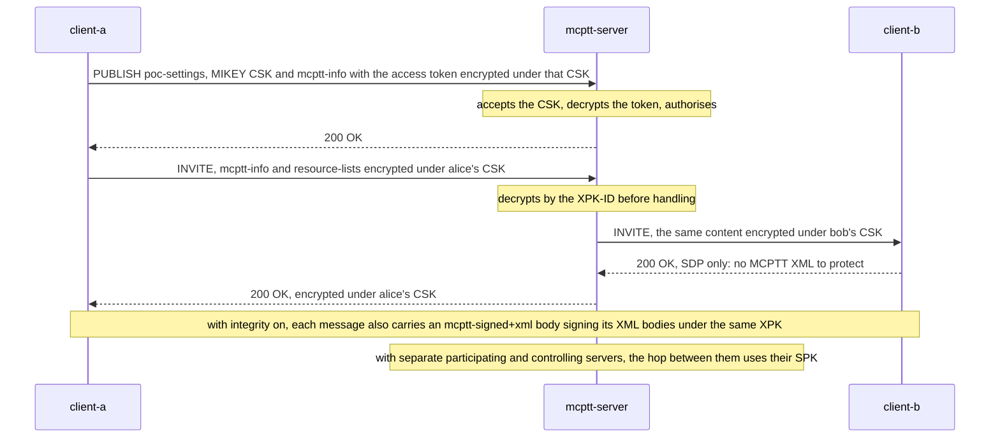

# MCPTT XML protection tests

These tests cover **confidentiality and integrity protection of the XML content of MCPTT signalling** (TS 24.379 V19.7.0 §4.8, §6.6.2 and §6.6.3, with TS 33.180 V19.4.0 §9.3 and §9.3.5). The MCData equivalent is in the [MCData protected tests](../mcdata/MCDATA_PROTECTED_TEST.md). What the tests do not cover is listed under [coverage gaps](#coverage-gaps).

Back to the [test index by call type](../MCPTT_TEST.md).

## Implemented profile

| Step | Behavior | Reference |
|---|---|---|
| Protected data | In the `application/vnd.3gpp.mcptt-info+xml`, resource-lists, PIDF, location and conference-info bodies: the access token, the request, calling, called and group identities, the client ID, originated-by, the associated group, the location functional alias, the emergency, alert and imminent peril indicators, and the reported location. In attributes: resource-list entries, the PIDF entity and affiliated groups, functional alias IDs and conference user entities. | §4.8 |
| Encryption | Each element becomes `<EncryptedData>` (XML Encryption 1.1, AES-128-GCM, KeyName the XPK-ID), and each URI attribute `sip:<ciphertext>;iv=...;key-id=...;alg=128-aes-gcm@mc1-encryption.3gppnetwork.org`. The key derives from the XPK and the client's MCPTT ID, or between servers the sending server's PSI (TS 33.180 Annex F.1.4). | §6.6.2.3.3, §6.6.2.3.4 |
| Keys | Between a client and its server, the XPK is the CSK the client uploads at service authorisation; between two servers, the SPK provisioned for the pair. | §6.6.2.2 |
| Service authorisation | The access token and client ID of the PUBLISH that uploads the CSK are encrypted with that CSK; the server accepts the CSK from the request first and then decrypts them. | §7.3.3 with §6.6.2 |
| Every message | The SIP engine protects the bodies of every request and response, once the destination is known, and opens them on receipt before any procedure runs. A server decrypts content from a peer and re-encrypts it for the next hop, which is the copying of §6.6.2.5. | §6.6.1.2, §6.6.1.4, §6.6.2.5 |
| Refusal | Content that cannot be decrypted is refused with 403 and warning 140. | §6.6.2.4.2 |
| Integrity | Every XML body of a message (mcptt-info, poc-settings, resource-lists, location, affiliation command, conference-info, PIDF, xcap-diff, simple-filter, regroup) gets a Content-ID and an xmldsig `<Signature>` in an `application/vnd.3gpp.mcptt-signed+xml` body (`<signatures>`, namespace `urn:3gpp:ns:mcpttSignedDoc:1.0`): a SHA-256 digest of the body referenced as `cid:`, and HMAC-SHA256 over the exclusive canonical SignedInfo under the integrity key of the hop's XPK (TS 33.180 Annex F.1.4, FC 0x52), KeyName the XPK-ID. Integrity is applied after encryption, and verified before decryption; a failed check is refused with 403 and warning 139. | §6.6.3.1, §6.6.3.3.3, §6.6.3.4, Annex F.6 |

### Local choices

| Choice | Reason |
|---|---|
| Protection is enabled by `security.confidentiality_protection` and `security.integrity_protection` in each client and server configuration, not by the service configuration document's `<confidentiality-protection>` and `<integrity-protection>`. | The lab has no service configuration document. |
| The signed digest covers the octets of each body as sent (no transform), and the signature covers the exclusive canonical form of SignedInfo. | TS 33.180 §9.3.5 leaves the canonicalisation to "an appropriate algorithm". |
| The MCData service protects its own messages under the MCData CSK; the MCPTT filter leaves messages to and from the MCData server alone. | One client process runs both services. |

## Call flow



## Running the tests

The XML protection scenario runs in the `xml-protection` (confidentiality), `xml-integrity` (confidentiality and
integrity) and `xml-protection-split` / `xml-integrity-split` (separate participating and controlling servers) labs of
the regression:

```bash
tools/regress.py --images <tag> --client-image openmcx-client:<tag> --select =xml-protection,=xml-integrity,=xml-integrity-split
```

The clients and servers report `xml_protection` in their status: whether each protection is enabled, and how many bodies they encrypted, decrypted, signed, verified and refused.

## Checks

| ID | What is checked |
|---|---|
| XP-00 | The clients are authorised with protection enabled |
| XP-01 | The service authorisation is protected: the servers decrypt every client's access token |
| XP-02 | A group call with protected mcptt-info |
| XP-03 | A private call with the called party protected (one server) |
| XP-04 | Every client and server encrypts and decrypts MCPTT XML |
| XP-05 | Nothing is refused |
| XP-06 | With integrity protection, every client and server signs its XML bodies and verifies those it receives |

In the same labs the protected private call scenario (automatic, manual, tampered key, first-to-answer, ambient
listening, emergency) and the prearranged scenario run with the protection on.

## Coverage gaps

| Area | Gap |
|---|---|
| MCData integrity | The MCData XML signatures of TS 24.282 §6.5.3 are not implemented. |
| Service configuration | `<confidentiality-protection>` and `<allow-signalling-protection>` are not read from a service configuration document. |
| Pre-established sessions | The REFER case of §6.6.2.1 does not arise (pre-established sessions are not in present edition). |
| Negative lab test | No scenario sends a tampered or undecryptable body; the xmlsec unit tests cover tampered bodies and signatures, keys of another XPK and decryption failures. |
