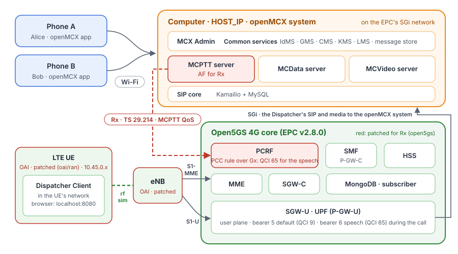

# Tutorial 5: MCX over a 4G core (Open5GS EPC) and the OAI LTE RAN (rfsim), with MCPTT QoS over Rx

Tutorial 3, on 4G instead of 5G: tutorial 1's system and phones, plus an LTE network made of the Open5GS 4G core
(EPC) and the OAI eNB and one LTE UE connected by the rfsimulator (a simulated radio, no radio hardware). The
dispatcher position runs inside the LTE UE, so all its traffic crosses the LTE radio and the EPC. When it calls, the
MCPTT server asks the EPC's PCRF, over **Rx** (TS 29.214, the MCPTT-5 reference point of TS 23.379), for the QoS of
mission-critical voice: the EPC sets up a **dedicated bearer with QCI 65** for the dispatcher's speech, down to the
radio.

<p align="center"></p>

The phones reach the system on the Wi-Fi as in tutorial 1; their calls get no 4G QoS (they are not on 4G). The MCPTT
server asks for QoS only for call legs of UEs in the LTE pool (10.45.0.0/16): a UE on another access, such as the
phones on WLAN, gets no request and its calls work as before (TS 24.379 clause 4.13).

## What you need

- **Tutorial 1 done once**: the phones have the app, and you know the steps in MCX Admin. Tutorial 1's system (and
  tutorials 3 and 4) must be **stopped**: tutorial 5 runs its own system with the same ports.
- **A Linux computer** with Docker and Docker Compose v2, about 8 CPU cores free (the rfsimulator's eNB and UE keep
  several cores busy) and **sudo** (step 3).
- **The images**, from Docker Hub: openMCX's (`openmcx/openmcx-*:v1`, as in tutorial 1, with Rx) and three patched
  images:
  - `openmcx/open5gs:2.8.0-mcx`: Open5GS v2.8.0 for every EPC function, with a PCRF change: an MCPTT AF session's
    audio gets QCI 65 (and an MCVideo session's video QCI 67), as TS 23.379 clause 5.7.3 asks, instead of the QCI 1
    of IMS voice. The patch and the build are in [`open5gs/`](open5gs/NOTICE). Open5GS is under the GNU AGPL v3.
  - `openmcx/oai-enb:2026.w39-mcx` and `openmcx/oai-lte-ue:2026.w39-mcx`: OAI's eNB and LTE UE with fixes for
    dedicated bearers: the UE accepts every type of tracking area identity list, accepts a dedicated bearer that the
    network sets up with a new connection and one that the network releases (TS 24.301), and the eNB and the UE
    release the bearer's radio bearer (TS 36.331). The patches and the build are in [`oai/ran/`](oai/ran/NOTICE).
    OAI is under the Collaborative Standards Software License v1.0: its patent license covers study, testing and
    research only.

  To build the patched images yourself: `open5gs/build-images.sh` (about 10 minutes) and `oai/ran/build-images.sh`
  (about 40 minutes); then set `OPEN5GS_IMG=open5gs:2.8.0-mcx`, `ENB_IMG=oai-enb:2026.w39-mcx` and
  `UE_IMG=oai-lte-ue:2026.w39-mcx` in `.env`.

## 1. Set the computer's address

```bash
cd tutorials/05-mcx-over-4g-open5gs-oai
cp .env.example .env
```

Set `HOST_IP` in `.env` to this computer's address on the Wi-Fi, as in tutorial 1.

## 2. Make the configuration

```bash
docker compose -f docker-compose-4g-mcx.yaml run --rm setup
```

As in tutorial 1 (a new system in `./config`), plus the MCPTT server's Rx settings (the PCRF as a Diameter peer and
the LTE pool 10.45.0.0/16) and the EPC's Diameter certificates (`config/epc-tls`).

## 3. Connect this computer to the UE pool

```bash
sudo ./host-network.sh add
```

As in tutorial 3: replies to the UE pool go back through the P-GW's user plane (the UPF, at its SGi address), and
they leave from `HOST_IP`, so the UE sees one address both ways and the EPC's packet filters match the speech.
`sudo ./host-network.sh remove` undoes both (step 8).

## 4. Start the system

```bash
docker compose -f docker-compose-4g-mcx.yaml up -d
docker compose -f docker-compose-4g-mcx.yaml ps --format 'table {{.Name}}\t{{.Status}}'
```

After about two minutes every service is `(healthy)`: the openMCX system, the EPC (`epc-mme`, `epc-hss`,
`epc-sgwc`, `epc-sgwu`, `epc-smf`, `epc-upf`, `epc-pcrf`, `epc-mongo`; `epc-subscriber` loads the UE's subscription
and exits), the eNB, the LTE UE, `ue-route` and the dispatcher. `openmcx-ue-route` shows the UE's address:

```bash
docker logs openmcx-ue-route        # UE address 10.45.0.3, 192.168.179.39 through oaitun_ue1
```

If the UE has no address after two minutes (the rfsimulator's first random access sometimes fails), restart it:
`docker restart openmcx-oai-lte-ue`, then `docker compose -f docker-compose-4g-mcx.yaml up -d --force-recreate
ue-route dispatcher`.

## 5. Users and phones, 6. Activate the dispatcher (over 4G)

As in tutorial 3, steps 5 and 6: in MCX Admin (`https://HOST_IP:8446/`) create `alice`, `bob` and `dispatcher`,
activate the phones, and activate the dispatcher position at **http://localhost:8080/**. The position's activation,
sign-in, SIP registration and calls go through the LTE user plane.

## 7. Call, and see the QoS

1. On the position, choose **Group call**: Alice's and Bob's phones join.
2. Hold **PTT** on the position: it has the floor, and the phones show `Dispatcher is talking`.
3. While the call is up, the MCPTT server has an Rx session with the PCRF for the dispatcher's leg, and the EPC has
   set up a dedicated bearer for it:

   ```bash
   docker logs openmcx-mcptt-server 2>&1 | grep rx_session
   docker logs openmcx-epc-mme 2>&1 | grep 'Bearer added'
   docker logs openmcx-oai-enb 2>&1 | grep 'QCI 65'
   docker logs openmcx-oai-lte-ue 2>&1 | grep -i 'dedicated EPS bearer'
   ```

   ```
   {"dialog":"f9b98939-…","event":"rx_session_created",…,"status":2001,"user_id":"sip:dispatcher.mcptt@mcx.test"}
   10/05 19:06:30.706: [mme] INFO: Bearer added (EBI=6 IMSI=208960100000001) (../src/mme/mme-context.c:4683)
   1152522.369879 [RRC]    I EPS ID 6, DRB ID 2 (index 1), QCI 65, priority 4, LCID 4 LCGID 1
   … ESM-PROC  - Dedicated EPS bearer context activation requested by the network (ebi=6)
   … ESM-PROC  - Dedicated EPS bearer context activation accepted by the UE (ebi=6)
   ```

   The default bearer (EPS bearer 5, QCI 9) carries everything else of the UE, including SIP. The MCPTT server's
   AA-Request names the leg's speech, RTCP and floor control flows and the MCPTT service (its ICSI): the PCRF makes a
   PCC rule with QCI 65 and installs it at the P-GW over Gx; the P-GW and S-GW create the dedicated bearer (EPS bearer
   6), and the MME and the eNB set it up on the radio as a data radio bearer.
4. End the call on the position. The MCPTT server ends the Rx session, and the EPC releases the dedicated bearer, on
   the radio too; the next call sets it up again:

   ```bash
   docker logs openmcx-mcptt-server 2>&1 | grep rx_session_terminated     # "status":2001
   docker logs openmcx-epc-mme 2>&1 | grep 'Bearer removed'               # Bearer removed (EBI=6 ...)
   docker logs openmcx-oai-lte-ue 2>&1 | grep 'DRB 2 released'            # [RRC] I [UE 0] DRB 2 released
   ```

## 8. Stop or start over

```bash
docker compose -f docker-compose-4g-mcx.yaml down        # stop; ./config is kept
docker compose -f docker-compose-4g-mcx.yaml down -v     # stop and delete the data
sudo ./host-network.sh remove
rm -rf config                                            # with down -v: start over at step 2
```

## How it is put together

- **Two compose files**: `docker-compose-4g-core.yaml` has tutorial 1's openMCX services, unchanged, on the EPC's
  **SGi network** (`openmcx-4g-sgi`, 192.168.74.128/26) and the Open5GS EPC on the **EPC network** (`openmcx-4g-core`,
  192.168.73.128/26). `docker-compose-4g-mcx.yaml` includes it and adds the eNB and the LTE UE (OAI's CI USIM:
  IMSI 208960100000001, APN `oai.ipv4`), the dispatcher in the UE's network namespace and `ue-route`, which routes
  `HOST_IP` through the UE's tunnel (`oaitun_ue1`) once it is attached.
- **The EPC is Open5GS**, one container per function: HSS, MME, S-GW (SGW-C and SGW-U), P-GW (Open5GS's SMF as
  PGW-C and its UPF as PGW-U) and the **PCRF**, with MongoDB for the subscriber; the configuration is in
  `open5gs/config/` and `open5gs/freeDiameter/`, the subscription in `open5gs/subscriber.js`. OAI's own 4G EPC has no
  PCRF, and so no Rx. Open5GS names its P-GW parts after their 5G counterparts; here they play only their 4G roles
  (S5, Gx, SGi), and the SMF runs without a 5G service interface.
- **Rx**: the MCPTT server is also on the EPC network (192.168.73.141), a Diameter peer of the PCRF over TCP. With
  the `rx` block that the setup adds (`setup/rx.py`), it opens an Rx session (TS 29.214) for each call leg of a UE in
  10.45.0.0/16: the AF-Application-Identifier (the MCPTT ICSI), the leg's speech, RTCP and floor control flows, the
  bandwidth, and the call's priority (MCPTT-Identifier and Reservation-Priority from its Resource-Priority). Without
  the `rx` block, as in tutorials 1 to 4, the server never contacts a PCRF. See
  [QoS for call media](../../docs/POLICY.md).
- **Packet filters**: the P-GW's packet filters for the UE leave out the UE's own address (`smf.yaml`,
  `no_ipv4v6_local_addr_in_packet_filter`): the "local address" components of TS 24.008 table 10.5.162 are used only
  when the UE supports them, and the OAI LTE UE does not.
- **The RAN** is OAI's eNB and LTE UE over the rfsimulator (band 7, 5 MHz), as in OAI's own `4g_rfsimulator_fdd_05MHz`
  test; their configuration is in `oai/ran/`.
- **The dispatcher** is the image and settings of tutorial 2, with its address the UE's, as in tutorial 3.
- **The phones** are not on 4G: their legs are outside the UE pool and get no Rx session.
