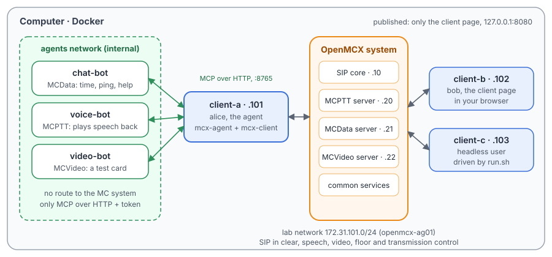
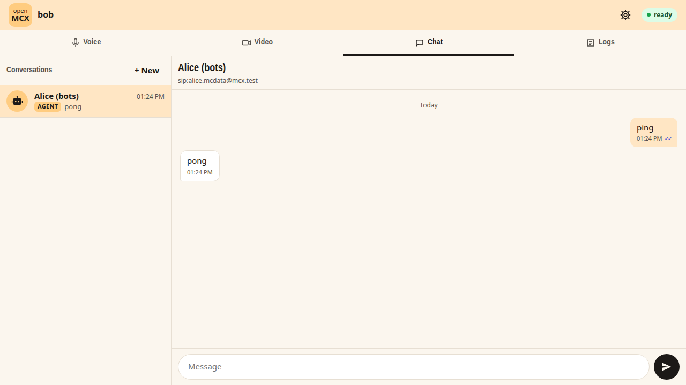
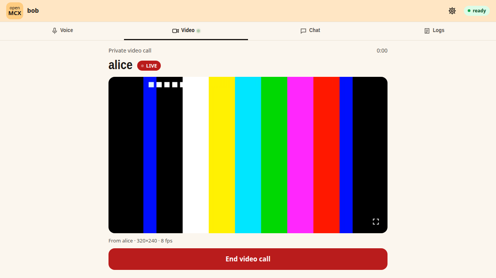

# Agent Tutorial 1: the example bots of mcx-agent (chat, voice and video)

One computer runs the OpenMCX system from the published images. One of its users is an **agent**: `alice` runs
[mcx-agent](https://github.com/openMCX/openmcx-client/tree/main/agent), the plumbing that lets a program take part in
mission critical communication. mcx-agent runs the MC client `mcx-client` as alice's identity and offers its services
as tools over MCP (the Model Context Protocol) on HTTP.

Three example bots use those tools. Each is a short Python program with nothing of OpenMCX inside:

- the **chat bot** (MCData): it marks each message read and answers `time`, `ping` and `help`;
- the **voice bot** (MCPTT): in a private call to alice, or a group call of her groups, it plays back each talk burst
  after a short tone;
- the **video bot** (MCVideo): it shows a test card in every video call alice is in, as a drone or a robot would show
  its camera.

You meet them in two ways: `run.sh` drives a headless user (client-c) through every case, and you try them yourself in
the browser as bob, on the OpenMCX client page. A capture of the lab network records it all for Wireshark.

The tutorial is built on two scenarios of the OpenMCX regression tests, `tests/integration/mcdata_agent_scenario.py`
and `tests/integration/voice_video_agent_scenario.py`.

> **The agent makes no calls.** It answers the calls users make to it and joins the group calls of its groups; it
> sends messages only to users who wrote to it. Each bot reaches only mcx-agent, on a network of its own with no route
> to the MC system, and needs its token.

> **SIP in clear, for learning.** The system runs in its debug mode: SIP goes over TCP without TLS (port 5060), so
> Wireshark shows every message and its bodies. A real system uses TLS (End to End Tutorials 1 to 5).

<p align="center"></p>

## How an agent is put together

| Part | What it is | Here |
|---|---|---|
| The MC identity | An MC user with MCData, MCPTT and MCVideo, as any phone has | `alice`: `sip:alice.mcdata@mcx.test`, `sip:alice.mcptt@mcx.test`, `sip:alice.mcvideo@mcx.test` |
| mcx-agent | A daemon that runs `mcx-client` for the identity and turns its services into tools: `wait_message`, `reply_message`, `wait_speech`, `speak`, `video_status`, … ([API.md](https://github.com/openMCX/openmcx-client/blob/main/agent/API.md)). It enforces the rules: who may be written to, how often, which services are on | container `client-a`, `config/agent.json` |
| MCP over HTTP | The tools as an MCP server on `http://client-a:8765/mcp`, with a bearer token; pictures to show go to `POST /video` on the same port (raw I420) | `config/agent-token` |
| The bots | Programs that call the tools: an AI agent would put a model where they answer with fixed rules | containers `chat-bot`, `voice-bot`, `video-bot` |

What each bot does with the tools:

| Bot | Loop | Tools |
|---|---|---|
| `chat-bot.py` | Wait for a message, mark it read, answer it in the sender's conversation | `status`, `wait_message`, `mark_read`, `reply_message` |
| `voice-bot.py` | Wait for a talk burst (a WAV of what was said), answer in the same call: a tone, then the speech | `status`, `call_status`, `wait_speech`, `speak` |
| `video-bot.py` | Stream pictures to `POST /video`; whenever alice is in a video call, ask to transmit | `status`, `video_status`, `video_transmit` |

## What you need

- A computer with Docker and Docker Compose v2 (Linux, or Docker Desktop on macOS or Windows) and a bash shell for
  `run.sh` (on Windows: WSL or Git Bash).
- The OpenMCX servers, the setup and the headless client come from Docker Hub (`openmcx/openmcx-*:1.0.0`).
- **mcx-agent and the client page you build yourself**, from a checkout of
  [openmcx-client](https://github.com/openMCX/openmcx-client) (they are not on Docker Hub yet). From the root of the
  checkout:

  ```bash
  linux/tools/build-image -t openmcx-client:local
  docker build -t openmcx-agent:local --build-arg CLIENT_IMAGE=openmcx-client:local agent
  docker build -t openmcx-dispatcher:local --build-arg CLIENT_IMAGE=openmcx-agent:local dispatcher
  ```

  `openmcx-agent:local` holds the daemon, its engine and the three bots (in `/usr/local/share/mcx-agent/examples/`);
  `openmcx-dispatcher:local` is the client page.
- A browser (Chrome, Edge or Firefox) for the client page, with a microphone to talk to the voice bot.
- [Wireshark](https://www.wireshark.org/) to look at the capture (optional: `run.sh` prints a summary).

## 1. Make the configuration

```bash
cd tutorials/agents/01-example-bots
docker compose run --rm setup
```

The setup container runs the generator of the regression lab (`tools/prepare-prearranged-test.py --debug-sip
--private-call --mcdata --mcvideo`), then [`setup/agent-config.py`](setup/agent-config.py). It writes `./config` with
these parts:

- a new certificate authority with the servers' and clients' certificates;
- the users `alice` (client-a, the agent), `bob` (client-b, you in the browser) and `client-c` (the headless user), all
  members of the group `operations` for MCPTT, MCData and MCVideo;
- the private call rules: bob may call anyone, client-c may call anyone with automatic commencement; for MCVideo the
  same;
- `agent.json`: mcx-agent on alice's identity, with voice and video on (pictures of 320x240 at 15 per second), MCP over
  HTTP on port 8765, no recipient list (the agent answers only users who wrote to it in the last 24 hours) and rate
  limits;
- `agent-token`: the token the bots and the daemon share;
- `client-b-ui.json`: bob's configuration for the client page, which takes the call's audio from the browser and
  sends it the received video.

It runs once. To start over, see step 6. The certificates last 30 days.

## 2. Start the system

```bash
docker compose up -d --wait
```

After about half a minute `--wait` returns and every service is healthy, with the capture already running. alice's
engine signs in for MCPTT, MCData and MCVideo and affiliates to `operations`; then the bots start. Each says when it
is ready:

```bash
docker compose logs chat-bot voice-bot video-bot
```

```
chat-bot-1   | ready as sip:alice.mcdata@mcx.test, alias none
voice-bot-1  | voice bot ready as sip:alice.mcptt@mcx.test
video-bot-1  | video feed ready: 320x240 at 15/s
```

| Address | Container |
|---|---|
| 172.31.101.10 | SIP core (Kamailio) |
| 172.31.101.20 | MCPTT server |
| 172.31.101.21 | MCData server |
| 172.31.101.22 | MCVideo server |
| 172.31.101.101 | client-a, `alice`: mcx-agent, also on the `agents` network |
| 172.31.101.102 | client-b, `bob`: the client page, on http://127.0.0.1:8080/client/ |
| 172.31.101.103 | client-c, `client-c`: the headless user |
| (agents network only) | chat-bot, voice-bot, video-bot |

The daemon's own view, through its command line in the container:

```bash
docker compose exec client-a mcx-agent status
```

## 3. Run the steps

```bash
./run.sh
```

The script sends each command to client-c and waits until client-c and the bots show its result before going on. It
takes about a minute and a half:

```
2. The chat bot (MCData): client-c writes ping, time and hello to alice
  $ client-c: sds sip:alice.mcdata@mcx.test ping
  ok: the SDS is accepted (202)
  ok: the chat bot answers "ping"
  ok: ping -> pong
...
3. The voice bot (MCPTT): a private call from client-c to alice, client-c talks, the bot answers
  $ client-c: private sip:alice.mcptt@mcx.test auto
  ok: the agent answers the call at once
  $ client-c: ptt /speech/alpha.wav
  ok: the voice bot hears client-c
  ok: the voice bot speaks in the call
  ok: client-c hears the answer (a tone, then its own words)
...
7. The capture: captures/01-example-bots-run.pcap.gz
```

| Step | client-c does | What happens |
|---|---|---|
| 1 | (none: sign-in) | alice's engine and client-c sign in and affiliate; mcx-agent reports MCData, MCPTT and MCVideo ready; the three bots log that they are ready. |
| 2 | `sds sip:alice.mcdata@mcx.test ping`, then `time`, then `hello` | A one-to-one SDS to alice (TS 24.282 clause 9.2.2). The chat bot gets it from `wait_message`, marks it read (`mark_read`: client-c gets a read report if it asked for one) and answers with `reply_message`: an SDS to client-c in the same conversation, with the message's ID as InReplyTo. `pong`; `It is 12:05 UTC on 2026-10-28.`; for anything else, its help. |
| 3 | `private sip:alice.mcptt@mcx.test auto`, `ptt /speech/alpha.wav`, `hangup` | A private call to alice (TS 24.379 clause 11.1.1): the agent answers at once. client-c talks for 6 s. When client-c releases the floor, mcx-agent hands the talk burst to the voice bot as a WAV (`wait_speech`); the bot asks for the floor and plays a tone and the speech back (`speak`), and client-c hears it. |
| 4 | `call`, `ptt …`, `hangup` | A group call on `operations` (TS 24.379 clause 10.1): alice is an affiliated member, so the agent is in the call. The bot answers in the group call: every member hears it. |
| 5 | `mcvideo-private sip:alice.mcvideo@mcx.test`, `mcvideo-hangup` | A private video call to alice (TS 24.281 clause 10.2): the agent answers; the video bot sees the call in `video_status` and asks to transmit (`video_transmit`); the server grants it (TS 24.581) and client-c receives the bot's pictures, H.264. |
| 6 | `mcvideo-call`, `mcvideo-hangup` | A group video call on `operations` (TS 24.281 clause 9.2): the agent joins, and the bot transmits in it. |

To type a command yourself, as client-c:

```bash
docker compose exec client-c mcx-client --config /config/client-c.json --command "sds sip:alice.mcdata@mcx.test ping"
```

## 4. Try it in the browser

Open **http://127.0.0.1:8080/client/**: you are bob. The page runs bob's MC client in its container and plays the
calls in the browser.

- **Chat**: the conversation "Alice (bots)" is first, with the bot's three words as suggestions. Pick one, or write
  anything else, and send it: the chat bot answers within a second, and the ticks show it read your message.

<p align="center"></p>

- **Voice**: type `alice` in "Call a user" and press **Call**; allow the microphone. Hold **Space** (or the PTT button)
  and say something, then release: after a tone the bot says it back. A group call works too: **Call** on
  `operations`. Hang up when you are done.
- **Video**: type `alice` in "Watch a user's camera" and press **Video call**: the bot's test card appears, with its
  moving bars. Or **Video call** on `operations`.

<p align="center"></p>

The server limits each transmission to 15 s. When it takes the transmission back, the bot asks again at once, so the
picture stops for a moment and comes back.

To see what the bots do meanwhile:

```bash
docker compose logs -f chat-bot voice-bot video-bot
```

```
chat-bot-1   | sip:bob.mcdata@mcx.test: 'time' -> 'It is 12:06 UTC on 2026-10-28.'
voice-bot-1  | heard sip:bob.mcptt@mcx.test in a private call (sip:bob.mcptt@mcx.test): 3120 ms
voice-bot-1  | spoke to sip:bob.mcptt@mcx.test: spoken (3470 ms)
video-bot-1  | in a private call: transmission granted
```

## 5. Look at the capture

`run.sh` copies the capture of your run to `captures/01-example-bots-run.pcap.gz`. The folder also holds a reference
run, [`captures/01-example-bots-full.pcap.gz`](captures/01-example-bots-full.pcap.gz). Wireshark opens the compressed
file directly.

The capture filter is `ip and not host 172.31.101.1 and (tcp port 5060 or (udp and not port 53) or icmp)`: SIP on
5060/tcp, speech, floor control, video and transmission control on UDP. The bots' traffic to mcx-agent is on the
`agents` network and is not in the capture: on the lab network alice looks like any other user.

| Filter | Shows |
|---|---|
| `sip.Method == "MESSAGE" && frame contains "one-to-one-sds"` | client-c's SDS to alice and the chat bot's answers |
| `sip.Method == "INVITE"` | The calls: client-c's MCPTT private and group calls, then its MCVideo calls |
| `rtp && ip.src == 172.31.101.101` | alice's media: the voice bot's answers (AMR-WB) and the video bot's pictures (H.264) |
| `udp && ip.src == 172.31.101.101 && !rtp` | alice's floor requests (MCPTT, TS 24.380) and transmission requests (MCVideo, TS 24.581) |

In **Telephony › RTP › RTP Streams**, each private call shows client-c's burst (172.31.101.103 to the MCPTT server)
and, right after it, the voice bot's answer (from the MCPTT server to 172.31.101.103), a little longer: the tone comes
first.

## 6. Stop or start over

```bash
docker compose down -v        # remove the containers and their data (status files, capture, the agent's store)
rm -rf config                 # with down -v: start over at step 1
```

To run the steps again on the same system, run `./run.sh` again. For a new capture, `docker compose down -v` and
`docker compose up -d --wait` first (the configuration stays).

## Your own agent

The bots are the place for your agent. In `docker-compose.yaml`, replace a bot's service with your program's container
on the `agents` network, give it `config/agent-token`, and point its MCP client at `http://client-a:8765/mcp` with
`Authorization: Bearer <token>`. An MCP client library's streamable HTTP transport works as it is; so do Claude Code
and other MCP hosts:

```bash
claude mcp add --transport http mcx http://<address>:8765/mcp --header "Authorization: Bearer $(cat config/agent-token)"
```

The tools, their results and error codes are in
[API.md](https://github.com/openMCX/openmcx-client/blob/main/agent/API.md), and the bots' sources in
[agent/examples](https://github.com/openMCX/openmcx-client/tree/main/agent/examples). The chat bot step by step is
[FIRST_AGENT.md](https://github.com/openMCX/openmcx-client/blob/main/agent/FIRST_AGENT.md).

## Images

| Image | What it is |
|---|---|
| `docker.io/openmcx/openmcx-setup:1.0.0` | The setup: the lab's generator |
| `docker.io/openmcx/openmcx-mcptt-server:1.0.0`, `…-mcdata-server:1.0.0`, `…-mcvideo-server:1.0.0` | The MCPTT, MCData and MCVideo servers |
| `docker.io/openmcx/openmcx-common:1.0.0`, `docker.io/openmcx/openmcx-http-proxy:1.0.0`, `docker.io/openmcx/openmcx-user-db:1.0.0` | The common services |
| `docker.io/openmcx/openmcx-client:1.0.0` | The headless client (client-c) |
| `docker.io/openmcx/openmcx-kamailio:1.0.0` | The SIP core |
| `openmcx-agent:local` | Built by you: mcx-agent, its engine and the example bots (client-a and the bots) |
| `openmcx-dispatcher:local` | Built by you: the client page (client-b) |
| `docker.io/library/mysql@sha256:…` | The SIP core's database |
| `docker.io/nicolaka/netshoot@sha256:…` | tcpdump, for the capture |

## When something does not work

- **`pull access denied for openmcx-agent`**: build the two local images first (What you need).
- **A service stays unhealthy**: `docker compose logs <service>`.
- **A bot keeps "waiting"**: `docker compose logs <bot>` says what for, e.g. `waiting for mcvideo: …` while alice is
  not yet signed in. `docker compose exec client-a mcx-agent status` shows each service of the agent, with
  `last_error`.
- **A step of run.sh fails**: it prints the step that did not complete. `docker compose exec client-c cat
  /artifacts/client-c/status.json` shows client-c's state (`call_state`, `received_packets`, `mcdata_inbox`,
  `mcvideo_call_state`, `mcvideo_transmitter`, …).
- **The page shows no picture**: the browser decodes H.264 with WebCodecs; use a current Chrome, Edge or Firefox.
- **The microphone is refused**: open the page as `http://127.0.0.1:8080` (a secure context), not by another address.
- **Port 8080 is taken**: change `127.0.0.1:8080:8080` under `client-b` in `docker-compose.yaml`.
- **No capture, or `capture` exited**: `docker compose logs capture`. The address range 172.31.101.0/24 must be free on
  the computer.

## How it is put together

- `docker-compose.yaml`: the lab of `prepare-prearranged-test.py --debug-sip --private-call --mcdata --mcvideo`,
  written for the published images by `tools/tutorial-compose.py`, then given the agent (client-a runs `mcx-agent
  daemon`), the client page (client-b, with `--ops-agent-intro` and `--ops-agent-suggestions` for the chat bot) and
  the three bots on the internal `agents` network.
- `setup/agent-config.py`: the agent's configuration and token, and the client page's configuration.
- `run.sh`: AG-02 to AG-04 of `tests/integration/mcdata_agent_scenario.py` (the chat bot), and VA-02 to VA-04, VA-06
  and VA-07 of `tests/integration/voice_video_agent_scenario.py` (the voice and video bots), with client-c as the
  user. Left out: the functional alias, files, the recipient rules and the audit log (the MCData scenario), and an
  agent that watches the video it receives (`video.receive`, in mcx-agent's README).
- `captures/01-example-bots-full.pcap.gz`: the reference run.
