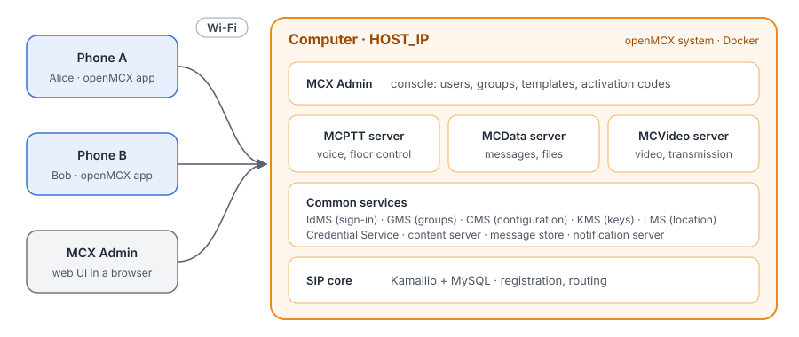
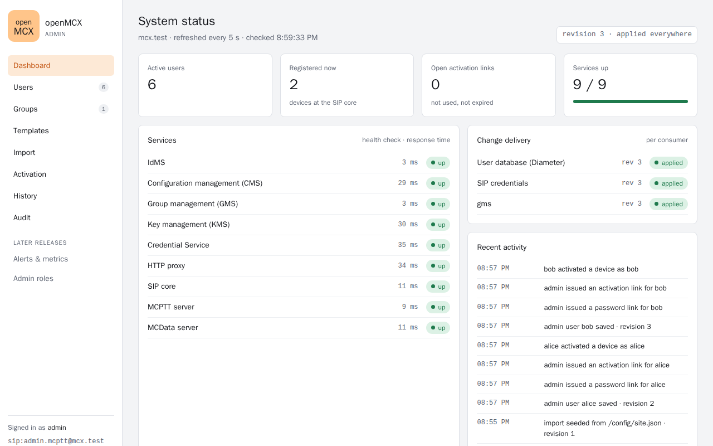
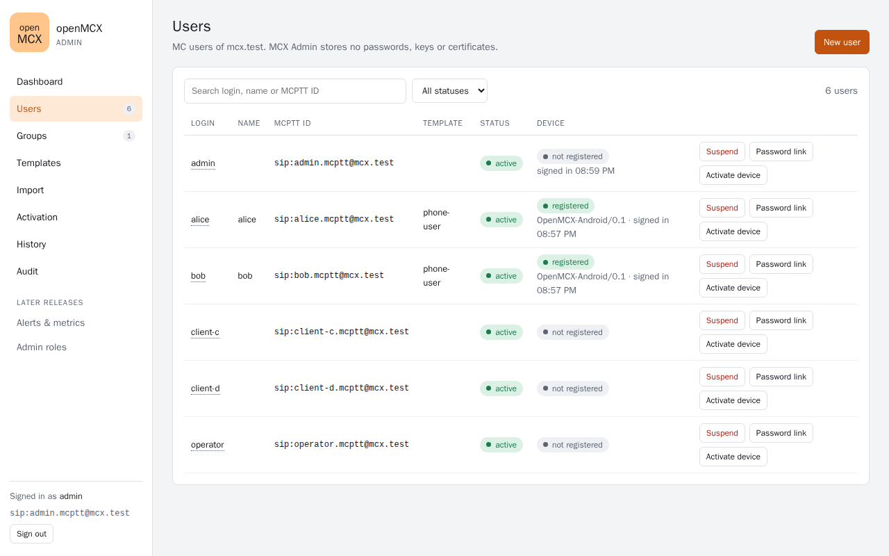
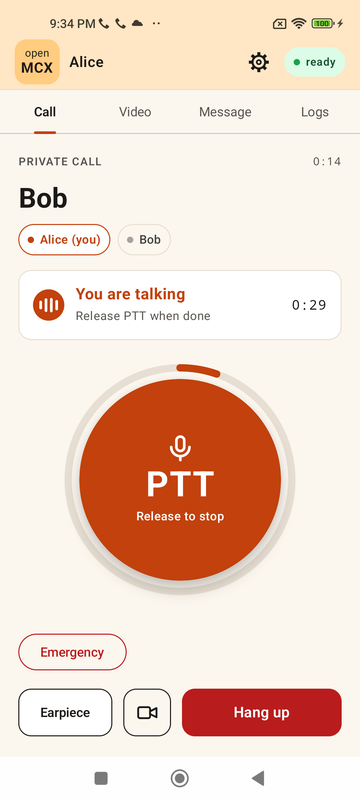
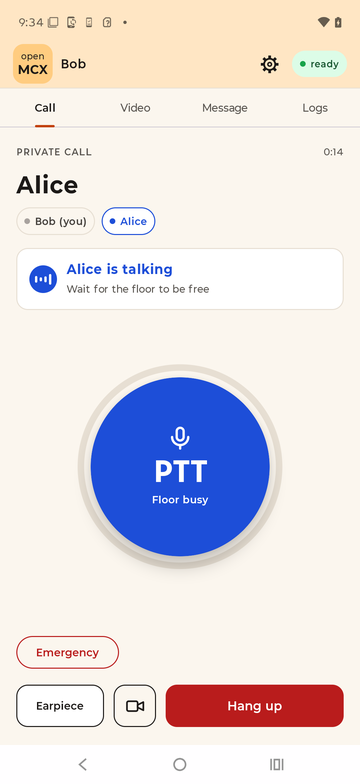
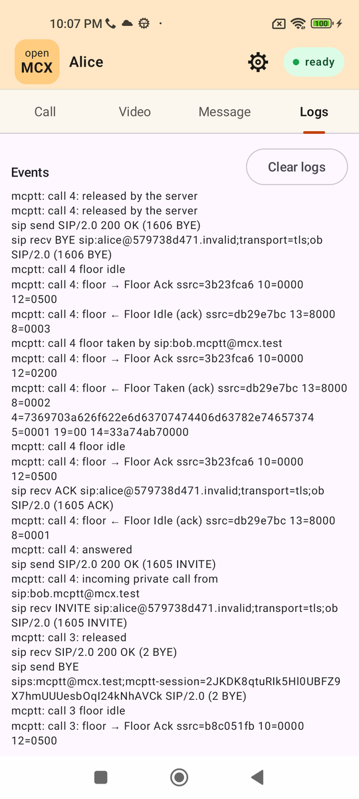
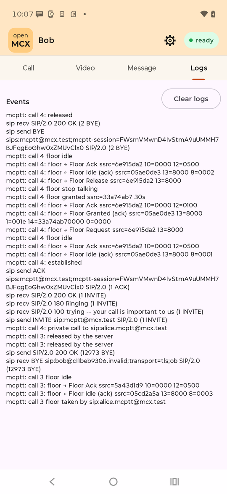

# Tutorial 1: MCX over WLAN with the Android app

One computer runs a complete openMCX system from the published images: the MCPTT, MCData and MCVideo servers, the
common services, the SIP core and MCX Admin. In MCX Admin's web console you create two users, and two Android phones
on the same Wi-Fi as the computer activate with them. Then they call, chat and make video calls.

> **WLAN as plain transport.** The Wi-Fi only carries IP. The 4G/5G features for MC services are not used: no QoS
> (QCI/5QI 65 and 69, priority, pre-emption), no network location (location reporting is off), no broadcast
> (MBMS/MBS). Signalling, floor control and media are the same as over 4G/5G.

<p align="center"></p>

## What you need

- A computer with Docker and Docker Compose v2 (Linux, or Docker Desktop on macOS or Windows), on the same Wi-Fi as
  the phones. Its firewall must let the phones reach the ports below.
- Two Android phones (Android 11 or later) with the openMCX app. Phones and computer on the same network, with no
  client isolation between devices (guest networks often have it).
- Nothing to compile: the tutorial uses the **prebuilt openMCX images from Docker Hub** (`openmcx/openmcx-*:1.0.0`).
  To build the images yourself, see [Images](#images) and [Building openMCX](../../../docs/BUILD.md).

| Port on the computer | Service |
|---|---|
| 5061/tcp | SIP core (TLS) |
| 8443/tcp | IdMS: sign-in and passwords |
| 8444/tcp | HTTP proxy: CMS, GMS, KMS, LMS, files |
| 8445/tcp | KMS |
| 8446/tcp | MCX Admin: web console and activation |
| 8447/tcp | Credential Service |
| 4000-4199/udp, 5000-5199/udp | MCPTT speech and floor control |
| 7000-7599/udp | MCVideo audio, transmission control and video |

## 1. Set the computer's address

```bash
cd tutorials/end-to-end/01-mcx-over-wlan-android
cp .env.example .env
```

Set `HOST_IP` in `.env` to the computer's IPv4 address on the Wi-Fi:

- Linux: `ip -4 route get 1.1.1.1` (the address after `src`)
- macOS: `ipconfig getifaddr en0`
- Windows: `ipconfig` (IPv4 address of the Wi-Fi adapter)

The phones reach every service through this address. If it changes (another network, a new DHCP lease), make a new
configuration (step 2) and activate the phones again.

## 2. Make the configuration

```bash
docker compose -f docker-compose-basic-mcx.yaml run --rm setup
```

The setup container writes `./config`: a new certificate authority and the servers' certificates, the system's
users and groups, the `phone-user` template, the configuration of every server and of MCX Admin, all set up for `HOST_IP`. It prints the console
address and the administrator's password, which it also keeps in `config/ADMIN.txt`.

It runs once. To start over with a new system, stop it with `down -v` and remove `./config` (step 8). The
certificates last 30 days.

## 3. Start the system

```bash
docker compose -f docker-compose-basic-mcx.yaml up -d
docker compose -f docker-compose-basic-mcx.yaml ps --format 'table {{.Name}}\t{{.Status}}'
```

After a minute or two every service shows `(healthy)`:

```
NAME                          STATUS
openmcx-cms                   Up 8 minutes (healthy)
openmcx-content-server        Up 8 minutes (healthy)
openmcx-credentials           Up 8 minutes (healthy)
openmcx-gms                   Up 8 minutes (healthy)
openmcx-http-proxy            Up 8 minutes (healthy)
openmcx-idms                  Up 8 minutes (healthy)
openmcx-kms                   Up 8 minutes (healthy)
openmcx-lms                   Up 8 minutes (healthy)
openmcx-mcdata-server         Up 8 minutes (healthy)
openmcx-mcptt-server          Up 7 minutes (healthy)
openmcx-mcvideo-server        Up 8 minutes (healthy)
openmcx-mcx-user-db           Up 8 minutes (healthy)
openmcx-mcxadmin              Up 8 minutes (healthy)
openmcx-message-store         Up 8 minutes (healthy)
openmcx-notification-server   Up 8 minutes (healthy)
openmcx-sip-core              Up 8 minutes (healthy)
openmcx-sip-db                Up 8 minutes (healthy)
```

Seventeen containers, each named `openmcx-<service>`; `setup` is not listed, it ran once in step 2. A service still `(health: starting)` needs a little
longer; `mcptt-server` starts last, after the services it depends on. Without `--format`, `ps` shows the same with
the image, command and ports of each container.

## 4. Open MCX Admin

Open `https://HOST_IP:8446/` in a browser on the computer (with your `HOST_IP`). The system has its own certificate
authority, which the browser does not know: accept the warning, here and at `https://HOST_IP:8443` where you sign in.
Sign in as `admin` with the password from `config/ADMIN.txt`. The console shows the system's users, groups and the
live status of its services.

The system starts with the administrator and three test users (operator, client-c, client-d) in the group `operations`.

<p align="center"></p>

## 5. Create the users

In the console, open **Users** and choose **New user** for each of the two phones' users, here `alice` and `bob`:

- **Login**: the user's name.
- **Template**: `phone-user`. The setup created it: its users can make private and ad hoc calls, send messages and
  make video calls to any user of the system. A user without a template has no rights.
- **Groups**: `sip:operations@mcx.test`.
- **Services**: tick **MCData** and **MCVideo** (MCPTT is always on).

Choose **Create user**. Then, on each user's row in **Users**, choose **Password link**: open the link in the browser
(it is the IdMS at `https://HOST_IP:8443`) and set the user's password. The link works once.

<p align="center"></p>

Here Alice and Bob are already activated on their phones (step 6), so their **Device** column shows them registered.

## 6. Activate the phones

Install the openMCX app on both phones: download
[`openmcx-client-v1.apk`](https://github.com/openMCX/openmcx-client/raw/main/android/apk/openmcx-client-v1.apk) from
the [openmcx-client](https://github.com/openMCX/openmcx-client) repository (`android/apk/`) on the phone, or install it
from the computer with `adb install openmcx-client-v1.apk`.

> **Test use only.** The APK is a debug build of the openMCX app, installed from outside the Play Store
> ("sideloaded") and not reviewed by Google. Install it only on phones kept for testing, not on a phone with personal
> or work data. Android asks to allow installing apps from the browser or file manager you used: allow it for this
> installation, and turn the permission off again afterwards (Settings → Apps → Special app access → Install unknown
> apps). Google Play Protect may then ask **Send app for a security check?**: choose **Don't send** (or **Send this
> time**) and the installation goes on; until it is answered the installation waits, also with `adb install`. To
> remove the app: Settings → Apps → MCX Client → Uninstall.

For each phone:

1. In the console, open **Activation**, choose the user and **Issue link**. A QR code appears; it works once.
2. On the phone, open openMCX and choose **Scan QR code**, then scan it.
3. Sign in with the user's password. The phone registers through `HOST_IP` and shows the user and the group
   `operations`.
4. Allow the microphone, the camera and notifications. On the **Logs** tab choose **Keep running in the background**,
   so that the phone's battery manager does not stop the app between calls.

## 7. Call, message and video call

- **Private call**: on Alice's phone, choose Bob and call. Hold the talk button to speak; release it so that the other
  side can answer.
  The one holding the PTT button has the floor; the other sees who is talking and that the floor is busy:

  | Alice has the floor | Bob, without the floor |
  |---|---|
  |  |  |

  The **Logs** tab shows the SIP messages and floor control of each call, newest first. Here Alice called Bob, then
  Bob called Alice: on Bob's phone his outgoing call (INVITE, 100 Trying, 180 Ringing, 200 OK, ACK, Floor Request,
  Floor Granted, Floor Release, Floor Idle, BYE), on Alice's the same call incoming (INVITE, 200 OK, ACK, Floor Taken
  by Bob, BYE); below it, the earlier call in the other direction:

  | Alice's Logs | Bob's Logs |
  |---|---|
  |  |  |

- **Group call**: start a call to `operations`; every phone in the group joins.
- **Message**: send a short message to the other user.
- **Video call**: choose **Video call** for the other user; hold **Transmit** to send your camera.

Checked on 2026-10-03 with a Xiaomi (Android 13) and a moto g67 (Android 16) on the same Wi-Fi as the computer:
activation from the codes, private and group calls with speech both ways, messages both ways, and video calls both
ways (28 of 28 checks). Every video picture that arrives is identical to the one sent; on a busy Wi-Fi some pictures
are lost on the air (in later runs that evening 20 to 50 % in one direction), since a picture spans several packets
and the loss of one loses the picture.

## 8. Stop or start over

```bash
docker compose -f docker-compose-basic-mcx.yaml stop          # stop, keep everything
docker compose -f docker-compose-basic-mcx.yaml down          # remove the containers, keep the data
docker compose -f docker-compose-basic-mcx.yaml down -v       # also remove the data (users, groups, messages)
rm -rf config                                                 # with down -v: start over at step 2
```

## Images

The compose file takes the images from `${OPENMCX_IMAGE_PREFIX}openmcx-<program>:${OPENMCX_TAG}` (`.env`):
`openmcx-setup`, `openmcx-mcptt-server`, `openmcx-mcvideo-server`, `openmcx-mcdata-server`, `openmcx-common`,
`openmcx-http-proxy`, `openmcx-user-db`, `openmcx-kamailio` (the SIP core) and MCX Admin's `openmcx-admin` (from the
`openMCX/openmcx-admin` repository), all with the same tag, the release. MySQL comes from Docker Hub.

To use images built on this computer instead, set `OPENMCX_IMAGE_PREFIX=` (empty) and `OPENMCX_TAG` to the tag you
built every image with:

```bash
tools/build-images u2404                                                  # the server images (docs/BUILD.md)
docker build -f tutorials/end-to-end/01-mcx-over-wlan-android/setup/Dockerfile -t openmcx-setup:u2404 .        # the setup image
docker build -t openmcx-kamailio:u2404 -f docker/Dockerfile.kamailio .    # the SIP core
docker build -t openmcx-admin:u2404 ../openmcx-admin                      # MCX Admin, from its repository
```

## When something does not work

- **A service stays unhealthy**: `docker compose -f docker-compose-basic-mcx.yaml logs <service>`.
- **The phones cannot connect**: check that the computer's firewall lets the ports above through, that `HOST_IP` is the
  Wi-Fi address, and that the phones are on the same network without client isolation.
- **Calls connect but there is no sound or video**: the UDP ports (4000-5199, 7000-7599) are blocked between the
  phones and the computer.
- **Certificates expired** (after 30 days): start over (step 8), then activate the phones again.

## How it is put together

- `docker-compose-basic-mcx.yaml`: the services, their configuration files from `./config`, their data in Docker
  volumes, and the published ports.
- `setup/`: the setup image. `configure.py` runs the lab's generator (`tools/prepare-prearranged-test.py` with MCData,
  MCVideo, ad hoc calls and MCX Admin) and then sets it up for phones on the network: the MCPTT and MCVideo servers
  advertise `HOST_IP` for media and accept the phones' addresses as the SIP core checks them; MCX Admin's activation
  codes and console, and IdMS's password links, point to `HOST_IP` and the published ports; activation codes carry
  MCVideo as well as MCPTT and MCData.
