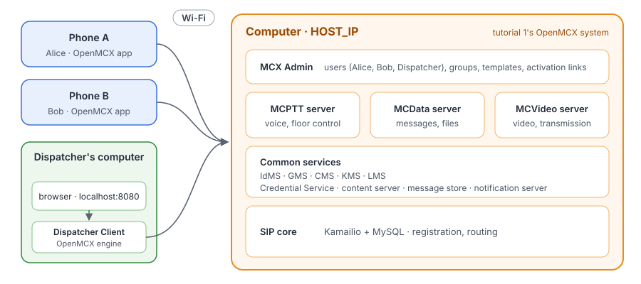
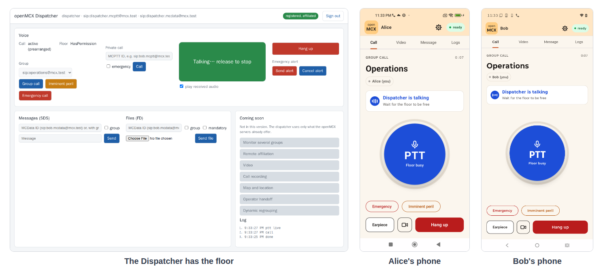

# Tutorial 2: MCX over WLAN with the Android phones and dispatcher client

Tutorial 1's system and phones, plus a **dispatcher position**: an MC user who works from a browser. The position
activates from MCX Admin like a phone, then calls the group `operations`, where Alice and Bob join on their phones,
and talks to them with the browser's microphone.

<p align="center"></p>

The position reaches the system the way the phones do: through `HOST_IP` and the ports tutorial 1 publishes. So it
runs on tutorial 1's computer or on another computer on the same network, unchanged.

## What you need

- **Tutorial 1 done**: its system running, the phones activated as `alice` and `bob` in the group `operations`.
- **Docker** with Docker Compose v2 on the dispatcher's computer (tutorial 1's, or another one).
- **A browser** on the dispatcher's computer, with a microphone and a speaker or headset.
- Nothing to compile: the tutorial uses the **prebuilt image from Docker Hub** (`openmcx/openmcx-dispatcher:1.0.0`). To
  build it yourself, see [Build](https://github.com/openMCX/openmcx-client#build) in openmcx-client, then set
  `OPENMCX_IMAGE_PREFIX=` (empty) and your tag in `.env`.

## 1. Set the addresses

```bash
cd tutorials/end-to-end/02-dispatcher-with-android
cp .env.example .env
```

In `.env`, set `HOST_IP` to the address of tutorial 1's computer (the same as in tutorial 1's `.env`). On another
computer, also set `DISPATCHER_IP` to that computer's own address on the network; on tutorial 1's computer, leave it
empty.

## 2. Start the position

```bash
docker compose -f docker-compose-dispatcher.yaml up -d
docker compose -f docker-compose-dispatcher.yaml ps --format 'table {{.Name}}\t{{.Status}}'
```

```
NAME                 STATUS
openmcx-dispatcher   Up 10 seconds (healthy)
```

The image is `openmcx/openmcx-dispatcher:1.0.0` from Docker Hub: the OpenMCX client engine and the dispatcher's web
service. The position has no user yet; it gets one in step 4.

## 3. Create the dispatcher user

In MCX Admin (`https://HOST_IP:8446/`, as in tutorial 1; sign in as `admin` with the password from tutorial 1's
`config/ADMIN.txt`), open **Users** → **New user**:

- **Login**: `dispatcher`
- **Template**: `phone-user`
- **Groups**: `sip:operations@mcx.test`
- **Services**: tick **MCData** and **MCVideo**

Choose **Create user**, then **Password link** on its row, and set its password in the browser.

## 4. Activate the position

1. In MCX Admin, open **Activation**, choose `dispatcher` and **Issue link**, then **Copy link**.
2. On the dispatcher's computer, open **http://localhost:8080/**. The browser allows the microphone only on
   `localhost` or over HTTPS, so open the position on its own computer.
3. Choose **Activate an account on this position**, paste the link and enter the dispatcher's password.

The position activates as a phone does: it checks MCX Admin's certificate against the link's pin, takes the
system's settings, trust root and addresses from the package, signs in and registers. The page then shows
`dispatcher`, registered, with the group `operations`. Later sign-ins on this position need only the login and
password; the account is kept in the position's volume, without its password.

One user, one device: the servers accept a user's service authorisation from one device at a time (several devices
of one user are not supported yet). Activate `dispatcher` on one position only; a user for a second position is a
second user (`dispatcher2`, ...).

## 5. Call the group

1. With the group `sip:operations@mcx.test` selected, choose **Group call**. Alice's and Bob's phones join the call;
   the position shows the call `active (prearranged)`.
2. Hold the green **PTT** button (press and hold it with the mouse) and speak: the position has the floor
   (`HasPermission`, the button says `Talking… release to stop`), and both phones show `Dispatcher is talking`.
   Release it to give the floor back.
3. When Alice holds PTT on her phone, the position shows her talking and plays her speech.

<p align="center"></p>

## 6. Stop or start over

```bash
docker compose -f docker-compose-dispatcher.yaml down         # stop; the activated account is kept
docker compose -f docker-compose-dispatcher.yaml down -v      # stop and forget the account
```

Tutorial 1's system is not affected by either. After `down -v` the position is a new device: activating `dispatcher`
on it again is refused until tutorial 1's system restarts (one device per user, step 4); activate another user, or
restart tutorial 1's system first. If tutorial 1 starts over with a new system, also start the position
over (`down -v`) and activate it again.

## How it is put together

- **The position** (`docker-compose-dispatcher.yaml`) runs on the network of its computer, as a phone is on the
  Wi-Fi. Its device settings (`setup/device.json.in`, with the two addresses filled in at start) hold only local
  settings: ports and addresses. Everything else comes from the activation.
- **Activation**: MCX Admin's package names the services as the system knows them (`sip-core:5061`, `idms:8443`,
  `http-proxy:8443`, ...) and maps each to `HOST_IP` and its published port (`address_map`). The position connects
  to the mapped address and checks each certificate against the service's name, as the phones do; the SIP core's
  name is mapped by a hosts entry (`extra_hosts`), its port being the same. The link is checked by its pin, and the
  system's trust root comes in the package, so nothing is copied from tutorial 1's computer.
- **On tutorial 1's own computer**, Docker delivers the servers' packets to the position from the containers'
  internal addresses, not from `HOST_IP`. Three settings of the device file make the position work there as well as
  on another computer:
  - `sip.outbound` (RFC 5626, as the phones do): the SIP core reaches the position over the connection it
    registered on, never by opening a new one to it;
  - `media.server_source: "port"`: the servers' speech, floor control and video are accepted from the negotiated
    port whatever address the NAT shows, and answered to the address they came from;
  - `media.bind` on `DISPATCHER_IP`: the position's packets leave from its own address.
- **Limits of the position** (dispatcher v1): one call at a time; several monitored groups, video, recording and a
  map are shown as "coming soon". See the dispatcher's [README](https://github.com/openMCX/openmcx-client/tree/main/dispatcher).

## Running the dispatcher on another computer on the network

Copy this folder to the other computer (or check out the repository there), set `HOST_IP` to tutorial 1's computer
and `DISPATCHER_IP` to the other computer in `.env`, and start it as in step 2. Then activate it as in step 4, with
the browser on that computer. Nothing is copied from tutorial 1's computer: the activation link and the account's
password are enough. The two computers must reach each other on the network (no firewall between them for the
ports tutorial 1 publishes and the position's ports below).

The position uses these ports on its computer, none of which tutorial 1 publishes, so both also run on one
computer: 8080/tcp (the web page, on `127.0.0.1` only), 5071/tcp (SIP), 4400 and 5400/udp (speech and floor
control), 4600, 5600 and 6600/udp (MCVideo), 7700-7701/udp (audio between the engine and the browser, `127.0.0.1`).

Checked on 2026-10-04 with the position on tutorial 1's own computer. A position on a second computer uses the same
image, files and steps with `DISPATCHER_IP` set; that setup is still to be checked on a real second computer.
