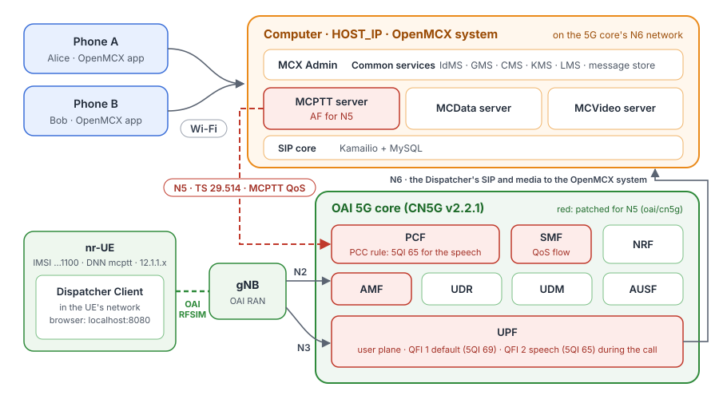
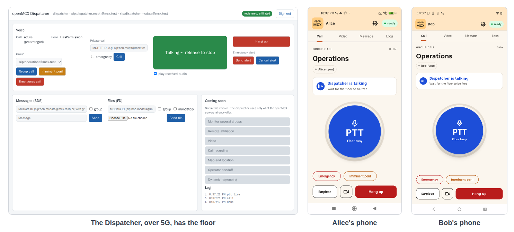

# Tutorial 3: MCX over the OAI 5G core and RAN (rfsim), with MCPTT QoS over N5

Tutorial 1's system and phones, plus a 5G network: the OAI 5G core, the OAI gNB and one nr-UE connected by the
rfsimulator (a simulated radio, no radio hardware). The dispatcher position runs inside the nr-UE, so all its traffic
crosses the 5G radio and core. When it calls, the MCPTT server asks the 5G core, over **N5**, for the QoS of
mission-critical voice: the core sets up a dedicated QoS flow (**5QI 65**) for the dispatcher's speech.

<p align="center"></p>

The phones reach the system on the Wi-Fi as in tutorial 1; their calls get no 5G QoS (they are not on 5G). The MCPTT
server asks for QoS only for call legs of UEs in the 5G pool (12.1.1.0/24).

The 5G addresses: the 5G core's functions (AMF, SMF, PCF, ...) and the gNB run on `192.168.71.128/26`; the data
network (N6) is `192.168.72.128/26`, with the UPF's N6 address `192.168.72.134` and the OpenMCX servers; the UE gets
its address from the pool `12.1.1.0/24` (the dispatcher's UE: `12.1.1.2`).

## What you need

- **Tutorial 1 done once**: the phones have the app, and you know the steps in MCX Admin. Tutorial 1's system must be
  **stopped**: tutorial 3 runs its own system with the same ports.
- **A Linux computer** with Docker and Docker Compose v2, about 8 CPU cores free (the rfsimulator's gNB and UE keep
  several cores busy) and **sudo** (step 3).
- **The OAI 5G core and RAN images**, from Docker Hub: OAI's own, and its AMF, PCF, SMF and UPF v2.2.1 with changes
  for N5 (`openmcx/oai-{amf,pcf,smf,upf}:mcx-n5`): the PCF turns an AF's media components into a PCC rule with 5QI 65,
  the SMF modifies the PDU session for it (a new QoS flow), and the UPF keeps the flow's packet rules. When the RAN
  cannot set the flow up, the AMF passes its answer on, the SMF removes the flow and reports the rule to the PCF, and
  the PCF tells the MCPTT server; the call goes on without the dedicated flow. The patches and the script that builds
  these images yourself are in [`oai/cn5g/`](oai/cn5g/README.md).

  The OAI 5G core is under the Collaborative Standards Software License v1.0: its patent license covers study,
  testing and research only ([`oai/cn5g/NOTICE`](oai/cn5g/NOTICE)).
- Nothing to compile: the tutorial uses **prebuilt images from Docker Hub**, OpenMCX's (`openmcx/openmcx-*:1.0.0`, as
  in tutorial 1) and OAI's. To build the OpenMCX images yourself, see
  [tutorial 1's Images](../01-mcx-over-wlan-android/README.md#images) and [Building OpenMCX](../../../docs/BUILD.md);
  for the three OAI images, [`oai/cn5g/`](oai/cn5g/README.md).

## 1. Set the computer's address

```bash
cd tutorials/end-to-end/03-mcx-over-oai-5g
cp .env.example .env
```

Set `HOST_IP` in `.env` to this computer's address on the Wi-Fi, as in tutorial 1.

## 2. Make the configuration

```bash
docker compose -f docker-compose-5g-mcx.yaml run --rm setup
```

As in tutorial 1 (a new system in `./config`), plus the MCPTT server's N5 settings: the PCF's address on the 5G core
network and the UE pool 12.1.1.0/24.

## 3. Connect this computer to the UE pool

```bash
sudo ./host-network.sh add
```

The dispatcher reaches the system at `HOST_IP`, as the phones do. Two settings of this computer complete the path:

- **A route** to the UE pool `12.1.1.0/24` through the UPF's N6 address `192.168.72.134`: replies to the UE go back
  through the UPF.
- **SNAT** for packets from the N6 network `192.168.72.128/26` to the UE pool: they leave from `HOST_IP`, so the UE
  sees one address both ways and the 5G core's packet filters (`permit out 17 from HOST_IP ...`) match the speech.

The three addresses are fixed in `host-network.sh` and match the 5G core's configuration (`oai/mcx_core_config.yaml`,
the networks in `docker-compose-5g-core.yaml`): change them only together. `sudo ./host-network.sh remove` undoes both
(step 9).

## 4. Start the system

```bash
docker compose -f docker-compose-5g-mcx.yaml up -d
docker compose -f docker-compose-5g-mcx.yaml ps --format 'table {{.Name}}\t{{.Status}}'
```

After about two minutes all 30 services are `(healthy)`: the OpenMCX system, the 5G core, the gNB, the nr-UE,
`ue-route` and the dispatcher. `openmcx-ue-route` shows the UE's address:

```bash
docker logs openmcx-ue-route        # UE address 12.1.1.2, HOST_IP through oaitun_ue1
```

## 5. Users and phones

As in tutorial 1, steps 4 to 6: in MCX Admin (`https://HOST_IP:8446/`; sign in as `admin` with the password from
`config/ADMIN.txt`) create `alice` and `bob` with the template
`phone-user` and the group `operations`, set their passwords and activate the phones. Also create `dispatcher` the same
way, and set its password.

- **Passwords**: use **Password link** on that user's own row; the box that opens says *Password link for alice*. The
  page that sets the password does not name the user.
- **Phones activated on another system** (tutorial 1, for example) keep that account: remove it in the app first, then
  scan the new user's QR code, and check that the code is for that user.

## 6. Activate the dispatcher (over 5G)

Open **http://localhost:8080/** on this computer: the dispatcher position, inside the nr-UE. In MCX Admin, issue an
activation link for `dispatcher` (Activation → Issue link → Copy link), and on the position choose **Activate an
account on this position**, paste the link and enter the password. The activation, the sign-in, the SIP registration
and every call of the position go through the 5G user plane.

## 7. Call, and see the QoS

1. On the position, choose **Group call**: Alice's and Bob's phones join.
2. Hold **PTT** on the position: it has the floor, and the phones show `Dispatcher is talking` with **Floor busy** on
   their PTT button.

<p align="center"></p>

3. While the call is up, the MCPTT server has an app session with the PCF for the dispatcher's leg, and the SMF has
   added a QoS flow to its PDU session:

   ```bash
   docker logs openmcx-mcptt-server 2>&1 | grep pcf_app_session
   docker logs openmcx-oai-pcf 2>&1 | grep -o '"flowDescription":"[^"]*"' | sort -u
   docker logs openmcx-oai-pcf 2>&1 | grep -o '"5qi":65'
   docker logs openmcx-oai-smf 2>&1 | grep -E 'PCF-initiated PDU|Add QoS flow|QoS Flow to Release'
   ```

   ```
   {"app_session_id":"1",...,"event":"pcf_app_session_created","status":201,"user_id":"sip:dispatcher.mcptt@mcx.test"}
   "flowDescription":"permit out 17 from HOST_IP 4000 to 12.1.1.2 4400"              speech (RTP)
   "flowDescription":"permit out 17 from HOST_IP 4001 to 12.1.1.2 4401"              RTCP
   "flowDescription":"permit out 17 from HOST_IP 5000 to 12.1.1.2 5400"              floor control
   "5qi":65                                                                          GBR 41 kbit/s, may pre-empt
   [smf_app] [info] PCF-initiated PDU Session Modification: 1 QoS flow(s) to add     the new QoS flow
   [smf_app] [info] Add QoS flow QFI 2 (PCC rule mcx-1-1, precedence 10): permit out 17 from HOST_IP 4000 to 12.1.1.2 4400 ...
   ```

   The QFI (QoS Flow Identifier) numbers a QoS flow within the UE's PDU session; the 5QI describes the flow's QoS
   (TS 23.501 clause 5.7.1). QFI 1 is the session's default flow, with 5QI 69 (MC signalling) for the DNN `mcptt`.
   The speech flow the PCF asks for is a second flow, so the SMF gives it the next QFI, 2, with 5QI 65. When the call
   ends, the MCPTT server deletes the app session (`pcf_app_session_deleted`, 204) and the SMF releases the flow; the
   next call's flow may get another free QFI (3, ...).

## 8. Look at the capture

The reference capture [`captures/03-mcx-over-oai-5g-full.pcapng.gz`](captures/03-mcx-over-oai-5g-full.pcapng.gz) (0.7 MB, 4 833
frames) records a run of steps 4 to 7: the system
starting, the UE registering over the 5G core, the phones and the dispatcher signing in, a group call from the
dispatcher with PTT, Bob talking back, and the hang-up. Wireshark opens the compressed file directly. The frame
numbers below are those of the reference.

It was captured on the two Docker networks, the 5G core's (`192.168.71.128/26`: N2, N3, N4, SBI and N5) and N6 with
the OpenMCX system (`192.168.72.128/26`), and reduced by port so that every TCP segment of a kept stream stays:

- NGAP and NAS-5GS (SCTP), PFCP, GTP-U (with IP fragments), the SBI of the core functions and N5 (HTTP/2 on 8080; the
  NRF's registrations and heartbeats are left out);
- SIP over TLS on 5061, **decrypted**: the file carries the TLS secrets of the SIP core (a pcapng decryption secrets
  block), so Wireshark shows the SIP messages without further setup;
- every UDP flow (speech and floor control) and ICMP.

The databases, DNS, the encrypted HTTPS between the OpenMCX services and the simulated radio between the gNB and the
UE (rfsimulator, TCP 4043) are left out.

The dispatcher's packets appear more than once: inside GTP-U on N3 between the gNB (`192.168.71.140`) and the UPF
(`192.168.71.134`), and on N6 after the UPF, once with `HOST_IP` (`192.168.90.88` in the reference) and once with
the address of the SIP core or the MCPTT server behind it. The UE's address is `12.1.1.2`; the phones are on the
Wi-Fi (`192.168.91.76` Alice, `192.168.88.177` Bob).

Useful display filters:

| Filter | Shows |
|---|---|
| `ngap` | N2 between the gNB and the AMF: NG Setup, the UE's registration and PDU session, and the PDU Session Resource Modify for the call's QoS flow. |
| `nas-5gs` | The UE's NAS: registration, authentication, security mode, PDU session establishment and modification. |
| `pfcp && !(pfcp.msg_type == 1 \|\| pfcp.msg_type == 2)` | N4 between the SMF and the UPF, without the heartbeats. |
| `http2.headers.path contains "policyauthorization"` | N5: the MCPTT server's app session at the PCF (TS 29.514), and its deletion. |
| `http2.headers.path contains "sm-policy" \|\| http2.headers.path contains "smpolicycontrol"` | N7: the PCF's policy for the PDU session and its update for the call. |
| `sip && !gtp` | Every SIP message (once; without the GTP-U copies). **Telephony → SIP Flows** draws them. |
| `rtcp.app.name == "MCPT" && !gtp` | Floor control (TS 24.380 clause 8.2). |
| `rtp && !gtp` | Speech: AMR-WB. |

What to look for, in the reference run:

- **The 5G core and the UE** (frames 12 to 378): PFCP Association between the SMF and the UPF (12), NG Setup (18), the
  UE's Registration request (22) with 5G-AKA through the AUSF, UDM and UDR, Security mode command (181), and the PDU
  session for the DNN `mcptt`: the AMF asks the SMF (238), the SMF asks the PCF for the session's policy (286), sets
  up the UPF (315) and sends the PDU session establishment accept through the AMF (342). The session's default QoS
  flow is QFI 1, 5QI 69 (MC signalling).
- **Sign-in and registration** (frames 545 to 1530): Alice's and Bob's phones (545, 827) and the dispatcher over 5G
  (1516) register with the SIP core: REGISTER, the challenge, REGISTER again.
- **The group call** (frames 1931 to 2005): the dispatcher's INVITE leaves the UE inside GTP-U (1931) and reaches the
  SIP core on N6 (1933); after the `407` challenge it is sent again (1950, 1952) and forwarded to the MCPTT server
  (1956), which invites Alice (1967) and Bob (1973). The server's `200` reaches the dispatcher (1985).
- **QoS over N5** (frames 2015 to 2085): the MCPTT server, as application function, asks the PCF for the dispatcher's
  media (2015: `POST /npcf-policyauthorization/v1/app-sessions` with the media components, speech, RTCP and floor
  control, TS 29.514). The PCF turns them into a PCC rule with 5QI 65 and updates the SMF (2031). The SMF changes the
  UPF's rules (2037) and adds a QoS flow to the PDU session (2062, 2067: PDU Session Resource Modify Request with
  QFI 2, 5QI 65, ARP 3 and a guaranteed bit rate of 41 kbit/s each way), which the gNB accepts (2072).
- **Floor control and speech** (frames 2179 to 4640): the dispatcher's Floor Request (2179) and Floor Granted (2180),
  Floor Taken to the phones (2183, 2184), the dispatcher's speech, Floor Release (3595); then Bob's turn (3633 to
  4640). Downlink, the speech and floor control the UPF sends the gNB for the dispatcher carry QFI 2 in their GTP-U
  header (filter `gtp.ext_hdr.pdu_ses_con.qos_flow_id == 2`); the UE's uplink packets stay on QFI 1 in the reference
  run.
- **Hang-up** (from frame 4690): the dispatcher's BYE (4690, 4692, again after the challenge 4699, 4701) and the
  server's BYEs to Alice and Bob (4706, 4710). The MCPTT server deletes the app session (4705), and the SMF releases
  the QoS flow (4749, 4763: PDU Session Resource Modify Request, cause normal release).

The access tokens of the IdMS travel in SIP for service authorisation, and the file holds the SIP core's TLS secrets.
They belong to a throwaway system: its signing key and users no longer exist and the tokens expired after an hour.
Treat a capture of your own system, and its TLS secrets, as secret.

## 9. Stop or start over

```bash
docker compose -f docker-compose-5g-mcx.yaml down        # stop; ./config is kept
docker compose -f docker-compose-5g-mcx.yaml down -v     # stop and delete the data
sudo ./host-network.sh remove
rm -rf config                                            # with down -v: start over at step 2
```

After `down`, `docker compose -f docker-compose-5g-mcx.yaml up -d` starts the same system again, users and phones
included; then run `sudo ./host-network.sh add` again (step 3): its route goes with the network `down` removes.

## How it is put together

- **Two compose files**: `docker-compose-5g-core.yaml` has tutorial 1's OpenMCX services, unchanged, on the 5G core's
  **N6 network** (`openmcx-5g-n6`, 192.168.72.128/26) and the OAI 5G core on the **core network** (`openmcx-5g-core`,
  192.168.71.128/26); [tutorial 4](../04-mcx-over-srsran-5g/README.md) uses it too. `docker-compose-5g-mcx.yaml`
  includes it and adds the gNB and the nr-UE (IMSI 208990100001100, DNN `mcptt`), the dispatcher in the nr-UE's
  network namespace and `ue-route`, which routes `HOST_IP` through the UE's tunnel (`oaitun_ue1`) once its PDU
  session is up. The OAI configuration is in `oai/`, the N5 patches of the AMF, PCF, SMF and UPF in `oai/cn5g/`.
- **N5**: the MCPTT server is also on the core network (192.168.71.141). With the `pcf` block that the setup adds
  (`setup/pcf.py`), it creates an `Npcf_PolicyAuthorization` app session (TS 29.514) for each call leg of a UE in
  12.1.1.0/24: the leg's speech, RTCP and floor control flows, its bandwidth and priority. The PCF makes a PCC rule
  (5QI 65), the SMF a QoS flow on the UE's PDU session (TS 23.502 4.3.3.2), the UPF its packet rules. Without the
  `pcf` block, as in tutorials 1 and 2, the server never contacts a PCF.
- **The dispatcher** is the image and settings of tutorial 2, with its address the UE's. The UE's address can change
  when the UE or the core restarts; the dispatcher then updates its activated accounts at start.
- **Routing**: the UPF sends a UE's packets for `HOST_IP` out of the core network (its default route), so they reach
  this computer from another Docker network than the OpenMCX system's and Docker's NAT keeps the UE's address (the
  SIP core checks that the SDP address is the sender's). The replies come back through `host-network.sh`'s route and
  leave from `HOST_IP`.
- **The phones** are not on 5G: their legs are outside the UE pool and get no app session.
