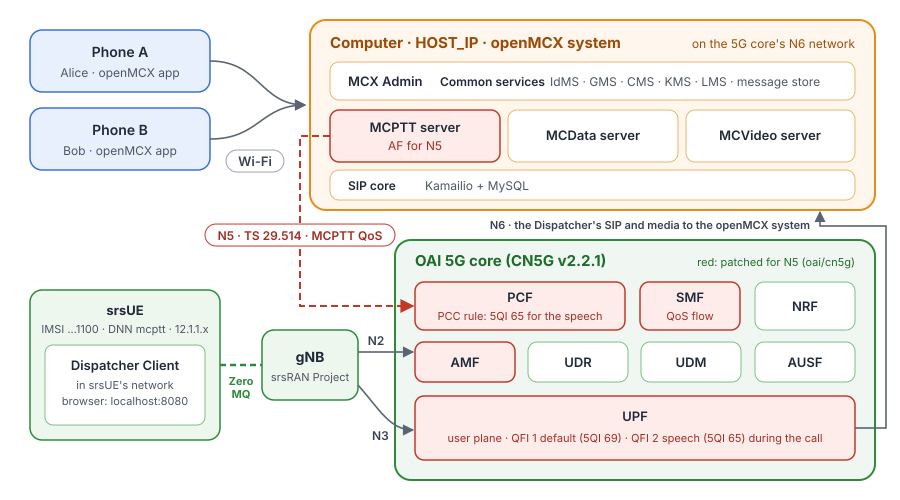
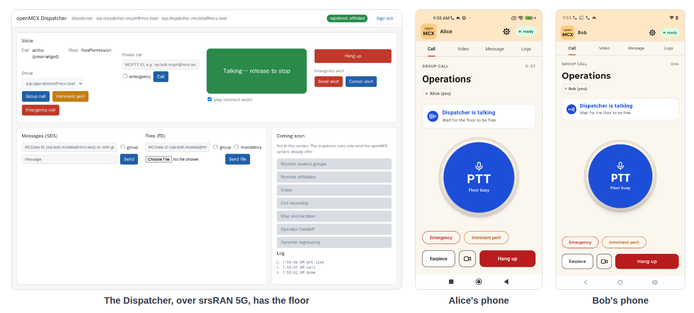

# Tutorial 4: MCX over the OAI 5G core and srsRAN (ZeroMQ), with MCPTT QoS over N5

Tutorial 3 with another radio access network: the same OpenMCX system, phones and OAI 5G core, but the srsRAN
Project gNB and srsUE instead of the OAI gNB and nr-UE, connected by srsRAN's ZeroMQ virtual radio (no radio
hardware). The Dispatcher Client runs inside srsUE, so all its traffic crosses the 5G radio and core. When it calls,
the MCPTT server asks the 5G core, over **N5**, for the QoS of mission-critical voice (**5QI 65**), exactly as in
tutorial 3.

<p align="center"></p>

What differs is the outcome: srsUE supports one QoS flow only, so the RAN cannot set up the dedicated 5QI 65 flow.
This tutorial shows what the standards foresee for that case: the RAN refuses the flow, the 5G core removes it and
tells the MCPTT server, and the call goes on over the PDU session's default flow.

As in tutorial 3, a second MC client runs in the UE: the Linux client of the test user `client-d`
(`openmcx-ue-client`), here in srsUE, which registers with **IMS AKA** through the **P-CSCF** (`openmcx-pcscf`,
192.168.72.140) with IPsec ESP security associations over the 5G user plane (TS 33.203; TS 33.180 clause 6.2.1 for
3GPP access), and goes through TS 37.579-2 test 5.1 at every start
([walk-through](#walk-through-of-ts-37579-2-test-51)). The Dispatcher Client and the phones keep SIP digest over TLS.

## What you need

- **Tutorial 3 done once**: its `.env`, its configuration (`tutorials/end-to-end/03-mcx-over-oai-5g/config`) and the route to the
  UE pool. Tutorial 4 starts tutorial 3's OpenMCX system and 5G core from tutorial 3's files, so tutorials 1 and 3
  must be **stopped**: tutorial 4 uses the same containers and ports.
- **A Linux computer** with Docker and Docker Compose v2, about 8 CPU cores free (the gNB and srsUE keep several cores
  busy) and **sudo** (for the route, as in tutorial 3).
- **Images**: nothing to compile. The OpenMCX images and OAI's come prebuilt from Docker Hub, as in tutorial 3, and so do the
  srsRAN gNB (`openmcx/openmcx-srsran-gnb:25.10-mcx`, with OpenMCX's patch) and srsUE (`openmcx/openmcx-srsue:25.10`),
  built from [`srsran/Dockerfile`](srsran/Dockerfile) from the srsRAN sources pinned to the release 25.10 commits. To
  build them yourself, see step 2.

  srsRAN Project and srsRAN 4G are under the GNU Affero General Public License v3. The gNB is built with a small
  OpenMCX patch (see [How it is put together](#how-it-is-put-together) and [`srsran/NOTICE`](srsran/NOTICE)); srsUE
  is unmodified.

## 1. Tutorial 3's steps 1 to 3

If not done yet, in `tutorials/end-to-end/03-mcx-over-oai-5g`: set `HOST_IP` in `.env` (step 1), make the configuration (step 2)
and connect this computer to the UE pool (step 3, `sudo ./host-network.sh add`). Tutorial 4's `.env` is a link to
tutorial 3's.

## 2. The srsRAN images (optional: build them yourself)

The compose file pulls the srsRAN images from Docker Hub when the system starts (step 3). To build them on this
computer instead (15 to 30 minutes each):

```bash
cd tutorials/end-to-end/04-mcx-over-srsran-5g
srsran/build-images.sh
```

This builds `openmcx-srsran-gnb:25.10-mcx` and `openmcx-srsue:25.10`; add `SRSRAN_IMAGE_PREFIX=` (empty) to `.env` to
use them. Each build checks that the release tag still points
to the pinned commit and stops if it does not, and the gNB build applies the patches in `srsran/patches/`, stopping
with the name of a patch that does not apply. The images carry the commit (and the gNB its patches' SHA-256) as
labels; the gNB also has `/usr/share/doc/srsran-project/SOURCE`.

## 3. Start the system

```bash
docker compose -f docker-compose-srsran-mcx.yaml up -d
docker compose -f docker-compose-srsran-mcx.yaml ps --format 'table {{.Name}}\t{{.Status}}'
```

After about two minutes every service is `(healthy)`: the 30 of the OpenMCX system, the 5G core, the gNB, srsUE,
`ue-route`, the Dispatcher Client, the P-CSCF (`pcscf`, `pcscf-route`) and the IMS AKA client (`ue-client`, healthy
once it is authorised). `openmcx-ue-route` shows srsUE's address:

```bash
docker logs openmcx-ue-route        # UE address 12.1.1.2, 192.168.179.39 and the P-CSCF 192.168.72.140 through tun_srsue
```

## 4. Users and phones

As in tutorial 3, step 5: in MCX Admin (`https://HOST_IP:8446/`; sign in as `admin` with the password from tutorial
3's `config/ADMIN.txt`) create `alice` and `bob` with the template
`phone-user` and the group `operations`, set their passwords and activate the phones. Also create `dispatcher` the same
way, and set its password. (With tutorial 3's configuration and data kept, they are already there.)

## 5. Activate the Dispatcher Client (over 5G)

Open **http://localhost:8080/** on this computer: the Dispatcher Client, inside srsUE. In MCX Admin, issue an
activation link for `dispatcher` (Activation → Issue link → Copy link), and on the Dispatcher Client choose **Activate
an account on this position**, paste the link and enter the password. The activation, the sign-in, the SIP
registration and every call go through srsUE, the gNB and the 5G user plane.

## 6. Call, and see what happens to the QoS

1. On the Dispatcher Client, choose **Group call**: Alice's and Bob's phones join.
2. Hold **PTT**: the Dispatcher Client has the floor, and the phones show `Dispatcher is talking` with **Floor busy**
   on their PTT button. Release it; Alice and Bob can talk in turn, and the Dispatcher Client hears them.

<p align="center"></p>

3. While the call is set up, the MCPTT server asks for the QoS flow, the RAN refuses it and the core falls back:

   ```bash
   docker logs openmcx-mcptt-server 2>&1 | grep pcf_
   docker logs openmcx-oai-pcf 2>&1 | grep -o '"5qi":65'
   docker logs openmcx-srsran-gnb 2>&1 | grep QFI
   docker logs openmcx-oai-smf 2>&1 | grep -E 'refused QoS flow|INACTIVE'
   docker logs openmcx-oai-pcf 2>&1 | grep Npcf_PolicyAuthorization_Notify
   ```

   ```
   {"app_session_id":"3",...,"event":"pcf_app_session_created","status":201,...}          N5: the MCPTT server asks
   "5qi":65                                                                               the PCF's PCC rule
   [CU-CP   ] [W] Couldn't allocate QFI=4                                                  the gNB refuses the flow
   [smf_app] [warning] NG-RAN refused QoS flow QFI 4 (PCC rule mcx-3-1, NGAP cause group 1 value 22): release it
     at the UPF and report the PCC rule to the PCF                                         radio resources not available
   [smf_n7 ] [info] Npcf_SMPolicyControl_Update: PCC rule(s) ["mcx-3-1"] INACTIVE, RES_ALLO_FAIL
   [pcf_app] [info] Npcf_PolicyAuthorization_Notify to http://192.168.71.141:8099/npcf-af/.../notify: app session 3,
     FAILED_RESOURCES_ALLOCATION (RES_ALLO_FAIL)                                          the PCF tells the MCPTT server
   {"app_session_id":"3","detail":"FAILED_RESOURCES_ALLOCATION","event":"pcf_notification",...}
   {"app_session_id":"3",...,"event":"pcf_app_session_deleted","status":204}              when the call ends
   ```

   srsUE supports one QoS flow (one data radio bearer) only, and the gNB is set to give it no more
   (`max_nof_drbs_per_ue: 1`). So the gNB refuses the 5QI 65 flow and keeps the session as it was (TS 38.413 8.2.3.2);
   the SMF removes the flow from the UPF and reports the PCC rule as not installed (TS 23.502 4.3.3.2, TS 29.512);
   the PCF tells the MCPTT server that the resources were not allocated (TS 29.514); and the call continues over the
   default QoS flow (5QI 69), without the dedicated QoS. The MC standards leave this decision to the MC service
   server: it may go on without a dedicated bearer or retry later (TS 23.280 10.11.1 NOTE 2, TS 24.379 4.13). With
   `"required": true` in the MCPTT server's `pcf` block, it would instead end the call leg (BYE, cause 503).

   Each call asks again, so each call shows the same sequence; the QFI number grows (2, 3, 4, ...) because the SMF
   gives each new flow the next free QFI.

## 7. Look at the capture

The reference capture [`captures/04-mcx-over-srsran-5g-full.pcapng.gz`](captures/04-mcx-over-srsran-5g-full.pcapng.gz) (1.3 MB, 7 908
frames) records a run of steps 3 to 6: the system starting, srsUE registering over the 5G core, the MC client of
`client-d` registering with IMS AKA through the P-CSCF, the phones and the Dispatcher Client signing in, a group call
from the Dispatcher Client with PTT, Bob talking back, the hang-up, and the phones' MC log-off. Wireshark opens the
compressed file directly. The frame numbers below are those of the reference.

It was captured on the network interfaces of the AMF, SMF, PCF, UPF, SIP core, P-CSCF and MCPTT server, not on the
Docker networks: the core network also carries the simulated radio between the gNB and srsUE (ZeroMQ, several hundred
MB/s), which is left out. Like tutorial 3's, the capture was reduced by port so that every TCP segment of a kept
stream stays:

- NGAP and NAS-5GS (SCTP), PFCP, GTP-U (with IP fragments), the SBI of the core functions and N5 (HTTP/2 on 8080; the
  NRF's registrations and heartbeats are left out), and the PCF's notifications to the MCPTT server (HTTP/2 on 8099);
- SIP over TLS on 5061, **decrypted**: the file carries the TLS secrets of the SIP core (a pcapng decryption secrets
  block);
- the IMS AKA client's SIP: unprotected on 5060 until the 401, then inside **IPsec ESP** between srsUE and the P-CSCF;
  to read it, copy [`captures/04-mcx-over-srsran-5g-full.esp_sa`](captures/04-mcx-over-srsran-5g-full.esp_sa) to
  `~/.config/wireshark/esp_sa` and tick **Edit → Preferences → Protocols → ESP → Attempt to detect/decode encrypted
  ESP payloads** (as in tutorial 3);
- every UDP flow (speech and floor control) and ICMP.

The ZeroMQ radio sometimes loses a TCP segment of srsUE, which TCP sends again after the ones behind it. For Wireshark
to put such SIP messages together, turn on **Edit → Preferences → Protocols → TCP → Reassemble out-of-order
segments** (`tshark -o tcp.reassemble_out_of_order:TRUE`).

srsUE's packets appear more than once: inside GTP-U on N3 between the gNB (`192.168.71.140`) and the UPF
(`192.168.71.134`), on N6 after the UPF with `HOST_IP` (`192.168.179.39` in the reference), and at the SIP core
(`192.168.72.171`), the P-CSCF (`192.168.72.140`) or the MCPTT server (`192.168.72.176`). srsUE's address is
`12.1.1.2`; the phones are on the Wi-Fi (`192.168.179.40` Alice, `192.168.179.42` Bob). With **Edit → Preferences →
Protocols → GTP** off (`--disable-protocol gtp`), only the copies after the UPF are read as TCP.

Useful display filters:

| Filter | Shows |
|---|---|
| `ngap` | N2 between the gNB and the AMF: NG Setup, srsUE's registration and PDU session, and the refused PDU Session Resource Modify. |
| `pfcp && !(pfcp.msg_type == 1 \|\| pfcp.msg_type == 2)` | N4 between the SMF and the UPF, without the heartbeats. |
| `http2.headers.path contains "policyauthorization" \|\| http2.headers.path contains "npcf-af"` | N5: the MCPTT server's app sessions at the PCF (TS 29.514), the PCF's notifications, and the deletion. |
| `http2.headers.path contains "sm-policy" \|\| http2.headers.path contains "smpolicycontrol"` | N7: the PCF's policy for the PDU session, its updates for the call and the SMF's reports. |
| `sip && ip.addr == 192.168.72.140 && tcp.port == 5060` | IMS AKA: the unprotected REGISTER with Security-Client and the 401 with the AKA challenge and Security-Server. |
| `esp && sip` | The IMS AKA client's SIP inside ESP (with the ESP SAs above). |
| `sip && !gtp && !(ip.addr == 192.168.179.39)` | Every SIP message once. **Telephony → SIP Flows** draws them. |
| `rtcp.app.name == "MCPT" && !gtp && !(ip.addr == 192.168.179.39)` | Floor control (TS 24.380 clause 8.2). |
| `gtp.ext_hdr.pdu_ses_con.qos_flow_id` | The QoS flow of each GTP-U packet: always 1 in this tutorial. |

What to look for, in the reference run (frame numbers with GTP off):

- **The 5G core and srsUE** (frames 1 to 194): PFCP Association between the SMF and the UPF (1), NG Setup (7),
  srsUE's Registration request (25) with 5G-AKA (Authentication request 45), Security mode command (67), the PDU
  session establishment accept for the DNN `mcptt` (183) and the PDU Session Resource Setup (192, 194). The session's
  default QoS flow is QFI 1, 5QI 69 (MC signalling).
- **IMS AKA of `client-d`** (frames 262 to 670): the unprotected REGISTER to the P-CSCF's port 5060 with
  Security-Client (262); the 401 with the AKA challenges and Security-Server (300); the first ESP packets (308); the
  protected REGISTER inside ESP (318) and its 200 (326); then the service authorisation PUBLISH (670) and the
  subscriptions, all inside ESP.
- **Sign-in and registration with SIP digest** (frames 1496 to 2190): Alice's and Bob's phones (1496, 1737) and the
  Dispatcher Client over 5G (2190) register with the SIP core: REGISTER, the challenge, REGISTER again.
- **The group call** (frames 3146 to 3234): the Dispatcher Client's INVITE (3146), the `407` challenge (3152); the
  MCPTT server invites the members, among them `client-d` through the P-CSCF, inside ESP (3187), and answers the
  Dispatcher Client with `200` (3234).
- **QoS over N5, refused by the RAN** (frames 3226 to 3457), once for each of srsUE's two call legs (the Dispatcher
  Client's and `client-d`'s, both at `12.1.1.2`):
  - The MCPTT server, as application function, asks the PCF for the leg's media (3226 and 3372: `POST
    /npcf-policyauthorization/v1/app-sessions` with the media components and a subscription to the events
    `FAILED_RESOURCES_ALLOCATION` and `SUCCESSFUL_RESOURCES_ALLOCATION`).
  - The PCF turns them into a PCC rule with 5QI 65 and updates the SMF (3248 and 3385), which asks for a QoS flow
    through the AMF (3286 and 3426: PDU Session Resource Modify Request).
  - The gNB refuses it (3287 and 3427: PDU Session Resource Modify Response, cause radio network
    `radio-resources-not-available`), and the SMF reports the PCC rule to the PCF (3319 and 3457, bodies 3323 and
    3461: `ruleStatus` `INACTIVE`, `failureCode` `RES_ALLO_FAIL`).
  - The PCF tells the MCPTT server (3333, body 3335, and 3477: `POST /npcf-af/.../notify`, event
    `FAILED_RESOURCES_ALLOCATION`, the resource `INACTIVE`), which lets the call go on.
- **Floor control and speech** (frames 3667 to 7524): the Dispatcher Client's Floor Request (3667), its speech, then
  Bob's turn, up to the last Floor Release (7524). All srsUE's GTP-U packets, speech and floor control included,
  travel on QFI 1, the default flow.
- **Hang-up** (from frame 7598): the Dispatcher Client's BYE (7598); the MCPTT server deletes the app session (7612);
  with no QoS flow set up, the SMF has nothing to release.
- **MC log-off of the phones** (from frame 7788): each phone logs off from MCVideo, MCData and MCPTT with a PUBLISH
  with Expires 0 each (from 7788; TS 24.379 clause 7.2.1A NOTE 3, TS 24.281 and TS 24.282 alike). After the MC
  log-off, each phone sends a SIP de-REGISTER, a REGISTER with Expires 0 (TS 24.229 clause 5.1.1.6; Bob's 7886).

The access tokens of the IdMS travel in SIP for service authorisation, and the file holds the SIP core's TLS secrets
(and the `.esp_sa` file the IPsec keys of `client-d`). They belong to a throwaway system: its signing key and users no
longer exist and the tokens expired after an hour. Treat a capture of your own system, its TLS secrets and its ESP
keys, as secret.

## 8. Stop or start over

```bash
docker compose -f docker-compose-srsran-mcx.yaml down        # stop; tutorial 3's ./config is kept
docker compose -f docker-compose-srsran-mcx.yaml down -v     # stop and delete the data
sudo ../03-mcx-over-oai-5g/host-network.sh remove
```

To run tutorial 3 again, stop tutorial 4 first; both use the same containers.

## Walk-through of TS 37.579-2 test 5.1

As in [tutorial 3](../03-mcx-over-oai-5g/README.md#walk-through-of-ts-37579-2-test-51), with the MC client of
`client-d` in srsUE (`openmcx-ue-client`) and srsRAN as the RAN: the same steps, the same P-CSCF and tutorial 3's
configuration. It runs by itself at every start (step 3); with `MCX_LOG=debug` in tutorial 3's `.env` the logs hold
every SIP message and HTTP request, and the client's debug log the keys of its IPsec security associations (lines
`ESP SA`), so that Wireshark can decrypt its SIP: treat it as secret.

```bash
docker compose -f docker-compose-srsran-mcx.yaml ps ue-client     # (healthy)
docker logs openmcx-ue-client 2>&1 | grep -E '"event":"(sip_registered|oidc_authenticated|signed_in|service_authorized|configuration_subscribed|group_documents_subscribed|group_document_notified|location_configuration_received)"'
python3 -c 'import json; print(json.dumps(json.load(open("../03-mcx-over-oai-5g/config/artifacts/client-d/status.json"))["sip_security"], indent=1))'
```

## How it is put together

- **Tutorial 3's core, shared**: `docker-compose-srsran-mcx.yaml` includes tutorial 3's `docker-compose-5g-core.yaml`
  with its `docker-compose-5g-core-aka.yaml` (the OpenMCX system on the N6 network and the OAI 5G core, with the same
  images, and the setup's IMS AKA user) and adds `srsran-gnb`, `srsue`, `ue-route`, the Dispatcher Client and the MC
  client of `client-d`, which run in srsUE's network namespace, and the P-CSCF with `pcscf-route`. `.env` is a link to
  tutorial 3's; the configuration is tutorial 3's `config/`.
- **srsRAN configuration** (`srsran/`): the gNB (`gnb.yaml`) has one cell in band 3 (FDD), 20 MHz, 15 kHz subcarrier
  spacing, and connects to the AMF (N2) and the UPF (N3) on the core network with tutorial 3's PLMN 208/99, TAC 1 and
  slice SST 1. srsUE (`ue.conf`) uses tutorial 3's subscriber (IMSI 208990100001100, DNN `mcptt`); its slice has no SD
  (`nssai-sd = 16777215`, 0xFFFFFF), as the core's, since srsUE's default SD of 1 is refused by the AMF. The two
  connect over ZeroMQ (gNB 192.168.71.140, srsUE 192.168.71.150).
- **One radio bearer** (`max_nof_drbs_per_ue: 1` in `gnb.yaml`): srsUE cannot configure a second QoS flow; with this
  setting the gNB refuses the flow itself instead of asking srsUE to reconfigure.
- **The gNB patch** (`srsran/patches/srsran-project/`): unpatched, the srsRAN gNB answers a refused flow by releasing
  the UE (and srsUE does not reconnect after a release). The patch makes it do what TS 38.413 8.2.3.2 specifies: keep
  the previous configuration, pass the NAS message to the UE only for a modified session, report the refused flow
  (QoS Flow Failed to Add or Modify List) or the refused session (Modify Unsuccessful Transfer), and keep the UE
  connected. See [`srsran/NOTICE`](srsran/NOTICE).
- **The 5G core** handles the refusal with the patches of tutorial 3's [`oai/cn5g/`](../03-mcx-over-oai-5g/oai/cn5g/README.md)
  (AMF, SMF, PCF), and the MCPTT server receives the PCF's notification over HTTP/2 (TS 29.500).
- **The phones** are not on 5G: their legs are outside the UE pool and get no app session.
