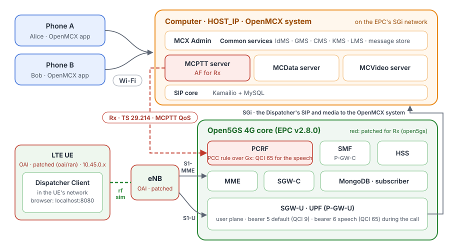

# Tutorial 5: MCX over a 4G core (Open5GS EPC) and the OAI LTE RAN (rfsim), with MCPTT QoS over Rx

Tutorial 3, on 4G instead of 5G: tutorial 1's system and phones, plus an LTE network made of the Open5GS 4G core
(EPC) and the OAI eNB and one LTE UE connected by the rfsimulator (a simulated radio, no radio hardware). The
dispatcher position runs inside the LTE UE, so all its traffic crosses the LTE radio and the EPC. When it calls, the
MCPTT server asks the EPC's PCRF, over **Rx** (TS 29.214, the MCPTT-5 reference point of TS 23.379), for the QoS of
mission-critical voice: the EPC sets up a **dedicated bearer with QCI 65** for the dispatcher's speech, down to the
radio.

<p align="center"></p>

The phones reach the system on the Wi-Fi as in tutorial 1; their calls get no 4G QoS (they are not on 4G). The MCPTT
server asks for QoS only for call legs of UEs in the LTE pool (10.45.0.0/16): a UE on another access, such as the
phones on WLAN, gets no request and its calls work as before (TS 24.379 clause 4.13).

A second MC client runs in the LTE UE, as in tutorial 3: the Linux client of the test user `client-d`
(`openmcx-ue-client`), which registers with **IMS AKA** through a **P-CSCF** (`openmcx-pcscf`, 192.168.74.140), with
IPsec ESP security associations over the LTE user plane (TS 33.203; TS 33.180 clause 6.2.1 for 3GPP access). It goes
through TS 37.579-2 test 5.1 at every start ([walk-through](#walk-through-of-ts-37579-2-test-51)). The dispatcher
position and the phones keep SIP digest over TLS.

## What you need

- **Tutorial 1 done once**: the phones have the app, and you know the steps in MCX Admin. Tutorial 1's system (and
  tutorials 3 and 4) must be **stopped**: tutorial 5 runs its own system with the same ports.
- **A Linux computer** with Docker and Docker Compose v2, about 8 CPU cores free (the rfsimulator's eNB and UE keep
  several cores busy), **sudo** (step 3) and the kernel's IPsec (the `xfrm_user`, `esp4` and `authenc` modules, with
  `hmac(sha1)` and `cbc(aes)`), for the IMS AKA client's security associations.
- **The images**, from Docker Hub: OpenMCX's (`openmcx/openmcx-*:develop`, the `main` branch: IMS AKA, the P-CSCF and
  the MC client in the UE need a version after 1.0.0) and three patched images:
  - `openmcx/open5gs:2.8.0-mcx`: Open5GS v2.8.0 for every EPC function, with a PCRF change: an MCPTT AF session's
    audio gets QCI 65 (and an MCVideo session's video QCI 67), as TS 23.379 clause 5.7.3 asks, instead of the QCI 1
    of IMS voice. The patch and the build are in [`open5gs/`](open5gs/NOTICE). Open5GS is under the GNU AGPL v3.
  - `openmcx/oai-enb:2026.w39-mcx` and `openmcx/oai-lte-ue:2026.w39-mcx`: OAI's eNB and LTE UE with fixes for
    dedicated bearers: the UE accepts every type of tracking area identity list, accepts a dedicated bearer that the
    network sets up with a new connection and one that the network releases (TS 24.301), and the eNB and the UE
    release the bearer's radio bearer (TS 36.331). The patches and the build are in [`oai/ran/`](oai/ran/NOTICE).
    OAI is under the Collaborative Standards Software License v1.0: its patent license covers study, testing and
    research only.

  To build the patched images yourself: `open5gs/build-images.sh` (about 10 minutes) and `oai/ran/build-images.sh`
  (about 40 minutes); then set `OPEN5GS_IMG=open5gs:2.8.0-mcx`, `ENB_IMG=oai-enb:2026.w39-mcx` and
  `UE_IMG=oai-lte-ue:2026.w39-mcx` in `.env`.

## 1. Set the computer's address

```bash
cd tutorials/end-to-end/05-mcx-over-4g-open5gs-oai
cp .env.example .env
```

Set `HOST_IP` in `.env` to this computer's address on the Wi-Fi, as in tutorial 1.

## 2. Make the configuration

```bash
docker compose -f docker-compose-4g-mcx.yaml run --rm setup
```

As in tutorial 1 (a new system in `./config`), plus the MCPTT server's Rx settings (the PCRF as a Diameter peer and
the LTE pool 10.45.0.0/16), the EPC's Diameter certificates (`config/epc-tls`) and, as in tutorial 3, the location
reporting configuration of the MCPTT, MCVideo and MCData servers and the test user `client-d` provisioned for IMS AKA
(a software ISIM with its own K and OPc, its ims_subscription row in the SIP database, `config/ue-client.json` and the
P-CSCF's `config/pcscf.cfg`). Every other user keeps SIP digest over TLS.

## 3. Connect this computer to the UE pool

```bash
sudo ./host-network.sh add
```

After step 2: the route goes through the SGi network, which the setup creates. As in tutorial 3: replies to the UE
pool go back through the P-GW's user plane (the UPF, at its SGi address), and they leave from `HOST_IP`, so the UE
sees one address both ways and the EPC's packet filters match the speech. The P-CSCF (`192.168.74.140`) is left out
of that address change: its IPsec security associations with the UE are bound to its own address (TS 33.203 clause
7.1). `sudo ./host-network.sh remove` undoes all of it (step 9); `down -v` deletes the SGi network and the route with
it, so run `add` again after the next setup.

## 4. Start the system

```bash
docker compose -f docker-compose-4g-mcx.yaml up -d
docker compose -f docker-compose-4g-mcx.yaml ps --format 'table {{.Name}}\t{{.Status}}'
```

After about two minutes every service is `(healthy)`: the OpenMCX system, the EPC (`epc-mme`, `epc-hss`,
`epc-sgwc`, `epc-sgwu`, `epc-smf`, `epc-upf`, `epc-pcrf`, `epc-mongo`; `epc-subscriber` loads the UE's subscription
and exits), the eNB, the LTE UE, `ue-route`, the dispatcher, the P-CSCF (`pcscf`, `pcscf-route`) and the IMS AKA
client (`ue-client`, healthy once it is authorised). `openmcx-ue-route` shows the UE's address:

```bash
docker logs openmcx-ue-route        # UE address 10.45.0.2, 192.168.179.39 and the P-CSCF 192.168.74.140 through oaitun_ue1
```

If the UE has no address after two minutes (the rfsimulator's first random access sometimes fails), restart it:
`docker restart openmcx-oai-lte-ue`, then `docker compose -f docker-compose-4g-mcx.yaml up -d --force-recreate
ue-route dispatcher`.

## 5. Users and phones, 6. Activate the dispatcher (over 4G)

As in tutorial 3, steps 5 and 6: in MCX Admin (`https://HOST_IP:8446/`; sign in as `admin` with the password from
`config/ADMIN.txt`) create `alice`, `bob` and `dispatcher`,
activate the phones, and activate the dispatcher position at **http://localhost:8080/**. The position's activation,
sign-in, SIP registration and calls go through the LTE user plane.

## 7. Call, and see the QoS

1. On the position, choose **Group call**: Alice's and Bob's phones join.
2. Hold **PTT** on the position: it has the floor, and the phones show `Dispatcher is talking`.
3. While the call is up, the MCPTT server has an Rx session with the PCRF for the dispatcher's leg, and the EPC has
   set up a dedicated bearer for it:

   ```bash
   docker logs openmcx-mcptt-server 2>&1 | grep rx_session
   docker logs openmcx-epc-mme 2>&1 | grep 'Bearer added'
   docker logs openmcx-oai-enb 2>&1 | grep 'QCI 65'
   docker logs openmcx-oai-lte-ue 2>&1 | grep -i 'dedicated EPS bearer'
   ```

   ```
   {"dialog":"f9b98939-…","event":"rx_session_created",…,"status":2001,"user_id":"sip:dispatcher.mcptt@mcx.test"}
   10/05 19:06:30.706: [mme] INFO: Bearer added (EBI=6 IMSI=208960100000001) (../src/mme/mme-context.c:4683)
   1152522.369879 [RRC]    I EPS ID 6, DRB ID 2 (index 1), QCI 65, priority 4, LCID 4 LCGID 1
   … ESM-PROC  - Dedicated EPS bearer context activation requested by the network (ebi=6)
   … ESM-PROC  - Dedicated EPS bearer context activation accepted by the UE (ebi=6)
   ```

   The default bearer of the MCX PDN connection (EPS bearer 5, QCI 69, the QCI of MC signalling, TS 23.203 table
   6.1.7) carries everything else of the UE, including SIP. The MCPTT server's
   AA-Request names the leg's speech, RTCP and floor control flows and the MCPTT service (its ICSI): the PCRF makes a
   PCC rule with QCI 65 and installs it at the P-GW over Gx; the P-GW and S-GW create the dedicated bearer (EPS bearer
   6), and the MME and the eNB set it up on the radio as a data radio bearer.
4. End the call on the position. The MCPTT server ends the Rx session, and the EPC releases the dedicated bearer, on
   the radio too; the next call sets it up again:

   ```bash
   docker logs openmcx-mcptt-server 2>&1 | grep rx_session_terminated     # "status":2001
   docker logs openmcx-epc-mme 2>&1 | grep 'Bearer removed'               # Bearer removed (EBI=6 ...)
   docker logs openmcx-oai-lte-ue 2>&1 | grep 'DRB 2 released'            # [RRC] I [UE 0] DRB 2 released
   ```

## 8. Look at the capture

The reference capture [`captures/05-mcx-over-4g-open5gs-oai-full.pcapng.gz`](captures/05-mcx-over-4g-open5gs-oai-full.pcapng.gz) (1.5 MB, 10 641
frames) records a run of steps 4 to 7: the EPC and the eNB starting, the UE attaching, the MC client of `client-d`
registering with IMS AKA through the P-CSCF, the phones and the dispatcher signing in, a group call from the
dispatcher with PTT, Bob talking back, the hang-up, and the phones' MC log-off. Wireshark opens the compressed file
directly. The frame numbers below are those of the reference.

It was captured on the two Docker networks, the EPC's (`192.168.73.128/26`: S1, S11, S5, Gx, Rx and S6a) and SGi
with the OpenMCX system (`192.168.74.128/26`), and reduced by port so that every TCP segment of a kept stream stays:

- S1AP and NAS-EPS (SCTP), GTPv2-C, PFCP (Open5GS splits the SGW and the PGW into control and user plane), GTP-U
  (with IP fragments) and Diameter (Rx, Gx and S6a);
- SIP over TLS on 5061, **decrypted**: the file carries the TLS secrets of the SIP core (a pcapng decryption secrets
  block), so Wireshark shows the SIP messages without further setup;
- the IMS AKA client's SIP: unprotected on 5060 until the 401, then inside **IPsec ESP** between the UE and the P-CSCF;
  to read it, copy [`captures/05-mcx-over-4g-open5gs-oai-full.esp_sa`](captures/05-mcx-over-4g-open5gs-oai-full.esp_sa)
  to `~/.config/wireshark/esp_sa` and tick **Edit → Preferences → Protocols → ESP → Attempt to detect/decode
  encrypted ESP payloads** (as in tutorial 3);
- every UDP flow (speech and floor control) and ICMP.

The databases, DNS, the encrypted HTTPS between the OpenMCX services and the simulated radio between the eNB and the
UE (rfsimulator, TCP 4043) are left out.

The UE's packets appear more than once: inside GTP-U between the eNB (`192.168.73.140`), the SGW-U
(`192.168.73.132`) and the UPF (`192.168.73.134`), and on SGi after the UPF, once with `HOST_IP` (`192.168.179.39` in
the reference) and once with the address of the SIP core or the MCPTT server behind it; the P-CSCF
(`192.168.74.140`) reaches the UE without NAT. The UE's address is `10.45.0.2`; the phones are on the Wi-Fi
(`192.168.179.40` Alice, `192.168.179.42` Bob).

Useful display filters:

| Filter | Shows |
|---|---|
| `s1ap` | S1 between the eNB and the MME: S1 Setup, the attach, and the E-RAB Setup and Release of the call's dedicated bearers. |
| `nas-eps` | The UE's NAS: attach, authentication, security mode, and the dedicated EPS bearer context activation and deactivation. |
| `s1ap.qCI == 69` | The default bearer of the MCX PDN connection (QCI 69, MC signalling). |
| `diameter.applicationId == 16777236` | Rx: the MCPTT server's AA-Requests and Session-Termination-Requests at the PCRF (TS 29.214). |
| `diameter.applicationId == 16777238` | Gx: the PCRF's Credit-Control and Re-Auth exchanges with the SMF (the PGW-C). |
| `gtpv2` | S11 and S5-C: Create Session, Modify Bearer, Create Bearer and Delete Bearer. |
| `sip && ip.addr == 192.168.74.140 && tcp.port == 5060` | IMS AKA: the unprotected REGISTER with Security-Client and the 401 with the AKA challenge and Security-Server. |
| `esp && sip` | The IMS AKA client's SIP inside ESP (with the ESP SAs above). |
| `sip && !gtp` | Every SIP message (once; without the GTP-U copies). **Telephony → SIP Flows** draws them. |
| `rtcp.app.name == "MCPT" && !gtp` | Floor control (TS 24.380 clause 8.2). |
| `rtp && !gtp` | Speech: AMR-WB. |

What to look for, in the reference run:

- **The EPC and the UE** (frames 1 to 237): PFCP Association (1), S1 Setup (96), the UE's Attach request with its PDN
  connectivity request (214), authentication through the HSS (218: Authentication request), Security mode command
  (220), the default bearer for the APN `oai.ipv4`: Create Session (224) and the PCRF's Gx Credit-Control (228), and
  the Initial Context Setup with Attach accept and Activate default EPS bearer context request (237: E-RAB with
  QCI 69).
- **IMS AKA of `client-d`** (frames 275 to 1087): the unprotected REGISTER to the P-CSCF's port 5060 with
  Security-Client (275); the 401 with the AKA challenges and Security-Server (336); the first ESP packets (358); the
  protected REGISTER inside ESP (393) and its 200 (401); then the service authorisation PUBLISH (1087) and the
  subscriptions, all inside ESP.
- **Sign-in and registration with SIP digest** (frames 2278 to 3736): Alice's phone (2278), the dispatcher over 4G
  (3110) and Bob's phone (3736) register with the SIP core.
- **The group call** (frames 4855 to 4949): the dispatcher's INVITE (4855), the `407` challenge (4862); the MCPTT
  server invites the members, among them `client-d` through the P-CSCF, inside ESP (4901), and answers the dispatcher
  with `200` (4949).
- **QoS over Rx** (frames 4942 to 5050), once for each of the UE's two call legs (`client-d`'s and the
  dispatcher's): the MCPTT server, as application function, sends the leg's media to the PCRF (4942 and 5019:
  AA-Request with the media components and their flow descriptions, for example `permit out 17 from 192.168.179.39
  4000 to 10.45.0.2 4400`, TS 29.214). The PCRF installs a rule at the SMF over Gx (4958: Re-Auth Request), which
  creates a dedicated bearer: Create Bearer Request (4968), E-RAB Setup Request with Activate dedicated EPS bearer
  context request (4972 and 5040: QCI 65), and the UE's accept (4977).
- **Floor control and speech** (frames 5382 to 10211): the dispatcher's Floor Request (5382), its speech, then Bob's
  turn, up to the last Floor Release (10211). Downlink, the speech and floor control for the UE reach the eNB in the
  dedicated bearers' GTP-U tunnels.
- **Hang-up** (from frame 10311): the dispatcher's BYE (10311). The MCPTT server ends the Rx sessions (10328:
  Session-Termination-Request), and the bearers go: Delete Bearer Request (10384), E-RAB Release Command with
  Deactivate EPS bearer context request (10386), and its response (10403).
- **MC log-off of the phones** (from frame 10513): each phone logs off from MCVideo, MCData and MCPTT with a PUBLISH
  with Expires 0 each (from 10513; TS 24.379 clause 7.2.1A NOTE 3, TS 24.281 and TS 24.282 alike). After the MC
  log-off, each phone sends a SIP de-REGISTER, a REGISTER with Expires 0 (TS 24.229 clause 5.1.1.6; Bob's 10611).

The access tokens of the IdMS travel in SIP for service authorisation, and the file holds the SIP core's TLS secrets
(and the `.esp_sa` file the IPsec keys of `client-d`). They belong to a throwaway system: its signing key and users no
longer exist and the tokens expired after an hour. Treat a capture of your own system, its TLS secrets and its ESP
keys, as secret.

## 9. Stop or start over

```bash
docker compose -f docker-compose-4g-mcx.yaml down        # stop; ./config is kept
docker compose -f docker-compose-4g-mcx.yaml down -v     # stop and delete the data
sudo ./host-network.sh remove
rm -rf config                                            # with down -v: start over at step 2
```

## Walk-through of TS 37.579-2 test 5.1

As in [tutorial 3](../03-mcx-over-oai-5g/README.md#walk-through-of-ts-37579-2-test-51), on 4G: the implementation
under test is the MC client of `client-d` in the LTE UE (`openmcx-ue-client`); the Open5GS EPC, the OAI eNB and the
OpenMCX system take the system simulator's place. It is a walk-through, not a conformance test (no TTCN-3 test suite,
no validated system simulator, a simulated radio). It runs by itself at every start (step 4); with `MCX_LOG=debug` in
`.env` the logs hold every SIP message and HTTP request, and the client's debug log the keys of its IPsec security
associations (lines `ESP SA`), so that Wireshark can decrypt its SIP: treat it as secret.

```bash
docker compose -f docker-compose-4g-mcx.yaml ps ue-client     # (healthy)
docker logs openmcx-ue-client 2>&1 | grep -E '"event":"(sip_registered|oidc_authenticated|signed_in|service_authorized|configuration_subscribed|group_documents_subscribed|group_document_notified|location_configuration_received)"'
python3 -c 'import json; print(json.dumps(json.load(open("config/artifacts/client-d/status.json"))["sip_security"], indent=1))'
```

The steps are those of tutorial 3's table, with step 1 on E-UTRA and the EPC (TS 37.579-1 procedure 5.4.2.3): the
LTE UE attaches with EPS AKA and NAS security and gets the MCX PDN connection (APN `oai.ipv4`) with its default EPS
bearer on QCI 69; in a capture, `nas-eps` and `s1ap.qCI == 69` (the E-RAB of the InitialContextSetupRequest). The
P-CSCF is at `192.168.74.140` on the SGi network: `sip && ip.addr == 192.168.74.140` shows the unprotected REGISTER
and the 401 with the AKA challenge and Security-Server, `esp && ip.addr == 192.168.74.140` the protected SIP after
it.

## How it is put together

- **Two compose files**: `docker-compose-4g-core.yaml` has tutorial 1's OpenMCX services, unchanged, on the EPC's
  **SGi network** (`openmcx-4g-sgi`, 192.168.74.128/26) and the Open5GS EPC on the **EPC network** (`openmcx-4g-core`,
  192.168.73.128/26). `docker-compose-4g-mcx.yaml` includes it and adds the eNB and the LTE UE (OAI's CI USIM:
  IMSI 208960100000001, APN `oai.ipv4`), the dispatcher and the MC client of `client-d` in the UE's network namespace,
  `ue-route`, which routes `HOST_IP` and the P-CSCF through the UE's tunnel (`oaitun_ue1`) once it is attached, and the
  P-CSCF on the SGi network with `pcscf-route`, its route to the UE pool through the UPF. The setup takes tutorial 3's
  `setup/ue-client.py` and `setup/location.py`.
- **The EPC is Open5GS**, one container per function: HSS, MME, S-GW (SGW-C and SGW-U), P-GW (Open5GS's SMF as
  PGW-C and its UPF as PGW-U) and the **PCRF**, with MongoDB for the subscriber; the configuration is in
  `open5gs/config/` and `open5gs/freeDiameter/`, the subscription in `open5gs/subscriber.js`. OAI's own 4G EPC has no
  PCRF, and so no Rx. Open5GS names its P-GW parts after their 5G counterparts; here they play only their 4G roles
  (S5, Gx, SGi), and the SMF runs without a 5G service interface.
- **Rx**: the MCPTT server is also on the EPC network (192.168.73.141), a Diameter peer of the PCRF over TCP. With
  the `rx` block that the setup adds (`setup/rx.py`), it opens an Rx session (TS 29.214) for each call leg of a UE in
  10.45.0.0/16: the AF-Application-Identifier (the MCPTT ICSI), the leg's speech, RTCP and floor control flows, the
  bandwidth, and the call's priority (MCPTT-Identifier and Reservation-Priority from its Resource-Priority). Without
  the `rx` block, as in tutorials 1 to 4, the server never contacts a PCRF. See
  [QoS for call media](../../../docs/POLICY.md).
- **Packet filters**: the P-GW's packet filters for the UE leave out the UE's own address (`smf.yaml`,
  `no_ipv4v6_local_addr_in_packet_filter`): the "local address" components of TS 24.008 table 10.5.162 are used only
  when the UE supports them, and the OAI LTE UE does not.
- **The RAN** is OAI's eNB and LTE UE over the rfsimulator (band 7, 5 MHz), as in OAI's own `4g_rfsimulator_fdd_05MHz`
  test; their configuration is in `oai/ran/`.
- **The dispatcher** is the image and settings of tutorial 2, with its address the UE's, as in tutorial 3.
- **The phones** are not on 4G: their legs are outside the UE pool and get no Rx session.
