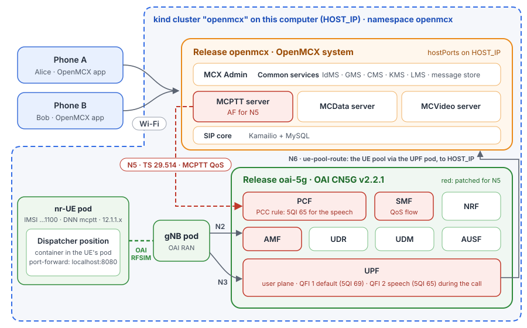

# Tutorial 6: MCX over the OAI 5G core and RAN (rfsim) on Kubernetes, with Helm

Tutorial 3 on Kubernetes: the same OpenMCX system, phones, OAI 5G core, gNB and nr-UE with the dispatcher position
inside it, and the same MCPTT QoS over **N5** (a dedicated QoS flow with **5QI 65** for the dispatcher's speech), but
installed with two Helm charts on a one-node Kubernetes cluster instead of Docker Compose:

- the **OpenMCX chart** ([`helm/openmcx`](../../../helm/openmcx/README.md)): the OpenMCX servers, common services, SIP
  core and MCX Admin, one pod per Compose service of tutorial 1, with the MCPTT server's N5 settings
  ([`openmcx-values.yaml`](openmcx-values.yaml));
- the **5G chart** of this tutorial ([`oai-5g/`](oai-5g/)): the OAI 5G core, the gNB, the nr-UE with the dispatcher
  position, and the route between the OpenMCX pods and the UEs.

<p align="center"></p>

The cluster is **kind** (Kubernetes in Docker): one node, a Docker container on this computer, which publishes the
phones' ports on `HOST_IP` as tutorial 3's Compose file does. Both charts go into one namespace, `openmcx`, so that the
names tutorial 3's configuration uses (`oai-pcf`, `mcptt-server`, `oai-amf`, ...) are Service names there.

## What you need

- **Tutorial 3 read once** (this tutorial follows its steps) and **tutorial 1 done once**: the phones have the app,
  and you know the steps in MCX Admin. Tutorials 1 to 5 must be **stopped**: the kind node takes the same ports on this
  computer.
- **A Linux computer** with Docker, about 8 CPU cores free (the rfsimulator's gNB and UE keep several cores busy; a
  laptop must run at full speed, on a charger strong enough for it) and about 6 GB of memory for the cluster. No sudo:
  the route that tutorial 3 sets on this computer runs inside the cluster here.
- **kind, kubectl and Helm**, each one file to download (their install pages:
  [kind](https://kind.sigs.k8s.io/docs/user/quick-start/#installation),
  [kubectl](https://kubernetes.io/docs/tasks/tools/install-kubectl-linux/), [Helm](https://helm.sh/docs/intro/install/)).
  The tutorial was tested with kind v0.33.0 (Kubernetes v1.37.0 node), kubectl v1.37.1 and Helm v4.3.1.
- **Wireshark** for step 7 (and its `editcap` for a capture of your own).
- **The images**, from Docker Hub as in tutorial 3: OpenMCX's (`openmcx/openmcx-*:1.0.0`), the OAI 5G core with the
  N5 changes (`openmcx/oai-{amf,pcf,smf,upf}:mcx-n5`, see tutorial 3's [`oai/cn5g/`](../03-mcx-over-oai-5g/oai/cn5g/README.md))
  and OAI's own. The node pulls them when the pods start (about 4 GB the first time).

  The OAI 5G core is under the Collaborative Standards Software License v1.0: its patent license covers study,
  testing and research only ([`oai/cn5g/NOTICE`](../03-mcx-over-oai-5g/oai/cn5g/NOTICE) of tutorial 3).

## 1. Create the cluster

```bash
cd tutorials/end-to-end/06-mcx-over-oai-5g-kubernetes
./kind-cluster.sh create
kubectl get nodes                                    # openmcx-control-plane   Ready
```

A cluster named `openmcx`, with one node (`kindest/node:v1.37.0`). The node publishes the ports the phones use on all
of this computer's addresses: SIP over TLS (5061), IdMS, HTTP proxy, KMS, MCX Admin and Credential Service (TCP
8443-8447), and the MCPTT and MCVideo servers' media (UDP 4000-4099, 5000-5099, 7000-7099, 7200-7299, 7400-7499).
Creating it takes a few minutes: Docker sets up one forwarding per port. kind makes `kind-openmcx` kubectl's
current context.

## 2. Install the OpenMCX system

`HOST_IP` is this computer's address on the Wi-Fi, as in tutorial 1:

```bash
helm install openmcx ../../../helm/openmcx -n openmcx --create-namespace \
    -f openmcx-values.yaml --set externalAddress=HOST_IP --timeout 20m
kubectl -n openmcx get pods -w                      # 17 pods Running and 1/1 READY after 5 to 15 minutes; Ctrl-C
```

`--timeout 20m`: Helm waits for the setup Job below, and the first time the node downloads the images too (Helm's
default, 5 minutes, is too short on a slow line; after it Helm gives up and the Job fails with `HTTP 401`).

Before the pods start, a Job of the chart runs tutorial 1's setup for `HOST_IP` (a new CA, the servers'
certificates, the users and groups, every server's configuration) and stores the result in the Secret
`openmcx-config`. With [`openmcx-values.yaml`](openmcx-values.yaml) it also adds the MCPTT server's N5 settings, the
`pcf` block of tutorial 3's `setup/pcf.py`: the PCF at `http://oai-pcf:8080`, the notifications to
`http://mcptt-server:8099`, the UE pool 12.1.1.0/24.

When they are all ready, `kubectl -n openmcx get pods` lists (the `AGE` column left out; the letters after each
name differ on every install):

```
NAME                                   READY   STATUS    RESTARTS
cms-75cd54695f-v7tv2                   1/1     Running   0
content-server-8677899c9-s4bfz         1/1     Running   0
credentials-559d84659c-cvlrt           1/1     Running   0
gms-54cd4d56c5-6k8rp                   1/1     Running   0
http-proxy-cdd4c7557-v9d4m             1/1     Running   0
idms-7755bb5d75-xwqwl                  1/1     Running   0
kms-6f6d85c6d6-tm798                   1/1     Running   0
lms-dbf5f67cc-clpfj                    1/1     Running   0
mcdata-server-7545c6d959-2pjhm         1/1     Running   0
mcptt-server-79c65c9d77-8mwzd          1/1     Running   0
mcvideo-server-7cdc95fdc8-kwngh        1/1     Running   0
mcx-user-db-5fd45747d5-qkdz7           1/1     Running   0
mcxadmin-7ccc9985d7-9sbn8              1/1     Running   0
message-store-6db7bc6595-zx86r         1/1     Running   0
notification-server-799c9957bf-k7n75   1/1     Running   0
sip-core-77588d66df-4ktn8              1/1     Running   0
sip-db-0                               1/1     Running   0
```

## 3. Install the 5G network

```bash
helm install oai-5g oai-5g -n openmcx --set externalAddress=HOST_IP
kubectl -n openmcx get pods -w                      # 12 more; oai-nr-ue 3/3 READY last
```

The 5G network's pods alone, with the release's label:

```
$ kubectl -n openmcx get pods -l app.kubernetes.io/instance=oai-5g
NAME                         READY   STATUS    RESTARTS
oai-amf-7d9cfd9f4-kz828      1/1     Running   0
oai-ausf-78f886dbcf-76fqt    1/1     Running   0
oai-gnb-5bf5f546ff-r2bh2     1/1     Running   0
oai-mysql-6fdd798b5b-qxd78   1/1     Running   0
oai-nr-ue-54bfcf574f-r94xw   3/3     Running   0
oai-nrf-7d96b974b8-b28wg     1/1     Running   0
oai-pcf-56d6678c7-q6jml      1/1     Running   0
oai-smf-6c9ff56455-5ngcf     1/1     Running   0
oai-udm-5d85879cf4-7xhw5     1/1     Running   0
oai-udr-5574d5ddcc-8g6zm     1/1     Running   0
oai-upf-6fc446595d-sftzj     1/1     Running   0
ue-pool-route-5p5fm          1/1     Running   0
```

`oai-nr-ue` is 3/3: the UE, `ue-route` and the dispatcher position (see [How it is put together](#how-it-is-put-together)).

After about two minutes the 5G core functions, the gNB and the nr-UE are ready, and the nr-UE has its PDU session:

```bash
kubectl -n openmcx logs deploy/oai-nr-ue -c ue-route     # UE address 12.1.1.2, HOST_IP through oaitun_ue1
kubectl -n openmcx logs ds/ue-pool-route                 # SNAT ..., hostPorts ..., route: 12.1.1.0/24 via the UPF ...
```

`ue-pool-route` does in the node what tutorial 3's `sudo ./host-network.sh add` does on the computer (see
[How it is put together](#how-it-is-put-together)); `helm uninstall` takes it away again.

If the nr-UE is not ready after five minutes, look at `kubectl -n openmcx logs deploy/oai-amf | grep -i reject`: on
a computer too slow for the rfsimulator (a laptop slowed down by a weak charger, for example) the AUSF answers the AMF
later than the AMF waits (1 s), and the AMF rejects the UE's authentication. The pod starts the UE again by itself
every few minutes. If the AMF logs `no SMF candidate is available` instead (an SMF stopped by a long slow spell),
start the SMF again, then the UE: `kubectl -n openmcx rollout restart deploy/oai-smf`, then the same for
`deploy/oai-nr-ue`.

## 4. Users and phones

As in tutorial 3, step 5: in MCX Admin (`https://HOST_IP:8446/`, sign in as `admin` with the password from the
Secret) create `alice`, `bob` and `dispatcher` with the template `phone-user` and the group `operations`, set their
passwords and activate the phones (alice and bob).

```bash
kubectl -n openmcx get secret openmcx-config -o jsonpath='{.data.ADMIN\.txt}' | base64 -d
```

## 5. Activate the dispatcher (over 5G)

The dispatcher position runs in the nr-UE's pod. Make it reachable from this computer's browser:

```bash
kubectl -n openmcx port-forward deploy/oai-nr-ue 8080      # keep it running
```

Open **http://localhost:8080/** and activate `dispatcher` as in tutorial 3, step 6: an activation link from MCX
Admin, then **Activate an account on this position**. The activation, the sign-in, the SIP registration and every
call of the position go through the 5G user plane; only the web page comes through `port-forward`.

## 6. Call, and see the QoS

As in tutorial 3, step 7: on the position, choose **Group call** (Alice's and Bob's phones join) and hold **PTT**.
While the call is up, the MCPTT server has an app session with the PCF for the dispatcher's leg, and the SMF has
added a QoS flow to its PDU session:

```bash
kubectl -n openmcx logs deploy/mcptt-server | grep pcf_app_session
kubectl -n openmcx logs deploy/oai-pcf | grep -o '"flowDescription":"[^"]*"' | sort -u
kubectl -n openmcx logs deploy/oai-pcf | grep -o '"5qi":65'
kubectl -n openmcx logs deploy/oai-smf | grep -E 'PCF-initiated PDU|Add QoS flow|QoS Flow to Release'
```

The lines are tutorial 3's: `pcf_app_session_created` (201), three flow descriptions `permit out 17 from HOST_IP ...
to 12.1.1.2 ...` (speech, RTCP, floor control), `"5qi":65`, and the SMF's QoS flow QFI 2. When the call ends,
`pcf_app_session_deleted` (204) and the SMF releases the flow. Tutorial 3's step 7 explains them; step 7 below
shows them in a capture.

The gNB gets the new flow from the AMF (NGAP PDU Session Resource Modify) and passes it on to the nr-UE:

```bash
kubectl -n openmcx logs deploy/oai-gnb | grep -E 'PDUSESSIONModify|QoS flow with QFI=2|QFI 2|PDU Session Modify successful'
```

```
35766.854598 [NGAP]   I PDUSESSIONModify initiating message
35766.855030 [NR_RRC] I UE 1: added QoS flow with QFI=2, total number of QoS flows = 2
35766.855048 [NR_RRC] I UE 1: found suitable DRB 1 to multiplex 5QI 65 (QFI 2) - current flows: GBR=0, Non-GBR=1
35766.855052 [NR_RRC] I UE 1: assigned DRB 1 to QFI 2 (5QI 65) in PDU session 1
35766.872228 [NR_RRC] I PDU Session Modify successful (pdusession_id=1)
35788.709262 [NGAP]   I PDUSESSIONModify initiating message
35788.709366 [NR_RRC] I UE 1: removed QoS flow with QFI=2
35788.709388 [SDAP]   I Update: release QFI 2 from DRB 1 (pdu_session=1)
35788.722416 [NR_RRC] I PDU Session Modify successful (pdusession_id=1)
```

The first five lines are from the start of the call: the gNB adds QFI 2 (5QI 65) to the PDU session, tells the
nr-UE with an RRC Reconfiguration, and answers the AMF. The last four are from the hang-up, when the flow is released
again. The OAI gNB does not open a radio bearer of its own for the flow: it carries QFI 2 on the session's DRB 1,
beside QFI 1, and its SDAP layer tells the two apart by the QFI in each packet's header. The numbers at the start of
each line are the gNB's clock and differ on every run.

## 7. Look at the capture

The reference capture [`captures/06-mcx-over-oai-5g-kubernetes-full.pcapng.gz`](captures/06-mcx-over-oai-5g-kubernetes-full.pcapng.gz)
(0.8 MB, 4 581 frames) records a run of steps 3 to 6: the 5G network starting, the UE registering, Alice, Bob and the
dispatcher signing in, a group call from the dispatcher with PTT, Bob talking back, and the hang-up. Wireshark opens
the compressed file directly. In the reference Alice and Bob are two dispatcher positions on this computer (they
reach `HOST_IP` as the phones do, from `HOST_IP` itself: ports 4500/5500 Alice, 4600/5600 Bob); the frame numbers below
are those of the reference.

It was captured on the kind node, on every pod's interface, which sees every packet between pods and every packet
between a pod and the outside (see [Your own capture](#your-own-capture)). It keeps each packet once, as the pod that
receives it sees it, and is reduced by port as tutorial 3's:

- NGAP and NAS-5GS (SCTP), PFCP, GTP-U (with IP fragments), the SBI of the core functions and N5 (HTTP/2 on 8080; the
  NRF's registrations and heartbeats are left out);
- SIP over TLS on 5061, **decrypted**: the file carries the TLS secrets of the SIP core (a pcapng decryption secrets
  block), so Wireshark shows the SIP messages without further setup;
- every UDP flow (speech and floor control) and ICMP.

The databases, DNS, the encrypted HTTPS between the OpenMCX services, the MCPTT server's Diameter (DTLS over SCTP) to
the user database, the cluster's own traffic (Kubernetes API, kubelet) and the simulated radio between the gNB and
the UE (rfsimulator, TCP 4043) are left out.

The addresses are the pods' (they change with every install). In the reference:

| Pod | Address | Pod | Address |
|---|---|---|---|
| `oai-gnb` | `10.244.0.74` | `oai-nrf` | `10.244.0.70` |
| `oai-upf` | `10.244.0.75` | `oai-ausf` | `10.244.0.72` |
| `oai-amf` | `10.244.0.78` | `oai-udm` | `10.244.0.69` |
| `oai-smf` | `10.244.0.73` | `oai-udr` | `10.244.0.68` |
| `oai-pcf` | `10.244.0.76` | `sip-core` | `10.244.0.24` |
| `mcptt-server` | `10.244.0.67` | `HOST_IP` | `10.232.66.40` |

The dispatcher's packets appear twice: inside GTP-U on N3 between the gNB and the UPF, as the UE sends and receives
them (`12.1.1.2` and `HOST_IP`), and on N6 as the SIP core or the MCPTT server sees them (`12.1.1.2` and the pod's own
address: the node sends the UE's packets for `HOST_IP` to the pod, and the pod's answers leave from `HOST_IP`).

The display filters are tutorial 3's:

| Filter | Shows |
|---|---|
| `ngap` | N2 between the gNB and the AMF: NG Setup, the UE's registration and PDU session, and the PDU Session Resource Modify for the call's QoS flow. |
| `nas-5gs` | The UE's NAS: registration, authentication, security mode, PDU session establishment and modification. |
| `pfcp && !(pfcp.msg_type == 1 \|\| pfcp.msg_type == 2)` | N4 between the SMF and the UPF, without the heartbeats. |
| `http2.headers.path contains "policyauthorization"` | N5: the MCPTT server's app session at the PCF (TS 29.514), and its deletion. |
| `http2.headers.path contains "sm-policy" \|\| http2.headers.path contains "smpolicycontrol"` | N7: the PCF's policy for the PDU session and its update for the call. |
| `sip && !gtp` | Every SIP message (once; without the GTP-U copies). **Telephony → SIP Flows** draws them. |
| `rtcp.app.name == "MCPT" && !gtp` | Floor control (TS 24.380 clause 8.2). |
| `rtp && !gtp` | Speech: AMR-WB. |

What to look for, in the reference run:

- **The 5G core and the UE** (frames 201 to 552): NG Setup (201), PFCP Association between the SMF and the UPF (225),
  the UE's Registration request (229) with 5G-AKA through the AUSF, UDM and UDR (240 to 374), Security mode command
  (382), and the PDU session for the DNN `mcptt`: the AMF asks the SMF (439), the SMF asks the PCF for the session's
  policy (504), sets up the UPF (515) and sends the PDU session establishment accept through the AMF (539). The
  session's default QoS flow is QFI 1, 5QI 69 (MC signalling).
- **Sign-in and registration**: Alice (729) and Bob (967) register with the SIP core: REGISTER, the challenge, REGISTER
  again; the dispatcher over 5G (1709 inside GTP-U, 1712 on N6).
- **The group call** (frames 2066 to 2114): the dispatcher's INVITE leaves the UE inside GTP-U (2066) and reaches the
  SIP core on N6 (2067); after the `407` challenge it is sent again (2079, 2080) and forwarded to the MCPTT server
  (2083), which invites Alice (2089, 2093) and Bob (2099, 2102). The server's `200` reaches the dispatcher (2110, 2114).
- **QoS over N5** (frames 2165 to 2250): the MCPTT server, as application function, asks the PCF for the dispatcher's
  media (2165: `POST /npcf-policyauthorization/v1/app-sessions` with the media components, speech, RTCP and floor
  control, TS 29.514; `201` at 2222). The PCF turns them into a PCC rule with 5QI 65 and updates the SMF (2189). The
  SMF changes the UPF's rules (2196) and adds a QoS flow to the PDU session (2225, 2231: PDU Session Resource Modify
  Request with QFI 2, 5QI 65, ARP 3 and a guaranteed bit rate of 41 kbit/s each way), which the gNB accepts (2236).
- **Floor control and speech** (frames 2347 to 4227): the dispatcher's Floor Request (2347) and Floor Granted (2348),
  Floor Taken to Alice and Bob (2349, 2351), the dispatcher's speech, Floor Release (3524) and Floor Idle; then Bob's
  turn: Floor Request (3547), Floor Granted (3550), Floor Taken (3551, 3552), Floor Release (4227). Downlink, the
  speech and floor control the UPF sends the gNB for the dispatcher carry QFI 2 in their GTP-U header (filter
  `gtp.ext_hdr.pdu_ses_con.qos_flow_id == 2`, 192 frames); the UE's uplink packets stay on QFI 1.
- **Hang-up** (from frame 4325): the dispatcher's BYE (4325, 4326, again after the challenge 4331, 4332) and the
  server's BYEs to Bob and Alice (4353, 4364). The MCPTT server deletes the app session (4336, `204` at 4397), and the
  SMF releases the QoS flow (4362, 4407: PDU Session Resource Modify Request, cause normal release).

The access tokens of the IdMS travel in SIP for service authorisation, and the file holds the SIP core's TLS secrets.
They belong to a throwaway system: its signing key and users no longer exist and the tokens expired after an hour.
Treat a capture of your own system, and its TLS secrets, as secret.

### Your own capture

All pods run on the kind node, so one `tcpdump` there sees N2, N3, N4, the SBI, N5, N6 and the phones. `kubectl debug`
starts it in a pod on the node's network (no sudo on this computer). Start it before step 3 to see the UE register,
or before step 6 for the call only:

```bash
kubectl -n openmcx debug node/openmcx-control-plane --profile=sysadmin --image=nicolaka/netshoot:v0.13 -- \
    sh -c "tcpdump -i any -U -w /tmp/tutorial-6.pcap 'not tcp port 4043 and not tcp port 6443 and not tcp port 10250
           and not tcp port 2379 and not tcp port 2380 and not tcp port 10257 and not tcp port 10259'; sleep 3600"
```

The filter leaves out the rfsimulator's radio (several MB/s) and the cluster's own traffic, `kubectl` included.
After the call, stop `tcpdump`, copy the file to this computer and remove the pod:

```bash
POD=$(kubectl -n openmcx get pods -o name | grep node-debugger)
kubectl -n openmcx exec $POD -- pkill -INT tcpdump
kubectl -n openmcx cp ${POD#pod/}:/tmp/tutorial-6.pcap tutorial-6.pcap
kubectl -n openmcx delete $POD
```

To decrypt the SIP, the SIP core must write its TLS secrets: install the OpenMCX system in step 2 with
`--set sipCore.tlsKeylog=true` added (troubleshooting only, never in production: the file decrypts all SIP, access
tokens included). Then put the secrets into the capture, as the reference has them:

```bash
kubectl -n openmcx exec deploy/sip-core -- cat /tmp/kamailio-tls-keylog.txt > tls-keylog.txt
editcap --inject-secrets tls,tls-keylog.txt tutorial-6.pcap tutorial-6.pcapng
```

On the node, `-i any` records each packet as it leaves one interface and as it enters the next: once leaving a pod and
once entering another, and a phone's packets once as they reach the node (for the node's address) and once as they
reach the pod (for the pod's address). This display filter keeps each packet once, as the pod that receives it sees it, as in
the reference:

```
(sll.pkttype == 0 && ip.src == 10.244.0.0/16) || (sll.pkttype == 4 && ip.dst == 10.244.0.0/16 && !(ip.src == 10.244.0.0/16))
```

## 8. Stop or start over

```bash
helm uninstall oai-5g -n openmcx                         # the 5G network; the node's route goes with it
helm uninstall openmcx -n openmcx                        # the OpenMCX system
```

`helm install` (steps 2 and 3) starts them again. The OpenMCX configuration (Secret `openmcx-config`) and the data
(users, groups, messages; PersistentVolumeClaims) outlive `helm uninstall openmcx`, so the activated phones keep
working. To start over with a new system (new CA: activate the phones again), delete them too, or the whole cluster:

```bash
kubectl -n openmcx delete secret openmcx-config
kubectl -n openmcx delete pvc --all
./kind-cluster.sh delete                                 # the cluster and everything in it
```

The dispatcher's accounts are in the 5G chart's claim `oai-5g-dispatcher`, which `helm uninstall oai-5g` deletes:
activate the position again after a new install.

## How it is put together

- **One pod per Compose service**, with the Compose service's name as a headless Service: the configurations of
  tutorials 1 and 3 name their peers (`sip-core`, `idms`, `oai-amf`, `mysql`, ...), and a headless Service resolves to
  the pod's own address, which the SIP core and the MC servers compare with a peer's source address. The OAI core
  functions read tutorial 3's configuration ([`oai-5g/files/mcx_core_config.yaml`](oai-5g/files/mcx_core_config.yaml));
  the only change is the UPF's N6 on `eth0`, a pod's only interface. Init containers wait for the peers a Compose
  service `depends_on`.
- **The gNB** names the AMF and its own N2/N3 address by IP: its pod writes them into a copy of tutorial 3's
  configuration at start ([`oai-5g/files/gnb.yaml`](oai-5g/files/gnb.yaml), `@AMF_IP@`, `@GNB_IP@`).
- **The nr-UE pod** has three containers sharing its network, as `oai-nr-ue`, `ue-route` and `dispatcher` share the
  nr-UE's in tutorial 3: the UE, the route of `HOST_IP` through its tunnel `oaitun_ue1`, and the dispatcher position.
  The position's `sip-core` is `HOST_IP` (a host alias), as for the phones. When the UE has no PDU session three
  minutes after its start, the kubelet starts it again (a liveness probe).
- **The phones** reach the OpenMCX pods on `HOST_IP`: kind's node publishes the ports (`kind-cluster.sh`), and the
  edge pods bind them in the node (`hostPort`). Docker and the node's port mapping keep the phone's address, which the
  SIP core checks against the SDP.
- **The UEs**: the `ue-pool-route` DaemonSet replaces tutorial 3's `host-network.sh` and needs no sudo, but runs
  privileged in the node's network: it routes the UE pool 12.1.1.0/24 through the UPF pod, makes the OpenMCX pods'
  packets to the UE pool leave from `HOST_IP` (SNAT), and sends the UE pool's packets for `HOST_IP` to the node's
  hostPorts. That last rule is kind's part: the node is a container behind the computer's address, so packets for
  `HOST_IP` would otherwise leave the node, and come back with the node's address instead of the UE's. Only the UE pool's packets go
  this way; this computer and the phones still reach `HOST_IP` as before.
- **N5**: the MCPTT server reaches the PCF as `oai-pcf` and the PCF the server as `mcptt-server`, both in the
  namespace. The OpenMCX chart's value `mcptt.pcf` is the `pcf` block of `mcptt-server.json`; without it, as in
  tutorial 1, the server never contacts a PCF.
- **Another cluster**: the charts are not tied to kind. On a one-node cluster on this computer (k3s, MicroK8s, ...)
  `HOST_IP` is the node's own address: `ue-pool-route` then only routes and sets SNAT. Its hostPort rule needs the CNI's
  portmap plugin (`CNI-HOSTPORT-DNAT`), as kind and k3s have; SCTP must work between pods (N2, Diameter).
