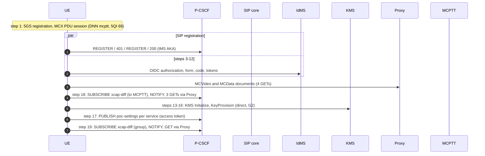
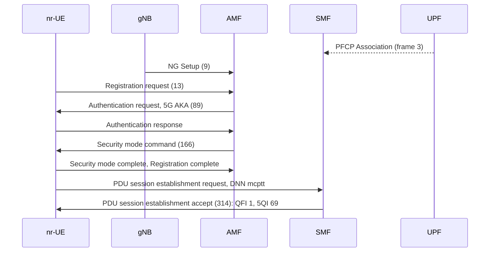
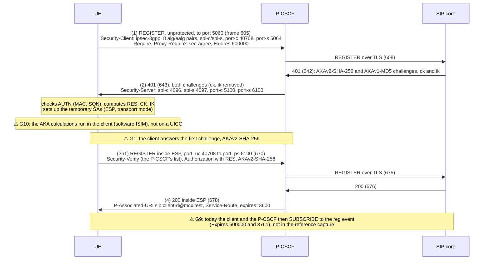
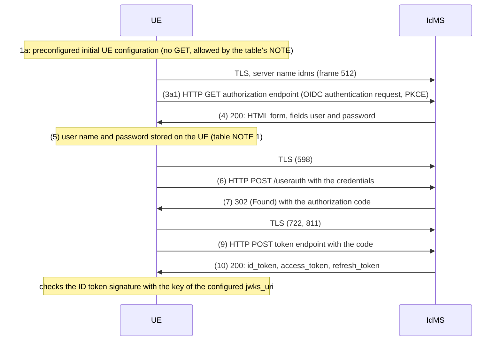
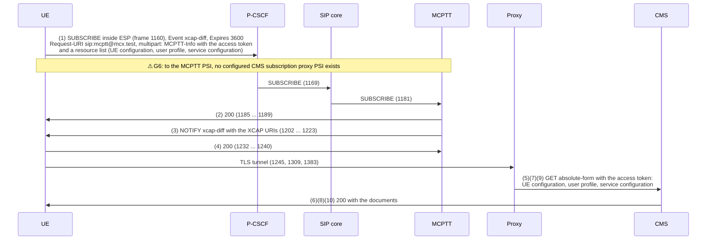
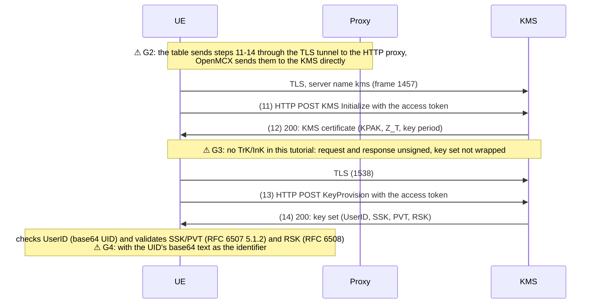
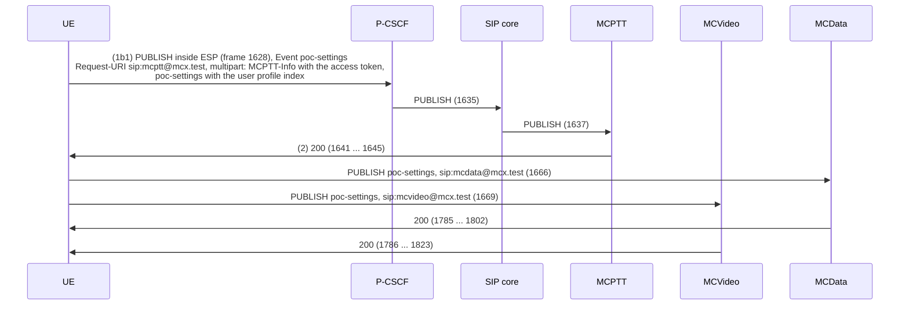
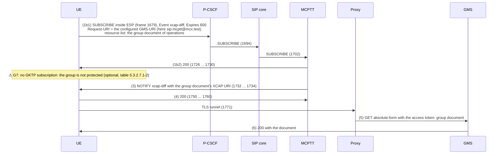
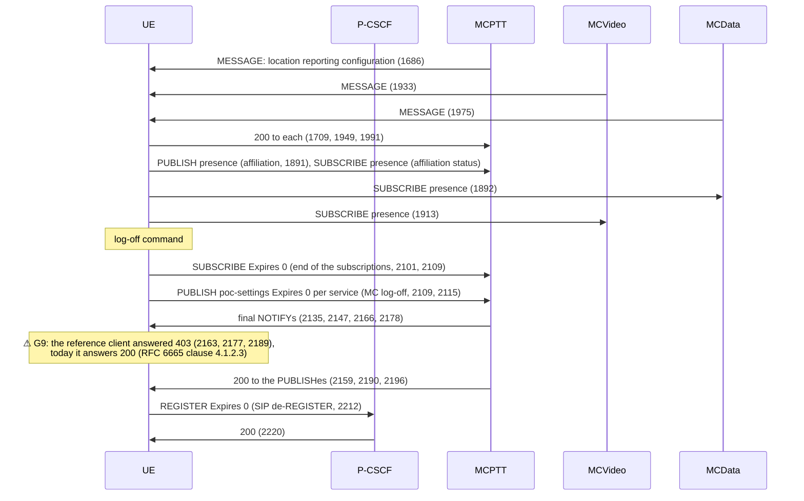

# Tutorial 7: call flow of TS 37.579-2 test 5.1, step by step

This page follows the [walk-through of test 5.1](README.md#5-walk-through-of-ts-37579-2-test-51) message by message:
- for each step of TS 37.579-2 V18.1.0 table 5.1.3.2-1, the procedure of TS 37.579-1 V18.1.0 it refers to;
- the messages the MC client sends and receives, with the frame numbers of the
  [reference capture](captures/07-ims-aka-over-oai-5g-full.pcapng.gz) (GTP off, ESP decrypted, see
  [Look at the capture](README.md#6-look-at-the-capture));
- where OpenMCX or this tutorial **differs from the test's procedure**, marked **⚠ G*n*** and listed in
  [Gaps](#gaps) at the end.

The MC client is OpenMCX's Linux client in the nr-UE. The OAI 5G core and RAN and the OpenMCX system take the system
simulator's place: this is a walk-through, not a conformance test.

The reference capture was made before the reg event subscriptions (TS 24.229 clause 5.1.1.3) and before a fix to the
answers at log-off. Where today's client sends more or answers differently, the diagram says so (**⚠ G9**).

## Actors

| Name in the diagrams | What it is | Address in the capture |
|---|---|---|
| UE | the nr-UE with the MC client `client-d@mcx.test` | `12.1.1.2` (UE pool) |
| 5GC | gNB, AMF, SMF, UPF of the OAI 5G core | `192.168.71.128/26` |
| P-CSCF | Kamailio with `docker/pcscf.cfg` | `192.168.72.140` |
| SIP core | the S-CSCF and registrar (Kamailio) | `192.168.72.170` |
| IdMS | OpenMCX IdMS | `HOST_IP:8443` |
| KMS | OpenMCX KMS | `HOST_IP:8445` |
| Proxy | home HTTP proxy, forward mode | `HOST_IP:8444` |
| CMS, GMS | configuration and group management servers, behind the proxy | `cms:8443`, `gms:8443` |
| MCPTT | MCPTT server (also the CMS and GMS subscription target, see G6) | `192.168.72.176` |
| MCVideo, MCData | MCVideo and MCData servers | `192.168.72.174`, `192.168.72.173` |

## Overview

| 5.1 step | TS 37.579-1 procedure | Frames | Gaps |
|---|---|---|---|
| 1 | 5.4.2 initial registration (5GS), 5.4.1B MCX PDU session | 3-314 | G8 |
| in parallel to 3-16 | table 5.3.2.4.1-1 SIP registration | 505-678 | G1, G9, G10 |
| 3-12 | table 5.3.2.3.1-1 steps 1-10 (initial configuration, user authentication) | 512-811 | - |
| 13-16 | table 5.3.2.3.1-1 steps 11-14 (key material) | 1457-1538 | G2, G3, G4, G5 |
| 17 | table 5.3.2.5.1-1 publication of MCX service settings | 1628-1823 | G5 |
| 18 | table 5.3.2.6.1-1 configuration management subscription | 1160-1383 | G5, G6 |
| 19 | table 5.3.2.7.1-1 group management subscription | 1679-1771 | G6, G7 |
| (after 5.1) | location configuration, affiliation, MC log-off, SIP de-REGISTER | 1686-2232 | G9 |

Order in the reference run: SIP registration and sign-in run in parallel; then the MCVideo and MCData documents,
the configuration subscription (step 18), the key material (steps 13-16), the service authorisation (step 17) and
the group subscription (step 19).

## Step 1: switch-on, 5GS registration and MCX PDU session

TS 37.579-1 clause 5.4.2 (initial registration) and clause 5.4.1B (the MCX PDU session). Not an MC client procedure:
the nr-UE does it before the MC client starts.

- What to check: `nas-5gs` and `ngap.fiveQI == 69`; the UE's address `12.1.1.2` (`docker logs openmcx-ue-route`).
- Normative: TS 24.501, TS 23.501 table 5.7.4-1 (5QI 69, MC signalling).
- **⚠ G8**: rfsim carries the 5QI in NGAP and NAS but does not enforce it on the radio.

## In parallel to steps 3-16: SIP registration with IMS AKA

TS 37.579-1 table 5.3.2.4.1-1. The client takes path 3b1: its REGISTER carries no access token, which goes in the
PUBLISH of step 17 (table 5.3.2.4.1-1 NOTE 1; TS 33.180 clause 5.1.3.2.1: the REGISTER is not delayed for the token).

- The P-CSCF chose `alg=null`, `ealg=aes-gcm-us` (AES-GCM, TS 33.203 annex I), the client's first pair.
- What to check: in the capture, `sip && ip.addr == 192.168.72.140 && tcp.port == 5060` (frames 505, 643) and
  `esp && sip` (670, 678); the client's `sip_registered` event and `sip_security` in its status file (README step 5).
- Normative: TS 24.229 clauses 5.1.1.2, 5.1.1.5, 5.2.2; TS 33.203 clauses 6.1, 7; TS 33.180 clause 6.2.1.

## Steps 3-12: initial configuration and user authentication

TS 37.579-1 table 5.3.2.3.1-1 steps 1-10. TLS to the IdMS directly, as the table's exceptions ask (the IdMS's
authorisation and token endpoints of table 5.5.8.1-1; TS 24.482 annex A.2.1.2 keeps the IdMS out of the proxy).

- The four TLS connections to the IdMS are frames 512, 598, 722 and 811 (`tls.handshake.type == 1`, server name
  `idms`); the HTTP inside stays encrypted. `docker logs openmcx-idms` shows the requests.
- The client offers TLS 1.3, and TLS 1.2 with ECDHE and AEAD suites only.
- What to check: `oidc_authenticated` in the client's log.
- Normative: TS 24.482 clause 6.2.1; TS 33.180 clause 5.1.2, annex B.

## Step 18: configuration management subscription

TS 37.579-1 table 5.3.2.6.1-1. In the reference run it comes before steps 13-16 and 17 (**⚠ G5**). First the client
reads the MCVideo and MCData user profiles and service configuration documents (4 GETs through the proxy, frames
888-1103), which are not part of test 5.1.

- The documents are read only after the NOTIFY (`mcptt.documents_on_notify`, set by tutorial 3's
  `setup/ue-client.py`), and in absolute-form through the proxy (TS 24.482 annex A.2.1.2).
- What to check: `configuration_subscribed` (three documents), `document_retrieved`; `docker logs
  openmcx-http-proxy` (requests by authority `cms:8443`).
- Normative: TS 24.484 clauses 6.3.13.2.2, 6.3.13.3.2.2, 8.2; TS 24.482 annex A.2.1.2.

## Steps 13-16: key material from the KMS

TS 37.579-1 table 5.3.2.3.1-1 steps 11-14. The client provisions its keys at sign-in (`security.kms_uri`, set by
tutorial 3's `setup/ue-client.py`), after the MCPTT service configuration document of step 18, which says which
protection applies (TS 24.379 clauses 6.6.2.3.1 and 6.6.3.3.1). The group `operations` is not protected, so no CSK
is made.

- What to check: `docker logs openmcx-kms 2>&1 | grep -E 'init|keyprov'`; `key_management` in the client's status
  file.
- Normative: TS 33.180 clauses 5.3.3, 5.3.5, 5.3.6, annex D, annex F.2.1.

## Step 17: publication of MCX service settings (service authorisation)

TS 37.579-1 table 5.3.2.5.1-1, path 1b1: the access token goes in the PUBLISH, after the user profile was read
(table NOTE 1).

- What to check: `service_authorized` in the client's log, `service_authorized` in the MCPTT server's.
- Normative: TS 24.379 clause 7.2.1; TS 24.281 and TS 24.282 clause 7.2.1; TS 33.180 clause 5.1.3.2.3.

## Step 19: group management subscription

TS 37.579-1 table 5.3.2.7.1-1, path 1b1 (a subscription to the group document only).

- What to check: `group_documents_subscribed`, `group_document_notified`, `document_retrieved`.
- Normative: TS 24.481 clauses 6.3.13.2.1, 6.3.13.2.2.

## After test 5.1: location configuration, affiliation, log-off

Not checked by test 5.1, shown for completeness.

- Normative: TS 24.379 clause 13.2.2 (location), clauses 9.2.1.2 and 9.2.1.3 (affiliation), clause 7.2.1A NOTE 3 (MC log-off);
  TS 24.229 clause 5.1.1.6 (SIP de-REGISTER).

## Gaps

Each gap is one of:
- **spec gap**: the specifications leave the detail open or contradict each other; OpenMCX keeps its behaviour and
  reports it ([Known limitations](../../../docs/LIMITATIONS.md));
- **tutorial**: a choice of this tutorial or its test bed, not of the MC client;
- **order**: the client does what the test checks, in another order;
- **capture**: the reference capture shows an older client;
- **test bed**: the emulated UE departs from a real one.

| Gap | Kind | Step | What | Where described |
|---|---|---|---|---|
| G1 | tutorial | SIP registration | The SIP core offers AKAv2-SHA-256 before AKAv1-MD5 (TS 33.203 clause 6.1.1) and the client answers the first; table 5.3.2.4.1-1 step 2 sends AKAv1-MD5 only, which the client also answers. | README step 5 |
| G2 | spec gap | 13-16 | The KMS requests go to the KMS directly. Table 5.3.2.3.1-1 steps 11-14 send them through the TLS tunnel to the HTTP proxy; TS 24.482 annex A.2.1.2 sends every request but the IdMS's through the proxy, TS 33.180 clause 5.3.2 lets the KMS be used without it, and no configuration item tells the UE which applies. | Known limitations, "Home HTTP proxy" |
| G3 | tutorial | 13-16 | No TrK and InK are provisioned in this tutorial, so the KMS exchange is unsigned and the key set unwrapped (TS 33.180 clause 5.3.2: the TrK and InK "may" be used). The Linux client signs, verifies and unwraps with `security.transport_keys`; the details the texts leave open (Signature-ID and TrK-ID, the key-wrap padding, the schema Id, AES-128-GCM, a Time without a zone) are listed there. | Known limitations, "KMS request security (TrK/InK)" |
| G4 | spec gap | 13-16, and every MIKEY-SAKKE use | The UID enters ECCSI and SAKKE as its base64 text. TS 33.180 annex F.2.1.1 does not say whether the 32 octets or their base64 text is the identifier; a KMS or peer that uses the 32 octets does not interwork. | Known limitations, "MIKEY-SAKKE UID form" |
| G5 | order | 13-16, 17, 18 | Step 18 (configuration subscription and documents) comes before steps 13-16 and 17. The MCPTT service configuration document decides the protection of the service authorisation (TS 24.379 clauses 6.6.2.3.1 and 6.6.3.3.1), so the client reads it first, then gets its keys and publishes. Table 5.1.3.2-1 lists steps 13-16 before 17-19 (17-19 in parallel); table 5.3.2.5.1-1 NOTE 1 sends the PUBLISH after the user profile. | this page |
| G6 | spec gap | 18, 19 | The configuration SUBSCRIBE goes to the MCPTT server's PSI: TS 24.484 clause 6.3.13.2.2 b) 2) names "the configured public service identity for performing subscription proxy function of the CMS", but no configuration item for it exists. The group SUBSCRIBE goes to the configured GMS-URI, in this tutorial the same PSI. | Known limitations, "CMS subscription proxy PSI" |
| G7 | tutorial | 19 | No GKTP subscription: the group `operations` is not protected; the GMK retrieval is optional (table 5.3.2.7.1-2). | README step 5 |
| G8 | tutorial | 1 | rfsim carries the 5QI but does not enforce it; no radio, no system simulator, no TTCN-3 test suite. | README step 5 |
| G9 | capture | SIP registration, log-off | The reference capture predates the reg event subscriptions of the client and the P-CSCF (TS 24.229 clauses 5.1.1.3 and 5.2.3; not part of table 5.3.2.4.1-1) and the client's 200 to the final NOTIFYs at log-off (RFC 6665 clause 4.1.2.3; it answered 403, and 481 after the de-REGISTER). | this page |
| G10 | test bed | SIP registration, and every IMS AKA run | The MC client holds its IMS AKA credentials (IMPI, K, OPc) in its own configuration, a software ISIM separate from the nr-UE's USIM, and runs the AKA calculations itself. A real UE keeps them on its UICC, in the ISIM or USIM application (TS 33.203 clause 4: "IMS authentication keys and functions at the user side shall be stored on a UICC"); the IM credentials of clause 9 (keys in the device) are only for a terminal without 3GPP access and "shall not used if ISIM or USIM is present". The test USIM of TS 37.579-1 clause 5.2.2.2.1 is a card. | Known limitations, "SIP core access" |
