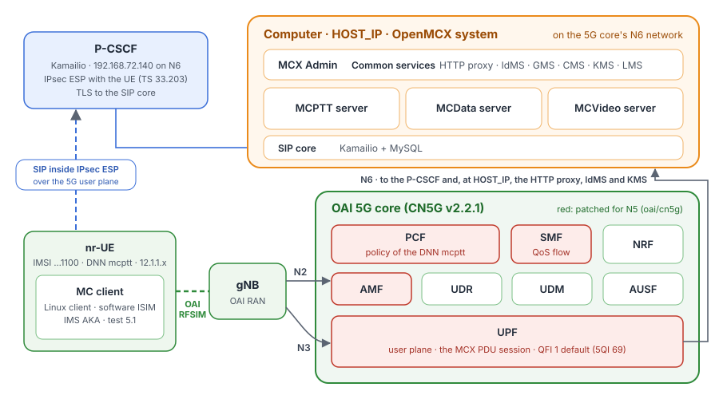

# Tutorial 7: MC client with IMS AKA over 5GS

[Tutorial 3](../03-mcx-over-oai-5g/README.md)'s 5G system (the OAI 5G core and RAN, rfsim) and OpenMCX system, with
one MC client in the nr-UE: OpenMCX's Linux client. From switch-on to service, it goes through test 5.1 of TS
37.579-2 by itself:
- the nr-UE registers with the 5G core;
- the user signs in to the IdMS;
- the client registers with **IMS AKA** through a **P-CSCF**, with its SIP inside **IPsec ESP**;
- the MCPTT server authorises the service;
- the client subscribes to its configuration and group documents.

Its HTTP requests go through the **home HTTP proxy** in absolute-form, except the IdMS's and the KMS's. There are no
phones and no dispatcher.

<p align="center"></p>

This tutorial runs in tutorial 3's folder. It starts tutorial 3's services with those of tutorial 3's profile `ims-aka`
(the P-CSCF and the MC client), without the dispatcher position. The configuration goes into tutorial
3's `./config`, as tutorial 3's does.

## What you need

- **A Linux computer** with Docker and Docker Compose v2 (2.24 or later), about 8 CPU cores free (the rfsimulator's gNB
  and UE keep several cores busy) and **sudo** (step 3).
- **Tutorial 3's system stopped**, and tutorial 1's: this tutorial runs the same services and ports.
- **IPsec in the kernel**: the modules `xfrm_user`, `esp4`, `authenc` and `gcm`, with the HMAC-SHA-1 and AES-CBC
  algorithms, as in the kernels of the common Linux distributions. Step 3 loads them.
- Nothing to compile. The tutorial uses **prebuilt images from Docker Hub**: OpenMCX's `develop` images (IMS AKA needs
  a version after 1.0.0) and tutorial 3's OAI images. No phones, no radio hardware.

## 1. Set the computer's address

```bash
cd tutorials/end-to-end/03-mcx-over-oai-5g
cp .env.example .env
```

In `.env`:
- set `HOST_IP` to an IPv4 address of this computer (its Wi-Fi or Ethernet address, not `127.0.0.1`);
- uncomment `MCX_LOG=debug`. The walk-through (step 5) reads the client's SIP messages and the keys of its IPsec
  security associations from that log.

The rest of the commands run in this tutorial's folder:

```bash
cd ../07-ims-aka-over-oai-5g
```

## 2. Make the configuration

```bash
docker compose -f docker-compose-test-5-1.yaml run --rm setup
```

The setup writes tutorial 3's configuration into `../03-mcx-over-oai-5g/config`
([tutorial 3, step 2](../03-mcx-over-oai-5g/README.md#2-make-the-configuration)), with two differences:
- the clients use the home HTTP proxy in **forward mode** (TS 24.482 annex A.2.1.2). They name each server by its own
  URI and send their requests to the proxy in absolute-form, over a TLS tunnel. The IdMS's and the KMS's requests go
  directly, not through the proxy. The proxy passes each request on by its authority (annex A.2.2.2);
- the setup writes the configuration of the MC client in the UE, which registers with IMS AKA
  (`config/ue-client.json`, made by tutorial 3's `setup/ue-client.py`).

The MC client signs in as one of the setup's test users, `client-d`: its identities (`sip:client-d@mcx.test`, the
private user identity `client-d@mcx.test`) appear in the logs, the status file and the capture. The setup gives it a
software ISIM with keys of its own (K, OPc), stored in the client's configuration and in the SIP database. The setup also writes
the P-CSCF's configuration (`config/pcscf.cfg`). The SIP core is then the S-CSCF of that identity.

If tutorial 3's `./config` already exists, the setup stops. A configuration made by tutorial 3's own setup uses the
proxy's path mode. To start over, see step 7.

## 3. Connect this computer to the UE pool

```bash
sudo ../03-mcx-over-oai-5g/host-network.sh add
```

As in [tutorial 3, step 3](../03-mcx-over-oai-5g/README.md#3-connect-this-computer-to-the-ue-pool). The script:
- adds the route to the UE pool `12.1.1.0/24` through the UPF;
- adds the SNAT to `HOST_IP`, from which the P-CSCF is exempt: it reaches the UE through the UPF with its own address,
  which its IPsec security associations are bound to;
- loads the IPsec modules.

## 4. Start the system

```bash
docker compose -f docker-compose-test-5-1.yaml up -d
docker compose -f docker-compose-test-5-1.yaml ps --format 'table {{.Name}}\t{{.Status}}'
```

After about two minutes all 32 services are `(healthy)`:
- the OpenMCX system;
- the P-CSCF (`pcscf` and `pcscf-route`);
- the 5G core, the gNB and the nr-UE, with `ue-route`;
- the MC client (`ue-client`). It is healthy once it has signed in, registered with IMS AKA and been
  authorised.

```bash
docker logs openmcx-ue-route        # UE address 12.1.1.2, HOST_IP and the P-CSCF 192.168.72.140 through oaitun_ue1
```

## 5. Walk-through of TS 37.579-2 test 5.1

Test 5.1 of TS 37.579-2 V18.1.0 is "Configuration / Authentication / User Authorisation / UE Configuration / User
Profile / Key Generation" (table 5.1.3.2-1). It checks what an MC client does from switch-on to service, with the
procedures of TS 37.579-1 V18.1.0:
- the 5GS registration of the UE;
- the MC user's sign-in;
- the SIP registration with IMS AKA;
- the service authorisation;
- the configuration and group management subscriptions.

Here it is a walk-through, not a conformance test. There is no TTCN-3 test suite (TS 37.579-5), no validated system
simulator and no radio. The OAI 5G core and RAN and the OpenMCX system take the system simulator's place. The
implementation under test is the MC client in the nr-UE (`openmcx-ue-client`).

The test runs by itself at every start of the system (step 4). Nothing needs doing in MCX Admin. The client is
preconfigured with:
- the initial UE configuration (TS 37.579-1 table 5.3.2.3.1-1 step 1a, the data of table 5.5.8.1-1): the IdMS's
  endpoints, the HTTP proxy, the P-CSCF and the identities;
- the user name and password (NOTE 1 of that table: stored on the UE).

With `MCX_LOG=debug` (step 1), the logs hold the SIP messages and the HTTP requests. The debug log of
`openmcx-ue-client` also holds the keys of its IPsec security associations (lines `ESP SA`), so Wireshark can decrypt
its SIP. **Treat that log as secret.** To run the test again, stop the system and start it again: step 7 with `down`
without `-v`, then `sudo ../03-mcx-over-oai-5g/host-network.sh add` and `up -d`.

The client is healthy when it is authorised:

```bash
docker compose -f docker-compose-test-5-1.yaml ps ue-client     # (healthy)
docker logs openmcx-ue-client 2>&1 | grep -E '"event":"(sip_registered|oidc_authenticated|signed_in|service_authorized|configuration_subscribed|group_documents_subscribed|group_document_notified|location_configuration_received)"'
python3 -c 'import json; print(json.dumps(json.load(open("../03-mcx-over-oai-5g/config/artifacts/client-d/status.json"))["sip_security"], indent=1))'
```

The last command shows the security associations in use (TS 33.203 clause 7.1, the SA_table):
- the mechanism and algorithms: `ims-aka`, `ipsec-3gpp`, and the integrity and encryption algorithms the P-CSCF
  chose from the client's list (`alg` `null` and `ealg` `aes-gcm-us`: AES-GCM, which protects integrity itself);
- the SPIs and protected ports of the UE: `spi_uc`, `spi_us`, `port_uc` and `port_us` (5064);
- the protected ports of the P-CSCF: `port_pc` and `port_ps`, from 5100 and 6100;
- the public user identity from the P-Associated-URI of the 200 (OK).

At the end, log the client off: the MC log-off (a PUBLISH with Expires 0 per service, TS 24.379 clause 7.2.1A NOTE
3), then the SIP de-REGISTER (TS 24.229 clause 5.1.1.6):

```bash
docker exec openmcx-ue-client mcx-client --config /run/mcx/ue-client.json --command log-off
docker logs openmcx-ue-client 2>&1 | grep -E '"event":"(service_logged_off|logged_off|sip_deregistered)"'
```

Step by step:

| 5.1 step | TS 37.579-1 | What the client does | Where to see it | Normative clauses |
|---|---|---|---|---|
| 1 | 5.4.2.3, 5.4.1B | The nr-UE registers with the 5GS (5G AKA, NAS security). It sets up the MCX PDU session on the DNN `mcptt`, whose default QoS flow has 5QI 69. | `docker logs openmcx-ue-route` (the UE's address). In a capture: `nas-5gs` and `ngap.fiveQI == 69` (step 6). | TS 24.501, TS 23.501 table 5.7.4-1 |
| in parallel to 3-16 | table 5.3.2.4.1-1, path 3b1 | Initial REGISTER, unprotected, to the P-CSCF's port 5060. It has Security-Client (`ipsec-3gpp` with the client's algorithms, its SPIs and ports) and sec-agree in Require and Proxy-Require. The SIP core answers 401 (Unauthorized) with an AKAv2-SHA-256 and an AKAv1-MD5 challenge. The P-CSCF adds Security-Server and removes the ck and ik meant for it. The client checks AUTN (MAC, SQN), computes RES, CK and IK, and sets up the temporary security associations. It sends the protected REGISTER from port_uc to port_ps, with Security-Verify and the AKA response, and gets the 200 (OK). The REGISTER does not wait for the access token, which goes in the PUBLISH (step 17). | `docker logs openmcx-ue-client 2>&1 \| grep -E 'SIP (->\|<-) .*REGISTER\|ESP SA'`. In a capture, the first REGISTER and the 401 are readable on N6 (`tcp.port == 5060`). The rest is ESP (`esp`), which Wireshark decrypts with the keys of the `ESP SA` lines. | TS 24.229 clauses 5.1.1.2, 5.1.1.5, 5.2.2; TS 33.203 clauses 6.1, 7; TS 33.180 clauses 5.1.3.2.1, 6.2.1 |
| 3-12 | table 5.3.2.3.1-1 steps 1-10 | Preconfigured initial UE configuration (step 1a). The OIDC authentication request to the IdMS; the HTML form with the fields `user` and `password` (table 5.3.2.3.2-5); the form posted to the IdMS's `/userauth`; the 302 (Found) with the authorization code; the token request; the ID, access and refresh tokens. The IdMS is reached directly, not through the HTTP proxy (TS 24.482 annex A.2.1.2). | `docker logs openmcx-idms 2>&1 \| grep -E 'HTTP (GET\|POST) /(authorize\|userauth\|token)'`, and the client's `oidc_authenticated` | TS 24.482 clause 6.2.1; TS 33.180 clause 5.1.2, annex B |
| 13-16 | table 5.3.2.3.1-1 steps 11-14 | The KMS Initialize and KeyProvision requests with the access token, and the KMS's answers with the key material. The client provisions its keys at sign-in although the group `operations` is not protected (`security.kms_uri`, set by `setup/ue-client.py`). It makes no CSK then. The requests go to the KMS directly ([Known limitations](../../../docs/LIMITATIONS.md), "Home HTTP proxy"). | `docker logs openmcx-kms 2>&1 \| grep -E 'init\|keyprov'`, and `key_management` in `../03-mcx-over-oai-5g/config/artifacts/client-d/status.json` | TS 33.180 clause 5.3.3, annex D |
| 17 | table 5.3.2.5.1-1, path 1b1 | PUBLISH to the MCPTT server with the access token (service authorisation) and the PoC settings with the user profile index; 200 (OK). | `docker logs openmcx-ue-client 2>&1 \| grep -E 'SIP (->\|<-) .*PUBLISH'`, and `service_authorized` | TS 24.379 clause 7.2.1; TS 33.180 clause 5.1.3.2.3 |
| 18 | table 5.3.2.6.1-1 | One SUBSCRIBE with the access token and a resource list of the MCPTT UE configuration, user profile and service configuration documents. The NOTIFY carries their XCAP URIs. The client GETs the documents only after the NOTIFY (`mcptt.documents_on_notify`, set by `setup/ue-client.py`), through the HTTP proxy in absolute-form. | `configuration_subscribed` (the three documents), `document_retrieved`; `docker logs openmcx-http-proxy` (the requests by authority, `cms:8443`) | TS 24.484 clauses 6.3.13.3.2.2, 8.2; TS 24.482 annex A.2.1.2 |
| 19 | table 5.3.2.7.1-1, path 1b1 | SUBSCRIBE to the group document of `operations`; NOTIFY; the GET of the document after the NOTIFY, through the HTTP proxy. There is no GKTP subscription for the GMK (optional, table 5.3.2.7.1-2): the group is not protected. | `group_documents_subscribed`, `group_document_notified`, `document_retrieved` | TS 24.481 clause 6.3.13.2.1 |
| (main procedure 6-7) | table 5.3.2.2.1-1 | The MCPTT, MCVideo and MCData servers' MESSAGE configuring location reporting (configured in step 2), and the client's 200 (OK). | `location_configuration_received` | TS 24.379 clause 13.2.2 |

Where the walk-through departs from the test:

- **The challenge**: the SIP core offers AKAv2-SHA-256 before AKAv1-MD5 (TS 33.203 clause 6.1.1), and the client
  answers the first. The 401 of TS 37.579-1 table 5.3.2.4.1-1 carries AKAv1-MD5, which the client also supports.
- **The radio**: the rfsimulator carries the 5QI of the QoS flows in NGAP and NAS but does not enforce it.

## 6. Look at the capture

The reference capture is [`captures/07-ims-aka-over-oai-5g-full.pcapng.gz`](captures/07-ims-aka-over-oai-5g-full.pcapng.gz)
(0.5 MB, 2 260 frames). It records a run of steps 4 and 5: the system starting, the UE registering over the 5G core,
and the MC client signing in, registering with IMS AKA through the P-CSCF, and being authorised and
configured; at the end, the client's MC log-off and SIP de-REGISTER. Wireshark opens the compressed file directly.
The frame numbers below are those of the reference.

It was captured on the two Docker networks:
- the 5G core's (`192.168.71.128/26`: N2, N3, N4, SBI);
- N6, with the OpenMCX system and the P-CSCF (`192.168.72.128/26`).

It keeps:
- NGAP and NAS-5GS (SCTP), PFCP, GTP-U (with IP fragments) and the SBI of the core functions (HTTP/2 on 8080);
- SIP over TLS on 5061 between the P-CSCF and the SIP core, **decrypted**: the file carries the TLS secrets of the SIP
  core (a pcapng decryption secrets block);
- the client's SIP, unprotected on 5060 until the 401, then inside **IPsec ESP** between the UE and the P-CSCF;
- the client's HTTPS: to the IdMS and the KMS directly, the rest in the TLS tunnel through the HTTP proxy. All of it
  stays encrypted.

It leaves out the databases, DNS, the HTTPS between the OpenMCX services, and the simulated radio between the gNB and
the UE (rfsimulator, TCP 4043).

To read the SIP inside ESP, give Wireshark the run's security associations:
1. copy [`captures/07-ims-aka-over-oai-5g-full.esp_sa`](captures/07-ims-aka-over-oai-5g-full.esp_sa) to
   `~/.config/wireshark/esp_sa`, or import it in **Edit → Preferences → Protocols → ESP → ESP SAs**;
2. tick **Attempt to detect/decode encrypted ESP payloads** there.

They are the keys of this throwaway run (CK and IK of one AKA challenge). A run of your own has others, in the
client's debug log (lines `ESP SA`).

The UE's packets appear twice:
- inside GTP-U on N3, between the gNB (`192.168.71.140`) and the UPF (`192.168.71.134`);
- on N6 after the UPF.

The UE's address is `12.1.1.2`. With **Edit → Preferences → Protocols → GTP** off (`--disable-protocol gtp`), only
the N6 copies are read as TCP and ESP.

Useful display filters:

| Filter | Shows |
|---|---|
| `ngap` | N2 between the gNB and the AMF: NG Setup, the UE's registration and PDU session. |
| `nas-5gs` | The UE's NAS: registration, authentication, security mode, PDU session establishment. |
| `sip && ip.addr == 192.168.72.140 && tcp.port == 5060` | IMS AKA: the unprotected REGISTER with Security-Client, and the 401 with the AKA challenge and Security-Server. |
| `esp && sip` | The client's SIP inside ESP (with the ESP SAs above): the protected REGISTER, PUBLISH, SUBSCRIBE, NOTIFY, MESSAGE. |
| `sip && tcp.port == 5061 && !gtp` | The same requests between the P-CSCF and the SIP core, over TLS. |
| `ip.src == 12.1.1.2 && tls.handshake.type == 1 && !gtp` | The client's TLS connections: the IdMS, the KMS and the HTTP proxy (the server name in each Client Hello). |

What to look for, in the reference run (frame numbers with GTP off):

- **The 5G core and the UE** (frames 3 to 314): PFCP Association between the SMF and the UPF (3), NG Setup (9), the
  UE's Registration request (13), the 5G AKA Authentication request (89), Security mode command (166), and the PDU
  session establishment accept for the DNN `mcptt` (314). The session's default QoS flow is QFI 1, 5QI 69.
- **IMS AKA** (frames 505 to 678): the unprotected REGISTER to the P-CSCF's port 5060 with Security-Client (505);
  the P-CSCF passes it to the SIP core over TLS (608), which answers 401 (642). The P-CSCF's 401 to the UE (643)
  carries the AKAv2-SHA-256 and AKAv1-MD5 challenges and Security-Server. Then come the first ESP packets (655) and
  the protected REGISTER inside ESP with Security-Verify and the AKA response (670), and its 200 (678). The client
  offers eight algorithm pairs in Security-Client, and the P-CSCF's first choice is `alg=null`, `ealg=aes-gcm-us`
  (AES-GCM, TS 33.203 annex I).
- **Sign-in** (frames 512 to 811, in parallel): the client's TLS connections to the IdMS at `HOST_IP` (Client Hellos
  512, 598, 722, 811, server name `idms`): the authentication request, the HTML form, the code and the tokens.
- **Through the HTTP proxy, and the KMS** (frames 888 to 1771): TLS connections to the HTTP proxy (888 and later,
  server name `http-proxy`); inside each tunnel, a second TLS session with the CMS or the GMS. The KMS Initialize and
  KeyProvision go to the KMS directly (1457, 1538, server name `kms`).
- **Configuration** (frames 1160 to 1734, inside ESP): the SUBSCRIBE for the three configuration documents (1160)
  and its NOTIFY (1223); the service authorisation PUBLISH with the access token (1628) and its 200 (1645); the
  SUBSCRIBE to the group document of `operations` (1679) and its NOTIFY (1734). The location reporting configuration
  MESSAGEs of the MCPTT, MCVideo and MCData servers follow (1686, 1933, 1975).
- **MC log-off and SIP de-REGISTER** (frames 2109 to 2220, after the walk-through): the PUBLISHes with Expires 0 for
  MCVideo (2109), MCData and MCPTT (2115; TS 24.379 clause 7.2.1A NOTE 3, TS 24.281 and TS 24.282 alike), then the
  REGISTER with Expires 0 (2212; TS 24.229 clause 5.1.1.6) and its 200 (2220).

The file holds the SIP core's TLS secrets, and the `.esp_sa` file the IPsec keys of the MC client. The access tokens of
the IdMS travel in SIP for service authorisation. They all belong to a throwaway system: its signing key and users no
longer exist, and the tokens expired after an hour. Treat a capture of your own system, its TLS secrets and its ESP
keys as secret.

## 7. Stop or start over

```bash
docker compose -f docker-compose-test-5-1.yaml down        # stop; tutorial 3's ./config is kept
docker compose -f docker-compose-test-5-1.yaml down -v     # stop and delete the data
sudo ../03-mcx-over-oai-5g/host-network.sh remove
rm -rf ../03-mcx-over-oai-5g/config                        # with down -v: start over at step 2
```

After `down`, `docker compose -f docker-compose-test-5-1.yaml up -d` starts the same system again. Then run
`sudo ../03-mcx-over-oai-5g/host-network.sh add` again (step 3): its route goes with the network that `down` removes.

To go back to tutorial 3 with the dispatcher, start over: `down -v`, then remove `../03-mcx-over-oai-5g/config` and
run tutorial 3's setup. Its configuration uses the HTTP proxy's path mode.

## How it is put together

- **One compose file on top of tutorial 3's**: `docker-compose-test-5-1.yaml` includes tutorial 3's
  `docker-compose-5g-mcx.yaml`, with tutorial 3 as the project directory. `./config`, `./oai`, `./setup` and `.env`
  are tutorial 3's. It merges `docker-compose-ims-aka.yaml` into it, which:
  - starts the services of tutorial 3's profile `ims-aka` (`pcscf`, `pcscf-route`, `ue-client`) with the others;
  - moves the dispatcher position to a profile of its own, `dispatcher`, so it does not start. It would be a second MC
    client in the nr-UE;
  - gives the setup the HTTP proxy's forward mode (`HTTP_PROXY_MODE=forward`).
- **The 5G network** is tutorial 3's: the OAI 5G core (with the AMF, PCF, SMF and UPF patched for N5, unused here,
  since no call is made), the gNB and the nr-UE (IMSI 208990100001100, DNN `mcptt`) over the rfsimulator. The nr-UE
  sets up one PDU session, the MCX PDU session of TS 37.579-1 clause 5.4.1B, on the DNN `mcptt`. Its default QoS flow
  has 5QI 69 (MC signalling, TS 23.501 table 5.7.4-1), with the default QoS rule at precedence 255 (TS 24.501 clause
  6.2.5.1.1.2). See [tutorial 3, How it is put together](../03-mcx-over-oai-5g/README.md#how-it-is-put-together).
- **IMS AKA** (TS 33.203; TS 33.180 clause 6.2.1 for 3GPP access):
  - The SIP core chooses the scheme by the private user identity, as an HSS stores it (TS 29.228 clause 6.3.1 step 4).
    The MC client's `client-d@mcx.test` has an IMS AKA subscription (K, OPc, AMF) in the SIP database; every other
    identity has a digest password.
  - The SIP core makes the authentication vectors itself (Kamailio `ims_auth`, MILENAGE, no HSS).
  - The P-CSCF (`pcscf`) is the SIP core's Kamailio image with `docker/pcscf.cfg`. It is on the N6 network at
    192.168.72.140, where the UE reaches it through the UPF without NAT: ESP cannot cross Docker's port publishing. It
    has `NET_ADMIN` for its security associations, and `pcscf-route` gives it the route to the UE pool through the
    UPF. It reaches the SIP core over TLS with its own certificate, and checks the SDP addresses of its UEs as the SIP
    core does those of the other clients.
  - The MC client (`ue-client`, `setup/ue-client.py` of tutorial 3) is the Linux client in the nr-UE's network
    namespace, with `NET_ADMIN` for its security associations there. It reaches the P-CSCF at a configured address
    (TS 24.229 clause 9.2.1 allows that instead of discovery). SIP runs over TCP inside the security associations.
- **The home HTTP proxy** (TS 24.482 annex A): the client reaches the proxy, the IdMS and the KMS at `HOST_IP`.
  - The CMS and the GMS (the configuration and group documents) and the MCData content server, message store and
    notification server are named by their own URIs (`https://cms:8443/xcap-root`, ...). The requests go through a
    TLS tunnel to the proxy in absolute-form.
  - The proxy has a forward map from each authority to its server
    (`../03-mcx-over-oai-5g/config/http-proxy.json`, `forward`).
  - The tunnel is authenticated one way: the client checks the proxy's certificate.
  - Mutual tunnel authentication and the KMS through the proxy are not implemented
    ([Known limitations](../../../docs/LIMITATIONS.md), "Home HTTP proxy").
- **Location**: as in tutorial 3, the servers send the location reporting configuration at service authorisation
  (`setup/location.py`); the client answers `200`.
