# Tutorial 7: sign in with Keycloak as IdMS

An MC system whose identity management server (IdMS) is not OpenMCX's but **Keycloak**, an open-source OpenID Connect
server. Two phones and a dispatcher sign in **on Keycloak's own page**, and the OpenMCX servers accept the
tokens Keycloak issues.

<p align="center">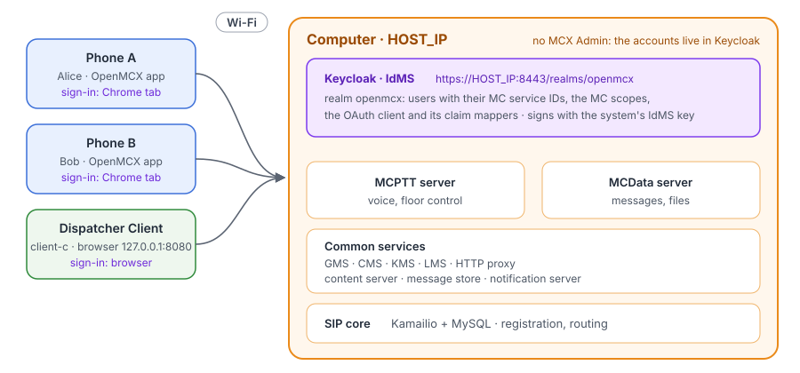</p>

What it shows, with the clauses of TS 33.180:

- **Sign-in on the IdMS's page** (annex B.4.2): the authorization code grant with PKCE, in the system browser: Chrome
  on the phones, the browser of this computer for the dispatcher. Neither client ever sees the password.
- **The tokens of another IdMS** (annex B.2): Keycloak's tokens carry the claims of annex B (`mcptt_id`, `mcdata_id`,
  `scope`, `client_id`), and the servers check them against Keycloak's keys (annex B.11.2).
- **Renewal with the refresh token** (annex B.5): the tokens live 5 minutes here; the clients renew them without any
  password, and the servers keep them authorised.
- **Where the client signed in**: the phones' Settings and the dispatcher's page name the IdMS.

The system is tutorial 1's (the MCPTT and MCData servers, the common services, the SIP core) without MCX Admin: the
accounts live in Keycloak.

## What you need

- **Docker** with Docker Compose v2 (2.24 or later) on a Linux computer, and its **IPv4 address on the Wi-Fi**.
- **Two Android phones** on the same Wi-Fi, with the **OpenMCX app** from the `develop` build
  ([`android/apk/openmcx-client-develop.apk`](https://github.com/openMCX/openmcx-client/tree/main/android/apk)), and a
  **screen lock** (Android installs a CA certificate only on a locked phone).
- **A browser** on this computer, for the dispatcher and Keycloak's console.
- The images from Docker Hub: OpenMCX's `develop` images (Keycloak as IdMS needs a version after 1.0.0) and
  Keycloak's `quay.io/keycloak/keycloak:26.3.3`.

## 1. Set the address

```bash
cd tutorials/end-to-end/07-keycloak-idms
cp .env.example .env
```

In `.env`, set `HOST_IP` to this computer's address on the Wi-Fi (`ip -4 route get 1.1.1.1`, the address after
`src`).

## 2. Write the configuration and start the system

```bash
docker compose -f docker-compose-keycloak.yaml run --rm setup
docker compose -f docker-compose-keycloak.yaml up -d
docker compose -f docker-compose-keycloak.yaml ps --format 'table {{.Name}}\t{{.Status}}'
```

The setup writes `./config`: a new certificate authority, the servers' configuration, Keycloak's realm, a provisioning
file per phone and the dispatcher's configuration. It prints, and keeps in `config/ADMIN.txt`, Keycloak's
administrator password and the users' passwords: `alice` and `bob` for the phones, `client-c` for the dispatcher.

Keycloak takes about a minute at its first start (it imports the realm). After `up -d` every container is healthy:

```
NAME                             STATUS
openmcx-kc-cms                   Up 52 seconds (healthy)
openmcx-kc-content-server        Up 52 seconds (healthy)
openmcx-kc-dispatcher            Up 5 seconds (healthy)
openmcx-kc-gms                   Up 52 seconds (healthy)
openmcx-kc-http-proxy            Up 46 seconds (healthy)
openmcx-kc-idms                  Up 52 seconds (healthy)
openmcx-kc-kms                   Up 52 seconds (healthy)
openmcx-kc-lms                   Up 52 seconds (healthy)
openmcx-kc-mcdata-server         Up 24 seconds (healthy)
openmcx-kc-mcptt-server          Up 24 seconds (healthy)
openmcx-kc-mcx-user-db           Up 52 seconds (healthy)
openmcx-kc-message-store         Up 52 seconds (healthy)
openmcx-kc-notification-server   Up 52 seconds (healthy)
openmcx-kc-sip-core              Up 36 seconds (healthy)
openmcx-kc-sip-db                Up 52 seconds (healthy)
```

## 3. Look at Keycloak's realm

Open `https://HOST_IP:8443/admin/` and sign in as `admin` with the password from `config/ADMIN.txt`. Your browser
warns about the certificate: it is the system's own CA's. Accept it for this site, or import `config/tls/ca.crt` into
the browser's certificate authorities.

In the realm **openmcx**, open **Clients** → **mcx-lab-client** (the OAuth client of the MC clients: public, PKCE
S256, the phones' and the dispatcher's redirect URIs) → **Client scopes**: the MC scopes of TS 33.180 table B.4.2.2-1,
which a client asks for and finds again in its access token's `scope`:

<p align="center">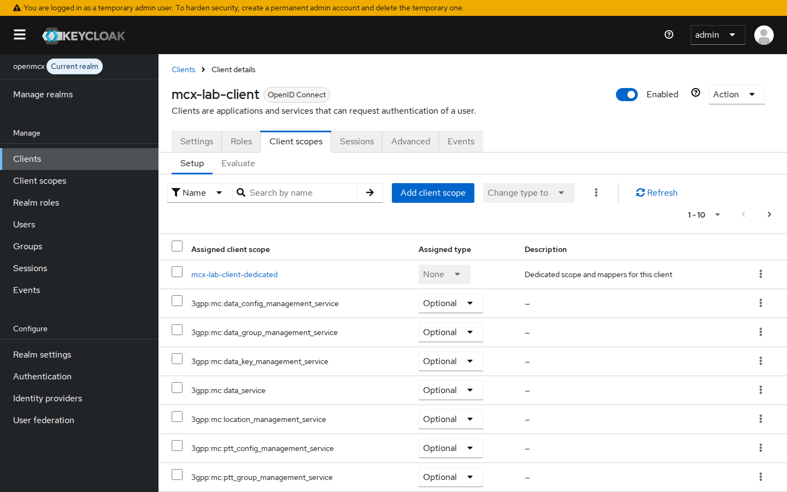</p>

**mcx-lab-client-dedicated** holds the claim mappers that give the tokens the claims of TS 33.180 annex B.2: the
users' attributes `mcptt_id`, `mcdata_id` and `mcvideo_id`; `client_id` (the OAuth client, table B.2.2.2-1) and the
MC servers' audience (`mcx-lab-server`) in the access token; `sub`:

<p align="center">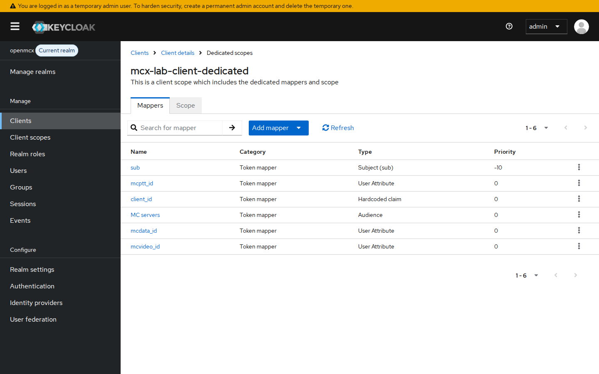</p>

**Users** → **alice** → **Attributes** holds her MC service IDs, which the mappers put in her tokens:

<p align="center">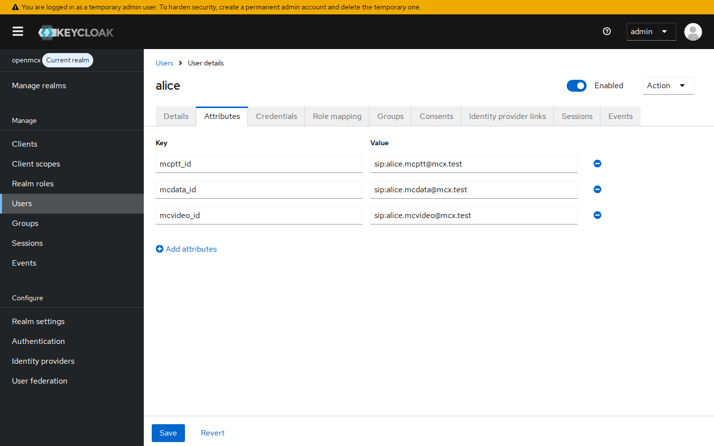</p>

Keycloak signs the tokens with the system's IdMS key (**Realm settings** → **Keys**), which the common services
verify with.

## 4. Install the CA on the phones

Each phone opens Keycloak's page in Chrome, which trusts only the phone's own certificate authorities. Copy
`config/tls/ca.crt` to each phone (for example `adb push config/tls/ca.crt /sdcard/Download/openmcx-ca.crt`), then
install it as a **CA certificate**:

- **Android 15 and later** (Motorola, Pixel): Settings → Security & privacy → More security & privacy →
  Encryption & credentials → Install a certificate → **CA certificate** → Install anyway → the file.
- **Xiaomi (MIUI, HyperOS)**: Settings → Passwords & security → Privacy → Encryption & credentials → Install a
  certificate → **CA certificate** → Install anyway → the file.

The app itself trusts the CA of its provisioning file; the CA on the phone is for Chrome. An IdMS whose certificate a
public CA issued needs neither: Chrome and the app's sign-in trust the phone's CAs.

## 5. Sign in on the phones

Copy `config/phones/alice.mcxprov` to the first phone and `config/phones/bob.mcxprov` to the second, then in the app:
**Settings** → **Import MCX profile** → the file. The profile has no password: the app opens Keycloak's page in a
Chrome tab.

<p align="center">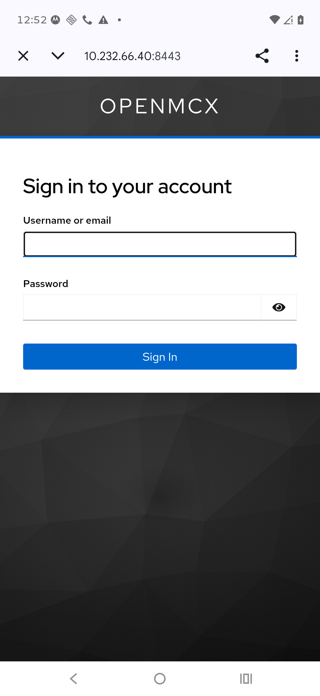</p>

Sign in as `alice` (and `bob` on the second phone) with the password from `config/ADMIN.txt`. Chrome says "Signed in.
You can return to the app." and the app registers, as ready. In **Settings** → **Show MCX profile**, the app names
the IdMS and when the access token ends; it renews it before then with the refresh token:

<p align="center">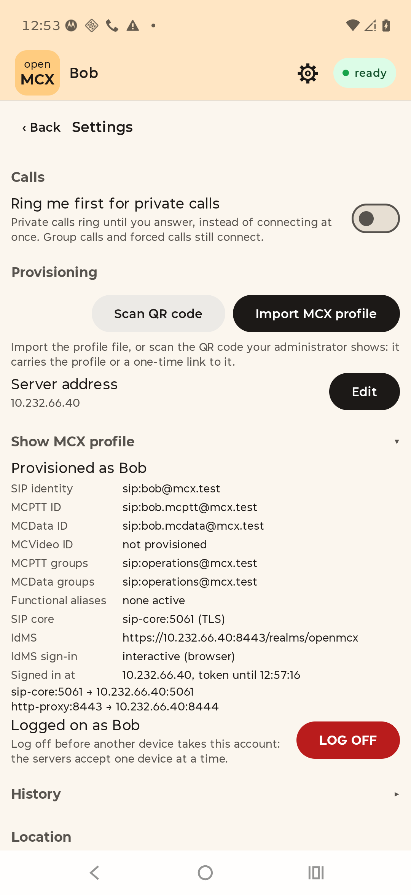</p>

## 6. Sign in at the dispatcher

Open `http://127.0.0.1:8080/` on this computer (this address exactly: Keycloak sends the browser back to it). The
dispatcher names its IdMS:

<p align="center">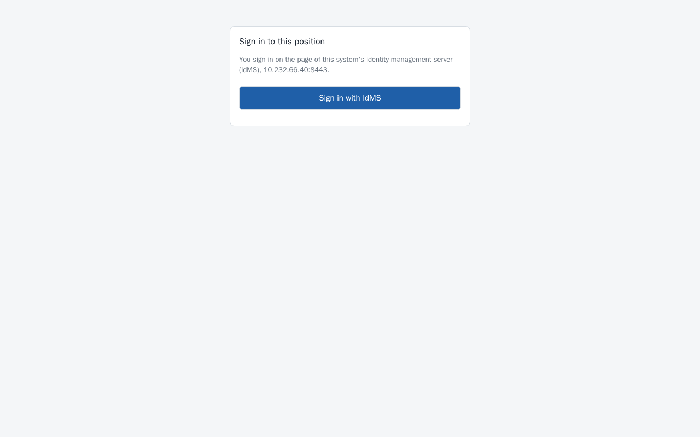</p>

**Sign in with IdMS** takes the browser to Keycloak's page:

<p align="center">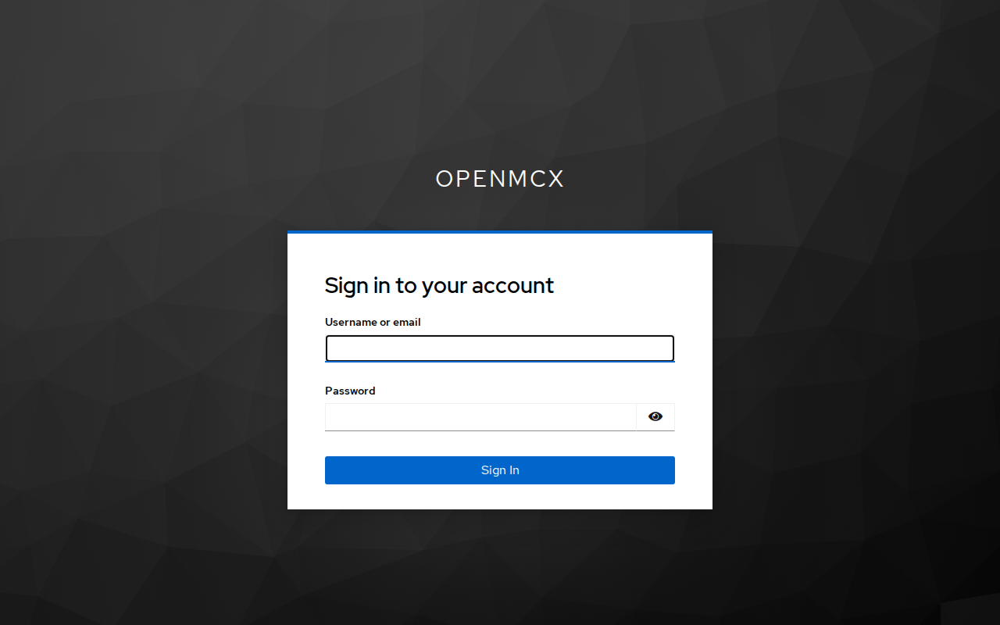</p>

Sign in as `client-c` with its password from `config/ADMIN.txt`. Keycloak sends the browser back to the dispatcher,
which registers and names the IdMS beside the user:

<p align="center">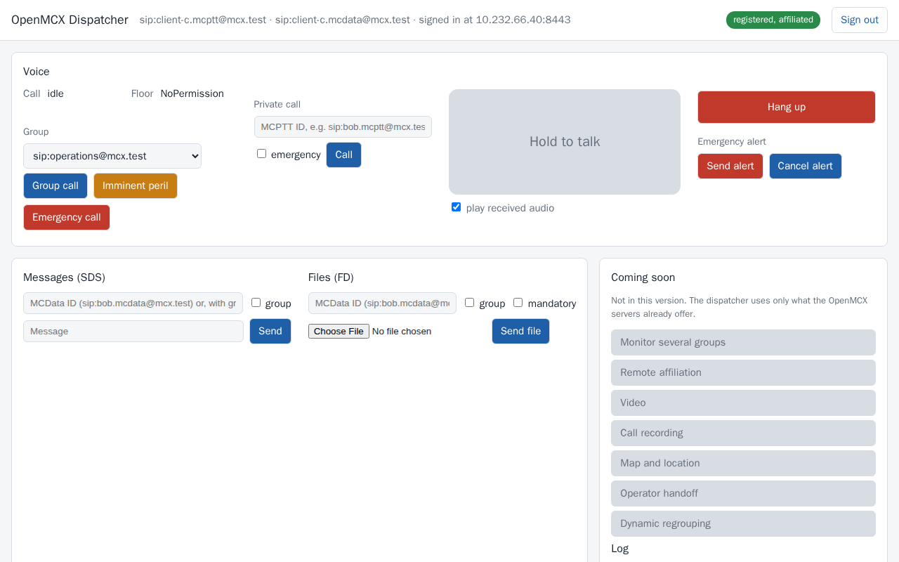</p>

Now call the group: **Group call** on the dispatcher. Alice and Bob join on their phones; hold to talk on the dispatcher,
or press PTT on a phone.

<p align="center">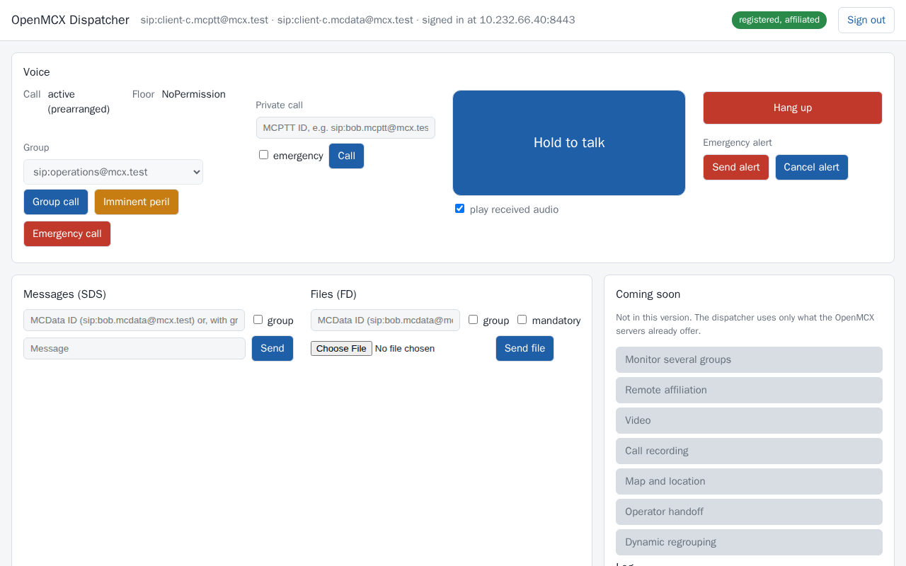 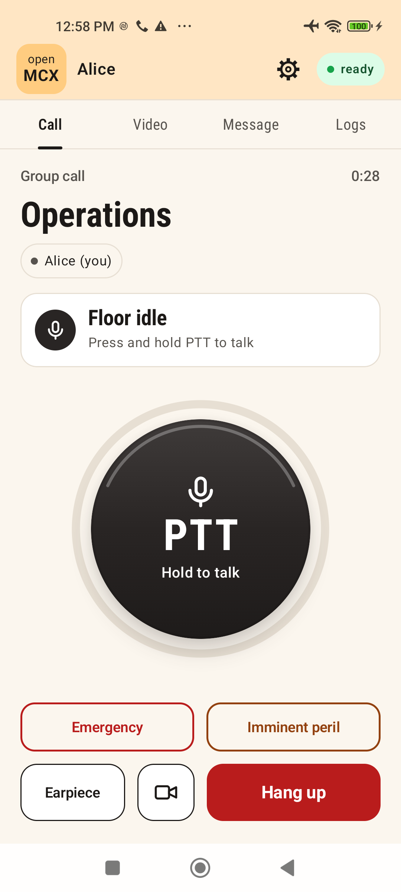</p>

## 7. Stop or start over

```bash
docker compose -f docker-compose-keycloak.yaml down -v   # remove the containers and their data
rm -rf config                                            # a new system next time (new CA, new passwords)
```

Remove the CA from the phones when you are done: Encryption & credentials → Trusted credentials → **User** → the
certificate → Remove.

## How it is put together

- **Keycloak** (`docker-compose-keycloak.yaml`, service `idms`) runs with the realm the setup wrote
  (`config/keycloak/openmcx.json`, from the lab generator's `--keycloak`): the users with their MC service IDs as
  attributes, the MC scopes as client scopes, the OAuth client `mcx-lab-client` (public, PKCE S256, the redirect URIs
  `http://127.0.0.1:8900/callback` of the phones and `http://127.0.0.1:8080/api/login/callback` of the dispatcher) and
  its claim mappers, and the system's IdMS key as its signing key. It answers at `https://HOST_IP:8443`, the issuer
  being `https://HOST_IP:8443/realms/openmcx` for the phones, the browser and the servers alike; its certificate,
  of the system's CA, names `HOST_IP`.
- **The servers** check each access token themselves (TS 33.180 annex B.11.2): its signature against Keycloak's keys
  (from its discovery document), the issuer, the MC servers' audience, the expiry, the scope of the service
  (`3gpp:mc:ptt_service`, `3gpp:mc:data_service`), `client_id` and the MC service ID. The common services verify the
  signature with the system's IdMS key. OpenMCX's own IdMS is not running.
- **The phones** have no password in their profile, so the app signs in in a Chrome tab (RFC 8252: the system
  browser, not a view inside the app) and receives the code on its loopback redirect URI. Its own connections to
  Keycloak trust the profile's CA and the phone's CAs.
- **The dispatcher** (`config/dispatcher.json`) is client-c in lab mode with `oauth.login: "browser"`: its
  page sends the browser to Keycloak and takes the code back at `/api/login/callback`, checking the state and a
  cookie that binds the sign-in to that browser. Like tutorial 2's dispatcher, it runs on this computer's network and
  reaches the system through `HOST_IP`.
- **Renewals**: the access tokens live 5 minutes (`token_ttl_seconds` in `setup/lab.json`); the clients renew them
  with the refresh token, and a refreshed token from Keycloak may come without a new ID token or nonce, which TS 33.180
  table B.5.3-1 and OpenID Connect allow.

## With another IdMS

The same steps work with any IdMS that follows TS 33.180 annex B. It needs an OAuth client for the MC clients (public,
PKCE S256) with their redirect URIs, the MC scopes, and the claims `mcptt_id` (and `mcdata_id`, `mcvideo_id`) in both
tokens and `client_id` in the access token. The OpenMCX servers take its issuer as `common.issuer` and the audience of
its access tokens as `common.token_audience`. An IdMS whose certificate a public CA issued needs no CA installed on the
phones.

Checked on 2026-10-19 with a Motorola (Android 16) and a Xiaomi (Android 13), Keycloak 26.3.3 and the `develop`
images.
