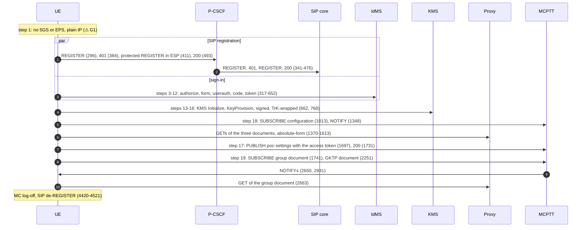
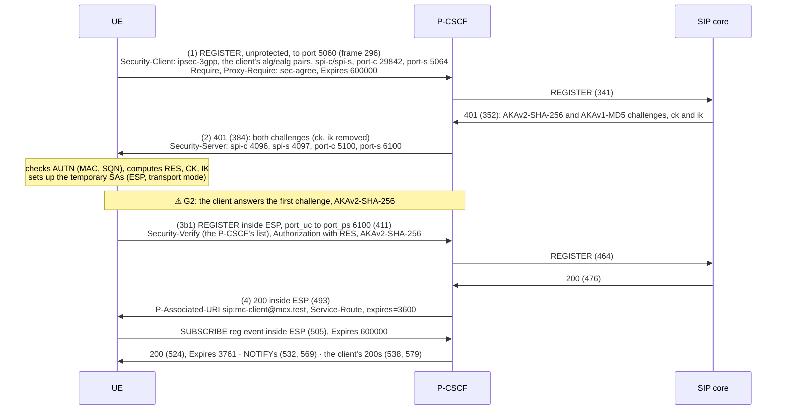
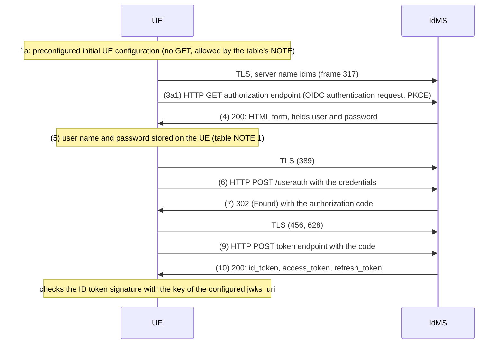
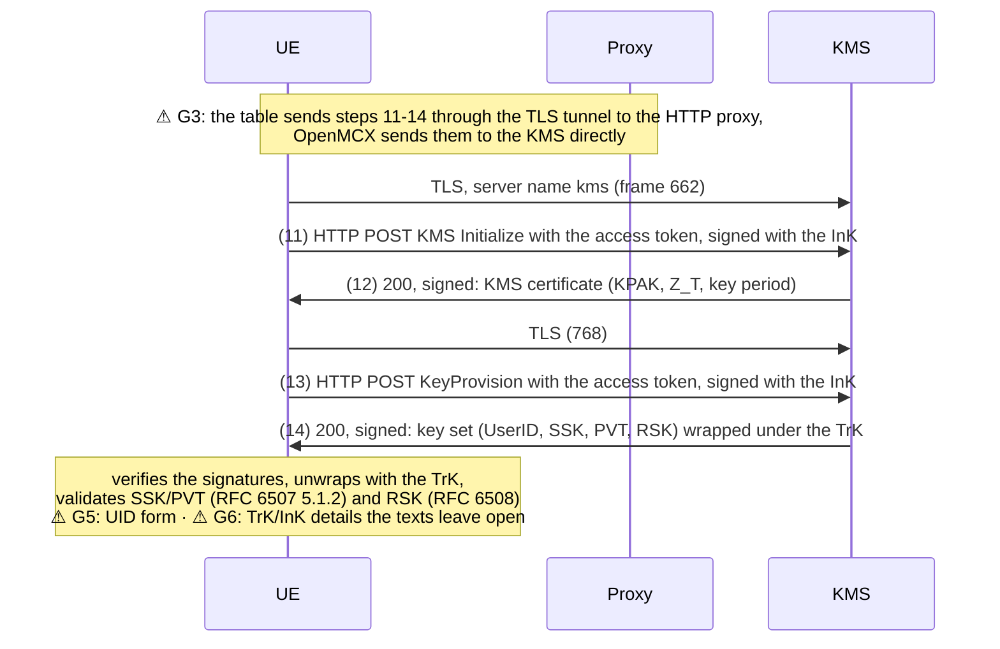
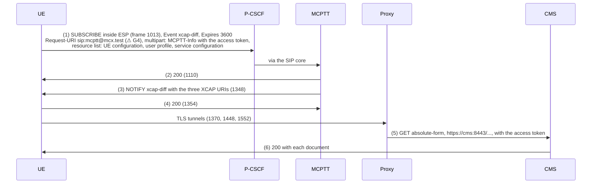
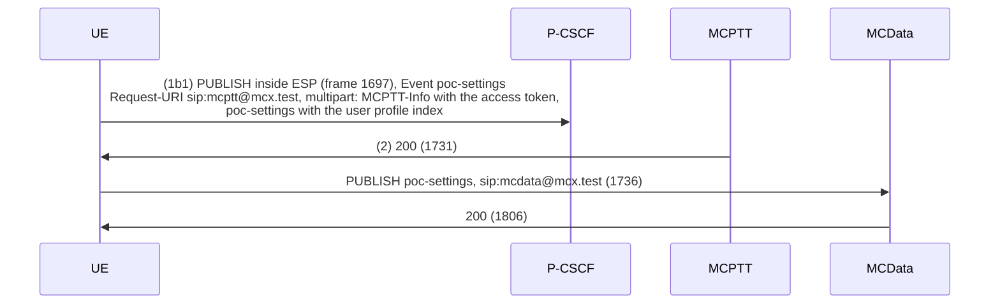
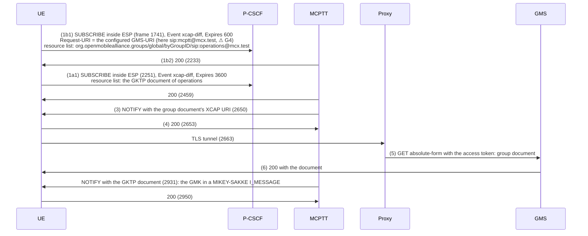
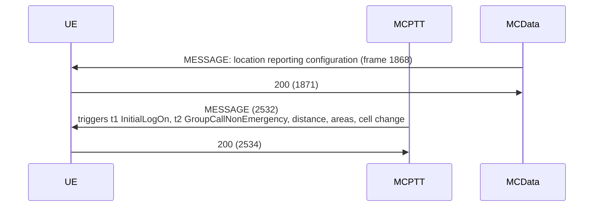
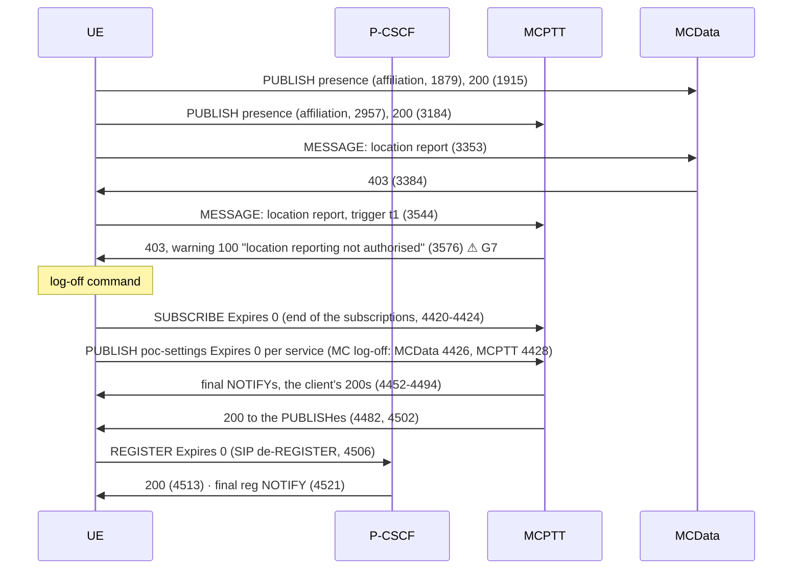

# Tutorial 10: call flow of TS 37.579-2 test 5.1 with the OpenMCX MC Client (Linux), step by step

This page follows the [walk-through of test 5.1](README.md#3-run-the-test-steps) message by message. For each step of
TS 37.579-2 V18.1.0 table 5.1.3.2-1 it gives:
- the procedure of TS 37.579-1 V18.1.0 that the step refers to;
- the messages the MC client sends and receives, with their frame numbers in the
  [reference capture](captures/linux-ue-conformance.pcap) (ESP decrypted, see
  [Look at the capture](README.md#4-look-at-the-captures));
- the points where OpenMCX or this tutorial **differs from the test's procedure**, marked **⚠ G*n*** and listed under
  [Gaps](#gaps) at the end.

The MC client is the OpenMCX MC Client (Linux), service `mc-client`, on an IP network without 3GPP access. The OpenMCX
system takes the place of the system simulator, so this is a walk-through, not a conformance test.

## Actors

| Name in the diagrams | What it is | Address in the capture |
|---|---|---|
| UE | the MC client `mc-client@mcx.test` | `172.31.109.104` |
| P-CSCF | Kamailio with `docker/pcscf.cfg` | `172.31.109.60` |
| SIP core | the S-CSCF and registrar (Kamailio) | `172.31.109.10` |
| IdMS | OpenMCX IdMS | `172.31.109.40:8443` |
| KMS | OpenMCX KMS | `172.31.109.43:8443` |
| Proxy | home HTTP proxy, forward mode | `172.31.109.45:8443` |
| CMS, GMS | configuration and group management servers, behind the proxy | `cms:8443`, `gms:8443` |
| MCPTT | MCPTT server (also the CMS and GMS subscription target, see G4) | `172.31.109.20` |
| MCData | MCData server | `172.31.109.21` |

## Overview

| 5.1 step | TS 37.579-1 procedure | Frames | Gaps |
|---|---|---|---|
| 1 | 5.4.1B MCX PDU session | - | G1 |
| in parallel to 3-16 | table 5.3.2.4.1-1 SIP registration | 296-579 | G2 |
| 3-12 | table 5.3.2.3.1-1 steps 1-10 (initial configuration, user authentication) | 317-652 | - |
| 13-16 | table 5.3.2.3.1-1 steps 11-14 (key material) | 662-827 | G3, G5, G6 |
| 18 | table 5.3.2.6.1-1 configuration management subscription | 892-1613 | G4 |
| 17 | table 5.3.2.5.1-1 publication of MCX service settings | 1697-1806 | - |
| 19 | table 5.3.2.7.1-1 group management subscription | 1741-2950 | G4 |
| (main procedure 6-7) | table 5.3.2.2.1-1 location reporting configuration | 1868-2534 | - |
| (after 5.1) | affiliation, location reports, MC log-off, SIP de-REGISTER | 1745-4521 | G7 |

In the reference run the SIP registration and the sign-in run in parallel. Then follow the key material (steps
13-16), the configuration subscription (step 18), the service authorisation (step 17) and the group subscription (step
19). Table 5.1.3.2-1 lets steps 17-19 run in parallel; the client sends the PUBLISH of step 17 only after it has read
the user profile (table 5.3.2.5.1-1 NOTE 1).

## Step 1: switch-on and the access

TS 37.579-1 clause 5.4.1B sets up the MCX PDU session (5GS) or PDN connection (EPS) for the MC client's signalling.
Here the client's container is on an IP network (`172.31.109.0/24`) and reaches the P-CSCF and the HTTP services
directly: the IPCAN model of a test system reached over a VPN. **⚠ G1**

## In parallel to steps 3-16: SIP registration with IMS AKA

TS 37.579-1 table 5.3.2.4.1-1. The client takes path 3b1: its REGISTER carries no access token, which goes in the
PUBLISH of step 17 (table 5.3.2.4.1-1 NOTE 1; TS 33.180 clause 5.1.3.2.1: the REGISTER is not delayed for the token).

- The P-CSCF chose `alg=null`, `ealg=aes-gcm-us` (AES-GCM, TS 33.203 annex I), the client's first pair.
- Every later request of the client carries Security-Verify and the sec-agree option tag in Require (RFC 3329
  section 2.3.1, TS 24.229 annex A), Proxy-Require in INVITE and OPTIONS only ([Known
  limitations](../../../docs/LIMITATIONS.md), "sec-agree option-tag in Proxy-Require"). Its Via names its protected
  server port 5064 (TS 24.229 clause 5.1.2A.1.1). The P-CSCF removes both before passing a request on.
- The reg event subscription (TS 24.229 clause 5.1.1.3) is not part of table 5.3.2.4.1-1.
- What to check: in the capture, `sip && ip.addr == 172.31.109.104 && tcp.port == 5060` (frames 296, 384) and
  `esp && sip` (411, 493); `sip_security` in the client's status (README step 3, check 1).
- Normative: TS 24.229 clauses 5.1.1.2, 5.1.1.5, 5.2.2; TS 33.203 clauses 6.1, 7; TS 33.180 clause 6.2.1.

## Steps 3-12: initial configuration and user authentication

TS 37.579-1 table 5.3.2.3.1-1 steps 1-10. Step 1a, the initial UE configuration, is preconfigured
(`config/mc-client.json`). TLS to the IdMS directly, as the table's exceptions ask (TS 24.482 annex A.2.1.2).

- What to check: `signed_in` in the client's status; with `MCX_LOG=debug`,
  `docker compose logs idms | grep -E 'HTTP (GET|POST) /(authorize|userauth|token)'`.
- Normative: TS 24.482 clause 6.2.1; TS 33.180 clause 5.1.2, annex B.

## Steps 13-16: key material from the KMS

TS 37.579-1 table 5.3.2.3.1-1 steps 11-14, right after the token. The KMS holds a TrK and an InK for the client's
MCPTT user (TS 33.180 clause 5.3.2, annex D.2.2, D.3.1).

- What to check: `transport_keys` and `key_management` in the client's status (README step 3, check 2); with
  `MCX_LOG=debug`, `docker compose logs kms | grep kms_signed_request`.
- Normative: TS 33.180 clauses 5.3.2, 5.3.3, 5.3.5, 5.3.6, annexes D and F.

## Step 18: configuration management subscription

TS 37.579-1 table 5.3.2.6.1-1.

- The GETs come after the NOTIFY (`mcptt.documents_on_notify`), and ':' and '@' stand unencoded in the XCAP path
  segments (RFC 3986 section 3.3). The two tunnels before the SUBSCRIBE (892, 962) fetch the MCData user profile and
  service configuration, which test 5.1 does not cover.
- What to check: `configuration` and `ue_configuration` in the client's status (README step 3, check 4); with
  `MCX_LOG=debug`, `docker compose logs http-proxy` (the requests by authority, `cms:8443`).
- Normative: TS 24.484 clauses 6.3.13.3.2.2, 8.2; TS 24.482 annex A.2.1.2; RFC 4825.

## Step 17: publication of MCX service settings (service authorisation)

TS 37.579-1 table 5.3.2.5.1-1, path 1b1: the access token goes in the PUBLISH, after the user profile was read
(table NOTE 1).

- What to check: `authorized` and `mcdata_authorized` in the client's status (README step 3, check 3).
- Normative: TS 24.379 clause 7.2.1; TS 24.282 clause 7.2.1; TS 33.180 clause 5.1.3.2.3.

## Step 19: group management subscription

TS 37.579-1 table 5.3.2.7.1-1: path 1b1 (the group document) and path 1a1 (the group's GKTP document, table
5.3.2.7.1-2, for the GMK).

- What to check: `group_documents`, `group_subscription_result`, `group_key_id` and `protected_ready` in the
  client's status (README step 3, check 5).
- Normative: TS 24.481 clauses 6.3.13.2.1, 6.3.13.2.2.

## Main procedure steps 6-7: location reporting configuration

TS 37.579-1 table 5.3.2.2.1-1 steps 6-7.

- What to check: `location.configured` and `mcdata_location.configured` in the client's status (README step 3, check 6).
- Normative: TS 24.379 clause 13.2.2; TS 24.282 clause 17.

## After test 5.1: affiliation, location reports, log-off

Not checked by test 5.1, shown for completeness.

- Normative: TS 24.379 clauses 9.2.1.2 and 9.2.1.3 (affiliation), 13.2.4 (location report), 7.2.1A NOTE 3 (MC
  log-off); TS 24.229 clause 5.1.1.6 (SIP de-REGISTER).

## Gaps

Each gap is one of:
- **spec gap**: the specifications leave the detail open or contradict each other; OpenMCX keeps its behaviour and
  reports it ([Known limitations](../../../docs/LIMITATIONS.md));
- **tutorial**: a choice of this tutorial or its test bed, not of the MC client.

| Gap | Kind | Step | What | Where described |
|---|---|---|---|---|
| G1 | tutorial | 1 | No 5GS or EPS: the client is on an IP network (the IPCAN model of a test system over a VPN), without a radio, a system simulator or a TTCN-3 test suite. | README, step 3 |
| G2 | tutorial | SIP registration | The SIP core offers AKAv2-SHA-256 before AKAv1-MD5 (TS 33.203 clause 6.1.1) and the client answers the first; table 5.3.2.4.1-1 step 2 sends AKAv1-MD5 only, which the client also answers. | README, step 3 |
| G3 | spec gap | 13-16 | The KMS requests go to the KMS directly. Table 5.3.2.3.1-1 steps 11-14 send them through the TLS tunnel to the HTTP proxy; TS 24.482 annex A.2.1.2 sends every request but the IdMS's through the proxy, TS 33.180 clause 5.3.2 lets the KMS be used without it, and no configuration item tells the UE which applies. The Linux and Android clients' `security.kms_via_proxy` (off by default) sends them through the proxy. | Known limitations, "Home HTTP proxy" |
| G4 | spec gap | 18, 19 | The configuration SUBSCRIBE goes to the MCPTT server's PSI: TS 24.484 clause 6.3.13.2.2 b) 2) names "the configured public service identity for performing subscription proxy function of the CMS", but no configuration item for it exists (Linux `cms.subscription_psi` and Android `mcptt.cms_subscription_psi` set one). The group SUBSCRIBEs go to the configured GMS-URI, in this tutorial the same PSI. | Known limitations, "CMS subscription proxy PSI" |
| G5 | spec gap | 13-16, and every MIKEY-SAKKE use | TS 33.180 annex F.2.1.1 does not say whether ECCSI and SAKKE take the UID's 32 octets or its base64 text. OpenMCX's KMS uses the text; the Linux client finds the form that validates the key set (`key_management.uid_form`, `text` here). | Known limitations, "MIKEY-SAKKE UID form" |
| G6 | spec gap | 13-16 | The TrK and InK exchange follows the texts where they are clear; the details they leave open (Signature-ID and TrK-ID, the key-wrap padding, the schema Id, AES-128-GCM, a Time without a zone) are listed there. | Known limitations, "KMS request security (TrK/InK)" |
| G7 | tutorial | after 5.1 | `mc-client` is the generator's user without the right to report its location (the regression's refusal case), so its reports are refused with 403. | README, step 3 |
