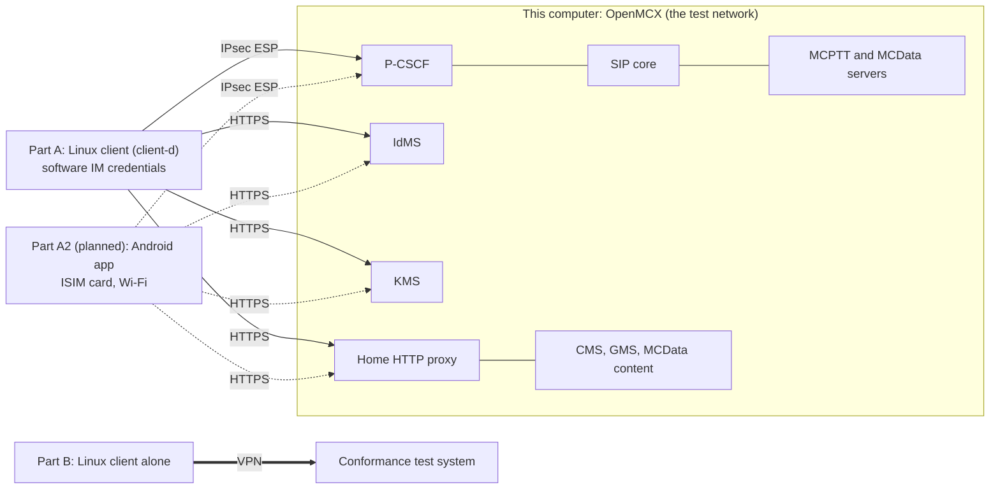

# Tutorial 10: OpenMCX UE conformance check

*TS 37.579-2 test 5.1, for OpenMCX's own MC clients*

This tutorial takes OpenMCX's MC clients through test 5.1 of TS 37.579-2 on IP access (no 5G core and no radio). From
switch-on to service, the client under test:
- signs the user in to the IdMS;
- registers with **IMS AKA** through a **P-CSCF**, with its SIP inside **IPsec ESP**;
- gets its key material from the KMS, with the exchange **signed and the keys wrapped under a transport key (TrK)**;
- has the MCPTT and MCData servers authorise the service;
- subscribes to its configuration and group documents, and to the group's key (GMK);
- sends its HTTP requests through the **home HTTP proxy** in absolute-form, except the IdMS's and the KMS's;
- at the end logs off (the MC log-off) and de-registers.

| Part | Client under test | Network side | Status |
|---|---|---|---|
| A, [steps 1 to 5](#1-make-the-configuration) | the Linux client (`client-d`), a terminal without 3GPP access | OpenMCX on this computer | runs |
| A2, [step 7](#7-the-android-app-as-the-client-under-test-planned) | the Android app on a phone with an ISIM card, over Wi-Fi | OpenMCX on this computer | planned (its IMS AKA registration runs) |
| B, [step 6](#6-against-a-conformance-test-system) | the Linux client alone | a conformance test system over a VPN | template |

Against OpenMCX (parts A and A2), OpenMCX takes the place of the test system, and it is not a validated one: the
verdicts are a self-check of the clients, not a conformance result. Only a conformance test system (part B) gives one.
What each client is ready for, its own deviations and the spec defects met on the way are summed up at the end:
[Results and learnings](#results-and-learnings).



[Tutorial 8](../08-ims-aka-over-oai-5g/README.md) runs the same test with the Linux client inside a 5G UE. Here its
container is a terminal without 3GPP access, so its software IMS AKA credentials are the IM credentials that TS 33.180
clause 6.2.1 allows for "non-3GPP-only MC UEs not equipped with UICC" (TS 33.203 clause 9, TS 24.229 clause
5.1.1.1B.1). The Android app on a phone holds them on its card (TS 33.203 clause 4).

## What you need

- **A Linux computer** with Docker and Docker Compose v2 (2.24 or later) and about 4 CPU cores free.
- **IPsec in the kernel**: the modules `xfrm_user`, `esp4`, `authenc` and `gcm`, as in the kernels of the common Linux
  distributions. The client and the P-CSCF set up their security associations in their own containers (with
  `NET_ADMIN`); if a module is not loaded yet: `sudo modprobe -a xfrm_user esp4 authenc gcm`.
- Nothing to compile, no phones, no `sudo` otherwise. The tutorial uses OpenMCX's **`develop` images** from Docker Hub
  (IMS AKA, the TrK and the documents on notify need a version after 1.0.0).
- Nothing is published on the computer: every service is on the tutorial's own network, `172.31.109.0/24`
  (bridge `openmcx-t10`).

## 1. Make the configuration

```bash
cd tutorials/end-to-end/10-openmcx-ue-conformance-check
docker compose run --rm setup
```

The setup runs OpenMCX's lab generator (`tools/prepare-prearranged-test.py`, the generator of the regression labs)
with the flags at the top of `docker-compose.yaml`, and copies the configuration to `./config`. Among them:

| Flag | What it gives the MC client `client-d` |
|---|---|
| `--aka-role client-d` | An IMS AKA subscription (private user identity `client-d@mcx.test`, K and OPc of its own) in the SIP database, and the P-CSCF (`pcscf`, `docker/pcscf.cfg`) as its first hop. |
| `--http-proxy-mode forward` | The home HTTP proxy in forward mode (TS 24.482 annex A.2.1.2): the clients name each server by its own URI and send their requests to the proxy in absolute-form, over a TLS tunnel. |
| `--protected --key-parameters-iei 0x79` | MIKEY-SAKKE keys: a client signature key (CSK) for the service, the group's GMK. |
| `--transport-keys --transport-key-role client-d=trk+ink` | A TrK and an InK for `client-d`'s MCPTT user (TS 33.180 clause 5.3.2, annex D): the KMS exchange is signed and the key set wrapped. |
| `--documents-on-notify` | The client GETs its documents only after the NOTIFY that names them (TS 37.579-1 tables 5.3.2.6.1-1 and 5.3.2.7.1-1). |
| `--group-management --location` | The group `operations` from the GMS, and the servers' location reporting configuration. |

The other three clients (`client-a` to `client-c`) are users of the same system with SIP digest, as on a control
room's network. They take no part in the test.

The certificates last 30 days. If `./config` exists, the setup stops: to start over, see step 5.

## 2. Start the system

```bash
MCX_LOG=debug docker compose up -d --wait
```

After about a minute all services are `(healthy)`. `client-d` is healthy once it has signed in, registered with IMS AKA
and been authorised.

`MCX_LOG=debug` is optional. With it, the logs hold the SIP messages and the HTTP requests, the HTTP proxy logs each
request line (step 3 checks their form), and `client-d`'s log holds the keys of its IPsec security associations (lines
`ESP SA`), so Wireshark can decrypt its SIP (step 4). **Treat that log as secret.**

## 3. Walk-through of TS 37.579-2 test 5.1

```bash
./run.sh
```

Test 5.1 of TS 37.579-2 V18.1.0 is "Configuration / Authentication / User Authorisation / UE Configuration / User
Profile / Key Generation" (table 5.1.3.2-1). It checks what an MC client does from switch-on to service, with the
procedures of TS 37.579-1 V18.1.0. Here it is a walk-through, not a conformance test: there is no TTCN-3 test suite
(TS 37.579-5) and no validated system simulator. The OpenMCX system takes the system simulator's place; the
implementation under test is `client-d`.

The test runs by itself at every start of the system (step 2). The client is preconfigured with the initial UE
configuration (TS 37.579-1 table 5.3.2.3.1-1 step 1a, the data of table 5.5.8.1-1: the IdMS, the HTTP proxy, the
P-CSCF and the identities) and with the user name and password (NOTE 1 of that table: stored on the UE).

`run.sh` checks each step in `client-d`'s status file, in this order:

1. the SIP registration with IMS AKA through the P-CSCF, and the security associations in use (TS 33.203 clause 7.1):
   `AKAv2-SHA-256`, `ipsec-3gpp`, `alg` `null` and `ealg` `aes-gcm-us` (AES-GCM, which protects integrity itself),
   the UE's protected server port `port_us` 5064 and the P-CSCF's `port_ps` 6100; then the subscription to its reg
   event (TS 24.229 clause 5.1.1.3);
2. the sign-in, then the KMS: `transport_keys` shows `signed, TrK-wrapped keys`;
3. the service authorisation of MCPTT and MCData;
4. the configuration subscription with the three documents, its NOTIFY and the GETs;
5. the group document subscription, its NOTIFY and the GET; the CSK and the GMK;
6. the location reporting configuration from the MCPTT and MCData servers;
7. with `MCX_LOG=debug`: every request through the HTTP proxy in absolute-form, none in origin-form;
8. the MC log-off (a PUBLISH with Expires 0 per service, TS 24.379 clause 7.2.1A NOTE 3), then the SIP de-REGISTER
   (TS 24.229 clause 5.1.1.6);
9. the capture, copied to `captures/10-openmcx-ue-conformance-check-run.pcap.gz`, and with `MCX_LOG=debug` the keys of the
   client's security associations, as `captures/10-openmcx-ue-conformance-check-run.esp_sa`. Before the log-off (check 8) it saves
   `client-d`'s status as the test left it, as `captures/10-openmcx-ue-conformance-check-run.status.json`.

To run the test again, start over (step 5): the client has logged off.

Step by step (the messages of each step, with the frame numbers of the reference capture and where OpenMCX or this
tutorial differs from the test's procedure: [call flow](CALL_FLOW.md)):

| 5.1 step | TS 37.579-1 | What the client does | Normative clauses |
|---|---|---|---|
| 1 | 5.4.1B (IPCAN) | No 5GS or EPS: the client's container is on an IP network, which takes the place of the MCX PDU session. | |
| in parallel to 3-16 | table 5.3.2.4.1-1, path 3b1 | Initial REGISTER, unprotected, to the P-CSCF's port 5060, with Security-Client (`ipsec-3gpp`, the client's algorithms, its SPIs and ports) and sec-agree in Require and Proxy-Require. The SIP core answers 401 (Unauthorized) with an AKAv2-SHA-256 and an AKAv1-MD5 challenge; the P-CSCF adds Security-Server and removes the ck and ik meant for it. The client checks AUTN, computes RES, CK and IK, sets up the temporary security associations and sends the protected REGISTER from port_uc to port_ps, with Security-Verify and the AKA response; 200 (OK). The REGISTER does not wait for the access token, which goes in the PUBLISH (step 17). Every later request carries Security-Verify and sec-agree in Require. | TS 24.229 clauses 5.1.1.2, 5.1.1.5, 5.2.2; TS 33.203 clauses 6.1, 7; RFC 3329 section 2.3.1; TS 33.180 clauses 5.1.3.2.1, 6.2.1 |
| 3-12 | table 5.3.2.3.1-1 steps 1-10 | The OIDC authentication request to the IdMS; the HTML form; the form posted to the IdMS's `/userauth`; the 302 (Found) with the code; the token request; the ID, access and refresh tokens. The IdMS is reached directly, not through the HTTP proxy (TS 24.482 annex A.2.1.2). | TS 24.482 clause 6.2.1; TS 33.180 clause 5.1.2, annex B |
| 13-16 | table 5.3.2.3.1-1 steps 11-14 | KMS Initialize and KeyProvision with the access token, each request signed with the InK, each answer verified, the key set unwrapped with the TrK. The requests go to the KMS directly ([Known limitations](../../../docs/LIMITATIONS.md), "Home HTTP proxy"). | TS 33.180 clauses 5.3.2, 5.3.3, annex D |
| 17 | table 5.3.2.5.1-1, path 1b1 | PUBLISH to the MCPTT and MCData servers with the access token (service authorisation) and the PoC settings; 200 (OK). | TS 24.379 clause 7.2.1; TS 24.282 clause 7.2.1; TS 33.180 clause 5.1.3.2.3 |
| 18 | table 5.3.2.6.1-1 | One SUBSCRIBE with the access token and a resource list of the MCPTT UE configuration, user profile and service configuration documents; the NOTIFY with their XCAP URIs; the GETs after the NOTIFY, through the HTTP proxy. | TS 24.484 clauses 6.3.13.3.2.2, 8.2; TS 24.482 annex A.2.1.2 |
| 19 | table 5.3.2.7.1-1, paths 1b1 and 1a1 | SUBSCRIBE to the group document of `operations`; NOTIFY; the GET. SUBSCRIBE to the group's GKTP document (table 5.3.2.7.1-2); NOTIFY; the GMK. | TS 24.481 clauses 6.3.13.2.1, 6.3.13.2.2 |
| (main procedure 6-7) | table 5.3.2.2.1-1 | The MCPTT and MCData servers' MESSAGE configuring location reporting; the client's 200 (OK). | TS 24.379 clause 13.2.2; TS 24.282 clause 17 |

Where the walk-through departs from the test, in short (the full list: [call flow, Gaps](CALL_FLOW.md#gaps)):

- **The access**: no 5GS or EPS, no radio (step 1).
- **The challenge**: the SIP core offers AKAv2-SHA-256 before AKAv1-MD5 (TS 33.203 clause 6.1.1), and the client
  answers the first. The 401 of TS 37.579-1 table 5.3.2.4.1-1 carries AKAv1-MD5, which the client also supports.
- **The KMS** is reached directly, not through the HTTP proxy.
- **After the test**: `client-d` is the generator's user without the right to report its location, so its first
  report (trigger `InitialLogOn`) is refused, 403 (Forbidden) with warning 100 from the MCPTT server. Location
  reporting is not part of test 5.1.

## 4. Look at the capture

The reference capture is [`captures/10-openmcx-ue-conformance-check-full.pcap.gz`](captures/10-openmcx-ue-conformance-check-full.pcap.gz)
(1.0 MB, 4 541 frames). It records a run of steps 2 and 3: the system starting, `client-d` signing in, registering
with IMS AKA, getting its keys and being authorised and configured, then its MC log-off and SIP de-REGISTER.
Wireshark opens the compressed file directly. The frame numbers below are those of the reference.

It was captured on the tutorial's network (`172.31.109.0/24`) and keeps:
- SIP on 5060 in clear: between the servers, the SIP core and the P-CSCF, and of the digest clients `client-a` to
  `client-c`;
- `client-d`'s SIP, unprotected on 5060 until the 401, then inside **IPsec ESP** between the client and the P-CSCF;
- HTTPS on 8443, encrypted: the clients' requests to the IdMS and the KMS, and the TLS tunnels to the HTTP proxy;
- UDP, for media and floor control (none in this run: no call is made).

It leaves out DNS, the databases and the computer's own traffic on the bridge.

To read the SIP inside ESP, give Wireshark the run's security associations:
1. copy [`captures/10-openmcx-ue-conformance-check-full.esp_sa`](captures/10-openmcx-ue-conformance-check-full.esp_sa) to
   `~/.config/wireshark/esp_sa`, or import it in **Edit → Preferences → Protocols → ESP → ESP SAs**;
2. tick **Attempt to detect/decode encrypted ESP payloads** there.

They are the keys of this throwaway run (CK and IK of one AKA challenge). A run of your own has others, in
`captures/10-openmcx-ue-conformance-check-run.esp_sa` (with `MCX_LOG=debug`).

Addresses: the SIP core `.10`, the MCPTT server `.20`, the MCData server `.21`, the IdMS `.40`, the KMS `.43`, the HTTP
proxy `.45`, the P-CSCF `.60`, `client-d` `.104`.

Useful display filters:

| Filter | Shows |
|---|---|
| `sip && ip.addr == 172.31.109.104 && tcp.port == 5060` | IMS AKA: the unprotected REGISTER with Security-Client, and the 401 with the AKA challenges and Security-Server. |
| `esp && sip` | `client-d`'s SIP inside ESP (with the ESP SAs above): the protected REGISTER, PUBLISH, SUBSCRIBE, NOTIFY, MESSAGE. |
| `sip && ip.addr == 172.31.109.60 && ip.addr == 172.31.109.10` | The same requests between the P-CSCF and the SIP core. |
| `ip.src == 172.31.109.104 && tls.handshake.type == 1` | `client-d`'s TLS connections: the IdMS, the KMS and the HTTP proxy (the server name in each Client Hello). |

What to look for, in the reference run:

- **IMS AKA** (frames 198 to 309): the unprotected REGISTER to the P-CSCF's port 5060 with Security-Client (198);
  the P-CSCF passes it to the SIP core (217), which answers 401 (245). The P-CSCF's 401 to the client (251) carries
  the AKAv2-SHA-256 and AKAv1-MD5 challenges and Security-Server. Then come the first ESP packets (253), the
  protected REGISTER inside ESP with Security-Verify and the AKA response (258), and its 200 (274). The client's
  SUBSCRIBE to its reg event follows (277), with its 200 (298) and the first NOTIFY (307).
- **Sign-in** (frames 203 to 295, in parallel): TLS connections to the IdMS (Client Hellos 203, 228, 249, 295, server
  name `idms`): the authentication request, the HTML form, the code and the tokens.
- **The KMS** (frames 327 and 350, server name `kms`): KMS Initialize and KeyProvision, signed, the key set wrapped.
- **Through the HTTP proxy** (frames 827 to 2608, server name `http-proxy`): inside each tunnel, a second TLS session
  with the CMS or the GMS.
- **Configuration** (inside ESP): the SUBSCRIBE for the three configuration documents (883), its 200 (940) and NOTIFY
  (1012); the service authorisation PUBLISHes with the access token to the MCPTT server (1676, 200 at 1691) and the
  MCData server (1698, 200 at 1823); the SUBSCRIBE to the group document of `operations` (1703, 200 at 2004, NOTIFY
  at 2598) and to its GKTP document (2020, 200 at 2360, NOTIFY at 2830). The location reporting configuration
  MESSAGEs of the MCPTT and MCData servers come at 1760 and 1889.
- **After the test**: the affiliation (PUBLISH presence, 1900 and 2961), the refused location reports (3338 and 3372,
  403 at 3369 and 3400).
- **MC log-off and SIP de-REGISTER** (frames 4416 to 4504): the SUBSCRIBEs with Expires 0 (4416 to 4420), the
  PUBLISHes with Expires 0 for MCData (4422) and MCPTT (4424), answered 200 (4482, 4484); then the REGISTER with
  Expires 0 (4488) and its 200 (4497).

The `.esp_sa` file holds the IPsec keys of the MC client. The access tokens of the IdMS travel in SIP for service
authorisation. They all belong to a throwaway system: its signing keys and users no longer exist, and the tokens
expired after an hour. Treat a capture of your own system and its ESP keys as secret.

## 5. Stop or start over

```bash
docker compose down -v      # stop and delete the data
rm -rf config               # then start over at step 1
```

`docker compose down` (without `-v`) keeps the data: `MCX_LOG=debug docker compose up -d --wait` starts the same
system again, and `client-d` signs in and registers again.

## 6. Against a conformance test system

The folder `external/` runs the same client alone, on a computer connected over a VPN to a conformance test system
for TS 37.579-2. The test system takes the place of everything else in steps 1 to 5: the P-CSCF and SIP core, the
IdMS, the KMS, the CMS and GMS, the home HTTP proxy. It drives the test and gives the verdict; `external/run.sh` only
follows the client through the same steps from its status file.

### What you need

- The VPN to the test system up on this computer, and this computer's address on it.
- The kernel modules of [What you need](#what-you-need), and Docker as above.
- The test system's values, as its PIXIT (TS 37.579-5) gives them:

| In `config/client.json` | Value |
| --- | --- |
| `sip.advertise`, `media.advertise` | this computer's address on the VPN |
| `sip.port` | the client's protected server port: any free port (5064 in the template) |
| `sip.identity`, `sip.isim.impi` | the public and private user identities of the test USIM's ISIM application |
| `sip.isim.k`, `algorithm`, `res_length` | K, and `"test"` for the test algorithm of TS 34.108 clause 8.1.2 (or remove both and give `opc` and `amf` for MILENAGE) |
| `sip.pcscf`, `trusted_core` | the P-CSCF's address and port |
| `mcptt` | the MCPTT ID, the MCPTT server's PSI, the group, and two `urn:uuid:` values of your own for the client and the UE |
| `oauth` | the IdMS's issuer, authorization and token endpoints, key set, the client ID with its redirect URI, the user name and password |
| `http.proxy` | the home HTTP proxy |
| `endpoints.cms`, `endpoints.gms`, `gms.subscription_psi` | the CMS and GMS XCAP roots and the GMS-URI |
| `cms.subscription_psi` | the target of the configuration SUBSCRIBE |
| `server_address` | the MCPTT server's media address |
| `security.kms_uri`, `kms_id` | the KMS's address, and the KMS URI its documents carry |
| `security.gms_uri` | the GMS identity the GMK messages are signed by (the initiator, IDRi, of their MIKEY I_MESSAGE) |
| `security.transport_keys` | the MCPTT ID as the key, with the TrK-ID and InK-ID (32-bit numbers) |
| `security.key_parameter_profile` | the MIKEY wire profile, as numbers: TS 33.180 annex E.6 leaves the Key Parameters IEI unassigned, so it is the test system's |
| `config/tls/ca.crt` | the CA certificate of the test system's HTTPS servers |
| `config/transport-keys/trk`, `ink` | the TrK and InK in hexadecimal, readable by their owner only |

### Run it

```bash
cd tutorials/end-to-end/10-openmcx-ue-conformance-check/external
mkdir -p config/tls config/transport-keys
cp client.json config/client.json          # then replace every <...> in it
cp <test system CA> config/tls/ca.crt
printf '%s' '<TrK hex>' > config/transport-keys/trk
printf '%s' '<InK hex>' > config/transport-keys/ink
chmod 600 config/transport-keys/*
MCX_LOG=debug docker compose up -d
./run.sh
```

If the test system's names are not in this computer's DNS, give them in a second compose file, for example
`hosts.yaml`:

```yaml
services:
  client-d:
    extra_hosts:
      <name in a URI>: <address>
```

and start with `docker compose -f docker-compose.yaml -f hosts.yaml up -d` and `OVERRIDE=hosts.yaml ./run.sh`.

`run.sh` waits for each step and prints what the client did: the registration and its security associations, the
sign-in, the KMS exchange (`uid_form` shows the UID form the KMS's keys are for), the service authorisation, the
configuration and group documents and the keys. It saves the client's status as `status-before-log-off.json`, then
asks before the MC log-off and the SIP de-REGISTER, so they come when the test system expects them.

To capture, run `tcpdump` or Wireshark on the VPN interface. With `MCX_LOG=debug` the client logs the keys of each
IPsec security association (`docker compose logs client-d | grep 'ESP SA'`), for Wireshark's ESP SA table as in
[step 4](#4-look-at-the-capture).

Stop with `docker compose down -v` after the de-REGISTER.

### How it differs from steps 1 to 5

- **The computer's network.** The client shares it (`network_mode: host`), so its SIP, its IPsec security associations
  and its media use the VPN's interface and address, which the P-CSCF sees in Via and Contact; a NAT of a container
  network would change them. The security associations are in this computer's kernel; the client removes them at the
  SIP de-REGISTER (TS 33.203 clause 7.4.1a). If it stops without one, list them with `sudo ip xfrm state` and delete
  only the client's (its address and ports): the VPN may use IPsec itself.
- **Settings for the test system.** The template turns on what such a test system expects where the texts leave a
  choice; each is described with the Linux client's settings ([client README](https://github.com/openMCX/openmcx-client/blob/main/linux/README.md#transport-and-integrity-keys-trk-ink)):
  - `security.kms_via_proxy`: the KMS requests through the home HTTP proxy, which needs the TrK;
  - `security.kms_keyprov_identity_path` `false`: the KeyProvision request to `…/keyprov` without the identity
    subdirectory (TS 33.180 annex D.2.4 allows both);
  - `cms.subscription_psi`: the configuration SUBSCRIBE to the test system's PSI;
  - the UID form, found from the KMS's key set.

  The readings behind them are in [Known limitations](../../../docs/LIMITATIONS.md). `sip.access_network_info` stays
  out: TS 24.229 defines no P-Access-Network-Info value for plain IP or a VPN.
- **MCPTT only.** The template has no MCData user and no location settings: test 5.1 of TS 37.579-2 is an MCPTT test.

## 7. The Android app as the client under test (planned)

The same walk-through with the Android app on a phone, over Wi-Fi, as part A2. The phone holds its IMS AKA credentials
on its card: an ISIM whose access rules (ARA-M) give the app carrier privileges, so that the app asks the card to run
the authentication and never sees its key. The app's IMS AKA registration runs today; the whole walk-through waits for
the other items of its column in [Results and learnings](#results-and-learnings). What the registration needs:

- **The card.** An ISIM with its private user identity in the IMSI form (`<IMSI>@<domain>`), a public user identity
  `sip:<IMSI>@<domain>` and the home domain (TS 23.003 clause 13), and an access rule for the app's signing
  certificate. The rule for a debug build's certificate is for a lab only; a release needs the operator's rule for the
  release certificate.
- **The subscription.** The card's public user identity is barred, and its registration binds the MC user's identity,
  the default one of the subscription's implicit set (TS 23.228 clauses 4.3.3.3 and 4.3.3.4): the network names only
  the MC user's identity in P-Associated-URI. `tools/load-card-keys.py --card <ICCID> --default-impu <the MC user's
  identity>` puts the subscription and the card's K and OPc into the SIP database, from a key file readable by its
  owner only; no key is in the generated configuration.
- **The offer.** The MCX Admin activation names the P-CSCF (`activation.ims_aka.pcscf` in `config/mcxadmin.json`,
  host and port; TS 24.229 clause 9.2.1 allows a configured address). The app then registers with IMS AKA, on Wi-Fi as
  on mobile data, when its card gives it carrier privileges and its ISIM holds the identities; otherwise it uses SIP
  digest over TLS on Wi-Fi and does not register on mobile data. Settings shows the decision: the card used, the
  registration, the reason, the last authentication and the protection.
- **The P-CSCF** runs in this computer's network namespace, as the client does in step 6: the phone's ESP cannot pass
  the NAT of a container network. Its IPsec module deletes every security association and policy of that namespace at
  start-up: on a computer that has its own IPsec (an IPsec VPN), run it elsewhere.

Checked on an Android 16 phone with a sysmoISIM-SJA5 card over Wi-Fi: the registration (AES-GCM with the unique salt,
no integrity algorithm of its own), a private call, SDS both ways with a second phone on SIP digest, a reregistration
on a new set of security associations after a network-initiated re-authentication (the old set closed after its
transactions), then the MC log-off and the SIP de-REGISTER. In the capture, every SIP message of the phone after the
initial REGISTER was inside ESP.

## How it is put together

- **One compose file**, `docker-compose.yaml`, made by `tools/tutorial-compose.py` from a lab of the generator, like the
  [unit-test tutorials](../../README.md#unit-test-tutorials): published image names, `./config` from the setup, a
  fixed address per service, and a capture service (`tcpdump` on the bridge).
- **IMS AKA** (TS 33.203; TS 33.180 clause 6.2.1):
  - The SIP core chooses the scheme by the private user identity, as an HSS stores it (TS 29.228 clause 6.3.1 step 4):
    `client-d@mcx.test` has an IMS AKA subscription (K, OPc, AMF) in the SIP database; every other identity has a
    digest password.
  - The SIP core makes the authentication vectors itself (Kamailio `ims_auth`, MILENAGE, no HSS).
  - The P-CSCF (`pcscf`, at `.60`) is the SIP core's Kamailio image with `docker/pcscf.cfg`, with `NET_ADMIN` for its
    security associations. Before passing a request on to the SIP core, it removes the sec-agree option tag, and
    Security-Verify from the requests after the registration (TS 24.229 annex A, RFC 3329 section 2.3.1: they are for
    the first hop).
  - `client-d` reaches the P-CSCF at a configured address (TS 24.229 clause 9.2.1 allows that instead of discovery),
    with `NET_ADMIN` for its security associations. SIP runs over TCP inside them.
  - Its IMS AKA credentials are held in software: on a terminal without 3GPP access these are the IM credentials of
    TS 33.203 clause 9 ([Known limitations](../../../docs/LIMITATIONS.md), "SIP core access").
- **Keys** (TS 33.180 clause 5.3): the KMS has a TrK and an InK for `client-d`'s MCPTT user; the client signs its KMS
  requests with the InK, verifies the KMS's signed answers and unwraps the key set with the TrK
  (`security.transport_keys` in `config/client-d.json`). Its MCData user has no TrK or InK. The
  details the texts leave open are listed in [Known limitations](../../../docs/LIMITATIONS.md), "KMS request security
  (TrK/InK)" and "MIKEY-SAKKE UID form".
- **The home HTTP proxy** (TS 24.482 annex A): the CMS, the GMS and the MCData content server, message store and
  notification server are named by their own URIs (`https://cms:8443/xcap-root`, ...); the requests go through a TLS
  tunnel to the proxy in absolute-form, and the proxy passes each on by its authority. The tunnel is authenticated one
  way. Mutual tunnel authentication is not implemented, and the KMS requests go directly (the Linux client's
  `security.kms_via_proxy`, off by default, sends them through the proxy; [Known
  limitations](../../../docs/LIMITATIONS.md), "Home HTTP proxy").

## Results and learnings

### What each client is ready for

Against OpenMCX (part A for the Linux client); the Android column is the app's state today: its IMS AKA registration
checked on a phone ([step 7](#7-the-android-app-as-the-client-under-test-planned)), the whole test not yet run.

| 5.1 step | Linux client | Android app |
|---|---|---|
| 1, the access | IP network instead of the MCX PDU session ([call flow, G1](CALL_FLOW.md#gaps)) | Wi-Fi, the same |
| SIP registration with IMS AKA, IPsec | passes; offers every algorithm pair of TS 33.203 annex H | passes with the card over Wi-Fi, also the reregistration on a new set; no AES-GMAC (below) |
| 3-12, sign-in | passes (the IdMS form) | OIDC sign-in in the phone's browser; not run against the test |
| 13-16, KMS | passes: signed with the InK, key set wrapped under the TrK | KMS requests without TrK and InK |
| 17, service authorisation | passes | PUBLISH with the access token, as in the test |
| 18, configuration documents | passes: one SUBSCRIBE for the three documents, GETs through the proxy | reads the documents with XCAP, no SUBSCRIBE |
| 19, group document and GMK | passes: SUBSCRIBE to the group and GKTP documents | reads the group document with XCAP, no SUBSCRIBE |
| MC log-off, de-REGISTER | passes | MC log-off per service, then SIP de-REGISTER |

So the Android app is not ready for the full test yet. Before part A2 it needs the TrK and InK for its KMS requests, the SIP subscriptions of steps 18 and 19, and the UID form of the test system's reading (below).
It has no XML signalling protection either: a service configuration that enables it stops the service, with the
reason shown ([Known limitations](../../../docs/LIMITATIONS.md), "Android app").

### Own deviations

- **Linux client**: none in the test's sequence; the walk-through's departures from the test's set-up are listed in
  [call flow, Gaps](CALL_FLOW.md#gaps) (the access, the challenge order, the KMS reached directly).
- **Android app**: no AES-GMAC for the security associations. TS 33.203 clause 7.1 makes the UE adhere to TS 33.210
  clause 5.3.4, "AES-GMAC with AES-128 shall be supported", and Android's IPsec API offers no AES-GMAC (up to
  Android 17). The app offers the other pairs; OpenMCX's P-CSCF selects AES-GCM with the unique salt first, which both
  clients support.

### Spec defects and gaps met on the way

Each is described, with the spec's version, clause and text, in [Known limitations](../../../docs/LIMITATIONS.md):

- "MIKEY-SAKKE UID form" (spec defect, reported): whether the identifier of ECCSI and SAKKE is the raw UID or its
  base64 text.
- "KMS request security (TrK/InK)": the details of the signed KMS exchange that the texts leave open.
- "Home HTTP proxy": the KMS behind the proxy, and the mutual authentication of the tunnel.
- "CMS subscription proxy PSI" (spec gap): no configuration item for that PSI.
- "sec-agree option-tag in Proxy-Require" (spec defect, to report).
- "P-Access-Network-Info": TS 24.229 defines no value for plain IP or a VPN.
- "Media feature tags of RFC 3840" (spec gap).

### Readings of a conformance test system

For part B the Linux client can follow a test system's reading where the texts leave a choice: the key-wrap padding
and the schema's `Id` of the KMS exchange, the raw UID, the KMS requests through the home HTTP proxy and the CMS
subscription PSI. Each is a setting of the Linux client, off by default, and each reading is listed in [Known
limitations](../../../docs/LIMITATIONS.md) with the text it rests on.
