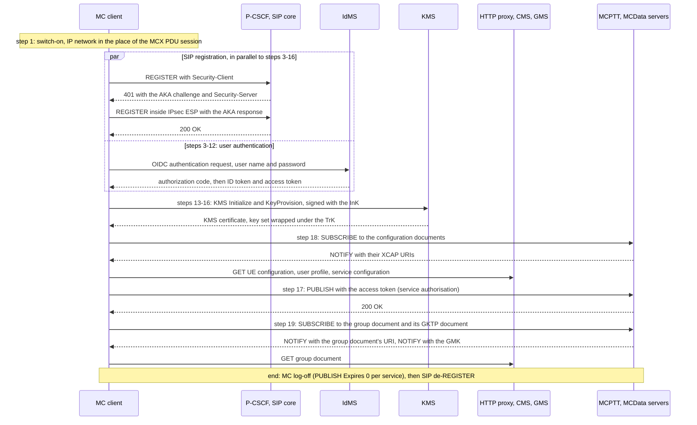

# Tutorial 10: OpenMCX UE conformance check

OpenMCX's own MC clients go through test 5.1 of
[TS 37.579-2 V18.1.0](https://www.etsi.org/deliver/etsi_ts/137500_137599/13757902/18.01.00_60/ts_13757902v180100p.pdf)
("Configuration / Authentication / User Authorisation / UE Configuration / User Profile / Key Generation"). The test
runs on an IP network instead of a 5G or 4G radio, and an OpenMCX system plays the part of the test system. It covers
everything from switching the client on until it is ready for service, followed by the MC log-off. The client under
test signs in at the IdMS, registers with **IMS AKA** through a **P-CSCF** with its SIP inside **IPsec ESP**, gets its
keys from the **KMS** (signed exchange, keys wrapped under a **TrK**), is authorised for MCPTT and MCData, and gets its
configuration and group documents and the group key through the **home HTTP proxy**.

**Contents**

- [What you need](#what-you-need)
- [Make the configuration](#1-make-the-configuration)
- [Start the system](#2-start-the-system)
- [Run the test steps](#3-run-the-test-steps)
- [Look at the captures](#4-look-at-the-captures)
- [Stop or start over](#5-stop-or-start-over)
- [The OpenMCX MC Client (Android)](#6-the-openmcx-mc-client-android)
- [Results and learnings](#results-and-learnings)
- [Call flow, frame by frame](CALL_FLOW.md)

<p align="center"></p>
<p align="center"><b>Figure 1: The two clients under test and the OpenMCX system in the place of the test system. Legend in the figure.</b></p>

| Client under test | Steps | Status |
|---|---|---|
| the **OpenMCX MC Client (Linux)**, `mc-client`: a terminal without 3GPP access, its IM credentials in software | [1&nbsp;to&nbsp;5](#1-make-the-configuration) | passes every step of test 5.1 |
| the **OpenMCX MC Client (Android)** on a phone over Wi-Fi, IMS AKA on its ISIM card | [6](#6-the-openmcx-mc-client-android) | the steps of the test run on a phone, not yet against the test system ([Table 5](#what-each-client-is-ready-for)) |

<p align="center"><b>Table 1: The clients under test.</b></p>

OpenMCX is not a validated test system, so a passing run is a self-check of the clients, not a conformance verdict.

## What you need

- **A Linux computer** with Docker and Docker Compose v2 (2.24 or later), about 4 CPU cores free.
- **IPsec in the kernel** (`xfrm_user`, `esp4`, `authenc`, `gcm`, loaded on common distributions; else
  `sudo modprobe -a xfrm_user esp4 authenc gcm`).
- OpenMCX's **`develop` images** from Docker Hub. Nothing needs to be built, and no port is published on the computer:
  all services run on the tutorial's own Docker network `172.31.109.0/24`.

## 1. Make the configuration

```bash
cd tutorials/end-to-end/10-openmcx-ue-conformance-check
docker compose run --rm setup
```

The setup runs OpenMCX's lab generator with the flags at the top of `docker-compose.yaml` and writes `./config`. These
flags give the MC client `mc-client` (user `mc-client@mcx.test`): an IMS AKA subscription and the P-CSCF as its first hop
(`--aka-role`), the home HTTP proxy in forward mode (`--http-proxy-mode forward`), MIKEY-SAKKE keys and the group's GMK
(`--protected`), a TrK and an InK (`--transport-keys`), documents fetched after their NOTIFY (`--documents-on-notify`),
the group `operations` and the location configuration. `client-a` to `client-c` are other users of the system; they register with SIP
digest and take no part in the test. The generated certificates are valid for 30 days.

## 2. Start the system

```bash
MCX_LOG=debug docker compose up -d --wait
```

All services report `(healthy)` after about a minute; `mc-client` does so once it has signed in, registered and been
authorised. `MCX_LOG=debug` is optional. It makes the services log the SIP messages, the HTTP proxy's request lines and
the client's IPsec keys, which Wireshark needs to decrypt the client's SIP. **Treat these logs as secret.**

## 3. Run the test steps

```bash
./run.sh
```

The client starts with its initial UE configuration (TS 37.579-1 table 5.3.2.3.1-1 step 1a), its user name and its
password already configured. `run.sh` reads the client's status file and reports each step of test 5.1 as the client
completes it. Figure 2 shows the steps; every SIP request passes through the P-CSCF and the SIP core. The
[call flow](CALL_FLOW.md) lists every message with its frame number in the capture.



<p align="center"><b>Figure 2: Test 5.1 at a glance, as the MC client runs it.</b></p>

| 5.1 step | What the MC client does |
|---|---|
| 1 | IP network in the place of the MCX PDU session (no 5GS or EPS) |
| in parallel | SIP registration with IMS AKA through the P-CSCF (AKAv2-SHA-256); IPsec ESP with AES-128-GCM; its reg event subscription |
| 3-12 | OIDC sign-in at the IdMS (directly, not through the proxy) |
| 13-16 | KMS Initialize and KeyProvision: requests signed with the InK, key set wrapped under the TrK |
| 17 | PUBLISH to the MCPTT and MCData servers with the access token: service authorisation |
| 18 | One SUBSCRIBE for the UE configuration, user profile and service configuration; NOTIFY; the GETs through the proxy |
| 19 | SUBSCRIBE to the group document and its GKTP document; NOTIFY; the GET; the GMK |
| end | MC log-off (PUBLISH with Expires 0 per service), then SIP de-REGISTER |

<p align="center"><b>Table 2: The steps of test 5.1 and what the MC client does in each.</b></p>

`run.sh` writes the capture `captures/run-ue-conformance.pcap.gz`, the client's status before the log-off
(`run-ue-conformance.status.json`) and, with `MCX_LOG=debug`, the IPsec keys (`run-ue-conformance.esp_sa`). To run the
test again, start over (step 5).

This tutorial departs from the test in three points: there is no 5GS or EPS, the SIP core offers AKAv2-SHA-256 before
AKAv1-MD5, and the client reaches the KMS directly instead of through the HTTP proxy. Details: [call flow,
Gaps](CALL_FLOW.md#gaps).

## 4. Look at the captures

| Capture | Client | ESP keys |
|---|---|---|
| [`captures/linux-ue-conformance.pcap`](captures/linux-ue-conformance.pcap) | the OpenMCX MC Client (Linux) through test 5.1 | [`linux-ue-conformance.esp_sa`](captures/linux-ue-conformance.esp_sa) |
| [`captures/android-ue-conformance.pcap`](captures/android-ue-conformance.pcap) | the OpenMCX MC Client (Android) on a phone: IMS AKA, a call, SDS, a reregistration, log-off | [`android-ue-conformance.esp_sa`](captures/android-ue-conformance.esp_sa) |

<p align="center"><b>Table 3: The reference captures and their ESP keys.</b></p>

To read the SIP inside ESP, copy the `.esp_sa` file to `~/.config/wireshark/esp_sa` (or import it in **Edit →
Preferences → Protocols → ESP → ESP SAs**) and tick **Attempt to detect/decode encrypted ESP payloads**. The keys,
tokens and certificates in these captures belong to throwaway lab systems. Keep a capture of your own system, and its
keys, secret.

| Display filter | Shows |
|---|---|
| <code>sip&nbsp;&amp;&amp;&nbsp;!esp</code> | the unprotected initial REGISTER with Security-Client, and the 401 with the AKA challenge and Security-Server |
| <code>esp&nbsp;&amp;&amp;&nbsp;sip</code> | the client's SIP inside ESP: protected REGISTER, PUBLISH, SUBSCRIBE, NOTIFY, MESSAGE (and INVITE in the Android capture) |
| <code>tls.handshake.type&nbsp;==&nbsp;1</code> | the client's TLS connections: IdMS, KMS, HTTP proxy (the server name in each Client Hello) |

<p align="center"><b>Table 4: Wireshark display filters for the captures.</b></p>

Every frame of the Linux capture, step by step: [call flow](CALL_FLOW.md).

## 5. Stop or start over

```bash
docker compose down -v      # stop and delete the data
rm -rf config               # then start over at step 1
```

## 6. The OpenMCX MC Client (Android)

The OpenMCX MC Client (Android) registers with IMS AKA when the phone has a suitable card. The AKA runs on the card's
ISIM, so the app never sees the card's key. IMS AKA needs:

- **a card** with an ISIM (private user identity `<IMSI>@<domain>`, public user identity, home domain) and an access
  rule (ARA-M) that gives the app carrier privileges;
- **the card's subscription** in the SIP core: `tools/load-card-keys.py --card <ICCID> --default-impu <the MC user's
  identity>` loads it from a key file readable by its owner only. The card's own public user identity is barred; the
  registration binds the MC user's identity (TS 23.228 clauses 4.3.3.3, 4.3.3.4);
- **the offer**: the MCX Admin activation names the P-CSCF (`activation.ims_aka.pcscf`, host:port);
- **the P-CSCF on the computer's network** (ESP cannot pass a container network's NAT). It deletes every IPsec security
  association of that network at start-up: do not run it on a computer with its own IPsec VPN.

Without such a card the app registers with SIP digest over TLS on Wi-Fi, and does not register at all on mobile data.
Settings → Network and SIM shows which method the app chose and why:

<p align="center"></p>
<p align="center"><b>Figure 3: The OpenMCX MC Client (Android): Settings, Network and SIM (framed in red), registered with IMS AKA through the card.</b></p>

[The Android capture](captures/android-ue-conformance.pcap) ([ESP keys](captures/android-ue-conformance.esp_sa)) was recorded with such a phone (Android 16, a sysmoISIM-SJA5 card) on the system
of tutorial 1. It contains the registration, a private call, SDS both ways with a second phone that uses SIP digest, a
reregistration on new security associations after the network asked for a re-authentication, the MC log-off and the SIP
de-REGISTER.

## Results and learnings

### What each client is ready for

| 5.1 step | OpenMCX MC Client (Linux) | OpenMCX MC Client (Android) |
|---|---|---|
| 1, access | IP network instead of the MCX PDU session | Wi-Fi instead of the MCX PDU session |
| SIP registration, IMS AKA, IPsec | passes; every algorithm pair of TS 33.203 annex H | passes with the card, including the reregistration; AES-GMAC is not offered |
| 3-12, sign-in | passes | OIDC sign-in in the phone's browser; not yet run against the test system |
| 13-16, KMS | passes: signed, key set wrapped under the TrK | signed with the InK, key set wrapped under the TrK, through the home HTTP proxy; the TrK and InK come with the provisioning file and stay in the Android Keystore; checked on a phone |
| 17, service authorisation | passes | passes, as the test expects |
| 18, configuration documents | passes | one SUBSCRIBE, the documents read after its NOTIFY; checked on a phone |
| 19, group document and GMK | passes | group document SUBSCRIBE, read after its NOTIFY, and the GMK from the GKTP subscription to the GMS-URI; checked on a phone |
| MC log-off, de-REGISTER | passes | passes |

<p align="center"><b>Table 5: What each client is ready for, per step of test 5.1.</b></p>

The OpenMCX MC Client (Android) ran the steps of test 5.1 on a phone with the card (IMS AKA over Wi-Fi), on a system
with this tutorial's protections and the KMS reached through the home HTTP proxy, followed by a protected private call
and the MC log-off; it has not yet been run against the test system. Its transport keys came with its provisioning file
(the out-of-band distribution of TS 33.180 clause 5.3.2). It has no XML signalling protection, so it does
not start MCData where the system requires it (Known limitations).

### Own deviations

| Client | Deviation | Spec |
|---|---|---|
| OpenMCX MC Client (Android) | no AES-GMAC (Android's IPsec API has none, up to Android 17); the other pairs are offered | TS 33.210 clause 5.3.4 "AES-GMAC with AES-128 shall be supported", via TS 33.203 clause 7.1 |
| OpenMCX MC Client (Linux) | none in the test's sequence (departures of the set-up: [call flow, Gaps](CALL_FLOW.md#gaps)) | |

<p align="center"><b>Table 6: Where the clients depart from the specifications.</b></p>

### Spec defects and gaps met

When a specification leaves a needed detail open, or two specifications contradict each other, OpenMCX keeps its
current behaviour and the defect is reported for correction. In some of these cases OpenMCX follows the ETSI test
system's interpretation instead; the last column of Table 7 says where. [Known
limitations](../../../docs/LIMITATIONS.md) quotes the exact text of each specification.

| Spec, clause | Gap | Where in test 5.1 | Effect, and what OpenMCX does |
|---|---|---|---|
| TS 24.229 clause 5.1.1.2.1 h) | **P-Access-Network-Info**: no value defined for plain IP or a VPN | registration | not sent, unless the option `sip.access_network_info` sets a value |
| TS 24.229 clause 5.1.1.2.1 c); RFC 3840 | **Media feature tags**: which tag, if any, for floor control and MSRP streams is not settled | registration | only the `audio` tag (and `video` for MCVideo) is sent |
| TS 37.579-5 table 9.2.1-1 | **IPsec algorithms**: hmac-md5-96 and des-ede3-cbc, removed from TS 33.203 annex H; no AES-GCM, AES-GMAC or HMAC-SHA-256 | registration | no effect: the test system's default, aes-cbc with hmac-sha-1-96, is among the pairs both clients offer |
| TS 37.579-2 clause 5.1.2 | **References**: TR 24.980 (informative) cited for the registration and IMS AKA instead of TS 24.229 and TS 33.203; TS 33.180 clause 6.2.1 quoted but not in the list | registration | no effect on the client (editorial) |
| TS 24.229 annex A vs RFC 3329 section 2.3.1 | **sec-agree in Proxy-Require**: "n/a" for most methods against the RFC's MUST | every request after the registration | Proxy-Require sec-agree is sent in INVITE and OPTIONS only; Require and Security-Verify go in every request |
| TS 37.579-5 table 9.2.2-1 | **TLS cipher suites**: TLS 1.2 RSA, PSK or NULL suites only (default TLS_RSA_WITH_NULL_SHA), against TS 33.210 clause 6.2 (TLS 1.3, AEAD and ECDHE only) | 3-12 and every HTTPS request | a UE that follows TS 33.210 supports none of the listed suites; OpenMCX refuses them |
| TS 37.579-1, TS 37.579-5 | **ID token key**: the test signs the ID token, but no PIXIT gives the key to verify it (OIDC Core 1.0 section 3.1.3.7 asks for the check) | 9-10 | the IdMS's public key has to be given to the client by other means |
| TS 33.180 annex F.2.1.1 (RFC 6507, RFC 6508); TS 37.579-1 table 5.5.4.10.8-1 | **UID form**: TS 33.180 V19.5.0 annex F.2.1.1 says "The full 256-bit output shall be used as the identifier within MIKEY-SAKKE (referred to as 'ID' in IETF RFC 6507 [9] and 'a' or 'b' within IETF RFC 6508 [10]. The resulting UID shall be base64 encoded." It does not say whether ECCSI and SAKKE take the 32 octets or their base64 text. TS 37.579-1 V18.1.0 table 5.5.4.10.8-1 inherits the gap: "the PVT is generated using the UID as contained in the UserID of the KSM message" | 13-16 (key set check), 17-19 (CSK, GMK) | The test suite uses the 32 octets. The KMS and the servers use the base64 text; the Linux and Android clients try both forms and use the one that validates the key set |
| TS 33.180 annexes D.2.2, D.3.1, D.3.5.3 | **Signature-ID, TrK-ID**: "shall be present" in signed messages, but typed xsd:string with no text form | 13-16 | OpenMCX neither sends nor reads them; the KeyName (the base64 XPK-ID) names the signing key |
| TS 33.180 annex D.3.5.1 | **Id attributes**: the signatures' References point to an Id typed xsd:string, not xsd:ID | 13-16 | OpenMCX resolves the Id as an ID, as the ETSI test suite does |
| TS 24.482 annex A.2.1.2 vs TS 33.180 clause 5.3.2 | **KMS behind the home HTTP proxy**: every request but the IdMS's through the proxy, against the KMS used without it; no item tells the UE which applies | 13-16 (test: through the proxy) | the clients reach the KMS directly; their option `security.kms_via_proxy` sends the requests through the proxy |
| TS 37.579-2 clause 5.1.2 | **Release baseline**: "Rel-14 requirements" while the test uses the Rel-19 KMS interface (TrK, InK, signed messages) | 13-16 | it is not said which TS 33.180 version the test follows |
| TS 33.180 clause 9.3.4.2 (RFC 3394); TS 37.579-1 table 5.5.4.10.8-1 | **Key wrap padding**: the AES-256 key wrap takes multiples of 8 octets, the RSK is 257 and the PVT 65 octets, and TS 33.180 names no padding or other wrap; TS 37.579-1 says "AES256" and states no padding either, while the ETSI test suite pads | 14 (key set) | A UE that does not pad exactly as the test suite does fails step 14. OpenMCX pads the same way (n - 1 zero octets, then one octet with the value n) before the RFC 3394 wrap; this is the test system's interpretation, not a 3GPP rule |
| TS 24.484 clause 6.3.13.2.2 b) 2) | **CMS subscription proxy PSI**: used for the configuration SUBSCRIBE, but no configuration item defines it | 18 | the clients send it to the MCPTT server's PSI; an option sets another one (Linux `cms.subscription_psi`, Android `mcptt.cms_subscription_psi`) |
| TS 24.484 clause 7.2.2.7 g) | **HTTP proxy tunnel authentication**: a certificate given without its private key, no PSK identity | 18, 19 (GETs through the proxy) | only the proxy is authenticated in the tunnel; a configuration that asks for mutual authentication is refused |
| TS 33.180 annex D.3.1 | **AES-128-GCM under the TrK**: "shall be supported" for an encrypted KmsResponse, the TrK has 256 bits, which 128-bit key is not said | (not used by the test) | not implemented; OpenMCX refuses such a response |

<p align="center"><b>Table 7: Defects and gaps met by test 5.1, in the 3GPP specifications (with the RFCs they use) and in the conformance test specifications (TS 37.579); a gap in both is one row; the rows follow the steps of test 5.1.</b></p>

