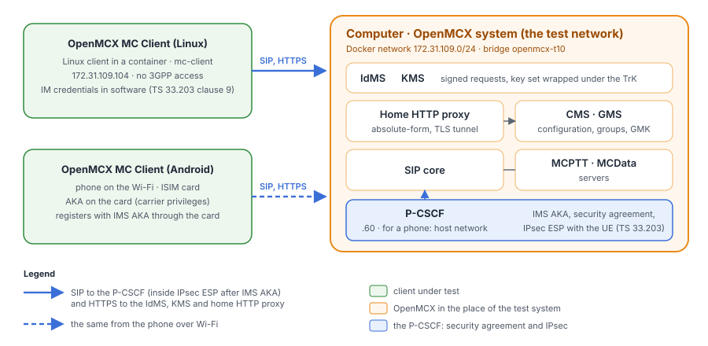
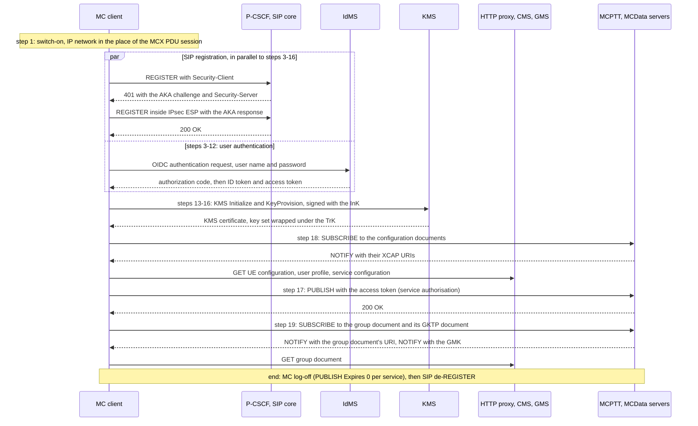
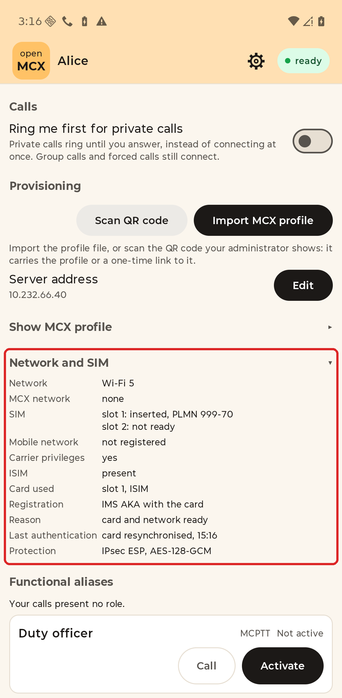
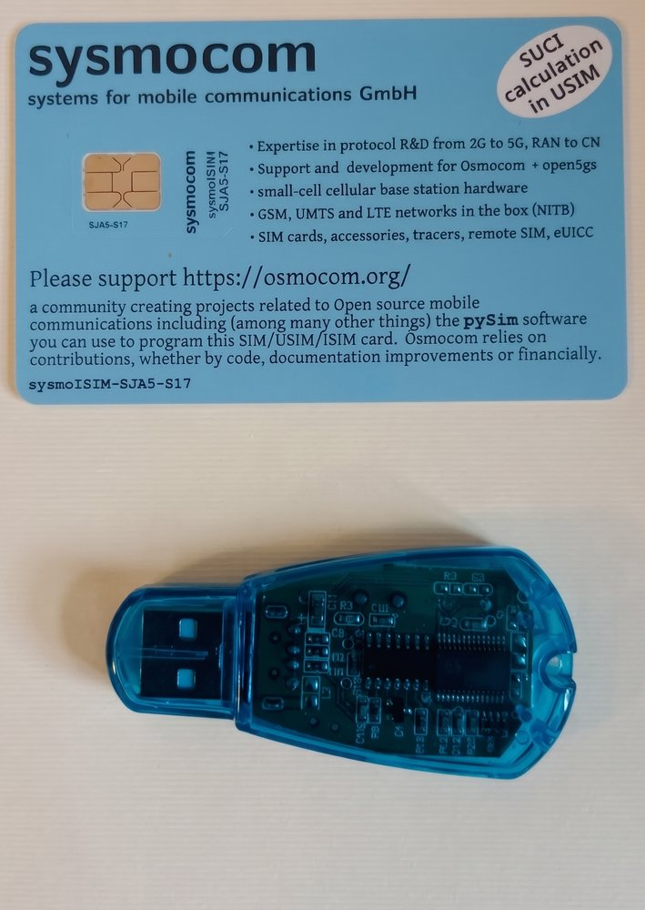

# Tutorial 10: OpenMCX UE conformance check

OpenMCX's own MC clients go through test 5.1 of
[TS 37.579-2 V18.1.0](https://www.etsi.org/deliver/etsi_ts/137500_137599/13757902/18.01.00_60/ts_13757902v180100p.pdf)
("Configuration / Authentication / User Authorisation / UE Configuration / User Profile / Key Generation"). The test
runs on an IP network instead of a 5G or 4G radio, and an OpenMCX system plays the part of the test system. It covers
everything from switching the client on until it is ready for service, followed by the MC log-off. The client under
test signs in at the IdMS, registers with **IMS AKA** through a **P-CSCF** with its SIP inside **IPsec ESP**, gets its
keys from the **KMS** (signed exchange, keys wrapped under a **TrK**), is authorised for MCPTT and MCData, and gets its
configuration and group documents and the group key through the **home HTTP proxy**.

**Contents**

- [What you need](#what-you-need)
- [Make the configuration](#1-make-the-configuration)
- [Start the system](#2-start-the-system)
- [Run the test steps](#3-run-the-test-steps)
- [Look at the captures](#4-look-at-the-captures)
- [Stop or start over](#5-stop-or-start-over)
- [The OpenMCX MC Client (Android)](#6-the-openmcx-mc-client-android)
- [Results and learnings](#results-and-learnings)
- [Call flow, frame by frame](CALL_FLOW.md)

<p align="center"></p>
<p align="center"><b>Figure 1: The two clients under test and the OpenMCX system in the place of the test system. Legend in the figure.</b></p>

| Client under test | Steps | Status |
|---|---|---|
| the **OpenMCX MC Client (Linux)**, `mc-client`: a terminal without 3GPP access that holds its IM credentials in software | [1&nbsp;to&nbsp;5](#1-make-the-configuration) | passes every step of test 5.1 |
| the **OpenMCX MC Client (Android)** on a phone over Wi-Fi, registering with IMS AKA from its ISIM card | [6](#6-the-openmcx-mc-client-android) | the steps of test 5.1 are checked on a phone, but not yet against the test system ([Table 3](#what-each-client-is-ready-for)) |

<p align="center"><b>Table 1: The clients under test.</b></p>

OpenMCX is not a validated test system, so a passing run is a self-check of the clients, not a conformance verdict.

## What you need

- **A Linux computer** with Docker and Docker Compose v2 (2.24 or later), about 4 CPU cores free.
- **IPsec in the kernel** (`xfrm_user`, `esp4`, `authenc`, `gcm`, loaded on common distributions; else
  `sudo modprobe -a xfrm_user esp4 authenc gcm`).
- OpenMCX's **`develop` images** from Docker Hub. Nothing needs to be built, and no port is published on the computer:
  all services run on the tutorial's own Docker network `172.31.109.0/24`.

## 1. Make the configuration

```bash
cd tutorials/end-to-end/10-openmcx-ue-conformance-check
docker compose run --rm setup
```

The setup runs OpenMCX's lab generator with the flags at the top of `docker-compose.yaml` and writes `./config`. These
flags give the MC client `mc-client` (user `mc-client@mcx.test`): an IMS AKA subscription and the P-CSCF as its first hop
(`--aka-role`), the home HTTP proxy in forward mode (`--http-proxy-mode forward`), MIKEY-SAKKE keys and the group's GMK
(`--protected`), a TrK and an InK (`--transport-keys`), documents fetched after their NOTIFY (`--documents-on-notify`),
the group `operations` and the location configuration. `client-a` to `client-c` are other users of the system; they register with SIP
digest and take no part in the test. The generated certificates are valid for 30 days.

## 2. Start the system

```bash
MCX_LOG=debug docker compose up -d --wait
```

All services report `(healthy)` after about a minute; `mc-client` does so once it has signed in, registered and been
authorised. `MCX_LOG=debug` is optional. It makes the services log the SIP messages, the HTTP proxy's request lines and
the client's IPsec keys, which Wireshark needs to decrypt the client's SIP. **Treat these logs as secret.**

## 3. Run the test steps

```bash
./run.sh
```

The client starts with its initial UE configuration (TS 37.579-1 table 5.3.2.3.1-1 step 1a), its user name and its
password already configured. `run.sh` reads the client's status file and reports each step of test 5.1 as the client
completes it. Figure 2 shows the steps; every SIP request passes through the P-CSCF and the SIP core. The
[call flow](CALL_FLOW.md) lists every message with its frame number in the capture.



<p align="center"><b>Figure 2: Test 5.1 at a glance, as the MC client runs it.</b></p>

| 5.1 step | What the MC client does |
|---|---|
| 1 | Uses an IP network instead of the MCX PDU session (no 5GS or EPS). |
| in parallel | Registers in SIP with IMS AKA (AKAv2-SHA-256) through the P-CSCF, protects its SIP with IPsec ESP (AES-128-GCM) and subscribes to its reg event. |
| 3-12 | Signs in with OIDC at the IdMS, directly and not through the proxy. |
| 13-16 | Sends the KMS Initialize and KeyProvision requests signed with the InK, and receives the key set wrapped under the TrK. |
| 17 | Sends a PUBLISH with the access token to the MCPTT and MCData servers for service authorisation. |
| 18 | Sends one SUBSCRIBE for the UE configuration, user profile and service configuration, receives the NOTIFY, and reads the documents with GETs through the proxy. |
| 19 | Subscribes to the group document and its GKTP document, receives the NOTIFYs, reads the group document with a GET and receives the GMK. |
| end | Sends the MC log-off (a PUBLISH with Expires 0 per service), then the SIP de-REGISTER. |

<p align="center"><b>Table 2: The steps of test 5.1 and what the MC client does in each.</b></p>

`run.sh` writes the capture `captures/run-ue-conformance.pcap.gz`, the client's status before the log-off
(`run-ue-conformance.status.json`) and, with `MCX_LOG=debug`, the IPsec keys (`run-ue-conformance.esp_sa`). To run the
test again, start over (step 5).

This tutorial departs from the test in three points: there is no 5GS or EPS, the SIP core offers AKAv2-SHA-256 before
AKAv1-MD5, and the client reaches the KMS directly instead of through the HTTP proxy. Details: [call flow,
Gaps](CALL_FLOW.md#gaps).

## 4. Look at the captures

| SIP in the clear (opens as it is) | As on the wire (ESP) | ESP keys |
|---|---|---|
| [`linux-ue-decrypted.pcapng`](captures/linux-ue-decrypted.pcapng) | [`linux-ue.pcap`](captures/linux-ue.pcap) | [`linux-ue.esp_sa`](captures/linux-ue.esp_sa) |
| [`android-ue-decrypted.pcapng`](captures/android-ue-decrypted.pcapng) | [`android-ue.pcap`](captures/android-ue.pcap) | [`android-ue.esp_sa`](captures/android-ue.esp_sa) |

The `-decrypted` captures open in any Wireshark: each ESP packet is replaced by the packet it carries, so the client's
SIP inside the IPsec security associations shows in the clear. Each replaced packet carries the packet comment
"ESP SPI 0x…, decrypted" (filter <code>frame.comment&nbsp;contains&nbsp;"ESP"</code>). Every other packet, every timestamp and every frame
number is the same as in the capture as on the wire. They were made with `tools/esp-decrypt-pcap.py` from the capture
and its ESP keys, which also works for a capture of your own run (`run-ue-conformance.pcap.gz`, after `gunzip`, with
`run-ue-conformance.esp_sa`; it needs Python with the `cryptography` package and Wireshark's `editcap`).

To read the capture as on the wire in Wireshark instead, copy its `.esp_sa` file to `~/.config/wireshark/esp_sa` (or
import it in **Edit → Preferences → Protocols → ESP → ESP SAs**) and tick **Attempt to detect/decode encrypted ESP
payloads**. The keys, tokens and certificates in these captures belong to throwaway lab systems. Keep a capture of your
own system, and its keys, secret.

The HTTPS traffic stays encrypted in both copies: the captures hold no TLS keys, and the `-decrypted` copies remove only
the IPsec layer.

Every frame of the Linux capture, step by step: [call flow](CALL_FLOW.md).

## 5. Stop or start over

```bash
docker compose down -v      # stop and delete the data
rm -rf config               # then start over at step 1
```

## 6. The OpenMCX MC Client (Android)

The OpenMCX MC Client (Android) registers with IMS AKA when the phone has a suitable card. The AKA runs on the card's
ISIM, so the app never sees the card's key. IMS AKA needs:

- **a card** with an ISIM (private user identity `<IMSI>@<domain>`, public user identity, home domain) and an access
  rule (ARA-M) that gives the app carrier privileges. This tutorial used a sysmocom sysmoISIM-SJA5 card, written with
  pySim through a USB PC/SC card reader;
- **the card's subscription** in the SIP core: `tools/load-card-keys.py --card <ICCID> --default-impu <the MC user's
  identity>` loads it from a key file readable by its owner only. The card's own public user identity is barred; the
  registration binds the MC user's identity (TS 23.228 clauses 4.3.3.3, 4.3.3.4);
- **the offer**: the MCX Admin activation names the P-CSCF (`activation.ims_aka.pcscf`, host:port);
- **the P-CSCF on the computer's network** (ESP cannot pass a container network's NAT). It deletes every IPsec security
  association of that network at start-up: do not run it on a computer with its own IPsec VPN.

Without such a card the app registers with SIP digest over TLS on Wi-Fi, and does not register at all on mobile data.
Settings → Network and SIM shows which method the app chose and why:

<table align="center"><tr>
<td align="center" valign="bottom"><br><b>Figure 3: The Android client: Network and SIM (in red), IMS AKA with the card.</b></td>
<td width="40"></td>
<td align="center" valign="bottom"><br><b>Figure 4: The sysmoISIM-SJA5 card and the USB card reader.</b></td>
</tr></table>

[The Android capture](captures/android-ue-decrypted.pcapng) ([as on the wire](captures/android-ue.pcap), [ESP keys](captures/android-ue.esp_sa)) was recorded with such a phone (Android 16, a sysmoISIM-SJA5 card) on the system
of tutorial 1. It contains the registration, a private call, SDS both ways with a second phone that uses SIP digest, a
reregistration on new security associations after the network asked for a re-authentication, the MC log-off and the SIP
de-REGISTER.

## Results and learnings

### What each client is ready for

| 5.1 step | OpenMCX MC Client (Linux) | OpenMCX MC Client (Android) |
|---|---|---|
| 1, access | IP network instead of the MCX PDU session | Wi-Fi instead of the MCX PDU session |
| SIP registration, IMS AKA, IPsec | passes; offers every algorithm pair of TS 33.203 annex H | passes with the ISIM card, including the reregistration; does not offer AES-GMAC ([Table 4](#own-deviations)) |
| 3-12, sign-in | passes | signs in with OIDC in the phone's browser; not yet run against the test system |
| 13-16, KMS | passes: signs its requests with the InK and receives the key set wrapped under the TrK | signs its requests with the InK and receives the key set wrapped under the TrK, through the home HTTP proxy; the TrK and InK arrive in the provisioning file and are kept in the Android Keystore; checked on a phone |
| 17, service authorisation | passes | passes, as the test expects |
| 18, configuration documents | passes | sends one SUBSCRIBE and reads the documents after its NOTIFY; checked on a phone |
| 19, group document and GMK | passes | subscribes to the group document and reads it after its NOTIFY, and receives the GMK through the GKTP subscription to the GMS-URI; checked on a phone |
| MC log-off, de-REGISTER | passes | passes |

<p align="center"><b>Table 3: What each client is ready for, per step of test 5.1.</b></p>

The OpenMCX MC Client (Android) ran the steps of test 5.1 on a phone with the card (IMS AKA over Wi-Fi), on a system
with this tutorial's protections and the KMS reached through the home HTTP proxy, followed by a protected private call
and the MC log-off; it has not yet been run against the test system. Its transport keys came with its provisioning file
(the out-of-band distribution of TS 33.180 clause 5.3.2). It protects XML signalling and MCData as the Linux client
does; a run with XML confidentiality and integrity on passed the same steps. With the KMS reached through the proxy
each MC service user ID needs its own TrK: the system gave one to the MCPTT ID only, so the app started MCPTT and
showed why MCData and MCVideo stayed off.

### Own deviations

| Client | Deviation | Spec |
|---|---|---|
| OpenMCX MC Client (Android) | does not offer AES-GMAC, because Android's IPsec API has none (up to Android 17); it offers the other algorithm pairs | TS 33.210 clause 5.3.4 "AES-GMAC with AES-128 shall be supported", via TS 33.203 clause 7.1 |
| OpenMCX MC Client (Linux) | on 5GS, sends no P-Access-Network-Info, because the client cannot read the serving cell from the modem of the UE it runs in; on the IP network of this tutorial there is none to send ([call flow, gap G1](CALL_FLOW.md#gaps)) | TS 24.229 clause U.3.1.1: "The UE shall always include the P-Access-Network-Info header field where indicated in subclause 5.1." |
| OpenMCX MC Client (Linux), OpenMCX MC Client (Android) | no `application` media feature tag for the floor control or transmission control stream (`m=application`, RFC 3840 section 10); the Android client sends no tags at all; fix in preparation | TS 24.229 clause 5.1.1.2.1 c): the media feature tags "for all supported streaming media types" |

<p align="center"><b>Table 4: Where the clients depart from the specifications.</b></p>

### Spec candidate corrections and workarounds

When a specification leaves a needed detail open, or two specifications contradict each other, OpenMCX keeps its current
behaviour and the defect is reported for correction. In some of these cases OpenMCX follows the ETSI test system's
interpretation instead; the last column of Table 5 says where. Versions: TS 24.229 V19.7.0, TS 24.482 V19.1.0, TS 24.484
V19.6.0, TS 33.180 V19.5.0, TS 37.579-1 and -2 V18.1.0. [Known limitations](../../../docs/LIMITATIONS.md) quotes the
exact text of each specification.

| Specification, clause | The problem | Step of test 5.1 | What OpenMCX does |
|---|---|---|---|
| TS 24.229 clauses 5.1.1.2.1 c), 5.1.3.1 and 5.1.4.1; TS 37.579-1 tables 5.3.3.4-1, 5.5.2.5.1-1, 5.5.2.13-1 and the other Contact tables | **Media feature tags**: TS 24.229 requires "the media feature tags defined in RFC 3840 [62] and RFC 5688 [120] for all supported streaming media types". MCData's MSRP stream is `m=message`, and its tag `+sip.message` is defined in RFC 4569, which TS 24.229 does not cite. TS 37.579-1 lists `audio` (and `video` for MCVideo) but not `application`, although the floor control stream is `m=application`. For MCData it lists `text`, which is the tag of an `m=text` stream (real-time text), not of MSRP. | registration, INVITE | The OpenMCX MC Client (Linux) sends `audio` and, with MCVideo, `video`; the Android client sends no tags. Neither sends `application` yet ([Table 4](#own-deviations)) or `+sip.message`. |
| TS 37.579-5 table 9.2.1-1 | **IPsec algorithms**: The test system's IPsec algorithms include hmac-md5-96 and des-ede3-cbc, which TS 33.203 annex H no longer has, and none of the Rel-19 algorithms (AES-GCM, AES-GMAC, HMAC-SHA-256). | registration | No effect on the test. The OpenMCX MC clients (Linux and Android) never offer MD5 or 3DES, but both offer aes-cbc with hmac-sha-1-96, which is the test system's default. |
| TS 37.579-2 clause 5.1.2 | **References**: For the registration and IMS AKA the test cites TR 24.980, which is informative, instead of TS 24.229 and TS 33.203; it quotes TS 33.180 clause 6.2.1 but does not list TS 33.180 as a reference. | registration | No effect on the test; the defect is editorial. |
| RFC 3329 section 2.3.1; TS 24.229 annex A (clause A.1.1) | **sec-agree in Proxy-Require**: After the security agreement, RFC 3329 requires `sec-agree` in Require and Proxy-Require and a Security-Verify in every later request. TS 24.229 annex A marks Proxy-Require "n/a" for the UE in every method but REGISTER, INVITE and OPTIONS, and no text says why it is weaker than the RFC. | every request after the registration | The OpenMCX MC clients put `sec-agree` in Proxy-Require only in INVITE and OPTIONS requests. They put `sec-agree` in Require, and a Security-Verify header field, in every request except ACK, CANCEL and PRACK. |
| TS 37.579-5 table 9.2.2-1; TS 33.210 clause 6.2 | **TLS cipher suites**: The test system's TLS cipher suites are all TLS 1.2 suites that use RSA key exchange, PSK or NULL encryption (default TLS_RSA_WITH_NULL_SHA). TS 33.210 clause 6.2 allows only TLS 1.3 and AEAD suites with ECDHE, so a compliant UE accepts none of them. | 3-12, every HTTPS request | The OpenMCX MC clients refuse these suites, so the test system has to be set to a suite that TS 33.210 allows. |
| TS 37.579-1, TS 37.579-5; OIDC Core 1.0 section 3.1.3.7 | **ID token key**: The test system's IdMS signs the ID token, and OIDC Core requires the client to check that signature, but no PIXIT item gives the UE the IdMS's signing key. | 9-10 | The IdMS's public key has to be given to the OpenMCX MC client by other means before the test. |
| TS 33.180 annex F.2.1.1; TS 37.579-1 table 5.5.4.10.8-1 | **UID form**: The UID is the 256-bit output of a SHA-256 hash, used as the ECCSI and SAKKE identity, and "The resulting UID shall be base64 encoded". TS 33.180 does not say whether ECCSI and SAKKE take the 32 raw octets or the 44-character base64 text, and the two give different keys. TS 37.579-1 does not say either. | 13-16 (key set), 17-19 (CSK, GMK) | The ETSI test suite uses the 32 raw octets. The OpenMCX KMS and the OpenMCX MC servers use the base64 text. The OpenMCX MC clients check the received key set with both forms and use the form that validates. |
| TS 33.180 annexes D.2.2, D.3.1 and D.3.5.3 | **Signature-ID, TrK-ID**: In a signed KMS message "the Signature-ID field [...] shall be present and indicate either the InK-ID [...] or the TrK-ID". These IDs are 32-bit numbers, but the schema (D.3.5.3) types the field xsd:string and no clause says how the number is written (decimal, hex or base64). | 13-16 | The OpenMCX MC clients neither send nor read Signature-ID or TrK-ID; the signing key is named by the ds:KeyName, which clause 9.3.5 defines as the base64 XPK-ID. |
| TS 33.180 annex D.3.5.1 | **Id attributes**: Signed KMS messages point their signature at the document with a reference such as `URI="#xmldoc"` to `Id="xmldoc"`, but the schema types `Id` as xsd:string, not xsd:ID. XML Signature resolves such a reference only to an attribute of type ID. | 13-16 | The OpenMCX MC clients treat `Id` as an attribute of type ID, as the ETSI test suite does, so the signature can be checked. |
| TS 24.482 annex A.2.1.2; TS 33.180 clause 5.3.2 | **KMS behind the home HTTP proxy**: TS 24.482 sends every HTTP request except those to the IdMS through the home HTTP proxy, so the KMS requests go through it too; TS 33.180 lets the client reach the KMS without the proxy. No configuration item tells the UE which applies. | 13-16 (the test expects the proxy) | The OpenMCX MC clients send their KMS requests directly to the KMS by default. With the option `security.kms_via_proxy` they send them through the proxy, and then each MC service user ID needs its own TrK. |
| TS 37.579-2 clause 5.1.2 | **Release baseline**: The test says "Unless otherwise stated, these are Rel-14 requirements", but steps 13-16 use the Rel-19 KMS interface (TrK, InK, signed messages). | 13-16 | No effect on the client, but the test does not say which TS 33.180 version it follows. |
| TS 33.180 clause 9.3.4.2 (RFC 3394); TS 37.579-1 table 5.5.4.10.8-1 | **Key wrap padding**: Key material is wrapped with "The AES-256 key wrap algorithm as defined in RFC 3394", which takes only multiples of 8 octets. The SAKKE RSK has 257 octets and the ECCSI PVT has 65. Neither spec names a padding; the ETSI test suite pads. | 14 (key set) | The OpenMCX KMS pads as the test suite does (n - 1 zero octets, then one octet with the value n) before the wrap, and the OpenMCX MC clients remove that padding after the unwrap. A UE that expects another padding fails step 14. |
| TS 24.484 clause 6.3.13.2.2 b) 2) | **CMS subscription proxy PSI**: The UE sends the configuration SUBSCRIBE to "the configured public service identity for performing subscription proxy function of the CMS". The CMS is configured with that PSI, but no UE configuration document carries it. | 18 | The OpenMCX MC clients send the SUBSCRIBE to the MCPTT server's PSI. An option sets another PSI (Linux `cms.subscription_psi`, Android `mcptt.cms_subscription_psi`). |
| TS 24.484 clause 7.2.2.7 g) | **HTTP proxy tunnel authentication**: For mutual authentication in the HTTP proxy tunnel the UE configuration gives either an `<x509>` certificate without its private key, which the UE therefore cannot present, or a pre-shared `<key>` without a PSK identity. | 18, 19 (GETs through the proxy) | The OpenMCX MC clients authenticate only the proxy, and refuse a configuration that asks for mutual authentication. |
| TS 33.180 annex D.3.1 | **AES-128-GCM under the TrK**: For an encrypted KmsResponse "The AES-128-GCM algorithm [...] shall be supported", but the TrK is a 256-bit key and the text does not say which 128-bit key to use. | (not used by the test) | Not implemented: the OpenMCX MC clients refuse a KmsResponse encrypted this way. |

<p align="center"><b>Table 5: Candidate corrections met by test 5.1, in the 3GPP specifications (with the RFCs they use) and in the conformance test specifications (TS 37.579), and what OpenMCX does; a gap in both is one row; the rows follow the steps of test 5.1.</b></p>

