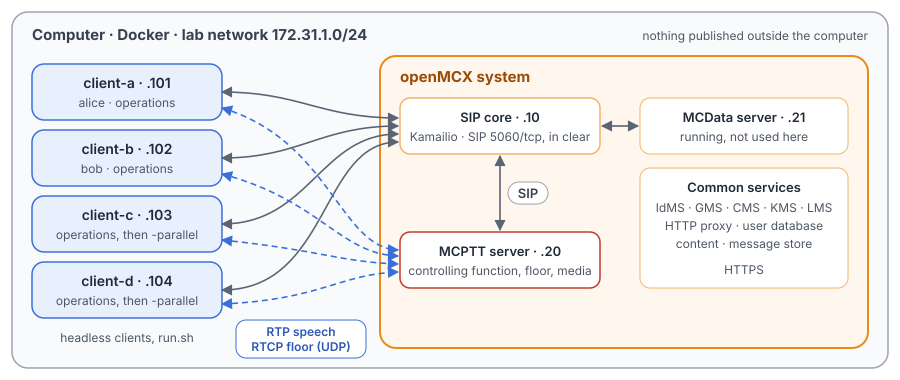
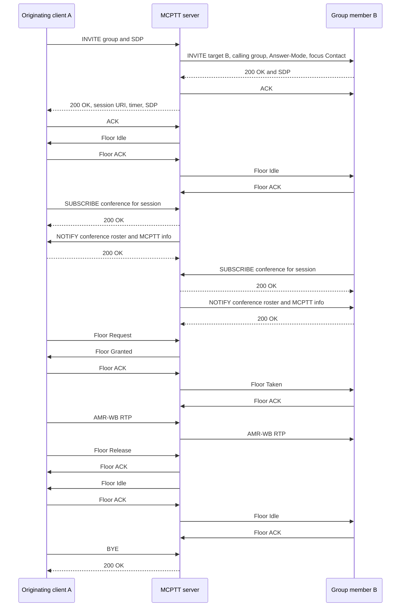

# Unit Test Tutorial 1: MCPTT prearranged group call with floor control and late entry

One computer runs the openMCX system from the published images, with four headless clients in place of phones.
A script takes them through the life of an on-network prearranged group call (TS 24.379 clause 10.1.1):

- a group call with floor control and speech;
- a member joining the running call (late entry);
- a member leaving and rejoining;
- the initiator ending the call for everyone;
- two groups in calls at the same time.

A capture of the lab network records every SIP message and every speech and floor control packet, so you can follow
the call in Wireshark.

This is the first of the unit test tutorials. Each one is built on a scenario of the openMCX regression tests, here
`tests/integration/prearranged_scenario.py`, and uses the same images.

> **SIP in clear, for learning.** The system runs in its debug mode: SIP goes over TCP without TLS (port 5060), so
> Wireshark shows every message, its SDP and its MCPTT XML. A real system uses TLS (tutorials 1 to 5). Speech and
> floor control are not encrypted in this tutorial in either mode. The HTTPS traffic to the common services
> (sign-in, configuration, keys) stays encrypted and is not captured.

<p align="center"></p>

## What you need

- A computer with Docker and Docker Compose v2 (Linux, or Docker Desktop on macOS or Windows) and a bash shell for
  `run.sh` (on Windows: WSL or Git Bash).
- No phones, no network set-up, nothing to compile: the tutorial uses the **prebuilt openMCX images from Docker Hub**
  (`openmcx/openmcx-*:v1`) and publishes no port; everything stays on the computer.
- [Wireshark](https://www.wireshark.org/) to look at the capture (optional: `run.sh` prints a summary).

## 1. Make the configuration

```bash
cd tutorials/01-group-call-basics
docker compose run --rm setup
```

The setup container runs the generator of the regression lab (`tools/prepare-prearranged-test.py --debug-sip`). It
writes `./config` with these parts:

- a new certificate authority with the servers' and clients' certificates;
- the users `alice` (client-a), `bob` (client-b), `client-c` and `client-d`;
- the groups `operations` (all four) and `operations-parallel` (client-c and client-d);
- the configuration of every server and client.

It runs once. To start over, see step 5. The certificates last 30 days.

## 2. Start the system

```bash
docker compose up -d --wait
```

After about half a minute `--wait` returns and every service is healthy, with the capture already running. The
clients have signed in, registered, been authorised for the service and affiliated to `operations`, and all of that
is in the capture.

| Address | Container |
|---|---|
| 172.31.1.10 | SIP core (Kamailio) |
| 172.31.1.20 | MCPTT server |
| 172.31.1.21 | MCData server (running, not used here) |
| 172.31.1.101 | client-a, user `alice` |
| 172.31.1.102 | client-b, user `bob` |
| 172.31.1.103 | client-c, user `client-c` |
| 172.31.1.104 | client-d, user `client-d` |

## 3. Run the steps

```bash
./run.sh
```

The script sends each command to a client and waits until the clients and the server show its result before going
on. It takes about half a minute:

```
1. Four clients signed in, registered and affiliated to the group operations
  ok: client-a to client-d authorized and affiliated
   client-c and client-d leave the group (they come back later)
  $ client-c: deaffiliate
  $ client-d: deaffiliate
  ok: client-c and client-d not affiliated

2. client-a calls the group: client-b, the only other affiliated member, joins
  $ client-a: call
  ok: client-a and client-b in the call
  ok: both see both in the conference roster
...
8. The capture: captures/01-group-call-run.pcap.gz
```

Each command is the same program the clients run, with `--command`. To type one yourself:

```bash
docker compose exec client-a mcx-client --config /config/client-a.json --command call
```

| Step | Command | What happens (TS 24.379) |
|---|---|---|
| 1 | `client-c: deaffiliate`, `client-d: deaffiliate` | They leave `operations` (clause 9.2): a call to the group does not invite them. |
| 2 | `client-a: call` | client-a starts the group call (10.1.1.2.1). The MCPTT server, as controlling function, invites the affiliated members, here only client-b. Both subscribe to the call's conference event package and receive the participant roster (6.3.3.4). |
| 3 | `client-a: ptt /speech/alpha.wav` | client-a asks for the floor, the server grants it and tells client-b who is talking (TS 24.380 clause 6.3). Speech goes through the server to client-b, then client-a releases the floor. |
| 4 | `client-c: affiliate` | client-c affiliates while the call is on, and the server invites it into the running call: late entry (10.1.1.4.6). |
| 5 | `client-b: hangup`, then `client-b: rejoin` | client-b leaves with BYE (10.1.1.2.3.1) while the call goes on, then rejoins the same session with an INVITE to the session URI (10.1.1.2.4.1, 10.1.1.4.5.1). |
| 6 | `client-a: hangup` | The initiator leaves; under the group's policy the server releases the call for everyone (6.3.8.1). |
| 7 | `client-c` and `client-d: group sip:operations-parallel@mcx.test`, `client-a: call`, `client-c: call`, then both `ptt` | Two groups, two calls, two independent floors at the same time. |

## 4. Look at the capture

`run.sh` copies the capture to `captures/01-group-call-run.pcap.gz`. The folder also holds a reference run,
`captures/01-group-call-full.pcap.gz` (154 KB, 3 245 frames): the frame numbers below and in the call flow are
those of the reference. Wireshark opens the compressed file directly (or `gunzip` it first).

The capture filter is `ip and not host 172.31.1.1 and (tcp port 5060 or (udp and not port 53) or icmp)`:

- SIP on 5060/tcp, with every TCP segment, so Wireshark rebuilds a message split over two segments;
- every UDP flow, since the speech and floor control ports come from the SDP and are not fixed;
- ICMP, which shows media sent to a closed port.

DNS, the encrypted HTTPS and the host's own traffic on the bridge (172.31.1.1) are left out.

Useful display filters:

| Filter | Shows |
|---|---|
| `sip` | Every SIP message. **Telephony → SIP Flows** draws them as a ladder. |
| `sip.Method == "INVITE" \|\| sip.CSeq.method == "INVITE"` | The calls: initial, late entry and rejoin. |
| `sdp` | The SDP offers and answers. |
| `rtcp.app.name == "MCPT"` | Floor control: Floor Request, Granted, Taken, Release, Idle and Ack (TS 24.380 clause 8.2). |
| `rtp` | Speech: AMR-WB. **Telephony → RTP → RTP Streams** lists six streams; select one and choose **Play Streams** to hear it (if your Wireshark build has the AMR codec). |
| `sip.Event contains "conference"` | The conference event package: SUBSCRIBE and the roster NOTIFYs. |

What to look for, in the reference run:

- **Registration and service authorisation** (frames 4 to 478): each client registers with the SIP core
  (REGISTER, `401` challenge, REGISTER, `200`). Then it subscribes to its configuration and affiliates (PUBLISH and
  SUBSCRIBE to `mcptt@mcx.test`); the SIP core challenges those with `407` first. The client's access token from the
  IdMS travels in SIP for service authorisation, so it is in the capture. In the reference run it comes from a
  throwaway system: its signing key and users no longer exist and the tokens expired after an hour. Treat a capture
  of your own system as secret.
- **The group call** (frames 479 to 575): client-a's INVITE to the MCPTT service (486) carries a multipart body.
  It has the SDP offer and the MCPTT XML with the group. In the SDP, `m=audio 4000 RTP/AVP 96` offers AMR-WB speech
  (`a=rtpmap:96 AMR-WB/16000/1`) with RTCP on 4001, and `m=application 5000 udp MCPTT` with
  `a=fmtp:MCPTT mc_floor_ssrc=…;mc_priority=0` offers floor control. The server's answer (508) gives 172.31.1.20 for
  both. The server invites client-b (493, 497) with `Answer-Mode: Auto`, so client-b answers at once.
  client-a gets no `180 Ringing`: the controlling function of a group call sends none (TS 24.379 clause 10.1.1.4.2),
  and answers `200` once client-b has. Its `200` carries `P-Asserted-Identity` (the MCPTT service) and the option
  tags `tdialog`, `norefersub`, `explicitsub` and `nosub` in `Supported` (clause 6.3.3.2.3.2).
- **Floor control and speech** (frames 571 to 1255): Floor Request (571), Floor Granted to client-a (572), Floor
  Taken to client-b (573), each confirmed with a Floor Ack. Then about 6.7 s of speech, 337 RTP packets each way
  through the server (client-a → server, server → client-b), and Floor Release (1250) and Floor Idle (1252, 1253).
- **Late entry** (frame 1273): the MCPTT server sends an INVITE to client-c on its own, just after client-c's
  affiliation. client-c did not call.
- **Leave and rejoin** (frames 1349 to 1408): client-b's BYE, then its INVITE to the session URI
  (`mcptt-session=…`, 1386 and 1393).
- **Release by the initiator** (from frame 1469): client-a's BYE (1469, challenged with `407`, again 1472),
  then the server's BYEs to client-b (1476, 1479) and client-c (1478, 1488) and the final conference NOTIFYs.
- **Two groups** (frames 1567 to 3233): two calls with different session URIs. Two floors are granted 0.1 s apart
  (1744, 1800) and four speech streams run at once, each only within its own group.

## 5. Stop or start over

```bash
docker compose down -v        # remove the containers and their data (status files, capture)
rm -rf config                 # with down -v: start over at step 1
```

To run the steps again on the same system, run `./run.sh` again: the capture keeps everything since `up`. For a new
capture, `docker compose down -v` and `docker compose up -d --wait` first (the configuration stays).

## Images

The compose file names every image in full, all from Docker Hub:

| Image | What it is |
|---|---|
| `docker.io/openmcx/openmcx-setup:v1` | The setup: the lab's generator |
| `docker.io/openmcx/openmcx-mcptt-server:v1`, `docker.io/openmcx/openmcx-mcdata-server:v1` | The MCPTT and MCData servers |
| `docker.io/openmcx/openmcx-common:v1`, `docker.io/openmcx/openmcx-http-proxy:v1`, `docker.io/openmcx/openmcx-user-db:v1` | The common services |
| `docker.io/openmcx/openmcx-client:v1` | The headless client (`openMCX/openmcx-client` repository) |
| `docker.io/openmcx/openmcx-kamailio:6.1.4-2` | The SIP core |
| `docker.io/library/mysql@sha256:…` | The SIP core's database |
| `docker.io/nicolaka/netshoot@sha256:…` | tcpdump, for the capture |

To use images you built yourself, change the `image:` lines in `docker-compose.yaml` (building them:
[docs/BUILD.md](../../../docs/BUILD.md)).

## When something does not work

- **A service stays unhealthy**: `docker compose logs <service>`.
- **A step of run.sh fails**: it prints the step that did not complete. `docker compose exec client-a cat
  /artifacts/client-a/status.json` shows a client's state, and `/artifacts/mcptt-server/status.json` the server's.
  Start over from a clean state with `docker compose down -v` and `docker compose up -d --wait`.
- **No capture, or `capture` exited**: `docker compose logs capture`. The capture container uses the host's network
  to reach the lab's bridge (`openmcx-ut01`), and the address range 172.31.1.0/24 must be free on the computer.
- **Certificates expired** (after 30 days): start over (step 5).

## How it is put together

- `docker-compose.yaml`: the regression lab of `prepare-prearranged-test.py --debug-sip`, written for the published
  images by `tools/tutorial-compose.py`. Each container has a fixed address, so the capture reads by role. The
  status files are in a volume, and the capture runs on the lab's bridge.
- `run.sh`: the steps of `tests/integration/prearranged_scenario.py`. The tutorial adds one step, speech in the
  first call (step 3).
- `speech/`: the two spoken test messages the clients transmit (16 kHz WAV, made with espeak-ng).
- `captures/01-group-call-full.pcap.gz`: the reference run, compressed.

## Call flow

The first call (steps 2 and 3), as in the regression's test report
([`tests/mcptt/PREARRANGED_TEST.md`](../../../tests/mcptt/PREARRANGED_TEST.md)). Registration, service authorisation
and affiliation come before it. Each SIP arrow passes through the SIP core. Authentication challenges and TCP
acknowledgements are left out; floor Acks are shown.



The same messages in the reference capture (A = client-a 172.31.1.101, S = MCPTT server 172.31.1.20, B = client-b
172.31.1.102, core = SIP core 172.31.1.10). A frame pair is the message on both legs, client to core and core to
server, or the other way:

| Message | Frames |
|---|---|
| A → S INVITE group and SDP | 486, 488 |
| S → B INVITE (target B, calling group, `Answer-Mode: Auto`) | 493, 497 |
| B → S 200 OK and SDP | 499, 501 |
| S → B ACK | 503, 504 |
| S → A 200 OK (session URI, SDP) | 505, 508 |
| A → S ACK | 512, 517 |
| S → B, S → A Floor Idle, and their Floor Acks | 507, 511; 518, 519 |
| B → S SUBSCRIBE conference, 200 OK, NOTIFY roster, 200 OK | 515, 522, 523, 527, 526, 530, 531, 532 |
| A → S SUBSCRIBE conference, 200 OK, NOTIFY roster, 200 OK | 537, 539, 541, 544, 542, 548, 551, 557 |
| A → S Floor Request; S → A Floor Granted; S → B Floor Taken; Acks | 571; 572; 573; 575, 574 |
| AMR-WB RTP, A → S and S → B | 576 onwards, until 1249 |
| A → S Floor Release; S → A Floor Ack; Floor Idle to A and B; Acks | 1250; 1251; 1252, 1253; 1255, 1254 |
| A → S BYE, 200 OK (after late entry and rejoin, step 6) | 1472, 1473; 1474, 1477 |

The conference subscription and the Floor Idle can come in another order than in the diagram, since they are
independent. In the capture, client-b subscribes before client-a.
