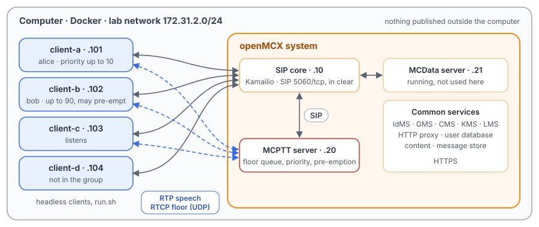
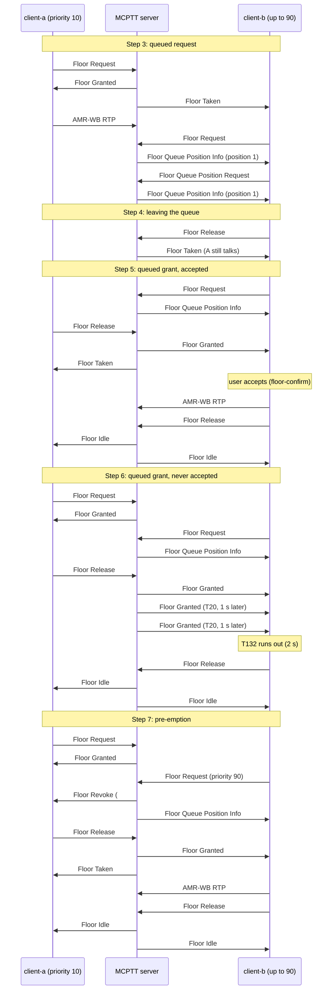

# Unit Test Tutorial 2: MCPTT floor control with queue, confirmation and pre-emption

One computer runs the openMCX system from the published images, with four headless clients in place of phones.
In a group call, a script takes them through MCPTT floor control (TS 24.380) beyond a plain request and grant:

- a request queued while someone else talks, and a question about its place in the queue;
- leaving the queue;
- a queued grant the user must accept before talking, and one the user never accepts;
- a higher-priority user taking the floor from the talker (pre-emption).

A capture of the lab network records every SIP message and every speech and floor control packet, so you can follow
each step in Wireshark.

The tutorial is built on two scenarios of the openMCX regression tests, `tests/integration/prearranged_floor_scenario.py`
and the floor part of `tests/integration/prearranged_priority_scenario.py`, and uses the same images.
[Unit Test Tutorial 1](../01-group-call-basics/README.md) explains the group call itself.

> **SIP in clear, for learning.** The system runs in its debug mode: SIP goes over TCP without TLS (port 5060), so
> Wireshark shows every message, its SDP and its MCPTT XML. A real system uses TLS (tutorials 1 to 5). Speech and
> floor control are not encrypted in this tutorial in either mode. The HTTPS traffic to the common services
> (sign-in, configuration, keys) stays encrypted and is not captured.

<p align="center"></p>

## What you need

- A computer with Docker and Docker Compose v2 (Linux, or Docker Desktop on macOS or Windows) and a bash shell for
  `run.sh` (on Windows: WSL or Git Bash).
- No phones, no network set-up, nothing to compile: the tutorial uses the **prebuilt openMCX images from Docker Hub**
  (`openmcx/openmcx-*:v1`) and publishes no port; everything stays on the computer.
- [Wireshark](https://www.wireshark.org/) to look at the capture (optional: `run.sh` prints a summary).

## 1. Make the configuration

```bash
cd tutorials/unit-tests/02-floor-queue-priority
docker compose run --rm setup
```

The setup container runs the generator of the regression lab
(`tools/prepare-prearranged-test.py --debug-sip --priority --floor-queue`). It writes `./config` with these parts:

- a new certificate authority with the servers' and clients' certificates;
- the users `alice` (client-a), `bob` (client-b), `client-c` and `client-d`, all in the group `operations`;
- floor queueing for the server and every client;
- floor priorities: client-b may ask for the floor at priority up to 90, the others up to 10, and every request is
  made at 10 unless the user chooses more;
- the group's pre-emption policy: a request at priority 75 or more pre-empts the talker, and only `bob` may make one.

It runs once. To start over, see step 5. The certificates last 30 days.

## 2. Start the system

```bash
docker compose up -d --wait
```

After about half a minute `--wait` returns and every service is healthy, with the capture already running.

| Address | Container |
|---|---|
| 172.31.2.10 | SIP core (Kamailio) |
| 172.31.2.20 | MCPTT server |
| 172.31.2.21 | MCData server (running, not used here) |
| 172.31.2.101 | client-a, user `alice` |
| 172.31.2.102 | client-b, user `bob` |
| 172.31.2.103 | client-c, user `client-c` |
| 172.31.2.104 | client-d, user `client-d` |

## 3. Run the steps

```bash
./run.sh
```

The script sends each command to a client and waits until the clients and the server show its result before going
on. It takes about half a minute:

```
3. client-a talks; client-b asks for the floor too and is queued at position 1
  $ client-a: ptt /tmp/hold.wav
  ok: client-a has the floor
  $ client-b: ptt /tmp/hold.wav
  ok: client-b queued at position 1, not talking
...
7. Pre-emption: client-a talks, client-b requests the floor at priority 90 and takes it over
  $ client-b: priority 90
  $ client-b: ptt /tmp/hold.wav
  ok: the server revokes client-a and grants client-b
...
9. The capture: captures/02-floor-queue-priority-run.pcap.gz
```

Each command is the same program the clients run, with `--command`. `ptt <file>` asks for the floor and, once it is
granted, sends the file as speech; `/tmp/hold.wav` is the client's test message repeated for 20 s, which `run.sh`
writes first, so that a talker keeps the floor while the others act. To type a command yourself:

```bash
docker compose exec client-b mcx-client --config /config/client-b.json --command queue-status
```

| Step | Command | What happens (TS 24.380) |
|---|---|---|
| 1 | `client-d: deaffiliate` | client-d leaves the group, so the call has three participants. |
| 2 | `client-a: call` | The group call starts (TS 24.379 clause 10.1.1). Each SDP negotiates queueing (`mc_queueing`, clause 14.2.2) and the highest priority the client may ask for (`mc_priority`, clause 14.2.3). |
| 3 | `client-a: ptt`, `client-b: ptt`, `client-b: queue-status` | client-a gets the floor. client-b asks too: instead of a Floor Deny, the server queues the request and answers Floor Queue Position Info, position 1 (clause 6.3.5.4.4); client-b is in 'U: queued' (clause 6.2.4.9). Asked again with Floor Queue Position Request, the server repeats the position (clauses 6.2.4.9.9, 6.3.5.4.7). |
| 4 | `client-b: release` | client-b leaves the queue with a Floor Release (clause 6.2.4.9.6). The server acknowledges it, removes the request and tells client-b who has the floor with a Floor Taken (clause 6.3.5.4.5). |
| 5 | `client-b: ptt`, `client-a: release`, `client-b: floor-confirm`, `client-b: release` | client-b queues again. When client-a releases, the server grants the floor to the first in the queue. A queued grant waits for its user: client-b talks only after `floor-confirm` (clause 6.2.4.9.12). |
| 6 | the same, without `floor-confirm` | The server repeats the Floor Granted every second until client-b's speech arrives or its counter C20 reaches its limit (T20, clauses 6.3.4.4.5, 6.3.4.4.9 and 6.3.4.4.10); a Floor Ack does not stop it. client-b acknowledges each but does not accept: after 2 s its own timer T132 runs out, and it gives the floor back with a Floor Release (clause 6.2.4.9.13). No speech is sent. |
| 7 | `client-a: ptt`, `client-b: priority 90`, `client-b: ptt` | client-b asks at priority 90, which the group treats as pre-emptive. The server revokes client-a with a Floor Revoke, cause #4 "Media Burst pre-empted" (clause 6.3.4.4.7), and queues client-b first. client-a stops and releases, and client-b gets the floor (and accepts it, as in step 5). |
| 8 | `client-a: hangup` | The initiator ends the call. |

## 4. Look at the capture

`run.sh` copies the capture to `captures/02-floor-queue-priority-run.pcap.gz`. The folder also holds a reference run,
`captures/02-floor-queue-priority-full.pcap.gz` (79 KB, 1 242 frames): the frame numbers below and in the call flow
are those of the reference. Wireshark opens the compressed file directly (or `gunzip` it first).

The capture filter is `ip and not host 172.31.2.1 and (tcp port 5060 or (udp and not port 53) or icmp)`:

- SIP on 5060/tcp, with every TCP segment, so Wireshark rebuilds a message split over two segments;
- every UDP flow, since the speech and floor control ports come from the SDP and are not fixed;
- ICMP, which shows media sent to a closed port.

DNS, the encrypted HTTPS and the host's own traffic on the bridge (172.31.2.1) are left out.

Useful display filters:

| Filter | Shows |
|---|---|
| `rtcp.app.name == "MCPT"` | Floor control (TS 24.380 clause 8.2). |
| `rtcp.app.name == "MCPT" && !(rtcp.app.subtype == 10)` | The same without the Floor Acks, the easiest way to follow the steps. |
| `sdp.fmtp.parameter contains "mc_"` | The SDP offers and answers with `mc_queueing` and `mc_priority`. |
| `rtp` | Speech: AMR-WB. **Telephony → RTP → RTP Streams** lists each talker's burst, to the server and from it to the others. |

Two things Wireshark 4.2 shows in a confusing way:

- **Floor Indicator "Unknown".** The server's floor messages carry the Floor Indicator `0x8400`: two bits at once, A
  "Normal call" and F "Queueing supported" (TS 24.380 clause 8.2.3.15). Wireshark names only single values.
- **The Floor Revoke's cause in the Info column.** The Info column takes the text from the Floor Deny causes and
  shows "Retry-after timer has not expired"; the packet details show the actual field, Reject Cause 4, "Media Burst
  pre-empted".

What to look for, in the reference run:

- **Negotiation** (frames 423 to 468): client-a's INVITE (430, after the SIP core's `407` challenge to 423) offers
  `a=fmtp:MCPTT mc_floor_ssrc=…;mc_priority=10;mc_queueing`. The server's INVITE to client-b (439) offers
  `mc_priority=90`, client-b's maximum, and client-b's answer (445) accepts it; client-c (449) gets 10.
- **Queued request** (frames 549 to 665): client-a's Floor Request (549), Floor Granted (550), Floor Taken to client-b
  and client-c (551, 552), client-a's speech from 556. client-b's Floor Request (595) is answered with Floor Queue
  Position Info (596), not with a Floor Deny. client-b's Floor Queue Position Request (664) gets a fresh one (665).
- **Leaving the queue** (frames 724 to 726): client-b's Floor Release (724), the server's Floor Ack (725) and Floor
  Taken (726).
- **Queued grant, accepted** (frames 779 to 903): client-b queues again (779, 780). client-a releases (833), and the
  server sends Floor Granted to client-b (835) and Floor Taken to client-a (836). client-b's speech starts at 841,
  after its user's `floor-confirm`. Its Floor Release (901) leaves the floor idle (Floor Idle from 903).
- **Queued grant, never accepted** (frames 909 to 1056): the server's Floor Granted to client-b (1044) is repeated at
  1050 and 1052, one second apart (T20), although client-b acknowledges each one. Exactly 2 s after the first, client-b sends Floor
  Release (1054): T132 has run out. No speech from client-b in between.
- **Pre-emption** (frames 1062 to 1176): client-a holds the floor (1062, 1063). client-b's Floor Request at priority 90
  (1126) makes the server send Floor Revoke to client-a (1127) and Floor Queue Position Info to client-b (1128).
  client-a releases (1130), client-b gets Floor Granted (1132) and talks from 1138.
- **End of the call** (frame 1182): client-a's BYE.

## 5. Stop or start over

```bash
docker compose down -v        # remove the containers and their data (status files, capture)
rm -rf config                 # with down -v: start over at step 1
```

To run the steps again on the same system, run `./run.sh` again: the capture keeps everything since `up`. For a new
capture, `docker compose down -v` and `docker compose up -d --wait` first (the configuration stays).

## Images

The compose file names every image in full, all from Docker Hub:

| Image | What it is |
|---|---|
| `docker.io/openmcx/openmcx-setup:v1` | The setup: the lab's generator |
| `docker.io/openmcx/openmcx-mcptt-server:v1`, `docker.io/openmcx/openmcx-mcdata-server:v1` | The MCPTT and MCData servers |
| `docker.io/openmcx/openmcx-common:v1`, `docker.io/openmcx/openmcx-http-proxy:v1`, `docker.io/openmcx/openmcx-user-db:v1` | The common services |
| `docker.io/openmcx/openmcx-client:v1` | The headless client (`openMCX/openmcx-client` repository) |
| `docker.io/openmcx/openmcx-kamailio:6.1.4-2` | The SIP core |
| `docker.io/library/mysql@sha256:…` | The SIP core's database |
| `docker.io/nicolaka/netshoot@sha256:…` | tcpdump, for the capture |

To use images you built yourself, change the `image:` lines in `docker-compose.yaml` (building them:
[docs/BUILD.md](../../../docs/BUILD.md)).

## When something does not work

- **A service stays unhealthy**: `docker compose logs <service>`.
- **A step of run.sh fails**: it prints the step that did not complete. `docker compose exec client-b cat
  /artifacts/client-b/status.json` shows a client's floor state (`floor_state`, `queue_position`,
  `pending_floor_confirmation`), and `/artifacts/mcptt-server/status.json` the server's (`floor_owner`). Start over
  from a clean state with `docker compose down -v` and `docker compose up -d --wait`.
- **No capture, or `capture` exited**: `docker compose logs capture`. The capture container uses the host's network
  to reach the lab's bridge (`openmcx-ut02`), and the address range 172.31.2.0/24 must be free on the computer.
- **Certificates expired** (after 30 days): start over (step 5).

## How it is put together

- `docker-compose.yaml`: the regression lab of `prepare-prearranged-test.py --debug-sip --priority --floor-queue`,
  written for the published images by `tools/tutorial-compose.py`. Each container has a fixed address, so the capture
  reads by role. The status files are in a volume, and the capture runs on the lab's bridge.
- `run.sh`: the steps of `tests/integration/prearranged_floor_scenario.py` (queue, query, cancellation, accepted and
  unaccepted grant) and the pre-emption of `tests/integration/prearranged_priority_scenario.py`. The tutorial keeps
  client-c in the call as a listener; the emergency and imminent peril parts of the priority scenario are left to a
  later tutorial.
- `speech/`: the two spoken test messages the clients transmit (16 kHz WAV, made with espeak-ng).
- `captures/02-floor-queue-priority-full.pcap.gz`: the reference run.

## Call flow

The floor control of steps 3 to 7, drawn from the reference capture (the regression's test reports have no diagram
for it). A = client-a, B = client-b, S = MCPTT server; client-c gets a Floor Taken or Floor Idle whenever B or A
does and is left out, as are the Floor Acks and the speech packets.



| Message | Frames |
|---|---|
| Step 3: A Floor Request; Floor Granted; Floor Taken to B and C | 549; 550; 551, 552 |
| Step 3: B Floor Request; Floor Queue Position Info; Floor Queue Position Request; Floor Queue Position Info | 595; 596; 664; 665 |
| Step 4: B Floor Release; Floor Ack; Floor Taken | 724; 725; 726 |
| Step 5: B Floor Request; Floor Queue Position Info; A Floor Release; Floor Granted to B; Floor Taken to A | 779; 780; 833; 835; 836 |
| Step 5: B's speech; B Floor Release; Floor Idle | from 841; 901; from 903 |
| Step 6: A Floor Request; Floor Granted; B Floor Request; Floor Queue Position Info; A Floor Release | 909; 910; 982; 983; 1042 |
| Step 6: Floor Granted to B, three times; B Floor Release; Floor Idle | 1044, 1050, 1052; 1054; from 1056 |
| Step 7: A Floor Request; Floor Granted; B Floor Request; Floor Revoke to A; Floor Queue Position Info to B | 1062; 1063; 1126; 1127; 1128 |
| Step 7: A Floor Release; Floor Granted to B; Floor Taken to A; B's speech; B Floor Release; Floor Idle | 1130; 1132; 1133; from 1138; 1174; from 1176 |
