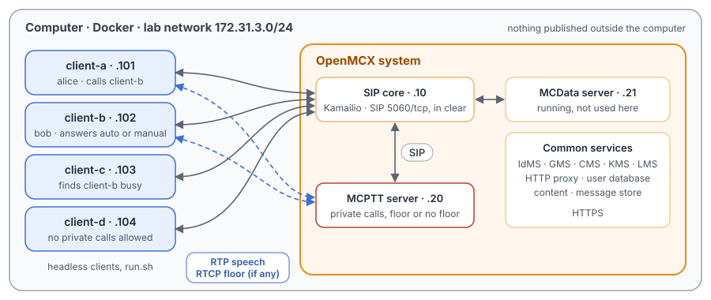
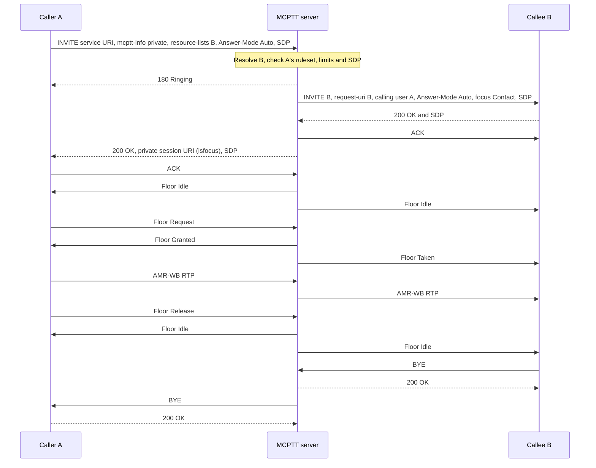
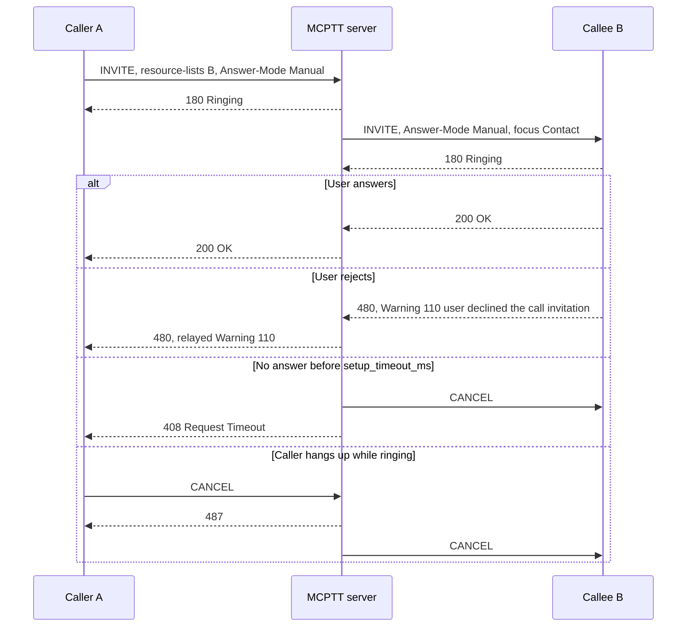

# Unit Test Tutorial 3: MCPTT private calls with and without floor control, answer modes

One computer runs the openMCX system from the published images, with four headless clients in place of phones.
A script takes them through on-network private calls between two users (TS 24.379 clause 11.1):

- automatic and manual commencement: answered at once, answered by the user, declined, cancelled by the caller, and
  not answered at all;
- a forced automatic answer;
- calls the server refuses (not authorised, busy);
- a private call **with** floor control, where one user talks at a time, and one **without** floor control, where
  both talk at once.

A capture of the lab network records every SIP message and every speech and floor control packet, so you can follow
each call in Wireshark and compare the two kinds of private call.

The tutorial is built on two scenarios of the openMCX regression tests, `tests/integration/private_call_scenario.py`
and `tests/integration/private_no_floor_scenario.py`, and uses the same images.
[Unit Test Tutorial 2](../02-floor-queue-priority/README.md) explains floor control in more depth.

> **SIP in clear, for learning.** The system runs in its debug mode: SIP goes over TCP without TLS (port 5060), so
> Wireshark shows every message, its SDP and its MCPTT XML. A real system uses TLS (tutorials 1 to 5). Speech and
> floor control are not encrypted in this tutorial in either mode. The HTTPS traffic to the common services
> (sign-in, configuration, keys) stays encrypted and is not captured.

<p align="center"></p>

## With and without floor control

| | With floor control (TS 24.379 clause 11.1.1) | Without floor control (TS 24.379 clause 11.1.2) |
|---|---|---|
| SDP offer and answer | `m=audio … RTP/AVP 96` and `m=application 5000 udp MCPTT`, the media-floor control entity with its `a=fmtp:MCPTT …` | only `m=audio … RTP/AVP 96`: the caller does not offer a media-floor control entity (clause 11.1.2.2), and that is what makes the call one without floor control |
| Floor control (RTCP APP "MCPT") | Floor Idle, Request, Granted, Taken, Deny, Release (TS 24.380) | none |
| Speech | one talker at a time; a second request is denied while someone talks | both directions at once, each user sends whenever they like |

## What you need

- A computer with Docker and Docker Compose v2 (Linux, or Docker Desktop on macOS or Windows) and a bash shell for
  `run.sh` (on Windows: WSL or Git Bash).
- No phones, no network set-up, nothing to compile: the tutorial uses the **prebuilt openMCX images from Docker Hub**
  (`openmcx/openmcx-*:v1`) and publishes no port; everything stays on the computer.
- [Wireshark](https://www.wireshark.org/) to look at the capture (optional: `run.sh` prints a summary).

## 1. Make the configuration

```bash
cd tutorials/unit-tests/03-private-calls
docker compose run --rm setup
```

The setup container runs the generator of the regression lab (`tools/prepare-prearranged-test.py --debug-sip
--private-call`). It writes `./config` with these parts:

- a new certificate authority with the servers' and clients' certificates;
- the users `alice` (client-a), `bob` (client-b), `client-c` and `client-d`;
- a private call ruleset for each user (TS 24.484): `alice` may call `bob` and `client-c` in any commencement mode and
  may force an automatic answer; `bob` may call anyone; `client-c` may call anyone automatically; `client-d` may
  neither make nor receive private calls;
- the MCPTT server's private call settings: one private call per user at a time, 5 s for the callee to answer, and a
  private call timer of 30 s (the calls in this tutorial are shorter).

It runs once. To start over, see step 5. The certificates last 30 days.

## 2. Start the system

```bash
docker compose up -d --wait
```

After about half a minute `--wait` returns and every service is healthy, with the capture already running.

| Address | Container |
|---|---|
| 172.31.3.10 | SIP core (Kamailio) |
| 172.31.3.20 | MCPTT server |
| 172.31.3.21 | MCData server (running, not used here) |
| 172.31.3.101 | client-a, user `alice` |
| 172.31.3.102 | client-b, user `bob` |
| 172.31.3.103 | client-c, user `client-c` |
| 172.31.3.104 | client-d, user `client-d` |

## 3. Run the steps

```bash
./run.sh
```

The script sends each command to a client and waits until the clients and the server show its result before going
on. It takes about a minute:

```
2. Automatic commencement: client-a calls client-b, which answers at once; they take turns to talk
  $ client-a: private sip:bob.mcptt@mcx.test auto
  ok: client-a and client-b in a private call, nobody else
  $ client-a: ptt /speech/alpha.wav
  ok: client-a has the floor
  $ client-b: ptt /speech/bravo.wav
  ok: client-b asks too while client-a talks: denied
...
10. A private call without floor control: both talk at once
  $ client-a: private sip:bob.mcptt@mcx.test auto no-floor
  ok: client-a and client-b in a private call, neither with floor control
...
11. The capture: captures/03-private-calls-run.pcap.gz
```

Each command is the same program the clients run, with `--command`. To type one yourself:

```bash
docker compose exec client-a mcx-client --config /config/client-a.json --command "private sip:bob.mcptt@mcx.test manual"
```

| Step | Command | What happens (TS 24.379 unless noted) |
|---|---|---|
| 1 | `answer-mode auto` on every client | Each client answers incoming private calls automatically (clause 6.2.3.2). |
| 2 | `client-a: private <bob> auto`, both `ptt`, `client-b: hangup` | Automatic commencement (clause 11.1.1.2.1.1): the INVITE to the MCPTT service carries `Answer-Mode: Auto` and names `bob` in a resource list; the server, as controlling function, invites `bob` (clause 11.1.1.4.1), who answers at once. Only these two are in the call. client-a talks; client-b's request while client-a talks is answered with a Floor Deny (TS 24.380 clause 6.3.5.4.4); then client-b talks. client-b's BYE ends the call for both. |
| 3 | `client-a: private <bob> manual`, `client-b: answer` | Manual commencement: `Answer-Mode: Manual`, so client-b rings (180 Ringing) and answers when its user accepts (clause 11.1.1.2.1.2). |
| 4 | `client-a: private <bob> manual`, `client-b: reject` | client-b declines with 480 and Warning 110 "user declined the call invitation", which the server relays to client-a (table 4.4.2-2). |
| 5 | `client-b: answer-mode manual`, `client-a: private <bob> force-auto` | client-b now answers manually, but client-a may force an automatic answer: the INVITE carries `Priv-Answer-Mode: Auto` instead of `Answer-Mode`, and client-b answers without ringing. |
| 6 | `client-a: private <bob> auto`, `client-a: hangup` | client-a asks for an automatic answer, but client-b's own setting is manual, so it rings. client-a gives up: CANCEL, 487 Request Terminated, and the server cancels client-b's invitation. |
| 7 | `client-a: private <bob> manual`, no answer | Nobody answers within the server's 5 s: client-a gets 408 Request Timeout and the server cancels client-b's invitation. |
| 8 | `client-d: private <alice> auto`, `client-a: private <client-d> auto` | The server checks each caller's ruleset before inviting anyone: client-d may not make private calls (403, Warning 107), and client-a may not call client-d (403, Warning 144). |
| 9 | `client-a: private <bob> auto`, `client-c: private <bob> auto` | client-b is already in a private call and may be in one at a time: client-c gets 486 Busy Here, and client-b is not disturbed. |
| 10 | `client-a: private <bob> auto no-floor`, both `ptt`, `client-b: hangup` | A private call without floor control (clause 11.1.2): no media-floor control entity in the SDP, no floor messages, and both users talk at the same time. |

## 4. Look at the capture

`run.sh` copies the capture to `captures/03-private-calls-run.pcap.gz`. The folder also holds a reference run,
`captures/03-private-calls-full.pcap.gz` (148 KB, 3 698 frames): the frame numbers below and in the call flow are
those of the reference. Wireshark opens the compressed file directly (or `gunzip` it first).

The capture filter is `ip and not host 172.31.3.1 and (tcp port 5060 or (udp and not port 53) or icmp)`:

- SIP on 5060/tcp, with every TCP segment, so Wireshark rebuilds a message split over two segments;
- every UDP flow, since the speech and floor control ports come from the SDP and are not fixed;
- ICMP, which shows media sent to a closed port.

DNS, the encrypted HTTPS and the host's own traffic on the bridge (172.31.3.1) are left out.

Useful display filters:

| Filter | Shows |
|---|---|
| `sip.Method == "INVITE" \|\| sip.Method == "CANCEL" \|\| sip.Method == "BYE" \|\| sip.Status-Code >= 300` | The calls and how each one ended. **Telephony → SIP Flows** draws them as ladders. |
| `sip.Warning` | The responses with an MCPTT warning text (110, 107, 144). |
| `sdp.media contains "MCPTT"` | The SDP with a media-floor control entity; compare with the offer of step 10, which has none. |
| `rtcp.app.name == "MCPT"` | Floor control (TS 24.380 clause 8.2). There is none in step 10. |
| `rtp` | Speech: AMR-WB. **Telephony → RTP → RTP Streams** lists eight streams, two per burst. |

Wireshark 4.2 shows the Floor Deny's Reject Cause only as a number, `1`: it is cause #1, "Another MCPTT client has
permission" (TS 24.380 clause 8.2.6.2).

What to look for, in the reference run:

- **Automatic commencement** (frames 417 to 451): client-a's INVITE (424, after the SIP core's `407` challenge to
  417) has `Answer-Mode: Auto`, an `application/resource-lists+xml` body naming `bob`, the MCPTT XML with
  `<session-type>private</session-type>`, and an SDP with `m=audio` and `m=application 5000 udp MCPTT`. The server
  sends 180 Ringing (428), invites client-b (430, 434), and answers client-a's INVITE with 200 OK (448) once client-b
  has answered (436). Floor Idle goes to both (443, 451). There is no conference subscription: a private call has
  none.
- **Floor control** (frames 457 to 1860): client-a's Floor Request (457), Floor Granted (458), Floor Taken to client-b
  (459), speech from 462. client-b's Floor Request (500) gets a Floor Deny (501). client-a's Floor Release (1139),
  client-b's Floor Request (1145) and Floor Granted (1146), its Floor Release (1860).
- **Release by the callee** (frames 1866 to 1876): client-b's BYE (1866), and the server's BYE to client-a (1876).
- **Manual commencement** (frames 1883 to 1928): the INVITE has `Answer-Mode: Manual` (1889); client-b's 180 Ringing
  (1901) and its 200 OK when the user answers (1908).
- **Declined** (frames 1946 to 1981): client-b's 480 with `Warning: 399 mcx "110 user declined the call invitation"`
  (1972), relayed to client-a (1981).
- **Forced automatic answer** (frames 1988 to 2004): the INVITE has `Priv-Answer-Mode: Auto` (1994, 2002), and client-b
  answers 200 OK (2004) without a 180 Ringing.
- **Cancelled** (frames 2045 to 2084): client-b rings (2064); client-a's CANCEL (2071), the CANCEL to client-b (2080)
  and 487 to client-a (2084).
- **Not answered** (frames 2099 to 2130): client-b rings (2115); 5 s later the server answers client-a 408 (2124,
  2128) and cancels client-b's invitation (2130).
- **Refused** (frames 2146 to 2178): client-d's INVITE gets 403 with Warning 107 (2160), client-a's INVITE to client-d
  403 with Warning 144 (2178). Neither reaches the called user.
- **Busy** (frames 2183 to 2236): while client-a and client-b are in a call, client-c's INVITE (2229) gets 486 Busy
  Here from the server (2233, 2236); no INVITE goes to client-b.
- **Without floor control** (frames 2262 to 3682): client-a's INVITE (2269) offers only `m=audio 4000 RTP/AVP 96`, and
  client-b's 200 OK (2281) answers the same. No floor message at all. Speech from client-a starts at 2298 and from
  client-b at 2310, and the two run at the same time (337 and 355 packets). client-b's BYE (3682) ends the call.

## 5. Stop or start over

```bash
docker compose down -v        # remove the containers and their data (status files, capture)
rm -rf config                 # with down -v: start over at step 1
```

To run the steps again on the same system, run `./run.sh` again: the capture keeps everything since `up`. For a new
capture, `docker compose down -v` and `docker compose up -d --wait` first (the configuration stays).

## Images

The compose file names every image in full, all from Docker Hub:

| Image | What it is |
|---|---|
| `docker.io/openmcx/openmcx-setup:v1` | The setup: the lab's generator |
| `docker.io/openmcx/openmcx-mcptt-server:v1`, `docker.io/openmcx/openmcx-mcdata-server:v1` | The MCPTT and MCData servers |
| `docker.io/openmcx/openmcx-common:v1`, `docker.io/openmcx/openmcx-http-proxy:v1`, `docker.io/openmcx/openmcx-user-db:v1` | The common services |
| `docker.io/openmcx/openmcx-client:v1` | The headless client (`openMCX/openmcx-client` repository) |
| `docker.io/openmcx/openmcx-kamailio:6.1.4-2` | The SIP core |
| `docker.io/library/mysql@sha256:…` | The SIP core's database |
| `docker.io/nicolaka/netshoot@sha256:…` | tcpdump, for the capture |

To use images you built yourself, change the `image:` lines in `docker-compose.yaml` (building them:
[docs/BUILD.md](../../../docs/BUILD.md)).

## When something does not work

- **A service stays unhealthy**: `docker compose logs <service>`.
- **A step of run.sh fails**: it prints the step that did not complete. `docker compose exec client-a cat
  /artifacts/client-a/status.json` shows a client's state (`call_state`, `private_peer`, `floor_control`,
  `last_call_failure`), and `/artifacts/mcptt-server/status.json` the server's sessions. Start over from a clean
  state with `docker compose down -v` and `docker compose up -d --wait`.
- **No capture, or `capture` exited**: `docker compose logs capture`. The capture container uses the host's network
  to reach the lab's bridge (`openmcx-ut03`), and the address range 172.31.3.0/24 must be free on the computer.
- **Certificates expired** (after 30 days): start over (step 5).

## How it is put together

- `docker-compose.yaml`: the regression lab of `prepare-prearranged-test.py --debug-sip --private-call`, written for
  the published images by `tools/tutorial-compose.py`. Each container has a fixed address, so the capture reads by
  role. The status files are in a volume, and the capture runs on the lab's bridge.
- `run.sh`: steps from `tests/integration/private_call_scenario.py` (automatic and manual commencement, decline,
  forced answer, cancel, timeout, two of its authorisation checks, busy) and `tests/integration/private_no_floor_scenario.py`
  (both talk at once). Left out: the remaining authorisation checks, a private call beside a group call, emergency
  private calls and first-to-answer calls (Unit Test Tutorial 4), and the 30 s private call timer.
- `speech/`: the two spoken test messages the clients transmit (16 kHz WAV, made with espeak-ng).
- `captures/03-private-calls-full.pcap.gz`: the reference run.

## Call flow

The two call flows of the regression's test report
([`tests/mcptt/PRIVATE_CALL_TEST.md`](../../../tests/mcptt/PRIVATE_CALL_TEST.md)). Registration and service
authorisation come before them. Each SIP arrow passes through the SIP core, which is left out, as are digest
challenges, TCP acknowledgements and floor Acks.

Automatic commencement, speech and release (steps 2, 5 and 9):



Manual commencement: answer, decline and timeout (steps 3, 4, 6 and 7):



A private call without floor control (step 10) follows the first flow without any of the floor messages, and both
users' speech runs at the same time.

The messages in the reference capture (A = client-a, B = client-b, core = SIP core). A frame pair is the message on
both legs, through the SIP core:

| Message | Frames |
|---|---|
| Step 2: A INVITE (Answer-Mode Auto); 180 Ringing from the server | 424, 426; 428 |
| Step 2: INVITE to B; B 200 OK; 200 OK to A | 430, 434; 436; 448 |
| Step 2: Floor Idle to B and A; A Floor Request; Floor Granted; Floor Taken to B | 443, 451; 457; 458; 459 |
| Step 2: B Floor Request; Floor Deny; A Floor Release; B Floor Request; Floor Granted; B Floor Release | 500; 501; 1139; 1145; 1146; 1860 |
| Step 2: B BYE; BYE to A | 1866; 1876 |
| Step 3: A INVITE (Answer-Mode Manual); to B; B 180 Ringing; B 200 OK; A BYE | 1889; 1899; 1901; 1908; 1928 |
| Step 4: A INVITE; B 480 (Warning 110); 480 to A | 1953; 1972; 1981 |
| Step 5: A INVITE (Priv-Answer-Mode Auto); to B; B 200 OK | 1994; 2002; 2004 |
| Step 6: A INVITE; B 180 Ringing; A CANCEL; CANCEL to B; 487 to A | 2052; 2064; 2071; 2080; 2084 |
| Step 7: A INVITE; B 180 Ringing; 408 to A; CANCEL to B | 2105; 2115; 2124, 2128; 2130 |
| Step 8: client-d INVITE; 403 (107); A INVITE to client-d; 403 (144) | 2153; 2160; 2171; 2178 |
| Step 9: client-c INVITE to B; 486 Busy Here | 2229; 2233, 2236 |
| Step 10: A INVITE (m=audio only); to B; B 200 OK; 200 OK to A; A's and B's speech; B BYE | 2269; 2279; 2281; 2291; from 2298 and 2310; 3682 |
