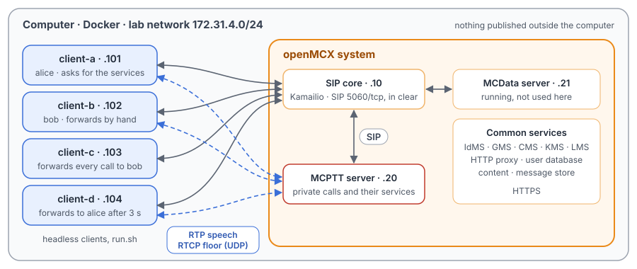
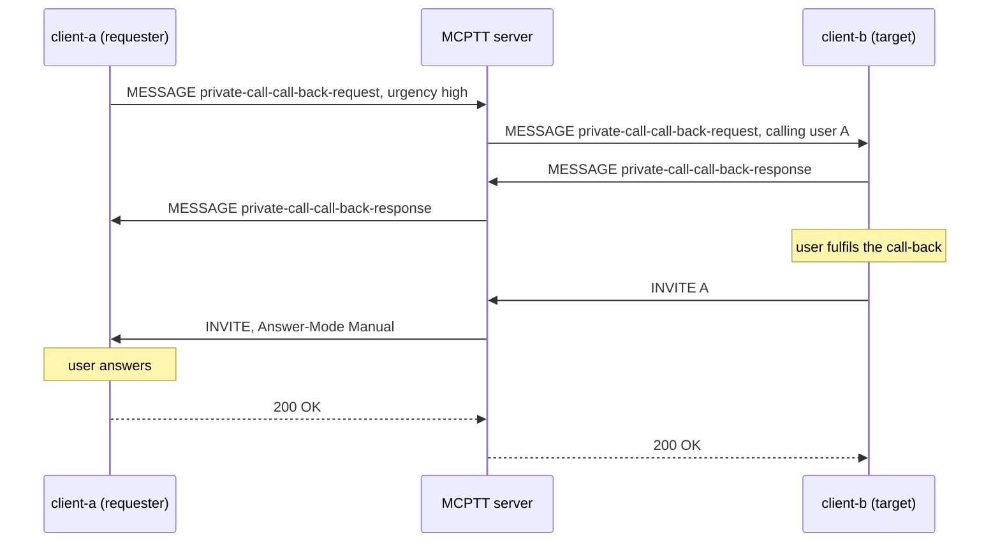
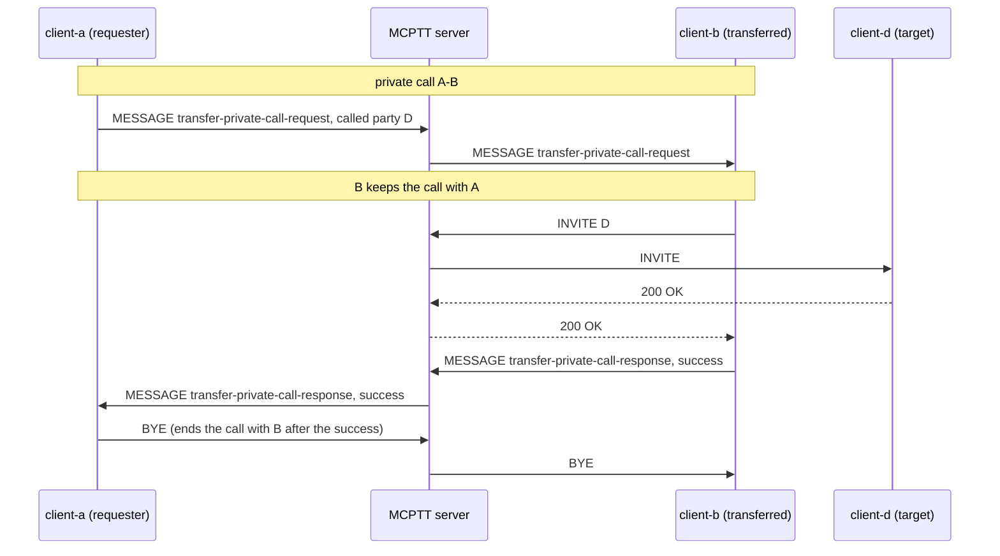
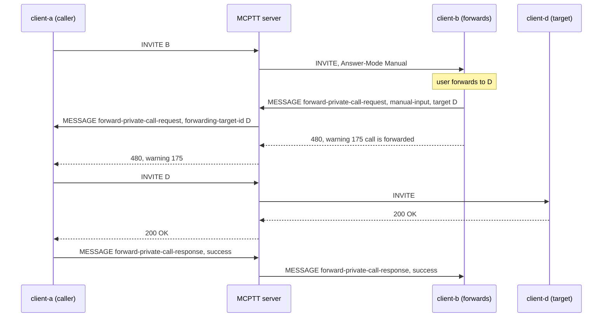
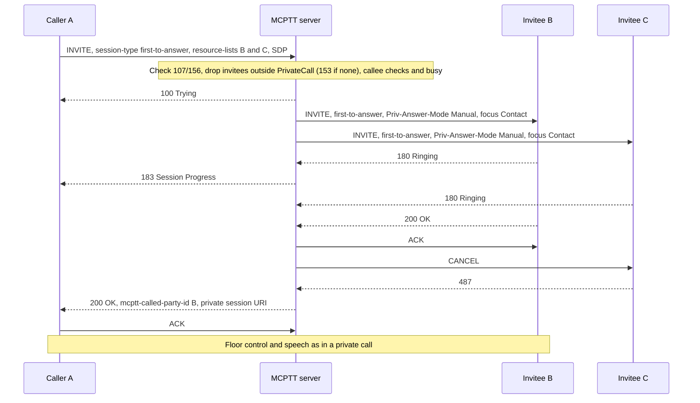

# Unit Test Tutorial 4: MCPTT call-back, transfer, forwarding and first-to-answer calls

One computer runs the openMCX system from the published images, with four headless clients in place of phones.
A script takes them through the services built on MCPTT private calls (TS 24.379 clause 11.1):

- a call-back request, its fulfilment, and a call-back request the user may not make;
- a remotely initiated private call: one user asks another user's device to place a call;
- an unannounced and an announced transfer of a running call;
- forwarding by hand, immediate forwarding and forwarding on no answer;
- a first-to-answer call: several users ring, the first to answer gets the call.

A capture of the lab network records every SIP message and every speech and floor control packet, so you can follow
each service in Wireshark.

The tutorial is built on two scenarios of the openMCX regression tests, `tests/integration/private_services_scenario.py`
and the first-to-answer part of `tests/integration/private_call_scenario.py`, and uses the same images. The emergency
first-to-answer call of `tests/integration/first_to_answer_emergency_scenario.py` is left to the emergency tutorial.

> **SIP in clear, for learning.** The system runs in its debug mode: SIP goes over TCP without TLS (port 5060), so
> Wireshark shows every message, its SDP and its MCPTT XML. A real system uses TLS (tutorials 1 to 5). Speech and
> floor control are not encrypted in this tutorial in either mode. The HTTPS traffic to the common services
> (sign-in, configuration, keys) stays encrypted and is not captured.

<p align="center"></p>

## What you need

- A computer with Docker and Docker Compose v2 (Linux, or Docker Desktop on macOS or Windows) and a bash shell for
  `run.sh` (on Windows: WSL or Git Bash).
- No phones, no network set-up, nothing to compile: the tutorial uses the **prebuilt openMCX images from Docker Hub**
  (`openmcx/openmcx-*:v1`) and publishes no port; everything stays on the computer.
- [Wireshark](https://www.wireshark.org/) to look at the capture (optional: `run.sh` prints a summary).

## 1. Make the configuration

```bash
cd tutorials/unit-tests/04-private-call-services
docker compose run --rm setup
```

The setup container runs the generator of the regression lab
(`tools/prepare-prearranged-test.py --debug-sip --private-call --private-services`). It writes `./config` with these
parts:

- a new certificate authority with the servers' and clients' certificates;
- the users `alice` (client-a), `bob` (client-b), `client-c` and `client-d`;
- their private call rights (TS 24.484 `<ruleset>`): alice may ask for call-backs, remotely initiated calls,
  transfers and first-to-answer calls; bob may forward a call by hand; client-c may make private calls but not ask
  for a call-back;
- forwarding settings held by the server: client-c forwards every call to bob at once, client-d forwards to alice
  when it does not answer within 3 s (the timer TNP1);
- up to two private calls per user at a time (N10, TS 24.484 `<MaxCall>`): a transferred user is in two calls for a
  moment, its call with the requester and the new call to the target.

It runs once. To start over, see step 5. The certificates last 30 days.

## 2. Start the system

```bash
docker compose up -d --wait
```

After about half a minute `--wait` returns and every service is healthy, with the capture already running.

| Address | Container |
|---|---|
| 172.31.4.10 | SIP core (Kamailio) |
| 172.31.4.20 | MCPTT server |
| 172.31.4.21 | MCData server (running, not used here) |
| 172.31.4.101 | client-a, user `alice` |
| 172.31.4.102 | client-b, user `bob` |
| 172.31.4.103 | client-c, user `client-c` |
| 172.31.4.104 | client-d, user `client-d` |

## 3. Run the steps

```bash
./run.sh
```

The script sends each command to a client and waits until the clients and the server show its result before going
on. It takes about a minute:

```
2. Call-back: client-a asks client-b to call back; client-b does, and client-a answers
  $ client-a: callback sip:bob.mcptt@mcx.test high
  ok: client-b stores the request (urgency high), client-a sees it confirmed
  $ client-b: callback-fulfil sip:alice.mcptt@mcx.test
  ok: client-a rings (a call-back is answered by hand)
...
8. Forwarding on no answer: client-d forwards to client-a when it does not answer within 3 s
  $ client-b: private sip:client-d.mcptt@mcx.test manual
  ok: client-d rings
  ok: after 3 s: client-d stops ringing and client-b reaches client-a
...
10. The capture: captures/04-private-call-services-run.pcap.gz
```

Each command is the same program the clients run, with `--command`. To type one yourself:

```bash
docker compose exec client-a mcx-client --config /config/client-a.json --command "callback sip:bob.mcptt@mcx.test"
```

Every service request and its answer is a SIP MESSAGE to the MCPTT service, with the kind of request in the MCPTT
XML (`<request-type>` or `<response-type>`); the server checks the requester's rights and relays it to the other
user.

| Step | Command | What happens (TS 24.379) |
|---|---|---|
| 1 | `answer-mode auto` on every client | Each client answers private calls automatically (clause 6.2.3.2), unless an INVITE asks for manual answer. |
| 2 | `client-a: callback <bob> high`, `client-b: callback-fulfil <alice>`, `client-a: answer` | client-a's call-back request reaches client-b, which stores it and answers with a call-back response (clause 11.1.5.2). client-b fulfils it with a private call to client-a, which rings for its user to answer (`Answer-Mode: Manual`, clause 11.1.5.2.3); both entries are then deleted. |
| 2 | `client-c: callback <alice>` | client-c's ruleset does not allow call-back requests: the server answers 403 with warning 151 (table 4.4.2-2). |
| 3 | `client-a: remote-call <bob> <client-d> auto` | client-a asks client-b's device to call client-d (clause 11.1.7). client-b places the call and reports the outcome, which the server relays to client-a. |
| 4 | `client-a: private <bob> auto`, `client-a: transfer <client-d>` | client-a sends a transfer request for its call (clause 11.1.8.2.1). client-b keeps the call with client-a, calls client-d and reports success (clause 11.1.8.2.2); only then does client-a end its call with client-b. Had the call to client-d failed, client-a and client-b would still be talking. For this, a user may be in two private calls at a time (the lab's limit N10 is 2). |
| 5 | `client-a: transfer <client-d> announced`, then `… complete` | Announced transfer (clause 11.1.8.2.3): client-a puts client-b on hold (re-INVITE `sendonly`) and calls client-d. The transfer request then carries client-d's dialog in `<replaces-header-value>`; client-b's INVITE to client-d has a `Replaces` header (RFC 3891), and client-d's call with client-a is replaced. |
| 6 | `client-a: private <bob> manual`, `client-b: forward <client-d>` | Forwarding by hand while the call rings (clause 11.1.9.2.1): client-b sends a forwarding request and answers the INVITE with 480 and warning 175 "call is forwarded". client-a gets the request with the target and calls client-d (clause 11.1.9.2.2), then tells client-b it worked. |
| 7 | `client-a: private <client-c> auto` | Immediate forwarding: the server never rings client-c; it answers client-a 480 with warning 175 and a forwarding request to bob (clause 11.1.1.3.2 step 4). |
| 8 | `client-b: private <client-d> manual` | Forwarding on no answer: client-d rings, and when TNP1 runs out (3 s, clause 6.3.2.5) the server cancels the INVITE and forwards client-b to alice. |
| 9 | `client-a: first-to-answer <bob> <client-d>`, `client-b: answer` | First-to-answer (clause 11.1.1.4.1): the server invites both, each with `Priv-Answer-Mode: Manual`, and sends 183 Session Progress to client-a at the first ringing. client-b answers first and gets the call; client-d's INVITE is cancelled. |

## 4. Look at the capture

`run.sh` copies the capture to `captures/04-private-call-services-run.pcap.gz`. The folder also holds a reference
run, `captures/04-private-call-services-full.pcap.gz` (122 KB, 1 568 frames): the frame numbers below and in the call
flows are those of the reference. Wireshark opens the compressed file directly (or `gunzip` it first).

The capture filter is `ip and not host 172.31.4.1 and (tcp port 5060 or (udp and not port 53) or icmp)`:

- SIP on 5060/tcp, with every TCP segment, so Wireshark rebuilds a message split over two segments;
- every UDP flow, since the speech and floor control ports come from the SDP and are not fixed;
- ICMP, which shows media sent to a closed port.

DNS, the encrypted HTTPS and the host's own traffic on the bridge (172.31.4.1) are left out.

Useful display filters:

| Filter | Shows |
|---|---|
| `sip.Method == "MESSAGE"` | The service requests and answers; open **MIME Multipart Media Encapsulation → application/vnd.3gpp.mcptt-info+xml** to read `<request-type>` or `<response-type>`. |
| `sip.Warning` | The 403 and 480 answers with their warning text (151, 175). |
| `sip.Method == "INVITE" \|\| sip.Method == "CANCEL" \|\| sip.Method == "BYE"` | The calls the services set up and end. |
| `sip.Replaces` | The INVITE of the announced transfer that replaces a call. |

Every request from a client appears twice: the SIP core first answers 407 (Proxy Authentication Required), and the
client sends it again with its credentials. The frames below name the second one.

What to look for, in the reference run:

- **Call-back** (frames 398 to 506): client-a's MESSAGE with
  `<request-type>private-call-call-back-request</request-type>` and `<urgency-ind>high</urgency-ind>` (398) reaches
  client-b (408). client-b's call-back response (417) reaches
  client-a (424). client-b's INVITE (439) reaches client-a with `Answer-Mode: Manual` (449), and client-a's 200 OK
  (458) comes after its user answered. client-c's request is answered 403 with
  `Warning: 399 mcx "151 user not authorised to make a private call call-back request"` (504, to client-c 506).
- **Remotely initiated call** (frames 512 to 577): client-a's request (512) names client-d in `<mcptt-called-party-id>`
  and asks for `<ric-commencement-mode>auto-mode</ric-commencement-mode>`. client-b gets it (520) and places the call
  (533, to client-d 541). Its response with `<remotely-initiated-call-outcome>success</…>` (563) reaches client-a
  (577).
- **Transfer** (frames 608 to 721): client-a calls client-b (608). The transfer request (644) reaches client-b (652).
  client-b, still in its call with client-a, calls client-d (663, to client-d 671) and reports
  `<transfer-call-outcome>success</…>` (692, to client-a 707). Only then does client-a end its call with client-b
  (BYE 716, to client-b 721), as TS 24.379 clause 11.1.8.2.1 step 2 says.

- **Announced transfer** (frames 752 to 923): client-a's call with client-b (752), the hold re-INVITE with
  `a=sendonly` (791), client-a's call to client-d (811). The transfer request (848) carries `<replaces-header-value>`.
  client-b, keeping the held call, calls client-d with a `Replaces` header (867, to client-d 879); client-d ends the
  replaced call with client-a (BYE 886). client-b's response (896) reaches client-a (923), and client-a ends the held
  call with client-b (BYE 930, to client-b 936).
- **Forwarding by hand** (frames 971 to 1059): client-a's INVITE reaches client-b with `Answer-Mode: Manual` (981).
  client-b's forwarding request with `<forwarding-reason>manual-input</forwarding-reason>` (994) reaches client-a
  (1005) with `<forwarding-target-id>`, and client-b answers 480 with warning 175 (1003, to client-a 1017). client-a
  calls client-d (1031, to client-d 1045) and sends the forward response (1050, to client-b 1059).
- **Immediate forwarding** (frames 1107 to 1161): the server answers client-a's INVITE to client-c with 480 and
  warning 175 itself (1111) and sends client-a a forwarding request with `<forwarding-reason>immediate</…>` (1115).
  client-a calls bob (1133, to bob 1147); client-c never gets an INVITE, only the forward response (1161).
- **Forwarding on no answer** (frames 1209 to 1305): client-d's INVITE (1219) is cancelled 3.0 s later (CANCEL
  1228): TNP1 has run out. client-b gets 480 with warning 175 (1235) and a forwarding request with
  `<forwarding-reason>no-answer</…>` (1243), calls alice (1263, to client-a 1271) and tells client-d (1305).
- **First-to-answer** (frames 1337 to 1547): client-a's INVITE (1337) becomes INVITEs to bob (1348) and client-d
  (1352), both with `Priv-Answer-Mode: Manual`. client-a gets 183 Session Progress (1364). client-b's 200 OK (1366)
  makes the call (200 OK to client-a 1375), and client-d's INVITE is cancelled (CANCEL 1386, 487 1390). client-a's
  speech starts at 1405; the call ends with client-a's BYE (1547).

## 5. Stop or start over

```bash
docker compose down -v        # remove the containers and their data (status files, capture)
rm -rf config                 # with down -v: start over at step 1
```

To run the steps again on the same system, run `./run.sh` again: the capture keeps everything since `up`. For a new
capture, `docker compose down -v` and `docker compose up -d --wait` first (the configuration stays).

## Images

The compose file names every image in full, all from Docker Hub:

| Image | What it is |
|---|---|
| `docker.io/openmcx/openmcx-setup:v1` | The setup: the lab's generator |
| `docker.io/openmcx/openmcx-mcptt-server:v1`, `docker.io/openmcx/openmcx-mcdata-server:v1` | The MCPTT and MCData servers |
| `docker.io/openmcx/openmcx-common:v1`, `docker.io/openmcx/openmcx-http-proxy:v1`, `docker.io/openmcx/openmcx-user-db:v1` | The common services |
| `docker.io/openmcx/openmcx-client:v1` | The headless client (`openMCX/openmcx-client` repository) |
| `docker.io/openmcx/openmcx-kamailio:6.1.4-2` | The SIP core |
| `docker.io/library/mysql@sha256:…` | The SIP core's database |
| `docker.io/nicolaka/netshoot@sha256:…` | tcpdump, for the capture |

To use images you built yourself, change the `image:` lines in `docker-compose.yaml` (building them:
[docs/BUILD.md](../../../docs/BUILD.md)).

## When something does not work

- **A service stays unhealthy**: `docker compose logs <service>`.
- **A step of run.sh fails**: it prints the step that did not complete. `docker compose exec client-a cat
  /artifacts/client-a/status.json` shows a client's state (`call_state`, `callback_requests_sent`,
  `service_outcomes`, `last_service_result`, `last_error`), and `/artifacts/mcptt-server/status.json` the server's
  calls (`sessions`). Start over from a clean state with `docker compose down -v` and `docker compose up -d --wait`.
- **No capture, or `capture` exited**: `docker compose logs capture`. The capture container uses the host's network
  to reach the lab's bridge (`openmcx-ut04`), and the address range 172.31.4.0/24 must be free on the computer.
- **Certificates expired** (after 30 days): start over (step 5).

## How it is put together

- `docker-compose.yaml`: the regression lab of `prepare-prearranged-test.py --debug-sip --private-call
  --private-services`, written for the published images by `tools/tutorial-compose.py`. Each container has a fixed
  address, so the capture reads by role. The status files are in a volume, and the capture runs on the lab's bridge.
- `run.sh`: the steps of `tests/integration/private_services_scenario.py` (PS-01, PS-03, PS-04, PS-06, PS-08, PS-09,
  PS-11 and PS-13 of `tests/mcptt/PRIVATE_CALL_TEST.md`) and the first-to-answer call of
  `tests/integration/private_call_scenario.py` (PC-16), here with bob and client-d as invitees. Left out: the
  call-back cancellation, the remotely initiated call with an application priority, the other refusals (warnings
  158 and 170), the client-side refusal and the forwarding of a user who is not registered; the emergency
  first-to-answer call belongs to the emergency tutorial.
- `speech/`: the two spoken test messages the clients transmit (16 kHz WAV, made with espeak-ng).
- `captures/04-private-call-services-full.pcap.gz`: the reference run.

## Call flow

The service flows below are drawn from the reference capture (the regression's test report describes them in a
table, without diagrams); the first-to-answer flow is the one of
[`tests/mcptt/PRIVATE_CALL_TEST.md`](../../../tests/mcptt/PRIVATE_CALL_TEST.md). The SIP core, its 407 challenges,
the 200 OK to each MESSAGE and the ACKs are left out. A = client-a, B = client-b, D = client-d, S = MCPTT server.

**Call-back (step 2)**



**Transfer (step 4)**



**Forwarding by hand (step 6)**



**First-to-answer (step 9)**, from `tests/mcptt/PRIVATE_CALL_TEST.md`; in this tutorial the invitees are bob (B) and
client-d (in the place of C):



| Message | Frames |
|---|---|
| Call-back: request A → S, S → B; response B → S, S → A | 398, 408; 417, 424 |
| Call-back: INVITE B → S, S → A (Manual); 200 OK from A | 439, 449; 458 |
| Transfer: request A → S, S → B; B's INVITE to D, S → D | 644, 652; 663, 671 |
| Transfer: response B → S, S → A; A's BYE, S → B | 692, 707; 716, 721 |
| Forwarding: INVITE A → S, S → B; request B → S, S → A | 971, 981; 994, 1005 |
| Forwarding: 480 from B, to A; INVITE A → S, S → D; response A → S, S → B | 1003, 1017; 1031, 1045; 1050, 1059 |
| First-to-answer: INVITE A → S; S → B, S → D; 183 to A | 1337; 1348, 1352; 1364 |
| First-to-answer: 200 OK from B, to A; CANCEL to D; 487 from D | 1366, 1375; 1386; 1390 |
