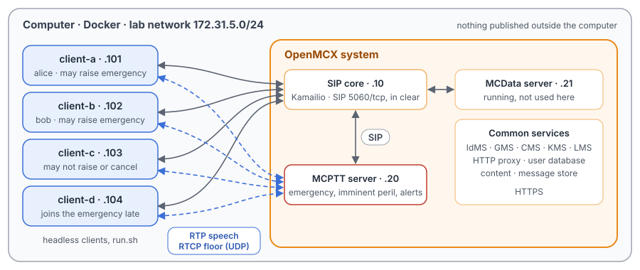
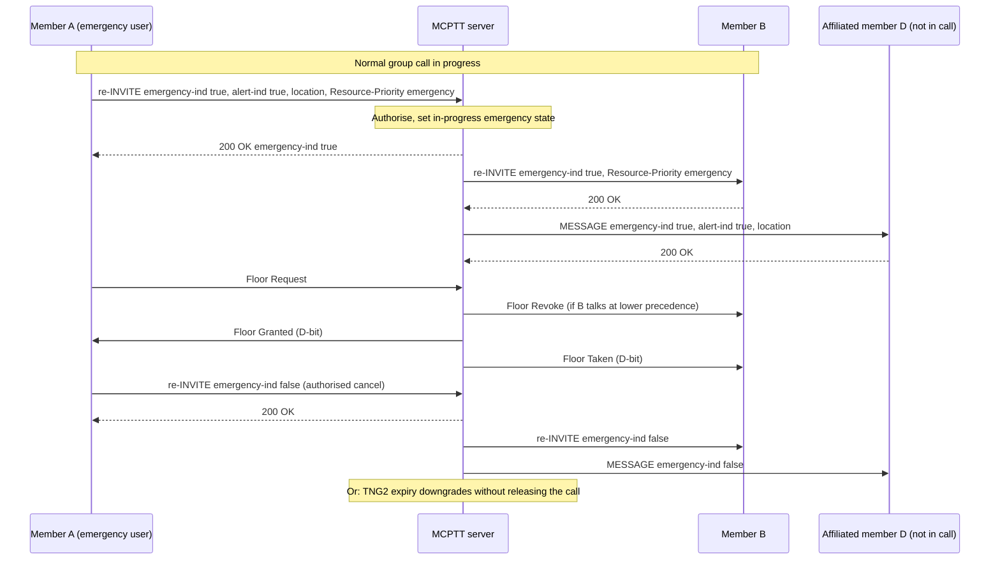
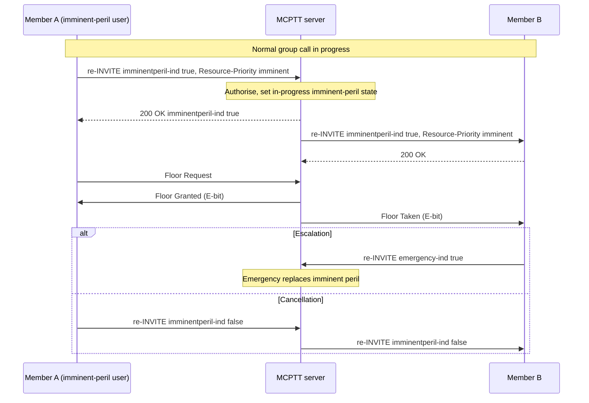

# Unit Test Tutorial 5: MCPTT emergency and imminent peril group calls and their alerts

One computer runs the openMCX system from the published images, with four headless clients in place of phones.
A script takes them through the priority group calls of TS 24.379:

- a normal group call raised to imminent peril, then to emergency, and back to normal;
- an emergency alert with the sender's location, and its cancellation;
- the server keeping the higher of two requested priorities, and telling the requester with a SIP INFO;
- requests from a user who is not allowed to make them, refused with 403;
- a member joining the emergency call late, and the emergency talker taking the floor from another talker;
- calls that start at imminent peril or emergency, and the group's emergency state outliving the call.

A capture of the lab network records every SIP message and every speech and floor control packet, so you can follow
each step in Wireshark.

The tutorial is built on the emergency, imminent peril and alert parts of the regression scenario
`tests/integration/prearranged_priority_scenario.py` and uses the same images.
[Unit Test Tutorial 1](../01-group-call-basics/README.md) explains the group call itself and
[Unit Test Tutorial 2](../02-floor-queue-priority/README.md) floor control with priorities.

> **SIP in clear, for learning.** The system runs in its debug mode: SIP goes over TCP without TLS (port 5060), so
> Wireshark shows every message, its headers and its MCPTT XML. A real system uses TLS (tutorials 1 to 5). Speech and
> floor control are not encrypted in this tutorial in either mode. The HTTPS traffic to the common services
> (sign-in, configuration, keys) stays encrypted and is not captured.

<p align="center"></p>

## What you need

- A computer with Docker and Docker Compose v2 (Linux, or Docker Desktop on macOS or Windows) and a bash shell for
  `run.sh` (on Windows: WSL or Git Bash).
- No phones, no network set-up, nothing to compile: the tutorial uses the **prebuilt openMCX images from Docker Hub**
  (`openmcx/openmcx-*:v1`) and publishes no port; everything stays on the computer.
- [Wireshark](https://www.wireshark.org/) to look at the capture (optional: `run.sh` prints a summary).

## 1. Make the configuration

```bash
cd tutorials/unit-tests/05-emergency-imminent-peril
docker compose run --rm setup
```

The setup container runs the generator of the regression lab
(`tools/prepare-prearranged-test.py --debug-sip --priority --floor-queue`). It writes `./config` with these parts:

- a new certificate authority with the servers' and clients' certificates;
- the users `alice` (client-a), `bob` (client-b), `client-c` and `client-d`, all in the group `operations`;
- the group's priority policy: `alice` and `bob` may raise and cancel imminent peril and emergency and may send
  emergency alerts; only `alice` may cancel alerts; `client-c` and `client-d` may do none of it;
- the Resource-Priority values of the three call priorities: `mcpttp.0` (normal), `mcpttp.10` (imminent peril) and
  `mcpttp.15` (emergency), in the RFC 8101 namespace `mcpttp`;
- a location for each client to put in its emergency alerts (a fixed test position, there is no GPS);
- an emergency timer (TNG2) of 5 minutes, which this tutorial does not wait for.

It runs once. To start over, see step 5. The certificates last 30 days.

## 2. Start the system

```bash
docker compose up -d --wait
```

After about half a minute `--wait` returns and every service is healthy, with the capture already running.

| Address | Container |
|---|---|
| 172.31.5.10 | SIP core (Kamailio) |
| 172.31.5.20 | MCPTT server |
| 172.31.5.21 | MCData server (running, not used here) |
| 172.31.5.101 | client-a, user `alice` |
| 172.31.5.102 | client-b, user `bob` |
| 172.31.5.103 | client-c, user `client-c` |
| 172.31.5.104 | client-d, user `client-d` |

## 3. Run the steps

```bash
./run.sh
```

The script sends each command to a client and waits until the clients and the server show its result before going
on. It takes about a minute:

```
5. client-a raises the call to emergency
  $ client-a: emergency on
  ok: the call and every participant at emergency, the alert kept

6. client-b asks for imminent peril: the server keeps emergency and tells client-b so
  $ client-b: imminent on
  ok: client-b corrected by the server, the call still at emergency
...
14. The capture: captures/05-emergency-imminent-peril-run.pcap.gz
```

Each command is the same program the clients run, with `--command`. To type one yourself:

```bash
docker compose exec client-a mcx-client --config /config/client-a.json --command "emergency on"
```

| Step | Command | What happens (TS 24.379) |
|---|---|---|
| 1, 2 | `client-d: deaffiliate`, `client-a: call` | client-d leaves the group for now; client-a starts a normal group call with client-b and client-c (`Resource-Priority: mcpttp.0`). |
| 3 | `client-a: imminent on` | client-a sends a re-INVITE with `<imminentperil-ind>` true and `Resource-Priority: mcpttp.10`. The server sets the group's in-progress imminent peril state and re-INVITEs the others the same way (clauses 10.1.1.4.7, 10.1.1.4.8, 6.3.3.1.15). |
| 4 | `client-a: alert on` | An emergency alert is a SIP MESSAGE with `<alert-ind>` true and the sender's location. The server sends it to every other affiliated member, answers 200 and confirms to the sender with a MESSAGE carrying `<alert-ind-rcvd>` (clause 12.1.3.1). |
| 5 | `client-a: emergency on` | A re-INVITE with `<emergency-ind>` true, `<alert-ind>` and `Resource-Priority: mcpttp.15`. Emergency replaces imminent peril; the server re-INVITEs the others and starts the emergency timer TNG2 (clause 10.1.1.4.7 step 6). |
| 6 | `client-b: imminent on` | client-b asks for less than the group already has. The server accepts the re-INVITE at emergency (`mcpttp.15` in the 200 OK) and after the ACK sends a SIP INFO with `<imminentperil-ind>` false and `<emergency-ind>` true (clause 6.3.3.1.18). |
| 7 | `client-c: emergency off` | client-c may not cancel: 403, with `<emergency-ind>` true in the body (clause 10.1.1.4.7 step 7). |
| 8 | `client-d: affiliate` | client-d affiliates during the emergency and is brought into the call by late entry, already at `mcpttp.15` (clause 10.1.1.4.6). |
| 9 | `client-b: ptt`, then `client-a: ptt` | In an emergency call the emergency user has precedence: client-a's Floor Request makes the server revoke client-b with cause #4 "Media Burst pre-empted" and give client-a the floor (TS 24.380 clause 6.3.4.4.7). |
| 10 | `client-a: emergency off`, `client-a: alert off` | client-a cancels the emergency (re-INVITE, `mcpttp.0`, everyone back to normal); the alert stays until it is cancelled by its own MESSAGE (clauses 10.1.1.4.7 step 8, 12.1.3.2). |
| 11 | `client-c: imminent on`, `client-c: alert on`, `client-a: hangup` | client-c may not raise imminent peril or send alerts: both refused with 403, nothing is distributed. Then the call ends. |
| 12 | `client-a: call imminent`, `client-a: imminent off` | A call can start at a priority: the initial INVITE carries `<imminentperil-ind>` and `mcpttp.10`, and every invited member is at imminent peril from the start. |
| 13 | `client-a: call emergency`, `client-a: hangup`, `client-a: emergency off` | The group's emergency state belongs to the group, not the call: it outlives the call's end. With no call left to re-INVITE, client-a cancels it with a SIP MESSAGE; the server tells every affiliated member and confirms to client-a with `<emergency-ind-rcvd>` (clause 12.1.3.3). |

## 4. Look at the capture

`run.sh` copies the capture to `captures/05-emergency-imminent-peril-run.pcap.gz`. The folder also holds a reference
run, `captures/05-emergency-imminent-peril-full.pcap.gz` (165 KB, 2 309 frames): the frame numbers below and in the
call flow are those of the reference. Wireshark opens the compressed file directly (or `gunzip` it first).

The capture filter is `ip and not host 172.31.5.1 and (tcp port 5060 or (udp and not port 53) or icmp)`:

- SIP on 5060/tcp, with every TCP segment, so Wireshark rebuilds a message split over two segments;
- every UDP flow, since the speech and floor control ports come from the SDP and are not fixed;
- ICMP, which shows media sent to a closed port.

DNS, the encrypted HTTPS and the host's own traffic on the bridge (172.31.5.1) are left out.

Useful display filters:

| Filter | Shows |
|---|---|
| `sip.Resource-Priority` | Every SIP message with a priority: the column shows `mcpttp.0`, `mcpttp.10` or `mcpttp.15`. |
| `sip.Method == "INVITE" \|\| sip.Method == "INFO" \|\| sip.Method == "MESSAGE"` | The priority signalling: (re-)INVITEs, the INFO correction and the alert MESSAGEs. |
| `sip.Status-Code == 403` | The refused requests; the Warning header says why. |
| `xml.tag contains "emergency-ind" \|\| xml.tag contains "alert-ind" \|\| xml.tag contains "imminentperil-ind"` | The messages whose MCPTT XML carries an indication. |
| `rtcp.app.name == "MCPT" && !(rtcp.app.subtype == 10)` | Floor control without the Floor Acks. |

Each request a client sends first meets a `407` from the SIP core (it authenticates every request, in a dialog too)
and is sent again with credentials; the frame numbers below are of the request that goes through.

Two things Wireshark 4.2 shows in a confusing way:

- **Floor Indicator "Unknown".** The server's floor messages carry the call type in the Floor Indicator with the F
  bit "Queueing supported" (TS 24.380 clause 8.2.3.15): `0x8400` (A, normal) in a normal call, `0x0C00` (E, imminent
  peril) and `0x1400` (D, emergency). Wireshark names only single values; the clients' Floor Requests, with one bit,
  show "Emergency call".
- **The Floor Revoke's cause in the Info column.** The Info column takes the text from the Floor Deny causes and
  shows "Retry-after timer has not expired"; the packet details show the actual field, Reject Cause 4, "Media Burst
  pre-empted".

The server also sends a Floor Idle every second while nobody has the floor: that is timer T7 (Floor Idle), TS 24.380
clause 6.3.4.3.4, not a reaction to the steps.

What to look for, in the reference run:

- **The normal call** (frames 507 to 548): client-a's INVITE with `Resource-Priority: mcpttp.0` (514) and the 200 OK
  (548).
- **Imminent peril** (frames 631 to 654): client-a's re-INVITE with `mcpttp.10` and `<imminentperil-ind>` true (638,
  after the `407` to 631), the server's re-INVITEs to client-b (646) and client-c (651), the 200 OK to client-a (649),
  and a Floor Idle with the E bit (654). The server's 200 OK to the re-INVITE (644) carries `P-Asserted-Identity` and
  adds the `norefersub` and `tdialog` option tags to `Supported` (TS 24.379 clause 10.1.1.4.7 steps 3 and 4); so do
  its 200 OKs to the later re-INVITEs.
- **The emergency alert** (frames 685 to 706): client-a's MESSAGE (688) with `<alert-ind>` true and an
  `application/vnd.3gpp.mcptt-location-info+xml` part, the server's MESSAGEs to client-b (693) and client-c (696), and
  the confirmation to client-a (700) with `<alert-ind-rcvd>` true.
- **Emergency** (frames 724 to 773): client-a's re-INVITE with `mcpttp.15`, `<emergency-ind>` and `<alert-ind>` true
  (731), the 200 OK (741), the re-INVITEs to client-b (743) and client-c (746), and a Floor Idle with the D bit (773).
  The participants learn of the emergency and the alert from these re-INVITEs only; members not in the call would get
  one MESSAGE instead (TS 24.379 clause 10.1.1.4.7 step 6 d)), and here every affiliated member is in the call.
- **The correction** (frames 785 to 805): client-b's re-INVITE with `mcpttp.10` (792), the 200 OK at `mcpttp.15`
  (800), and the SIP INFO (803, 805) with `Info-Package: g.3gpp.mcptt-info`, `<emergency-ind>` true and
  `<imminentperil-ind>` false.
- **A refused cancellation** (frames 825 to 841): client-c's re-INVITE with `mcpttp.0` (832), the 403 (838, 841) with
  `Warning: 399 mcx "emergency cancellation not authorized"` and `<emergency-ind>` true.
- **Late entry** (frames 872 to 882): a MESSAGE to client-d as it affiliates (872, with `<emergency-ind>` true), then the
  server's INVITE to client-d at `mcpttp.15` (879, 882), which also carries client-a's alert. There is no late alert
  MESSAGE: TS 24.379 clause 12.1.3.4 sends one only while the group has no call; with a call, the member is brought
  into it (late entry, clause 10.1.1.4.6).
- **Emergency floor precedence** (frames 970 to 1357): client-b has the floor (970, 971); client-a's Floor Request
  (1179) makes the server send Floor Revoke to client-b (1181) and Floor Queue Position Info to client-a (1182);
  client-b releases (1187), client-a gets Floor Granted (1189) and talks from 1199.
- **Back to normal** (frames 1373 to 1452): client-a's re-INVITE with `mcpttp.0` (1379), the re-INVITE to client-b
  (1387), the 200 OK (1391); then the alert cancellation, a MESSAGE with `<alert-ind>` false (1433), sent on to the
  others (1438 and on) and confirmed to client-a (1452).
- **Refusals** (frames 1493 to 1530): client-c's re-INVITE for imminent peril (1500) and its alert MESSAGE (1525) both
  get 403 (1509, 1530); no alert from client-c reaches anyone.
- **Calls that start at a priority** (frames 1632 to 2182): an initial INVITE at `mcpttp.10` (1639) with every member
  invited at `mcpttp.10` (client-d at 1664), lowered by a re-INVITE at `mcpttp.0` (1831); then an initial INVITE at
  `mcpttp.15` (1988), ended by client-a's BYE (1781).
- **The group's emergency state cancelled after the call** (frames 2266 to 2290): client-a's MESSAGE with
  `Resource-Priority: mcpttp.0` and `<emergency-ind>` false (2269), the server's MESSAGEs to every member (client-d
  at 2282) and the confirmation to client-a (2290) with `<emergency-ind-rcvd>` true.

## 5. Stop or start over

```bash
docker compose down -v        # remove the containers and their data (status files, capture)
rm -rf config                 # with down -v: start over at step 1
```

To run the steps again, start from a clean state: the group's emergency state lives in the server, so
`docker compose down -v` and `docker compose up -d --wait` first (the configuration stays).

## Images

The compose file names every image in full, all from Docker Hub:

| Image | What it is |
|---|---|
| `docker.io/openmcx/openmcx-setup:v1` | The setup: the lab's generator |
| `docker.io/openmcx/openmcx-mcptt-server:v1`, `docker.io/openmcx/openmcx-mcdata-server:v1` | The MCPTT and MCData servers |
| `docker.io/openmcx/openmcx-common:v1`, `docker.io/openmcx/openmcx-http-proxy:v1`, `docker.io/openmcx/openmcx-user-db:v1` | The common services |
| `docker.io/openmcx/openmcx-client:v1` | The headless client (`openMCX/openmcx-client` repository) |
| `docker.io/openmcx/openmcx-kamailio:6.1.4-2` | The SIP core |
| `docker.io/library/mysql@sha256:…` | The SIP core's database |
| `docker.io/nicolaka/netshoot@sha256:…` | tcpdump, for the capture |

To use images you built yourself, change the `image:` lines in `docker-compose.yaml` (building them:
[docs/BUILD.md](../../../docs/BUILD.md)).

## When something does not work

- **A service stays unhealthy**: `docker compose logs <service>`.
- **A step of run.sh fails**: it prints the step that did not complete. `docker compose exec client-a cat
  /artifacts/client-a/status.json` shows a client's `priority`, `alerts` and `last_error`, and
  `/artifacts/mcptt-server/status.json` the server's sessions and `group_priority`. Start over from a clean state with
  `docker compose down -v` and `docker compose up -d --wait`.
- **No capture, or `capture` exited**: `docker compose logs capture`. The capture container uses the host's network
  to reach the lab's bridge (`openmcx-ut05`), and the address range 172.31.5.0/24 must be free on the computer.
- **Certificates expired** (after 30 days): start over (step 5).

## How it is put together

- `docker-compose.yaml`: the regression lab of `prepare-prearranged-test.py --debug-sip --priority --floor-queue`,
  written for the published images by `tools/tutorial-compose.py`. Each container has a fixed address, so the capture
  reads by role. The status files are in a volume, and the capture runs on the lab's bridge.
- `run.sh`: the emergency, imminent peril and alert steps of `tests/integration/prearranged_priority_scenario.py`.
  Left out: its numeric pre-emption (in Unit Test Tutorial 2), a second emergency user and the cancellation refused
  while that user talks, alert cancellations by and for another user, and the expiry of TNG2 (5 minutes here).
- `speech/`: the two spoken test messages the clients transmit (16 kHz WAV, made with espeak-ng).
- `captures/05-emergency-imminent-peril-full.pcap.gz`: the reference run.

## Call flow

The emergency upgrade and cancellation, from the regression's test report
([`tests/mcptt/EMERGENCY_CALL_TEST.md`](../../../tests/mcptt/EMERGENCY_CALL_TEST.md)). Registration, service
authorisation and affiliation come before it; the SIP core and the floor Acks are left out. In this tutorial client-d
is not affiliated during the upgrade, so the MESSAGE to an affiliated member outside the call (D) does not occur;
client-d joins later by late entry (step 8).



The imminent peril call, from [`tests/mcptt/IMMINENT_PERIL_CALL_TEST.md`](../../../tests/mcptt/IMMINENT_PERIL_CALL_TEST.md);
this tutorial takes the escalation branch (step 5, by A itself):



The same messages in the reference capture (A = client-a 172.31.5.101, B = client-b 172.31.5.102, S = MCPTT server
172.31.5.20; a pair is the message on both legs through the SIP core):

| Message | Frames |
|---|---|
| A → S re-INVITE imminent peril (`mcpttp.10`); S → B, S → C re-INVITE; 200 OK to A | 638, 643; 646, 651; 649 |
| A → S re-INVITE emergency, alert (`mcpttp.15`); 200 OK to A; S → B, S → C re-INVITE | 731, 736; 741; 743, 746 |
| B → S re-INVITE imminent peril; 200 OK at emergency; S → B INFO | 792, 794; 800; 803, 805 |
| B Floor Request; Floor Granted to B; A Floor Request; Floor Revoke to B; Floor Queue Position Info to A | 970; 971; 1179; 1181; 1182 |
| B Floor Release; Floor Granted to A; Floor Taken to B; A's speech | 1187; 1189; 1190; from 1199 |
| A → S re-INVITE normal (`mcpttp.0`); S → B re-INVITE; 200 OK to A | 1379, 1384; 1387; 1391 |
