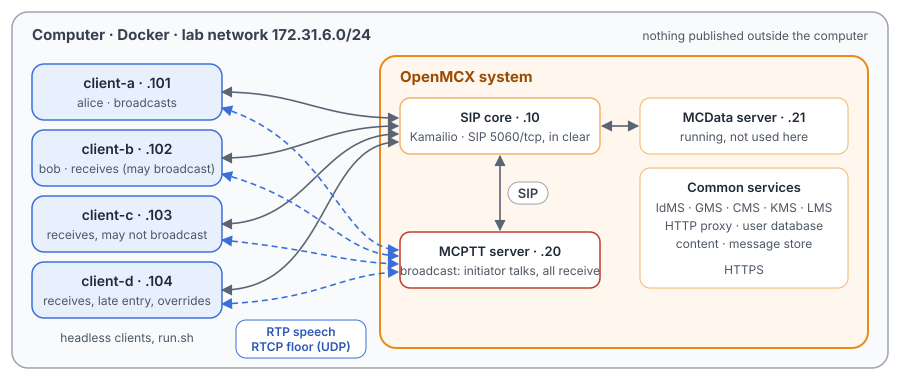
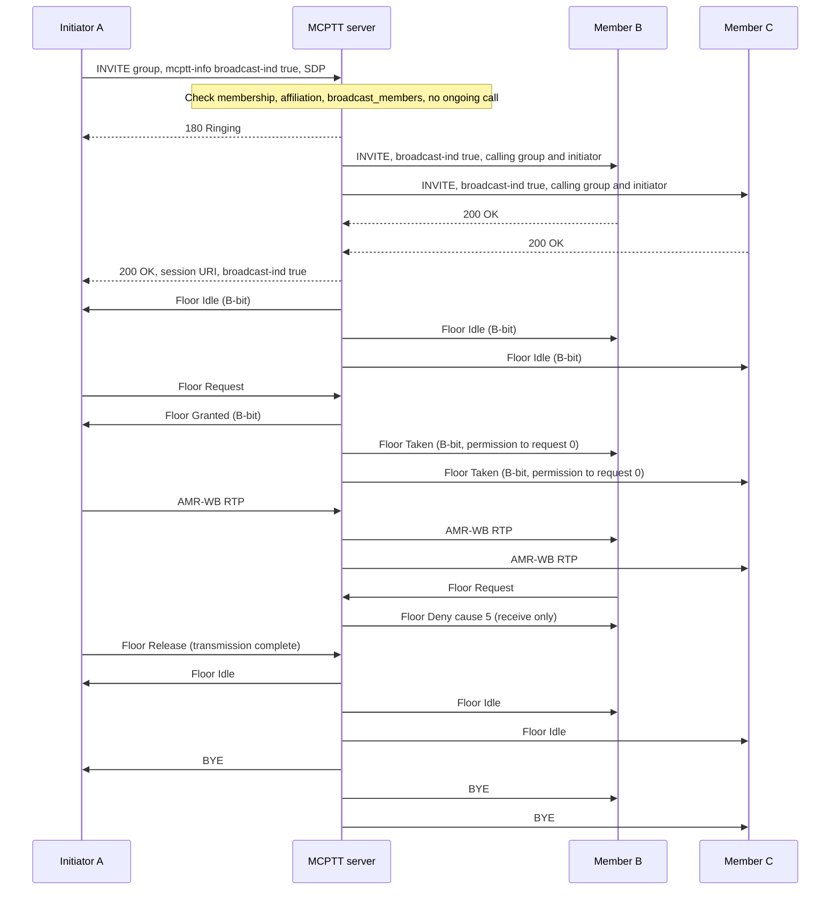

# Unit Test Tutorial 6: MCPTT broadcast group calls: receive only, late entry and override

One computer runs the openMCX system from the published images, with four headless clients in place of phones.
A script takes them through on-network broadcast group calls (TS 24.379 clause 4.12): group calls in which only the
initiator talks, the others only listen, and the call ends with the initiator's transmission.

- a broadcast to every affiliated member, without a conference subscription;
- receivers asking for the floor and being refused (receive only);
- the end of the transmission ending the call, with no hangup;
- broadcasts the server refuses: by a user without the right, and over a group call in progress;
- a member joining a running broadcast (late entry);
- an authorised member taking over the transmission (override).

A capture of the lab network records every SIP message and every speech and floor control packet, so you can follow
each step in Wireshark.

The tutorial is built on a scenario of the openMCX regression tests, `tests/integration/broadcast_call_scenario.py`,
and uses the same images. [Unit Test Tutorial 1](../01-group-call-basics/README.md) explains the normal group call
it differs from.

> **SIP in clear, for learning.** The system runs in its debug mode: SIP goes over TCP without TLS (port 5060), so
> Wireshark shows every message, its SDP and its MCPTT XML. A real system uses TLS (tutorials 1 to 5). Speech and
> floor control are not encrypted in this tutorial in either mode. The HTTPS traffic to the common services
> (sign-in, configuration, keys) stays encrypted and is not captured.

<p align="center"></p>

## Broadcast and normal group call

| | Normal group call ([Unit Test Tutorial 1](../01-group-call-basics/README.md)) | Broadcast group call |
|---|---|---|
| INVITE | MCPTT XML without `<broadcast-ind>` | `<broadcast-ind>true</broadcast-ind>` in the MCPTT XML (TS 24.379 clause 6.2.8.2), on the initiator's INVITE and on every INVITE the server sends to the members |
| Conference roster | members subscribe to the conference event package | nobody subscribes; a SUBSCRIBE is refused with 480 and warning 105 (clause 10.1.3.4.1) |
| Who may talk | anyone, one at a time | only the initiator; anyone else gets Floor Deny cause #5 "Receive only" (TS 24.380 clauses 6.3.5.3.4, 6.3.5.4.4) |
| Floor messages | Floor Indicator A "Normal call" (`0x8000`); Floor Taken with permission to request 1 | Floor Indicator B "Broadcast group call" (`0x4000`); Floor Taken with permission to request 0 (TS 24.380 clause 8.2.3.15) |
| End of the call | when someone hangs up, by the group's policy | when the initiator's transmission ends (TS 24.379 clause 4.12) |

## What you need

- A computer with Docker and Docker Compose v2 (Linux, or Docker Desktop on macOS or Windows) and a bash shell for
  `run.sh` (on Windows: WSL or Git Bash).
- No phones, no network set-up, nothing to compile: the tutorial uses the **prebuilt openMCX images from Docker Hub**
  (`openmcx/openmcx-*:v1`) and publishes no port; everything stays on the computer.
- [Wireshark](https://www.wireshark.org/) to look at the capture (optional: `run.sh` prints a summary).

## 1. Make the configuration

```bash
cd tutorials/unit-tests/06-broadcast-group-call
docker compose run --rm setup
```

The setup container runs the generator of the regression lab
(`tools/prepare-prearranged-test.py --debug-sip --broadcast`). It writes `./config` with these parts:

- a new certificate authority with the servers' and clients' certificates;
- the users `alice` (client-a), `bob` (client-b), `client-c` and `client-d`, all in the group `operations`;
- the MCPTT server's broadcast policy: only `alice` and `bob` may start a broadcast group call, and `client-d` may
  override a broadcast transmission;
- a call ends when its initiator leaves.

It runs once. To start over, see step 5. The certificates last 30 days.

## 2. Start the system

```bash
docker compose up -d --wait
```

After about half a minute `--wait` returns and every service is healthy, with the capture already running.

| Address | Container |
|---|---|
| 172.31.6.10 | SIP core (Kamailio) |
| 172.31.6.20 | MCPTT server |
| 172.31.6.21 | MCData server (running, not used here) |
| 172.31.6.101 | client-a, user `alice` |
| 172.31.6.102 | client-b, user `bob` |
| 172.31.6.103 | client-c, user `client-c` |
| 172.31.6.104 | client-d, user `client-d` |

## 3. Run the steps

```bash
./run.sh
```

The script sends each command to a client and waits until the clients and the server show its result before going
on. It takes about a minute:

```
2. client-a starts a broadcast group call: every affiliated member is invited, nobody subscribes to the roster
  $ client-a: call broadcast
  ok: one broadcast call with client-a to client-d
  ok: no conference subscription in a broadcast
3. client-b, a receiver, asks for the idle floor: denied, receive only
  $ client-b: ptt /speech/bravo.wav
  ok: client-b denied with cause #5 (Receive only)
...
11. The capture: captures/06-broadcast-group-call-run.pcap.gz
```

Each command is the same program the clients run, with `--command`. To type one yourself:

```bash
docker compose exec client-a mcx-client --config /config/client-a.json --command "call broadcast"
```

| Step | Command | What happens (TS 24.379 unless noted) |
|---|---|---|
| 2 | `client-a: call broadcast` | client-a's INVITE to the MCPTT service carries `<broadcast-ind>true` (clause 6.2.8.2). The server, as controlling function, invites every affiliated member with the same indication and `Answer-Mode: Auto`. No member subscribes to the conference event package. |
| 3 | `client-b: ptt` | client-b asks for the idle floor and gets Floor Deny with cause #5 "Receive only": in a broadcast, only the initiator's requests reach floor arbitration (TS 24.380 clause 6.3.5.3.4). |
| 4 | `client-a: ptt`, `client-c: ptt` | client-a is granted the floor; the receivers get Floor Taken with the B-bit and permission to request 0. client-c's request while client-a talks is denied with cause #5 too (TS 24.380 clause 6.3.5.4.4). Every receiver hears client-a; client-a receives no speech. |
| 5 | (none) | client-a's speech ends and it releases the floor. The server then ends the call for everyone with BYE, client-a included (clause 4.12; TS 23.379 clause 10.6.2.5.2). |
| 6 | `client-a: call broadcast`, `client-b: conference-subscribe`, `client-a: hangup` | A forced SUBSCRIBE to the conference event package is refused with 480 and warning 105 "subscription not allowed in a broadcast group call" (clause 10.1.3.4.1). The initiator leaving ends the broadcast (clause 6.3.8.1). |
| 7 | `client-c: call broadcast` | client-c may not start a broadcast: 403 with warning 100 "function not allowed due to broadcast group call not authorised". |
| 8 | `client-a: call`, `client-b: hangup`, `client-b: call broadcast`, `client-c: ptt` | A broadcast cannot take over a group call in progress on the group: 486 with warning 100 "function not allowed due to group call in progress", and the call goes on. In that normal call client-c may talk: Floor Taken has the A-bit and permission to request 1. |
| 9 | `client-d: deaffiliate`, `client-a: call broadcast`, `client-d: affiliate`, `client-a: ptt` | client-d is not affiliated when the broadcast starts. When it affiliates, the server invites it into the running broadcast as a receiver (late entry, clause 10.1.1.4.6), and it hears client-a. |
| 10 | `client-a: call broadcast`, `client-a: ptt`, `client-c: ptt`, `client-d: ptt` | client-c is still refused (cause #5), but client-d may override: the server revokes client-a with cause #4 "Media Burst pre-empted" and grants client-d, whose transmission everybody hears. The call ends with client-d's transmission. Override is TS 23.379 clause 10.6.2.5 (stage 2); TS 24.379 has no stage-3 procedure for it, so the encoding is the project's. |

## 4. Look at the capture

`run.sh` copies the capture to `captures/06-broadcast-group-call-run.pcap.gz`. The folder also holds a reference
run, `captures/06-broadcast-group-call-full.pcap.gz` (216 KB, 6 570 frames, most of them speech): the frame numbers
below and in the call flow are those of the reference. Wireshark opens the compressed file directly (or `gunzip` it
first).

The capture filter is `ip and not host 172.31.6.1 and (tcp port 5060 or (udp and not port 53) or icmp)`:

- SIP on 5060/tcp, with every TCP segment, so Wireshark rebuilds a message split over two segments;
- every UDP flow, since the speech and floor control ports come from the SDP and are not fixed;
- ICMP, which shows media sent to a closed port.

DNS, the encrypted HTTPS and the host's own traffic on the bridge (172.31.6.1) are left out.

Useful display filters:

| Filter | Shows |
|---|---|
| `sip.Method == "INVITE" \|\| sip.CSeq.method == "INVITE"` | The calls; open the MCPTT XML part of an INVITE to see `<broadcast-ind>`. |
| `sip.Warning` | The refusals: 480 (warning 105), 403 and 486 (warning 100). |
| `rtcp.app.name == "MCPT" && !(rtcp.app.subtype == 10)` | Floor control without the Floor Acks. |
| `rtp` | Speech: AMR-WB. **Telephony → RTP → RTP Streams** shows one stream to the server from each talker and one from the server to each listener. |

Two things Wireshark 4.2 shows in a confusing way:

- **The Floor Deny's cause.** The packet details show the Reject Cause only as `5`, without its name; cause #5 is
  "Receive only" (TS 24.380 clause 8.2.6.2).
- **The Floor Revoke's cause in the Info column.** The Info column of the override's Floor Revoke takes its text from
  the Floor Deny causes and shows "Retry-after timer has not expired"; the packet details show the actual field,
  Reject Cause 4, "Media Burst pre-empted".

What to look for, in the reference run:

- **The broadcast call** (frames 396 to 452): client-a's INVITE (403, after the SIP core's `407` challenge to 396)
  has `<broadcast-ind>true</broadcast-ind>`. The server invites client-b (412, 416), client-c (422) and client-d (430),
  each with `<broadcast-ind>true` and `Answer-Mode: Auto`, and answers client-a (446). The Floor Idle messages (443,
  452) carry the Floor Indicator "Broadcast group call".
- **Receive only** (frames 465 to 622): client-b's Floor Request on the idle floor (465) gets Floor Deny, cause 5
  (466). client-a's Floor Request (476) is granted (477); client-b, client-c and client-d get Floor Taken (478 to
  480) with "The receiver is not permitted to request floor (0)". client-a's speech starts at 482; client-c's request
  (621) is denied (622).
- **End of the transmission** (frames 1836 to 1871): client-a's Floor Release (1836), Floor Idle (from 1838), and the
  server's BYEs to all four (from 1844; the one to client-a reaches it at 1862). No client sent a BYE.
- **No conference subscription** (frames 1873 to 1959): a new broadcast (1873, 1879). client-b's SUBSCRIBE (1941)
  is answered 480 with warning 105 (1948, 1949). client-a's BYE (1952) ends the broadcast for everyone (server BYEs
  from 1959).
- **Not authorised** (frames 1983 to 1998): client-c's broadcast INVITE (1983), answered 403 with warning 100 (1994,
  1998). The server invites nobody.
- **Group call in progress** (frames 2003 to 3330): a normal group call (2003), whose members do subscribe to the
  roster (client-b at 2048). client-b leaves (2182) and tries a broadcast (2224): 486 with warning 100 (2235, 2239).
  client-c talks in the normal call (2250, 2251) and client-a gets Floor Taken (2252) with "Normal call" and "The
  receiver is permitted to request floor (1)".
- **Late entry** (frames 3410 to 4865): the broadcast (3410) reaches client-a, client-b and client-c only. client-d's
  affiliation (PUBLISH, 3468) makes the server invite it into the running call (3484, 3487). client-a's transmission
  (3502) reaches client-d too (Floor Taken 3506); it ends at 4859 and the call with it (BYEs from 4865).
- **Override** (frames 4898 to 6541): client-c's request (5047) is denied (5052). client-d's request (5102) makes the
  server send Floor Revoke to client-a (5103), which releases (5104); client-d is granted (5106), client-a gets Floor
  Taken (5107), and client-d's speech starts at 5111. Its release (6534) ends the call (BYEs from 6541).

## 5. Stop or start over

```bash
docker compose down -v        # remove the containers and their data (status files, capture)
rm -rf config                 # with down -v: start over at step 1
```

To run the steps again on the same system, run `./run.sh` again: the capture keeps everything since `up`. For a new
capture, `docker compose down -v` and `docker compose up -d --wait` first (the configuration stays).

## Images

The compose file names every image in full, all from Docker Hub:

| Image | What it is |
|---|---|
| `docker.io/openmcx/openmcx-setup:v1` | The setup: the lab's generator |
| `docker.io/openmcx/openmcx-mcptt-server:v1`, `docker.io/openmcx/openmcx-mcdata-server:v1` | The MCPTT and MCData servers |
| `docker.io/openmcx/openmcx-common:v1`, `docker.io/openmcx/openmcx-http-proxy:v1`, `docker.io/openmcx/openmcx-user-db:v1` | The common services |
| `docker.io/openmcx/openmcx-client:v1` | The headless client (`openMCX/openmcx-client` repository) |
| `docker.io/openmcx/openmcx-kamailio:6.1.4-2` | The SIP core |
| `docker.io/library/mysql@sha256:…` | The SIP core's database |
| `docker.io/nicolaka/netshoot@sha256:…` | tcpdump, for the capture |

To use images you built yourself, change the `image:` lines in `docker-compose.yaml` (building them:
[docs/BUILD.md](../../../docs/BUILD.md)).

## When something does not work

- **A service stays unhealthy**: `docker compose logs <service>`.
- **A step of run.sh fails**: it prints the step that did not complete. `docker compose exec client-b cat
  /artifacts/client-b/status.json` shows a client's state (`call_type`, `floor_indicator`, `permission_to_request`,
  `last_floor_reject_cause`, `last_call_failure`), and `/artifacts/mcptt-server/status.json` the server's. Start over
  from a clean state with `docker compose down -v` and `docker compose up -d --wait`.
- **No capture, or `capture` exited**: `docker compose logs capture`. The capture container uses the host's network
  to reach the lab's bridge (`openmcx-ut06`), and the address range 172.31.6.0/24 must be free on the computer.
- **Certificates expired** (after 30 days): start over (step 5).

## How it is put together

- `docker-compose.yaml`: the regression lab of `prepare-prearranged-test.py --debug-sip --broadcast`, written for the
  published images by `tools/tutorial-compose.py`. Each container has a fixed address, so the capture reads by role.
  The status files are in a volume, and the capture runs on the lab's bridge.
- `run.sh`: checks BC-01 to BC-10 and BC-17 of `tests/integration/broadcast_call_scenario.py`. Left out: the
  emergency and imminent peril broadcasts (BC-18, BC-19), which belong with the emergency tutorial, and the
  group-broadcast and user-broadcast hierarchies (BC-15, BC-16), which need groups of their own.
- `speech/`: the two spoken test messages the clients transmit (16 kHz WAV, made with espeak-ng).
- `captures/06-broadcast-group-call-full.pcap.gz`: the reference run.

## Call flow

The broadcast of steps 2 to 5, as in the regression's test report
([`tests/mcptt/BROADCAST_CALL_TEST.md`](../../../tests/mcptt/BROADCAST_CALL_TEST.md)). Registration, service
authorisation and affiliation come before it. Each SIP arrow passes through the SIP core, which is left out, and so
are the Floor Acks. C stands for any further receiver (client-c and client-d here).



The same messages in the reference capture (A = client-a, B = client-b, C = client-c; client-d gets what client-c
gets). In the tutorial, client-b's denied request comes before client-a talks (step 3), and client-c's during it
(step 4). A frame pair is the message on both legs, client to SIP core and SIP core to server, or the other way:

| Message | Frames |
|---|---|
| A → S INVITE with `broadcast-ind` | 403, 405 |
| S → A 180 Ringing | 407 |
| S → B, S → C INVITE with `broadcast-ind` | 412, 416; 422 |
| S → A 200 OK | 446 |
| S → B, S → A Floor Idle (B-bit) | 443; 452 |
| B → S Floor Request; S → B Floor Deny cause 5 | 465; 466 |
| A → S Floor Request; S → A Floor Granted; Floor Taken to B, C, D | 476; 477; 478 to 480 |
| A → S AMR-WB RTP | from 482 |
| C → S Floor Request; S → C Floor Deny cause 5 | 621; 622 |
| A → S Floor Release; Floor Idle | 1836; from 1838 |
| S → A, B, C, D BYE | from 1844 |
