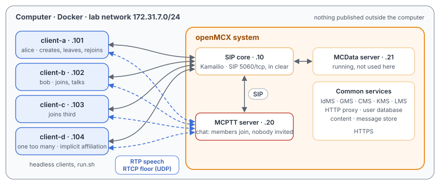
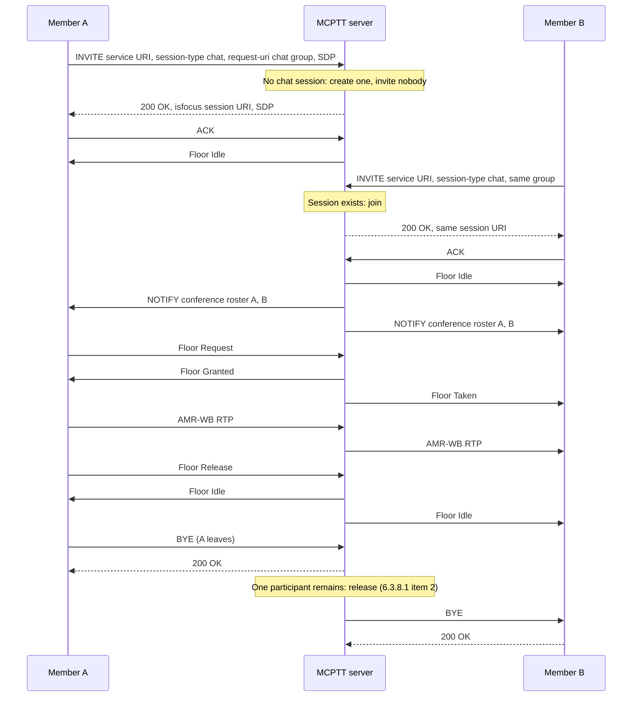

# Unit Test Tutorial 7: MCPTT chat group calls: joining, capacity and implicit affiliation

One computer runs the openMCX system from the published images, with four headless clients in place of phones.
A script takes them through on-network chat group calls (TS 24.379 clause 10.1.2):

- members joining one by one, the first creating the session and nobody being invited;
- floor control in the session, and the participant limit;
- the creator leaving and rejoining, and the release when one participant remains or when nobody talks;
- the checks on the call type and the group, and implicit affiliation.

A capture of the lab network records every SIP message and every speech and floor control packet, so you can follow
each step in Wireshark.

The tutorial is built on a scenario of the openMCX regression tests, `tests/integration/chat_call_scenario.py`, and
uses the same images. [Unit Test Tutorial 1](../01-group-call-basics/README.md) explains the prearranged group call
that a chat group call is compared with.

> **SIP in clear, for learning.** The system runs in its debug mode: SIP goes over TCP without TLS (port 5060), so
> Wireshark shows every message, its SDP and its MCPTT XML. A real system uses TLS (tutorials 1 to 5). Speech and
> floor control are not encrypted in this tutorial in either mode. The HTTPS traffic to the common services
> (sign-in, configuration, keys) stays encrypted and is not captured.

<p align="center"></p>

## Chat and prearranged group call

| | Prearranged group call ([Unit Test Tutorial 1](../01-group-call-basics/README.md)) | Chat group call |
|---|---|---|
| Group | a group without a type | a group of type chat (`operations-chat`) |
| Starting | one member calls; the server invites every affiliated member | each member joins on its own with an INVITE carrying `<session-type>chat</session-type>`; the first creates the session, and the server invites nobody (TS 24.379 clause 10.1.2.4.1.1) |
| Answer | 200 OK once a member answers, with no 180 Ringing | 200 OK at once, with the session's `isfocus` URI |
| Initiator | may end the call for everyone (group policy) | has no special role: it may leave and come back while the others stay |
| End | the initiator leaves, or one participant is left, or no speech for a while | one participant left after others had joined, or no speech for a while (here 20 s) |

## What you need

- A computer with Docker and Docker Compose v2 (Linux, or Docker Desktop on macOS or Windows) and a bash shell for
  `run.sh` (on Windows: WSL or Git Bash).
- No phones, no network set-up, nothing to compile: the tutorial uses the **prebuilt openMCX images from Docker Hub**
  (`openmcx/openmcx-*:v1`) and publishes no port; everything stays on the computer.
- [Wireshark](https://www.wireshark.org/) to look at the capture (optional: `run.sh` prints a summary).

## 1. Make the configuration

```bash
cd tutorials/unit-tests/07-chat-group-calls
docker compose run --rm setup
```

The setup container runs the generator of the regression lab (`tools/prepare-prearranged-test.py --debug-sip
--chat`). It writes `./config` with these parts:

- a new certificate authority with the servers' and clients' certificates;
- the users `alice` (client-a), `bob` (client-b), `client-c` and `client-d`;
- the prearranged group `operations` and the chat group `operations-chat`, with all four users as members; the chat
  group allows three participants at a time and ends a session after 20 s without speech;
- two more chat groups that do not allow a chat call now: `operations-chat-preconfigured` (for preconfigured use only)
  and `operations-chat-regrouped` (regrouped).

It runs once. To start over, see step 5. The certificates last 30 days.

## 2. Start the system

```bash
docker compose up -d --wait
```

After about half a minute `--wait` returns and every service is healthy, with the capture already running.

| Address | Container |
|---|---|
| 172.31.7.10 | SIP core (Kamailio) |
| 172.31.7.20 | MCPTT server |
| 172.31.7.21 | MCData server (running, not used here) |
| 172.31.7.101 | client-a, user `alice` |
| 172.31.7.102 | client-b, user `bob` |
| 172.31.7.103 | client-c, user `client-c` |
| 172.31.7.104 | client-d, user `client-d` |

## 3. Run the steps

```bash
./run.sh
```

The script sends each command to a client and waits until the clients and the server show its result before going
on. It takes about a minute, 20 s of which is step 8 waiting for the inactivity timer:

```
2. client-a joins first: the server creates the chat session and invites nobody
  $ client-a: chat
  ok: a chat session with client-a alone
  ok: nobody else is invited
...
5. client-c joins; client-d is one too many (the group allows three participants)
  $ client-c: chat
  ok: client-a, client-b and client-c in the chat session
  ok: the rosters list three
  $ client-d: chat
  ok: client-d refused with 486 and warning 122
...
12. The capture: captures/07-chat-group-calls-run.pcap.gz
```

Each command is the same program the clients run, with `--command`. To type one yourself:

```bash
docker compose exec client-b mcx-client --config /config/client-b.json --command chat
```

| Step | Command | What happens (TS 24.379 unless noted) |
|---|---|---|
| 1 | `group sip:operations-chat@mcx.test` on every client | Each client selects the chat group and affiliates to it (clause 9.2). |
| 2 | `client-a: chat` | client-a's INVITE to the MCPTT service carries `<session-type>chat</session-type>` and the chat group (clause 10.1.2.2.1.1). No session exists, so the server creates one, answers 200 OK at once and invites nobody (clause 10.1.2.4.1.1 steps 11 and 16). |
| 3 | `client-b: chat` | The same request joins the running session: the same session URI, and a conference roster NOTIFY to client-a (step 26). |
| 4 | `client-a: ptt`, `client-b: ptt`, `client-b: ptt` | Floor control as in any group call (TS 24.380): client-a is granted the floor, client-b's request meanwhile gets a Floor Deny with cause #1 "Another MCPTT client has permission"; then client-b talks. |
| 5 | `client-c: chat`, `client-d: chat` | client-c is the third participant; client-d would be the fourth and is refused with 486 and warning 122 "too many participants" (step 12 b)). |
| 6 | `client-a: hangup`, `client-a: chat` | The member who created the session leaves: the session goes on for client-b and client-c, whose rosters drop client-a. client-a then rejoins the same session. |
| 7 | `client-b: hangup`, `client-c: hangup` | With one participant left after others had joined, the server releases the session with a BYE to client-a (clause 6.3.8.1 item 2). |
| 8 | `client-d: chat` | client-d joins alone; nobody joins it and nobody talks, and after 20 s the server releases the session. |
| 9 | `client-a: call`, `client-a: group sip:operations@mcx.test`, `client-a: chat` | The call type must match the group: a prearranged call on a chat group gets 403 with warning 118, a chat call on a prearranged group 403 with warning 117 (clause 4.4.2). |
| 10 | `client-d: deaffiliate`, `client-d: call force`, `client-d: chat` | client-d is no longer affiliated: a normal call gets 403 with warning 120 "user is not affiliated to this group", but the chat join is accepted and the server affiliates client-d itself (implicit affiliation, clauses 9.2.2.3.6 to 9.2.2.3.8), telling it by an affiliation NOTIFY. |
| 11 | `client-c: group …preconfigured`, `chat`; `client-c: group …regrouped`, `chat` | A chat call on a group for preconfigured use only gets 403 with warning 167, on a regrouped group 403 with warning 148 (clause 10.1.2.4.1.1 steps 4 b) and 4 c)). |

## 4. Look at the capture

`run.sh` copies the capture to `captures/07-chat-group-calls-run.pcap.gz`. The folder also holds a reference run,
`captures/07-chat-group-calls-full.pcap.gz` (140 KB, 2 696 frames): the frame numbers below and in the call flow are
those of the reference. Wireshark opens the compressed file directly (or `gunzip` it first).

The capture filter is `ip and not host 172.31.7.1 and (tcp port 5060 or (udp and not port 53) or icmp)`:

- SIP on 5060/tcp, with every TCP segment, so Wireshark rebuilds a message split over two segments;
- every UDP flow, since the speech and floor control ports come from the SDP and are not fixed;
- ICMP, which shows media sent to a closed port.

DNS, the encrypted HTTPS and the host's own traffic on the bridge (172.31.7.1) are left out.

Useful display filters:

| Filter | Shows |
|---|---|
| `sip.Method == "INVITE" \|\| sip.CSeq.method == "INVITE"` | The joins and their answers; the server never sends an INVITE here. |
| `sip.Warning` | The refusals: warnings 122, 118, 117, 120, 167 and 148. |
| `sip.Event contains "conference"` | The conference rosters: every join and every leave updates them. |
| `rtcp.app.name == "MCPT"` | Floor control. |
| `rtp` | Speech: AMR-WB, one talker at a time. |

Each client request appears twice: the SIP core challenges the first with 407, and the client sends it again with
its credentials.

One thing Wireshark 4.2 shows in a confusing way: the Floor Deny's Reject Cause appears only as the number `1`; its
meaning is "Another MCPTT client has permission" (TS 24.380 clause 8.2.6.2).

What to look for, in the reference run:

- **The first join** (frames 538 to 571): client-a's INVITE (545, after the 407 to 538) with
  `<session-type>chat</session-type>`. The server answers 200 OK (550, to client-a 552) with no 180 Ringing before
  it, and a Contact with `isfocus` and the session URI. Floor Idle (556), then client-a's conference subscription
  (559) and its first roster (571). No INVITE goes from the server to anyone.
- **The second join** (frames 589 to 610): client-b's INVITE (596) gets the same session URI in its 200 OK (604);
  the server sends client-b a Floor Idle (609) and client-a a new roster (610).
- **Floor control** (frames 658 to 2064): client-a's Floor Request (658), Floor Granted (659), Floor Taken to client-b
  (660), client-a's speech from 663. client-b's Floor Request (767) is answered with Floor Deny (768). client-a's
  Floor Release (1340) and Floor Idle (1342); then client-b's request (1346), grant (1347), speech from 1350 and
  release (2064). 337 and 355 RTP packets reach the listener, about 6.7 and 7.1 s of speech.
- **One too many** (frames 2161 to 2176): client-d's INVITE (2168) is refused with 486 and `Warning: 399 mcx "122
  too many participants"` (2172, to client-d 2176).
- **The creator leaves and comes back** (frames 2193 to 2249): client-a's BYE (2196) ends only its own part: its
  conference subscription ends (NOTIFY `terminated`, 2206), client-b's roster drops it (2210), and the server sends
  no BYE to anyone. client-a's new INVITE (2241) joins the same session (200 OK 2249).
- **Release when one is left** (frames 2311 to 2379): client-b leaves (2314) and the session goes on; client-c leaves
  (2351) and the server releases client-a with a BYE (2362, to client-a 2369). client-a answers 200 OK (2370) and its
  subscription ends (2379).
- **Release when nobody talks** (frames 2386 to 2445): client-d's lone session starts at 2400 (27.9 s) and the
  server's BYE comes at 2445 (47.9 s), 20 s later.
- **Call type and group checks** (frames 2458 to 2692): 403 with warning 118 (2469), 117 (2506), 120 (2544), 167
  (2651) and 148 (2688).
- **Implicit affiliation** (frames 2553 to 2609): client-d's chat INVITE (2559) is accepted (200 OK 2564), and the
  server tells client-d of its new affiliation with a presence NOTIFY (2568). client-d leaves (2608).

## 5. Stop or start over

```bash
docker compose down -v        # remove the containers and their data (status files, capture)
rm -rf config                 # with down -v: start over at step 1
```

To run the steps again on the same system, run `./run.sh` again: the capture keeps everything since `up`. For a new
capture, `docker compose down -v` and `docker compose up -d --wait` first (the configuration stays).

## Images

The compose file names every image in full, all from Docker Hub:

| Image | What it is |
|---|---|
| `docker.io/openmcx/openmcx-setup:v1` | The setup: the lab's generator |
| `docker.io/openmcx/openmcx-mcptt-server:v1`, `docker.io/openmcx/openmcx-mcdata-server:v1` | The MCPTT and MCData servers |
| `docker.io/openmcx/openmcx-common:v1`, `docker.io/openmcx/openmcx-http-proxy:v1`, `docker.io/openmcx/openmcx-user-db:v1` | The common services |
| `docker.io/openmcx/openmcx-client:v1` | The headless client (`openMCX/openmcx-client` repository) |
| `docker.io/openmcx/openmcx-kamailio:6.1.4-2` | The SIP core |
| `docker.io/library/mysql@sha256:…` | The SIP core's database |
| `docker.io/nicolaka/netshoot@sha256:…` | tcpdump, for the capture |

To use images you built yourself, change the `image:` lines in `docker-compose.yaml` (building them:
[docs/BUILD.md](../../../docs/BUILD.md)).

## When something does not work

- **A service stays unhealthy**: `docker compose logs <service>`.
- **A step of run.sh fails**: it prints the step that did not complete. `docker compose exec client-d cat
  /artifacts/client-d/status.json` shows a client's state (`call_state`, `call_type`, `affiliated`,
  `conference_participants`, `last_call_failure`), and `/artifacts/mcptt-server/status.json` the server's sessions.
  Start over from a clean state with `docker compose down -v` and `docker compose up -d --wait`.
- **No capture, or `capture` exited**: `docker compose logs capture`. The capture container uses the host's network
  to reach the lab's bridge (`openmcx-ut07`), and the address range 172.31.7.0/24 must be free on the computer.
- **Certificates expired** (after 30 days): start over (step 5).

## How it is put together

- `docker-compose.yaml`: the regression lab of `prepare-prearranged-test.py --debug-sip --chat`, written for the
  published images by `tools/tutorial-compose.py`. Each container has a fixed address, so the capture reads by role.
  The status files are in a volume, and the capture runs on the lab's bridge.
- `run.sh`: checks CH-01 to CH-08, CH-15 and CH-16 of `tests/integration/chat_call_scenario.py`. Left out: a chat
  session beside a prearranged call (CH-09), the emergency and imminent peril chat calls (CH-14, see
  [Unit Test Tutorial 5](../05-emergency-imminent-peril/README.md) for emergency calls), the implicit affiliation
  undone by a refused join, and a higher-priority joiner displacing a participant.
- `speech/`: the two spoken test messages the clients transmit (16 kHz WAV, made with espeak-ng).
- `captures/07-chat-group-calls-full.pcap.gz`: the reference run.

## Call flow

The first join, a second join, speech and the release when one participant is left, as in the regression's test
report ([`tests/mcptt/CHAT_CALL_TEST.md`](../../../tests/mcptt/CHAT_CALL_TEST.md)). Each SIP arrow passes through the
SIP core; floor Acks and the conference SUBSCRIBE and its 200 OK are left out.



In the reference run the last two parts happen with three members (step 7): client-b and client-c leave, and the
server releases client-a.

| Message | Frames |
|---|---|
| A → S INVITE (chat), S → A 200 OK (no 180) | 545, 547; 550, 552 |
| S → A Floor Idle; A's conference SUBSCRIBE and first roster | 556; 559, 571 |
| B → S INVITE (chat), S → B 200 OK (same session URI) | 596, 598; 604 |
| S → B Floor Idle; roster to A | 609; 610 |
| A Floor Request; Floor Granted; Floor Taken to B; A's speech | 658; 659; 660; from 663 |
| A Floor Release; Floor Idle to A | 1340; 1342 |
| Release (step 7): B's BYE; C's BYE; S → A BYE, 200 OK from A | 2314; 2351; 2362, 2369, 2370 |
