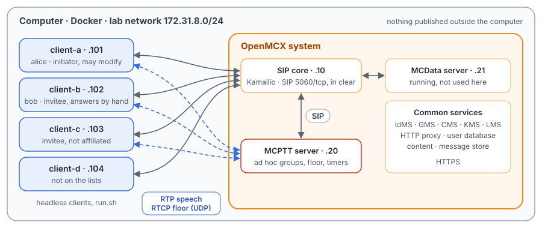
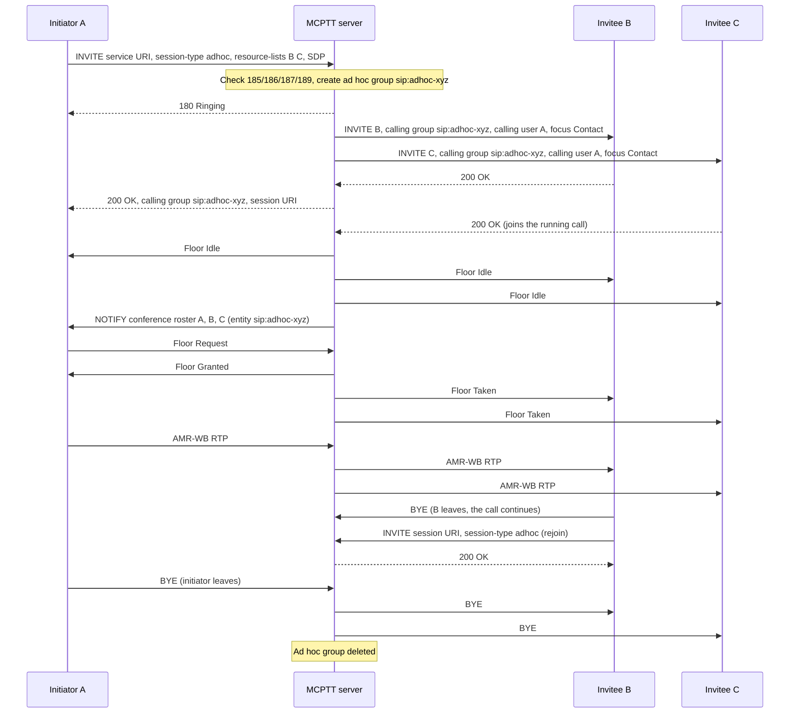

# Unit Test Tutorial 8: MCPTT ad hoc group calls: lists, refusals, modification and timers

One computer runs the openMCX system from the published images, with four headless clients in place of phones.
A script takes them through on-network ad hoc group calls (TS 24.379 clause 17): calls to a list of users, with no
preconfigured group. For each call the MCPTT server generates an ad hoc group (`sip:adhoc-…`) and deletes it when the
call ends.

- a call to a list of users, one of them not affiliated to any group;
- floor control, a participant leaving and rejoining, and the initiator alone keeping the call;
- requests the server refuses (warnings 185, 189, 187) and a list with nobody reachable;
- manual answer and decline;
- adding and removing participants of a running call;
- an emergency ad hoc call ended by its timer TNG2, and an ordinary one ended by the call timer TNG3.

A capture of the lab network records every SIP message and every speech and floor control packet, so you can follow
each call in Wireshark.

The tutorial is built on the scenario `tests/integration/adhoc_call_scenario.py` of the openMCX regression tests and
uses the same images. [Unit Test Tutorial 1](../01-group-call-basics/README.md) explains a prearranged group call, for
comparison.

> **SIP in clear, for learning.** The system runs in its debug mode: SIP goes over TCP without TLS (port 5060), so
> Wireshark shows every message, its SDP and its MCPTT XML. A real system uses TLS (tutorials 1 to 5). Speech and
> floor control are not encrypted in this tutorial in either mode. The HTTPS traffic to the common services
> (sign-in, configuration, keys) stays encrypted and is not captured.

<p align="center"></p>

## Ad hoc and prearranged group call

| | Prearranged group call ([Unit Test Tutorial 1](../01-group-call-basics/README.md)) | Ad hoc group call |
|---|---|---|
| The group | provisioned in the group management server | generated by the MCPTT server for the call (`sip:adhoc-…`), deleted at its end |
| Who is invited | the group's affiliated members | the users on the initiator's list (a `resource-lists` body in the INVITE); they need no affiliation |
| The initiator's INVITE | names the group | `<session-type>adhoc</session-type>` and the list, no group |
| One participant left | the call is released | the call goes on (TS 24.379 clause 6.3.8.1 item 2 does not apply) |
| Changing the participants | not possible | the initiator adds or removes users with a re-INVITE (clause 17.4.5) |

## What you need

- A computer with Docker and Docker Compose v2 (Linux, or Docker Desktop on macOS or Windows) and a bash shell for
  `run.sh` (on Windows: WSL or Git Bash).
- No phones, no network set-up, nothing to compile: the tutorial uses the **prebuilt openMCX images from Docker Hub**
  (`openmcx/openmcx-*:v1`) and publishes no port; everything stays on the computer.
- [Wireshark](https://www.wireshark.org/) to look at the capture (optional: `run.sh` prints a summary).

## 1. Make the configuration

```bash
cd tutorials/unit-tests/08-adhoc-group-calls
docker compose run --rm setup
```

The setup container runs the generator of the regression lab (`tools/prepare-prearranged-test.py --debug-sip
--adhoc`). It writes `./config` with these parts:

- a new certificate authority with the servers' and clients' certificates;
- the users `alice` (client-a), `bob` (client-b), `client-c` and `client-d`, all in the group `operations`;
- their ad hoc rights (TS 24.484 `<allow-adhoc-group-call>` and the related elements): alice may start ad hoc calls,
  emergency and imminent peril ones too, and change their participants; bob and client-c may start ordinary ones;
  client-d may not start any; every user may take part;
- the MCPTT server's ad hoc settings: at most 3 invitees, 5 s for the first answer, the call timer TNG3 of 30 s, the
  emergency timer TNG2 of 12 s, and release when the initiator leaves.

It runs once. To start over, see step 5. The certificates last 30 days.

## 2. Start the system

```bash
docker compose up -d --wait
```

After about half a minute `--wait` returns and every service is healthy, with the capture already running.

| Address | Container |
|---|---|
| 172.31.8.10 | SIP core (Kamailio) |
| 172.31.8.20 | MCPTT server |
| 172.31.8.21 | MCData server (running, not used here) |
| 172.31.8.101 | client-a, user `alice` |
| 172.31.8.102 | client-b, user `bob` |
| 172.31.8.103 | client-c, user `client-c` |
| 172.31.8.104 | client-d, user `client-d` |

## 3. Run the steps

```bash
./run.sh
```

The script sends each command to a client and waits until the clients and the server show its result before going
on. It takes about two minutes, most of it the two call timers:

```
2. client-a calls bob and client-c by list: the server makes an ad hoc group for the call
  $ client-a: adhoc sip:bob.mcptt@mcx.test sip:client-c.mcptt@mcx.test
  ok: client-a, client-b and client-c in one ad hoc call (client-c without affiliation)
  ok: client-d, not on the list, is not invited
...
10. The call timer (TNG3, 30 s) ends an ordinary ad hoc call
  ok: TNG3 ends the call
11. The capture: captures/08-adhoc-group-calls-run.pcap.gz
```

Each command is the same program the clients run, with `--command`. To type one yourself:

```bash
docker compose exec client-a mcx-client --config /config/client-a.json --command "adhoc sip:bob.mcptt@mcx.test"
```

| Step | Command | What happens (TS 24.379 unless noted) |
|---|---|---|
| 1 | `answer-mode auto` on every client, `client-c: deaffiliate` | Each client answers incoming calls automatically; client-c is affiliated to no group. |
| 2 | `client-a: adhoc <bob> <client-c>` | The INVITE to the MCPTT service has `<session-type>adhoc</session-type>` and a `resource-lists` body with the two users, and no group (clause 17.2.2.1.1). The server checks the request, generates the ad hoc group and invites the two users with it as calling group and alice as calling user (clauses 17.4.2.2, 17.4.2.1.1). client-c is invited although it is not affiliated: the invitees are implicitly affiliated. client-a gets 180, then 200 once the first invitee answers. client-d, not on the list, is not invited. |
| 3 | `client-a: ptt`, `client-b: ptt` | Floor control as in a group call (TS 24.380): client-a is granted the floor, client-b's request meanwhile is denied. |
| 4 | `client-b: hangup`, `client-b: rejoin` | client-b leaves with BYE and the call goes on; it rejoins with an INVITE to the session URI (clauses 17.2.5.1.1, 17.4.4.1.1). |
| 5 | `client-b: hangup`, `client-c: hangup`, `client-a: hangup` | With client-a alone the call goes on: releasing a call that has one participant left (clause 6.3.8.1 item 2) does not apply to ad hoc calls. When client-a, the initiator, leaves, the server releases the call (item 3) and deletes the ad hoc group. |
| 6 | `client-d: adhoc <alice>`; `client-a: adhoc` with four users, with itself only, with an unknown user | 403 with warning 185 (client-d may not start ad hoc calls, clause 17.4.2.2 step 4), 189 (more than 3 invitees, step 6), 187 (no participant besides the initiator, step 7), and 480 when nobody on the list can be reached. The server invites nobody for the refused requests. |
| 7 | `client-b: answer-mode manual`; `client-a: adhoc <bob> <client-c>`; `client-b: answer`, then `reject` | client-b rings while client-a and client-c are already connected, and joins when its user answers. The second time client-b declines (480, warning 110); the server keeps that to itself and the call goes on with the others. |
| 8 | `client-a: adhoc-modify add <client-c>`, `… remove <bob>`; `client-c: adhoc-modify add <client-d>` | client-a changes the participants with a re-INVITE to the session (clauses 17.2.6.1.1, 17.4.5.1.1): the server invites client-c, then sends client-b a BYE. client-c may not modify the call: 403, warning 190. |
| 9 | `client-b: adhoc emergency <alice>`; `client-a: adhoc emergency <bob> <client-c>` | client-b may not start an emergency ad hoc call: 403 with `<adhoc-emergency-ind>` false (clause 17.4.2.2 step 3B). client-a's emergency call carries `<adhoc-emergency-ind>` true and `Resource-Priority: mcpttp.15`, and so do the invitations (steps 13, 14A). The server starts TNG2 (12 s) and releases the call when it expires (step 14A b) ii)). |
| 10 | `client-a: adhoc <bob>`, `client-a: ptt` | An ordinary ad hoc call has the call timer TNG3 (30 s): when it expires, the server releases the call (clause 6.3.8.1 item 5). |

## 4. Look at the capture

`run.sh` copies the capture to `captures/08-adhoc-group-calls-run.pcap.gz`. The folder also holds a reference run,
`captures/08-adhoc-group-calls-full.pcap.gz` (196 KB, 3 622 frames): the frame numbers below and in the call
flow are those of the reference. Wireshark opens the compressed file directly (or `gunzip` it first).

The capture filter is `ip and not host 172.31.8.1 and (tcp port 5060 or (udp and not port 53) or icmp)`:

- SIP on 5060/tcp, with every TCP segment, so Wireshark rebuilds a message split over two segments;
- every UDP flow, since the speech and floor control ports come from the SDP and are not fixed;
- ICMP, which shows media sent to a closed port.

DNS, the encrypted HTTPS and the host's own traffic on the bridge (172.31.8.1) are left out.

Each request a client sends appears twice, because the SIP core challenges it with `407` first and the client sends
it again with its credentials; the frame numbers below are those of the second one.

Useful display filters:

| Filter | Shows |
|---|---|
| `sip.Method == "INVITE" \|\| sip.Method == "BYE"` | The calls: setup, rejoin, modification and release. |
| `sip contains "adhoc"` | The ad hoc requests and the server's invitations with the generated group. |
| `sip.Warning` | The refusals with their warning texts. |
| `sip.Resource-Priority == "mcpttp.15"` | The emergency ad hoc call. |
| `rtcp.app.name == "MCPT" && !(rtcp.app.subtype == 10)` | Floor control without the Floor Acks. |

One thing Wireshark 4.2 shows in a confusing way: the Floor Deny's Reject Cause appears only as the number `1` (cause
#1, "Another MCPTT client has permission", TS 24.380 clause 8.2.6.2).

What to look for, in the reference run:

- **The list call** (frames 440 to 483): client-a's INVITE (447) has `<session-type>adhoc</session-type>`
  and a `resource-lists` part with bob and client-c, and no group. The server answers 180 (451) and invites bob
  (453) and client-c (463) with `Answer-Mode: Auto`, an `isfocus` Contact, alice as
  `<mcptt-calling-user-id>` and the generated `sip:adhoc-…` as `<mcptt-calling-group-id>`. The 200 to client-a
  (483) follows bob's 200 (459). No INVITE goes to client-d.
- **Floor control** (frames 564 to 1587): client-a's Floor Request (564), Floor Granted (565),
  Floor Taken to client-b and client-c (566, 567), client-a's speech from 569 (6.7 s, 337 RTP
  packets to the server and the same to each listener). client-b's Floor Request (610) gets a Floor Deny
  (611). client-a's Floor Release (1585) and Floor Idle (1587).
- **Leave and rejoin** (frames 1596 to 1641): client-b's BYE (1596), then its INVITE to the same session
  URI (1633), answered 200 (1641).
- **The initiator alone, then gone** (frames 1708 to 1773): client-b's and client-c's BYEs (1708,
  1741). The server keeps the call with client-a alone (it repeats Floor Idle every second, T7, TS 24.380 clause
  6.3.4.3.4) until client-a's BYE (1772).
- **Refusals** (frames 1811 to 1879): 403 with `Warning: 399 mcx "185 …"` (1815), `"189 …"` (1835),
  `"187 …"` (1853), and 480 for the unknown user (1876, to client-a 1879), each without an INVITE to anyone.
- **Manual answer** (frames 1890 to 2043): bob rings (180, 1901); client-c answers (1910) and client-a gets
  its 200 (1923); bob answers later (1978). client-a's BYE (2037) makes the server end the call for
  client-c (2041) and bob (2043).
- **Decline** (frames 2100 to 2219): bob's 480 with `Warning: 399 mcx "110 user declined the call invitation"`
  (2187) stays at the server; client-a and client-c go on, and client-a's BYE (2215) ends the call
  (2219, to client-c only).
- **Modification** (frames 2255 to 2494): client-a's re-INVITE to the session (2341) with an `INVITE` entry for
  client-c makes the server invite client-c (2347); the next (2426), with a `BYE` entry for bob, makes it
  send bob a BYE (2431). client-c's attempt (2479) gets 403 with warning 190 (2483).
- **Emergency ad hoc call** (frames 2534 to 2732): client-b's INVITE with `Resource-Priority: mcpttp.15` (2534) gets
  403 with `<adhoc-emergency-ind>` false (2538). client-a's (2554) is accepted: the invitations to bob (2559)
  and client-c (2569) carry `<adhoc-emergency-ind>` true and `mcpttp.15`, and the floor messages the D bit
  (Floor Indicator "Emergency call"). 12 s after the 200 (2592) the server ends the call (BYE 2732): TNG2.
- **Call timer** (frames 2792 to 3590): an ordinary ad hoc call, 200 at 2815, and the server's BYE 30 s later
  (3590): TNG3.

## 5. Stop or start over

```bash
docker compose down -v        # remove the containers and their data (status files, capture)
rm -rf config                 # with down -v: start over at step 1
```

To run the steps again on the same system, run `./run.sh` again: the capture keeps everything since `up`. For a new
capture, `docker compose down -v` and `docker compose up -d --wait` first (the configuration stays).

## Images

The compose file names every image in full, all from Docker Hub:

| Image | What it is |
|---|---|
| `docker.io/openmcx/openmcx-setup:v1` | The setup: the lab's generator |
| `docker.io/openmcx/openmcx-mcptt-server:v1`, `docker.io/openmcx/openmcx-mcdata-server:v1` | The MCPTT and MCData servers |
| `docker.io/openmcx/openmcx-common:v1`, `docker.io/openmcx/openmcx-http-proxy:v1`, `docker.io/openmcx/openmcx-user-db:v1` | The common services |
| `docker.io/openmcx/openmcx-client:v1` | The headless client (`openMCX/openmcx-client` repository) |
| `docker.io/openmcx/openmcx-kamailio:6.1.4-2` | The SIP core |
| `docker.io/library/mysql@sha256:…` | The SIP core's database |
| `docker.io/nicolaka/netshoot@sha256:…` | tcpdump, for the capture |

To use images you built yourself, change the `image:` lines in `docker-compose.yaml` (building them:
[docs/BUILD.md](../../../docs/BUILD.md)).

## When something does not work

- **A service stays unhealthy**: `docker compose logs <service>`.
- **A step of run.sh fails**: it prints the step that did not complete. `docker compose exec client-a cat
  /artifacts/client-a/status.json` shows a client's state (`call_type`, `call_group`, `adhoc_priority`,
  `last_call_failure`, `last_modify_result`), and `/artifacts/mcptt-server/status.json` the server's. Start over from a
  clean state with `docker compose down -v` and `docker compose up -d --wait`.
- **No capture, or `capture` exited**: `docker compose logs capture`. The capture container uses the host's network
  to reach the lab's bridge (`openmcx-ut08`), and the address range 172.31.8.0/24 must be free on the computer.
- **Certificates expired** (after 30 days): start over (step 5).

## How it is put together

- `docker-compose.yaml`: the regression lab of `prepare-prearranged-test.py --debug-sip --adhoc`, written for the
  published images by `tools/tutorial-compose.py`. Each container has a fixed address, so the capture reads by role.
  The status files are in a volume, and the capture runs on the lab's bridge.
- `run.sh`: checks AH-01 to AH-08, AH-10, AH-15 (without the imminent peril call) and the modification part of AH-16
  of `tests/integration/adhoc_call_scenario.py`. Left out: an ad hoc call beside a prearranged one (AH-09), the
  imminent peril and emergency broadcast ad hoc calls (AH-15, AH-15b), participants by criteria (AH-16) and the ad hoc
  group emergency alert (AH-17).
- `speech/`: the two spoken test messages the clients transmit (16 kHz WAV, made with espeak-ng).
- `captures/08-adhoc-group-calls-full.pcap.gz`: the reference run.

## Call flow

The list call, rejoin and release (steps 2 to 5), as in the regression's test report
([`tests/mcptt/ADHOC_CALL_TEST.md`](../../../tests/mcptt/ADHOC_CALL_TEST.md)). Registration and service authorisation
come before it. Each SIP arrow passes through the SIP core. Floor Acks and the conference SUBSCRIBE/200 are left out.



The same messages in the reference capture (A = client-a, S = MCPTT server, B = client-b, C = client-c). A frame pair
is the message on both legs, client to core and core to server, or the other way:

| Message | Frames |
|---|---|
| A → S INVITE, session-type adhoc, resource-lists B C | 447, 449 |
| S → A 180 Ringing | 451 |
| S → B, S → C INVITE with the ad hoc group | 453, 463 |
| B → S 200 OK; S → A 200 OK | 459; 483 |
| A → S Floor Request; Floor Granted; Floor Taken to B and C | 564; 565; 566, 567 |
| AMR-WB RTP from A | from 569 |
| B → S BYE; B → S INVITE session URI (rejoin); 200 OK | 1596, 1597; 1633, 1635; 1641 |
| A → S BYE (the initiator leaves; B and C had left before) | 1772, 1773 |

In this run the clients leave one by one (step 5), so the server's own BYEs to the remaining participants, the last
part of the diagram, appear in step 7 instead, when client-a leaves a call with bob and client-c in it: frames 2041
and 2043.
